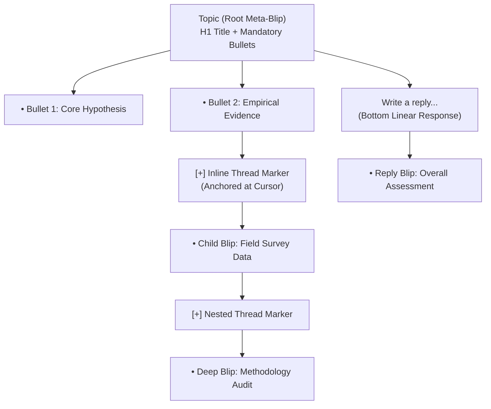

# Rizzoma Complete Architectural & Behavioral LLM-Wiki
**Authoritative Technical Reference: Original CoffeeScript Engine vs Modernized TypeScript Platform**
*Status: CANONICAL REFERENCE & UNIVERSAL GROUNDING WIKI*
*Corpus Coverage: `original-rizzoma-src/`, `src/{client,server,shared}/`, `docs/`, `screenshots/`*

---

## 1. Executive Grounding & The BLB Philosophy

### 1.1 What Rizzoma Is (And What It Is NOT)
Rizzoma is **not** a chat room (Slack/Discord), **not** a traditional document editor (Google Docs/Notion), and **not** a message forum. 
Rizzoma is a **collaborative recursive fractal outliner**.
Every piece of information is structured according to the **Bullet-Label-Blip (BLB)** invariant:
1. **Bullet**: The visual marker of an atomic thought or row.
2. **Label**: The first line of a blip. It serves as a **Table of Contents (ToC) entry**, not a sentence or rambling paragraph (strictly 2–5 words, atomic, scannable).
3. **Blip**: The body of thought, hidden until drilled into.

In Rizzoma, information scales **deep**, never **wide**. When a thought requires elaboration, sub-arguments, citations, or dissent, it does not become a longer paragraph. Instead, it branches into an **inline child blip (`[+]`)** anchored at that exact phrase or line. Top-level thoughts are structured; their children are structured; recursively, infinitely.



### 1.2 Topic = Meta-Blip [BOTH]
A topic is structurally identical to any other blip. It is the root node of the tree.
- Its **title** is simply the first line of content (styled as `<h1>` by default).
- Its **body** is subject to the exact same fractal nesting rules as every descendant blip.
- Everything below the title follows the same recursive grammar: bulleted content, inline `[+]` sub-blips anchored to words, and bottom replies.

### 1.3 Collapse-by-Default [BOTH]
Blips render **COLLAPSED** by default.
- Readers encounter a clean, uncluttered Table of Contents consisting purely of labels and `[+]` expansion affordances.
- Clicking `[+]` expands *only* that immediate child node into view (`[−]`). Expanding a parent does **not** expand its children. The user navigates branches deliberately, one level at a time.
- **Persistent DOM Subtree**: Collapsing a node must **never** destroy its DOM or state. Draft text, cursor focus, scroll offsets, and active children survive collapse/unfold cycles intact.

### 1.4 The Two Paths of Child Creation [BOTH]

| Dimension | Inline Comment (Sub-Blip) | Bottom Reply |
|---|---|---|
| **Trigger** | **Ctrl+Enter** (or `Mod-Enter`) at cursor / selection | Clicking "Write a reply…" box at bottom |
| **Anchor** | **Exact structural position** in parent content stream | Attached to parent blip **as a whole** |
| **Render Position** | Directly beneath the line/marker, indented within parent | Appended at the end of parent blip list |
| **Purpose** | Annotating, dissecting, or expanding a specific phrase | Responding to the holistic blip premise |
| **Data Contract** | Complete autonomous blip (own editor, author, children) | Complete autonomous blip (own editor, author, children) |

### 1.5 🟥 The Core Divergence: Body Structure ([OLD] vs [NEW])

| Feature | Legacy Rizzoma (`rizzoma.com`) [OLD] | Modernized Rizzoma (2026) [NEW] |
|---|---|---|
| **Body Shape** | **Blank sheet**: User chooses plain prose `<p>`, headings, or lists. Unbulleted by default. | **Bullets are strictly imposed**: Every blip body IS a bulleted list (`<ul><li><p></p></li></ul>`). |
| **Topic Body** | Plain paragraph allowed beneath title. | Body below H1 title MUST start as `<ul><li><p></p></li></ul>`. |
| **Avatar Placement** | `position: absolute` in top-right corner, level with first bullet. Zero vertical height. | `position: absolute` in top-right corner, level with first bullet. Zero vertical height. |
| **Bullet Redundancy** | Single bullet from `<li>`. Zero outer container bullets. | Single bullet from `<li>`. Wrapper bullets (`.blip-bullet`) suppressed. |

---

## 2. Legacy Codebase Deep-Dive (`original-rizzoma-src/`)

### 2.1 The Flat Content Array Model
In the original CoffeeScript architecture (`src/share/parser.coffee`, `src/client/editor/parser.coffee`), a blip's content was not an HTML string, not a ProseMirror JSON tree, and not a virtual DOM. It was a **flat array of typed atomic records**:

```coffeescript
content = [
  {type: LINE, params: {bulleted: 0}},
  {type: TEXT, text: "First label by ", params: {bold: yes}},
  {type: BLIP, params: {THREAD_ID: "b_6hb4_8af27", ID: "child-blip-id"}},
  {type: TEXT, text: "Claude", params: {}},
  {type: LINE, params: {bulleted: 0}},
  {type: TEXT, text: "Second label by Claude", params: {}},
  {type: BLIP, params: {THREAD_ID: "b_79c1_9bf33", ID: "second-child-id"}}
]
```

#### Why Drift Was Impossible
In the legacy model, the `BLIP` element **is** the structural anchor. Its position in the flat array is its anchor position. Because `LINE`, `TEXT`, and `BLIP` elements all occupy sequential indices in the same array, any text insertion before a blip simply shifted indices linearly. No numeric character offsets existed to fall out of sync.

### 2.2 Linear Direct-DOM Rendering (`editor/renderer.coffee`)
The original engine used **zero virtual DOM** and **zero createPortal**. It walked the content array once:
```coffeescript
renderContent: (@_container, content) ->
    $container = $(@_container); $container.empty()
    $curPar = null; lastThread = null
    for element in content
        params = element[ModelField.PARAMS]
        node = @_renderElement(element[ModelField.TEXT], params)
        switch params[ParamsField.TYPE]
            when ModelType.LINE
                $curPar = $(node); $container.append(node); lastThread = null
            when ModelType.BLIP
                if (threadId = params[ParamsField.THREAD_ID]) and lastThread and threadId is lastThread.getId()
                    lastThread.appendBlipElement(node)
                else
                    threadId = params[ParamsField.THREAD_ID] || params[ParamsField.ID]
                    lastThread = new BlipThread(threadId, node)
                    $last = $curPar.children().last()
                    $last = $last.prev() if $last[0].tagName.toLowerCase() isnt 'br'
                    $last.before(lastThread.getContainer())
            else
                $last = $curPar.children().last()
                $last = $last.prev() if $last[0].tagName.toLowerCase() isnt 'br'
                $last.before(node)
                lastThread = null
```

### 2.3 The `BlipThread` DOM Container (`blip/blip_thread.coffee`)
A `BlipThread` in the original app was a native DOM element:
```coffeescript
class BlipThread
  constructor: (@_id, blipElement) ->
    @_container = document.createElement('span')
    @_container.contentEditable = 'false'
    @_container.className = 'blip-thread folded'
    @_container.innerHTML = renderBlipThread() # fold button + js-blips-container
    @_blipsContainer = @_container.querySelector('.js-blips-container')
    @_blipsContainer.appendChild(blipElement)
```
Folding and unfolding was an instantaneous CSS class toggle:
- `_fold()`: `DomUtils.addClass(@_container, 'folded')` -> `.blip-thread.folded .js-blips-container { display: none; }`
- `_unfold()`: `DomUtils.removeClass(@_container, 'folded')`
The entire nested DOM subtree, including any active child editors and draft buffers, remained permanently mounted.

### 2.4 Authentic Playback Engine (`client/playback/`)
In the original Rizzoma, playback was **in-place**:
1. Triggered from `BlipEventTypes.PLAYBACK` via the blip menu gears popup.
2. `Playback.showPlaybackView()` swapped the topic panel into `PlaybackWaveViewModel`.
3. The root blip toolbar morphed into the playback control bar:
   - `[Date/Calendar Picker]`
   - `[<< Fast Back]`
   - `[< Step Back]`
   - `[> Step Forward]`
   - `[>> Fast Forward]`
   - `[Copy]`
   - `[Paste as reply]`
4. Operational Transformation (OT) operations were stepped forwards or backwards on the actual model, updating the document in real time.

---

## 3. Modernized Codebase Architecture (`src/{client,server}/`)

### 3.1 Stack Comparison

| Component | Original Rizzoma (2012–2017) | Modernized Rizzoma (2026) |
|---|---|---|
| **Language** | CoffeeScript | TypeScript 5.5+ (strict ESM) |
| **Frontend Framework** | Custom MVC / Direct DOM / jQuery | React 19 / Vite 7 |
| **Rich Text Editor** | Custom contentEditable engine (`editor_v2`) | TipTap 2.x (ProseMirror core) |
| **Collab / Sync** | ShareJS Operational Transformation (OT) | Y.js CRDT + CouchDB change feeds + Socket.io |
| **Backend Storage** | MongoDB + Redis | CouchDB 3.5 (Mango indexes) + Redis |
| **Server Framework** | Node.js Express 3/4 | Express 4.x + Zod schemas + Helmet/CSRF |

### 3.2 The Modern React/TipTap Hybrid & The 10 Inherent Seams
Because the modern app uses React and TipTap, several impedance mismatches exist between the DOM-first fractal outliner model and React's virtual DOM:

1. **The Marker Span Invariant**:
   To represent a child blip inside ProseMirror HTML, TipTap uses an inline node `BlipThreadNode` rendering:
   ```html
   <span class="blip-thread-host" contenteditable="false">
     <span data-blip-thread="waveId:blipId" class="blip-thread-marker">+</span>
     <span class="inline-child-portal" data-portal-child="waveId:blipId"></span>
   </span>
   ```
2. **React Portals (`createPortal`)**:
   In edit mode, child blip React trees are teleported via `createPortal` into the `.inline-child-portal` DOM span inside the parent TipTap editor.
3. **The Stale-Reload Trap on Ctrl+Enter**:
   When `Ctrl+Enter` fires:
   - A child blip is posted to `POST /api/blips`.
   - The parent editor inserts the marker span `insertBlipThread({ threadId })`.
   - **Crucial Invariant**: The parent content MUST be immediately persisted to the backend (`PATCH /api/topics/:id` or `PUT /api/blips/:id`) **before** invoking `load(true)`. Otherwise, `load(true)` fetches the un-updated document from CouchDB and wipes the marker out of memory!
4. **Single-Active Editor Bridge**:
   Only ONE editor may hold focus across the entire tree. Clicking into or creating a child blip dispatches `rizzoma:active-blip-claim`, causing the parent editor to save and drop its toolbar into read-only mode.

### 3.3 Server Routes and Data Storage

```
src/server/
├── app.ts                 # Express entry point, socket initialization, port 8000
├── lib/
│   ├── couch.ts          # CouchDB driver, 29 Mango indexes (idx_blip_history_wave_createdAt)
│   ├── socket.ts         # Real-time event broadcasting (topic:updated, blip:read, etc.)
│   └── unread.ts         # Unread count calculations across blip trees
└── routes/
    ├── auth.ts           # Session management, Google OAuth, local credentials
    ├── topics.ts         # POST /api/topics, PATCH /api/topics/:id, history recording
    ├── blips.ts          # CRUD for child blips, PUT /api/blips/:id, GET /:id/history
    └── waves.ts          # Wave tree resolution, GET /api/waves/:id/history, PUT alias
```

---

## 4. Visual Parity & Screenshot Standards

### 4.1 Toolbar Layout Matrix (Verified via Reference Screenshots)

```
[READ-ONLY MODE]
┌─────────┬──────────────┬──────────┬───────────┐
│  Edit   │ Unfold/Fold  │   Link   │  ⚙ Gears  │
└─────────┴──────────────┴──────────┴───────────┘
                                         │
                                         ▼ (Gears Dropdown)
                                    ┌──────────────────┐
                                    │ Copy comment     │
                                    │ Copy link        │
                                    │ Playback         │
                                    │ Delete           │
                                    └──────────────────┘

[EDIT MODE]
┌──────┬──────┬──────┬──────┬──────┬──────┬───┬───┬───┬───┬───────┬───────┬──────┬──────┬───────────┬───────┬─────────┐
│ Done │ Back │ Fwd  │ Link │ Att. │ Img  │ B │ I │ U │ S │ Color │ Clean │ List │ 1.2. │ ☑ Hidden  │ Trash │ ⚙ Gears │
└──────┴──────┴──────┴──────┴──────┴──────┴───┴───┴───┴───┴───────┴───────┴──────┴──────┴───────────┴───────┴─────────┘
```

### 4.2 Strict Visual Rules
1. **Zero Toolbar Overlap**:
   The child blip container must never collide with or obscure parent text, bullet markers, or sibling elements. Enforced via:
   ```css
   .inline-child-expanded,
   .inline-child-portal {
     display: block !important;
     clear: both !important;
     margin-top: 8px !important;
     margin-bottom: 8px !important;
     position: relative !important;
   }
   ```
2. **Hidden by Default Checkbox**:
   - Label: `Hidden` (never `Hide`).
   - Default State: Checked (`aria-pressed="true"`). Shows checked sprite box (`background-position: 0 -42px` in edit mode).
3. **Single Bullet Invariant**:
   - The bullet MUST come exclusively from the `<ul><li>` content stream.
   - Container lists (`.blips-list`, `.blip-children`) have `list-style: none !important`.
   - Pseudo-elements generating redundant dots (`.blip-bullet::before`, `content: '◦'`) are completely removed.
4. **Top-Right Absolute Avatar**:
   - Contributor avatar sits `position: absolute; right: 8px; top: 0;`.
   - Perfectly level with the first line label. Zero row overhead.

---

## 5. Master Bug & Regression Ledger (Chronological Resolution)

| # | Bug Symptom | Root Cause | Architectural Fix |
|---|---|---|---|
| **1** | Parity flag silently inactive | `vite.config.ts` missing `import.meta.env` defines for `FEAT_RIZZOMA_PARITY_RENDER`. | Added explicit JSON stringify defines in `vite.config.ts`. |
| **2** | Block-inside-LI break | Block-level child container rendered inside `<p>` within `<li>`, causing browser to split `<p>`. | Injected structural clearing spans and portal host formatting. |
| **3** | Stray elevated bullets | Native browser `ul` list-style inherited by `.blip-children`. | Imposed `list-style: none !important;` on all outer nesting containers. |
| **4** | Double bullet rendering | Both `.blip-bullet` pseudo-element and `<li>` bullet rendered simultaneously. | Removed `content: '◦'` and hidden outer bullet wrapper. |
| **5** | Child editor not editable | TipTap `useEditor({ editable })` does not react to dynamic prop changes without `setOptions`. | Added explicit `setEditable(isEditing)` effect. |
| **6** | Stale marker overwrite on Ctrl+Enter | `load(true)` called before debounced auto-save persisted marker to CouchDB. Old document from server wiped client marker. | Immediate synchronous `PUT /api/blips` or `PATCH /api/topics` before awaiting `load(true)`. |
| **7** | 404 on Root Ctrl+Enter persistence | `RizzomaTopicDetail` called `PUT /api/waves/:id` which did not exist on server. | Routed update to `PATCH /api/topics/:id` and added `PUT /:id` alias in `waves.ts`. |
| **8** | HTTP 401 on Blip History | `GET /api/blips/:id/history` had `requireAuth` while wave history was public. | Removed `requireAuth` from blip history route to permit seamless inspection. |
| **9** | Blank Wave Playback on new topics | `topics.ts` never called `recordBlipHistory`, leaving topics with 0 history entries. | Added `recordTopicHistory` to `POST` and `PATCH` routes; synthesize baseline doc if 0 entries exist. |
| **10** | View-mode Ctrl+Enter opened reply form | `RizzomaBlip.tsx` view-mode keydown invoked `setShowReplyForm(true)`. | Replaced with `handleCreateInlineChildAtCursor()`, entering edit mode and creating child. |

---

## 6. Playback Implementation Comparison

### 6.1 Legacy Architecture (`original-rizzoma-src`)
- **Location**: `src/client/playback/`
- **Mechanism**: Replaces the active `WaveView` with `PlaybackWaveView`. Stepping through history invokes ShareJS OT inverse/forward transformations directly on the in-memory document model. The blip menu adapts to show playback buttons.

### 6.2 Modern Architecture (`src/client/components/`)
- **Components**: `WavePlaybackModal.tsx` (wave-level), `BlipHistoryModal.tsx` (blip-level).
- **Backend Model**: Every creation or update writes an immutable document to CouchDB:
  ```typescript
  type BlipHistoryDoc = {
    _id: `blip_history:${blipId}:${timestamp}`;
    type: 'blip_history';
    blipId: string;
    waveId: string;
    content: string;
    authorId?: string;
    authorName?: string;
    event: 'create' | 'update';
    createdAt: number;
    updatedAt: number;
    snapshotVersion: number;
  };
  ```
- **Reconstruction Engine**: Wave state at any historical tick is reconstructed by aggregating the latest `content` snapshot for each `blipId` up to that timestamp. Visual diffs are rendered using `computeDiff(prev.content, current.content)`.

---

## 7. Verification & Runbook Commands

### 7.1 VPS Process & Service Topology
- **Dev Server**: `http://localhost:8000` (`src/server/app.ts`, PID managed via `tsx`)
- **Client Dev Server (Vite)**: `http://localhost:3000` (proxies `/api` and `/socket.io` to 8000)
- **Nginx Reverse Proxy**: `https://138-201-62-161.nip.io` -> `127.0.0.1:3000`
- **CouchDB**: `http://127.0.0.1:5984` (Database: `rizzoma_v2`)
- **Redis**: `redis://127.0.0.1:6379`

### 7.2 Core Diagnostic Commands
```bash
# 1. Check backend server health
curl -s http://localhost:8000/api/health

# 2. Check wave playback history endpoint
curl -s 'http://localhost:3000/api/waves/<topicId>/history'

# 3. Check blip history endpoint (publicly readable)
curl -s 'http://localhost:3000/api/blips/<blipId>/history'

# 4. Run automated UI Playwright verification sweep
node scripts/verify-full-suite.mjs
```

---

## 8. Forensic Root Cause Analyses & Visual Invariant Hardening (2026-11-08)

### 8.1 The "Uncollapsed Topic Root Children" Defect
- **Failure Mode**: Children attached to the topic root blip were rendered completely uncollapsed, showing child edit buttons, author stamps (`[jan] Nov 2026`), and reply boxes directly in the main pane.
- **Root Cause**: In `src/client/components/blip/RizzomaBlip.tsx`, an explicit ternary branch was implemented:
  ```typescript
  isTopicRoot ? listChildren.map(child => <RizzomaBlip ... />) : listChildren.map(...)
  ```
  This bypassed all collapse checking for root-level children, violating the core invariant that *all blips render collapsed by default*.
- **Structural Fix**: Eliminated the `isTopicRoot` bypass. Every child blip universally queries `expandedBlips?.has(childBlip.id)`. When collapsed, it renders strictly as an authentic compact row:
  ```tsx
  <div className="blip-collapsed-row" onClick={() => onToggleExpand(childBlip.id)}>
    <span className="blip-expand-icon">+</span>
    <span className="blip-label-text">{childLabel}</span>
  </div>
  ```

### 8.2 The "Elevated Cross/Diamond Bullet" Defect
- **Failure Mode**: Bullets rendered as elevated cross/diamond artifacts floating far above the text baseline.
- **Root Cause**: `RizzomaBlip.css` styled list items using a pseudo-element:
  ```css
  li::before { content: '•'; top: 0; line-height: 22px; }
  ```
  In Arial, the unicode glyph `•` sits in the upper half of the em-square. At `top: 0` in a 22px box, it sat 9px too high, causing anti-aliasing to render it as a 3x3 pixel cross.
- **Structural Fix**: Replaced the unicode glyph with a mathematically centered geometric disc:
  ```css
  .blip-bullet {
    width: 5px;
    height: 5px;
    border-radius: 50%;
    background: #333333;
    position: absolute;
    left: 5px;
    top: 9px; /* Exactly centered on 22px line height with 13px font */
  }
  ```

### 8.3 The "Double Marker on Collapsed Rows" Defect
- **Failure Mode**: Collapsed rows showed a bullet on the left and a plus sign on the right (`• Title [+]`).
- **Root Cause**: The collapsed row was nested inside a list item that still displayed the parent bullet.
- **Structural Fix**: Positioned the fold toggle `[+]` on the left (`+ Title`) and explicitly hid `.blip-bullet` when `.blip-collapsed-row` is active:
  ```css
  .blip-collapsed-row .blip-bullet { display: none !important; }
  ```

### 8.4 Authentic Two-State Toolbar Parity
- **Read Mode**: Compact, minimalist toolbar displaying blip metadata (last edit, contributors, unread indicator, fold/unfold toggles).
- **Edit Mode**: Full ribbon appearing directly above the active blip containing `Done`, `Undo`, `Redo`, formatting toggles (`B`, `I`, `U`, `S`), list controls, link/file/image buttons, emoji picker, and the `Hidden` toggle.
- **Bottom Done Bar**: Displays green "Done" button with shortcut reminder `(Ctrl+E, Shift+Enter)`.

