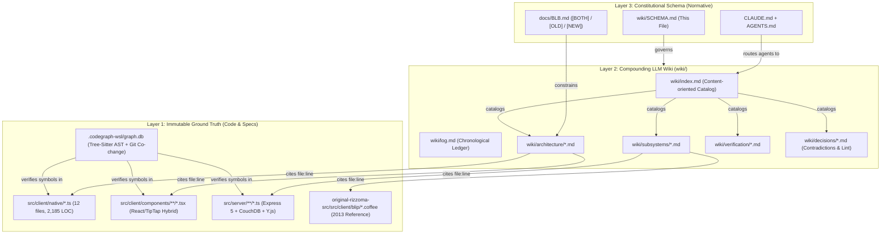
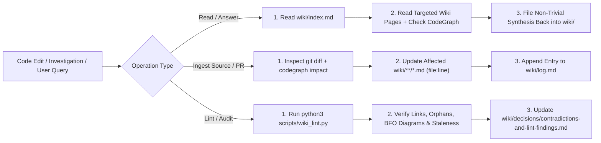

# Modernized Rizzoma — LLM Wiki Schema & Ontological Constitution (`SCHEMA.md`)

**¶1** □ This document is the **constitutional schema** (`Layer 3`) for the modernized Rizzoma codebase knowledge base at `/mnt/c/Rizzoma/wiki/`. It combines **Andrej Karpathy's `llm-wiki` pattern** (persistent compounding Markdown synthesis over immutable ground truth, replacing ad-hoc context-window rediscovery) with **Pavel Kravtsov's BFO + Metagraph Knowledge Framework** (`tekliner/improvado-agentic-frameworks-and-skills`) and **Colby McHenry's `codegraph`** AST call-graph intelligence.

---

## 1. Three-Layer Architecture (`Continuant` Structure)

### 1.1 Layer Definitions
- **¶2** □ **Layer 1 — Immutable Ground Truth (`src/`, `original-rizzoma-src/`, `scripts/`, `.codegraph-wsl/`)**: The executable TypeScript/CoffeeScript source code, Playwright acceptance suites, and the local SQLite AST graph built by `~/.local/bin/codegraph`. When prose in `docs/` or `wiki/` disagrees with `src/`, **Layer 1 wins** and the discrepancy is recorded in `wiki/decisions/contradictions-and-lint-findings.md` until resolved.
- **¶3** □ **Layer 2 — Compounding LLM Wiki (`wiki/`)**: Agent-owned Markdown files that synthesize cross-cutting architectural mechanisms, call chains, historical bug seams, and verification gates. Every claim in Layer 2 carries an explicit `file:line` citation to Layer 1.
- **¶4** □ **Layer 3 — Schema (`wiki/SCHEMA.md`, `CLAUDE.md`, `AGENTS.md`)**: Rules governing how agents read, update, lint, and verify the wiki.

---

## 2. Three Core Operations (`Occurrent` Workflow)

### 2.1 Operation 1 — `Query` (Read Before Grepping)
- **¶5** □ Before running broad searches across `src/`, read [`wiki/index.md`](index.md) to locate the relevant architectural or subsystem page, then use `~/.local/bin/codegraph context "<task>"` or `~/.local/bin/codegraph impact <symbol>` inside `/mnt/c/Rizzoma` to trace exact callers and blast radius.
- **¶6** ▷ Whenever an investigation yields a non-trivial architectural insight, root-cause trace, or performance measurement, **file it back into the relevant `wiki/` page** instead of leaving it trapped in chat history.

### 2.2 Operation 2 — `Ingest` (Code / Spec Change Assimilation)
- **¶7** □ When a commit or feature phase lands (e.g., wiring `BlipEditorHost` into `NativeWaveView`), a single change typically touches 2–4 wiki pages:
  1. Update the `file:line` ground-truth citations and modality markers (`□`, `◇`, `▷`) in the affected `wiki/subsystems/` or `wiki/architecture/` pages.
  2. Update `last_verified: YYYY-MM-DD` and `source_commit: <hash>` in the page frontmatter and [`wiki/index.md`](index.md).
  3. Append a structured entry to [`wiki/log.md`](log.md) matching `## [YYYY-MM-DD] ingest | <Title>`.

### 2.3 Operation 3 — `Lint` (Mechanical Health & Contradiction Check)
- **¶8** □ Run `python3 /mnt/c/Rizzoma/scripts/wiki_lint.py` (which delegates to `/mnt/g/My Drive/claude-hooks/tools/wiki_and_security_audit.py`). The linter mechanically checks:
  1. **Zero Orphan Pages**: Every `.md` file under `wiki/` (except `index.md`, `SCHEMA.md`, `log.md`) is linked in `wiki/index.md`.
  2. **Link & Ground-Truth Integrity**: Every relative Markdown link resolves, and every backticked or linked `src/...` / `docs/...` / `scripts/...` path exists on disk.
  3. **BFO Dual-Axis Diagram Compliance**: Architecture and subsystem pages contain both a `Continuant` structural diagram (`graph TD` / `flowchart TD`) and an `Occurrent` temporal/causal flow diagram (`graph LR` / `flowchart LR`).
  4. **Git Staleness Detection**: Detects if any cited `src/...` file has a newer `git log -1` commit date than the wiki page's `last_verified` date.
  5. **Security Audit (`secure-agents`)**: Checks git-tracked files for leaked credentials, unparameterized SQL/shell string interpolation, and raw error/body logging.

---

## 3. Ontological & Epistemic Conventions (BFO + Metagraph Rules)

- **¶9** □ **BFO Dual-Axis Diagramming (ISO/IEC 21838-2)**:
  - **Continuants (`IndependentContinuant` / `GenericallyDependentContinuant`)** — things that *are* (modules, classes, data structures, DOM hierarchies, deployment nodes) MUST be drawn top-down (`graph TD` or `flowchart TD`).
  - **Occurrents (`Process` / `ProcessBoundary`)** — things that *happen* over time (request pipelines, event dispatch, parser-to-renderer walks, Y.js sync flows) MUST be drawn left-to-right (`graph LR` or `flowchart LR`).
  - Never mix structural module containment and temporal event sequences in the same diagram axis.
- **¶10** □ **Paragraph Addressing (`¶N`)**: Every substantive paragraph in a wiki page begins with a bold paragraph anchor (`**¶1**`, `**¶2**`, ...) so other pages and murderboards can cite exact claims (`wiki/subsystems/native-render-port.md#¶4`).
- **¶11** □ **Deontic Modalities**:
  - `□` (**Obligatory / Hard Invariant**): Verified code invariant or non-negotiable `[BOTH]` / `[OLD]` specification rule.
  - `◇` (**Permissible / Optional Flag**): Feature-flagged or configurable behavior (e.g., `?render=native`, `perfRender=lite`).
  - `▷` (**Recommended / Target State**): Planned Phase 2–5 port target not yet wired in default runtime.
- **¶12** □ **Typed Semantic Edges**: Cross-page links in frontmatter or edge tables use explicit relation types:
  - `requires`: Target subsystem must exist/run for this subsystem to function.
  - `elaborates`: Target page provides deeper implementation detail for a summary here.
  - `supersedes`: This mechanism replaces an older implementation (e.g., `src/client/native/renderer.ts` `supersedes` `src/client/components/blip/InlineHtmlRenderer.tsx`).
  - `contradicts`: Documented conflict between two files or between prose and code (tracked in [`wiki/decisions/contradictions-and-lint-findings.md`](decisions/contradictions-and-lint-findings.md)).
