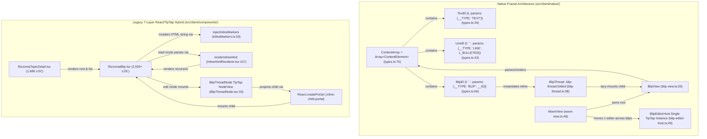
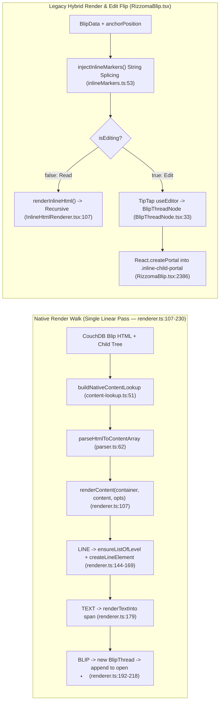

# Architecture Comparison — Original `ContentArray` Fractal vs. 7-Layer React/TipTap Hybrid

**¶1** □ The central engineering problem of the modernized Rizzoma codebase (`/mnt/c/Rizzoma`) is rendering and editing **arbitrarily deep inline fractal discussion trees** where a child blip is anchored at a specific character/line position inside its parent blip's rich-text body (`docs/ORIGINAL_FRACTAL_LOGIC_AND_WHY_OURS_DOESNT_MATCH.md:1-151`). This page synthesizes the structural (`Continuant`) and runtime (`Occurrent`) difference between the legacy 7-layer React/TipTap hybrid (`src/client/components/blip/RizzomaBlip.tsx`) and the direct TypeScript native port (`src/client/native/`).

---

## 1. Structural Ontology (`Continuant` — `graph TD`)

### 1.1 Why the Original 2013 CoffeeScript Architecture Never Drifted
- **¶2** □ In original Rizzoma (`original-rizzoma-src/src/client/blip/model.coffee:1-35`, ported verbatim to `src/client/native/types.ts:13-76`), a blip's document model is a **single flat ShareJS/OT ops array** (`ContentArray`) containing four element types: `TEXT` (`ModelType.TEXT`), `LINE` (`ModelType.LINE`), `BLIP` (`ModelType.BLIP`), and `ATTACHMENT` (`ModelType.ATTACHMENT`).
- **¶3** □ **Position-by-Index Invariant**: A child blip does **not** store a numeric character offset (`anchorPosition: number`) in a separate database field. Instead, the child blip's anchor **is** a 1-character `BlipEl` (`{ t: ' ', params: { __TYPE: 'BLIP', __ID: childBlipId } }`) sitting directly inside the parent's `ContentArray` (`src/client/native/types.ts:66-71`). When a user types 50 characters before the child blip, the `TEXT` element before `BlipEl` grows, and `BlipEl`'s index shifts automatically. Drift between text and child anchor is **mathematically impossible**.
- **¶4** □ **DOM Stability via CSS Folding**: In `src/client/native/blip-thread.ts:38-216` (ported from `original-rizzoma-src/src/client/blip/blip_thread.coffee`), every inline `BlipEl` renders a persistent `` (`src/client/native/blip-thread.ts:81-94`). Expanding or collapsing a thread merely toggles `.folded` (`src/client/native/blip-thread.ts:141-178`) and lazy-instantiates the child `BlipView` on first unfold (`src/client/native/blip-thread.ts:154-160`). The wrapper never unmounts when switching between read and edit mode.

### 1.2 Why the 7-Layer React/TipTap Hybrid Produced 12 Failure Seams
- **¶5** □ The React/TipTap hybrid stores each blip's body as an HTML string (`blip.content`) and stores child positions out-of-band as `blip.anchorPosition: number` (`src/client/components/RizzomaTopicDetail.tsx:1265-1266`). Rendering a single inline child requires coordinating **seven layers** (`docs/ORIGINAL_FRACTAL_LOGIC_AND_WHY_OURS_DOESNT_MATCH.md:62-84`):
  1. `blip.content` HTML string in CouchDB (`src/server/routes/blips.ts:1-591`).
  2. `injectInlineMarkers()` string surgery (`src/client/components/blip/inlineMarkers.ts:53`), which walks HTML text nodes, counts characters up to `anchorPosition`, and splices `` into the HTML string.
  3. Read-mode HTML-to-React tree conversion via `renderInlineHtml()` (`src/client/components/blip/InlineHtmlRenderer.tsx:107`).
  4. Edit-mode ProseMirror schema parsing via `BlipThreadNode` (`src/client/components/editor/extensions/BlipThreadNode.tsx:33`), which creates a `` DOM anchor inside TipTap.
  5. `React.createPortal` inside `src/client/components/blip/RizzomaBlip.tsx:2386`, which teleports the child `<RizzomaBlip>` into the `.inline-child-portal` span when `isEditing` is true.
  6. Separate read-mode vs. edit-mode conditional branches in `src/client/components/blip/RizzomaBlip.tsx:2370-2410`.
  7. Global React state and custom window events (`ACTIVE_BLIP_CLAIM_EVENT = 'rizzoma:active-blip-claim'` at `src/client/components/blip/RizzomaBlip.tsx:78`, plus retry loops in `src/client/components/RizzomaTopicDetail.tsx:750-785`).
- **¶6** □ **Consequence**: Whenever a parent blip transitions between read mode and edit mode (`isEditing` flip in `src/client/components/blip/RizzomaBlip.tsx`), the read-mode `renderInlineHtml` tree unmounts and the edit-mode TipTap `BlipThreadNode` portal mounts a brand-new DOM subtree, destroying child editor focus, resetting scroll state, and requiring asynchronous `requestAnimationFrame` retry loops (`src/client/components/RizzomaTopicDetail.tsx:774`).

---

## 2. Runtime Execution Comparison (`Occurrent` — `graph LR`)

---

## 3. Side-by-Side Architectural Matrix

| Architectural Dimension | Original CoffeeScript (`original-rizzoma-src/`) | Modernized Native Port (`src/client/native/`) | Legacy React/TipTap Hybrid (`src/client/components/blip/`) |
|---|---|---|---|
| **Document Model** | Flat ShareJS `ContentArray` (`model.coffee:4-16`) | Flat TypeScript `ContentArray` (`src/client/native/types.ts:76`) | HTML string + numeric `anchorPosition` (`src/client/components/blip/RizzomaBlip.tsx:52`) |
| **Inline Child Anchor** | `{t:' ', params:{__TYPE:'BLIP', __ID}}` in `ContentArray` | `BlipEl` (`ModelType.BLIP`) in `ContentArray` (`src/client/native/types.ts:66`) | Injected `` via `injectInlineMarkers` (`src/client/components/blip/inlineMarkers.ts:53`) |
| **Rendering Algorithm** | Single linear loop (`renderer.coffee:420-476`) | Single linear loop `renderContent()` (`src/client/native/renderer.ts:107-230`) | Dual path: `renderInlineHtml` (read) vs TipTap + `React.createPortal` (edit) |
| **Thread Wrapper** | `BlipThread` (`blip_thread.coffee:21-415`) | `BlipThread` (`src/client/native/blip-thread.ts:38-232`) | Split across `InlineHtmlRenderer.tsx:107` and `BlipThreadNode.tsx:33` |
| **Fold / Unfold** | Toggle `.folded` CSS class (`blip_thread.coffee:215-248`) | Toggle `.folded` CSS class (`src/client/native/blip-thread.ts:141-178`) | React state `expandedInlineIds` + re-render / portal remount |
| **Active Editor Count** | 1 shared editor per wave | `BlipEditorHost` (`src/client/native/blip-editor-host.ts:49`) — 1 editor per wave | 1 `useEditor()` hook instantiated per mounted `RizzomaBlip` (`src/client/components/blip/RizzomaBlip.tsx:580`) |
| **Current Runtime Status** | Reference specification only | ◇ Live read-only via `?render=native` (`src/client/components/RizzomaTopicDetail.tsx:1223-1262`) | □ Default read+edit runtime (`src/client/components/RizzomaTopicDetail.tsx:1417`) |
