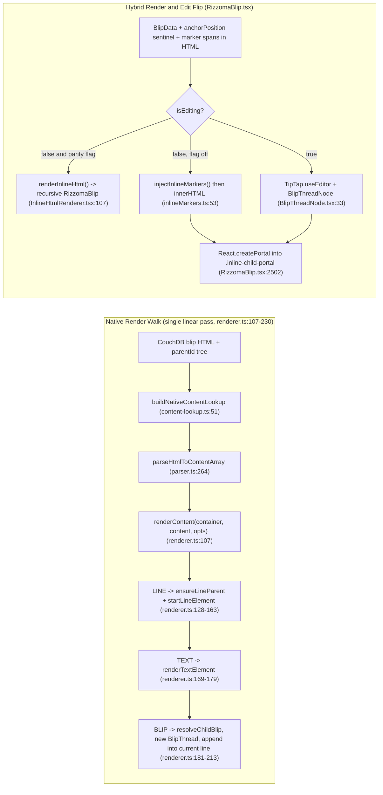

# Architecture Comparison — Original `ContentArray` Fractal vs. React/TipTap Hybrid

**¶1** □ The central engineering problem of the modernized Rizzoma codebase (`/mnt/c/Rizzoma`) is rendering and editing **arbitrarily deep inline fractal discussion trees** where a child blip is anchored at a specific position inside its parent blip's rich-text body (`docs/ORIGINAL_FRACTAL_LOGIC_AND_WHY_OURS_DOESNT_MATCH.md:1-35`, `:137-171`). This page contrasts the structural (`Continuant`) and runtime (`Occurrent`) difference between the React/TipTap hybrid (`src/client/components/blip/RizzomaBlip.tsx`) and the direct TypeScript native port (`src/client/native/`).

**¶1a** ◇ **Re-verification note (2026-11-07, HEAD `6cf6fc7a`)**: every `file:line` below was re-read against the working tree. `RizzomaBlip.tsx` and `src/server/routes/blips.ts` carry other sessions' **uncommitted** edits (`git diff --ignore-cr-at-eol HEAD`: 4 changed lines in `blips.ts`, a few hunks in `RizzomaBlip.tsx`), so line numbers in those two files may be off by a few lines against `HEAD`. Claims marked *read, not run* come from reading code only; nothing on this page was executed or screenshot-verified this session.

---

## 1. Structural Ontology (`Continuant` — `graph TD`)

```mermaid
graph TD
    subgraph NATIVE["Native Fractal Architecture (src/client/native/)"]
        CA["ContentArray = ContentElement[] (types.ts:91)"]
        TEXT_EL["TextEl {type:'text', text, params} (types.ts:51)"]
        LINE_EL["LineEl {type:'line', text:' ', params:{bulleted,numbered,heading}} (types.ts:58)"]
        BLIP_EL["BlipEl {type:'blip', text:' ', params:{id, threadId?}} (types.ts:66)"]
        WV["WaveView (wave-view.ts:47)"]
        BV["BlipView (blip-view.ts:33)"]
        BT["BlipThread span.blip-thread.folded (blip-thread.ts:38)"]
        BEH["BlipEditorHost one per mounted BlipView (blip-editor-host.ts:51)"]

        WV -->|owns views map, root| BV
        BV -->|renders via renderContent| CA
        CA -->|contains| TEXT_EL
        CA -->|contains| LINE_EL
        CA -->|contains| BLIP_EL
        BLIP_EL -->|wrapped inline by| BT
        BT -->|holds child container from| BV
        BV -->|edit mode mounts| BEH
    end

    subgraph HYBRID["React/TipTap Hybrid (src/client/components/)"]
        RTD["RizzomaTopicDetail.tsx (1,724 LOC)"]
        RB["RizzomaBlip.tsx (2,778 LOC)"]
        IM["injectInlineMarkers (inlineMarkers.ts:53)"]
        IHR["renderInlineHtml (InlineHtmlRenderer.tsx:107)"]
        BTN["BlipThreadNode TipTap node (BlipThreadNode.tsx:33)"]
        PORTAL["React.createPortal (.inline-child-portal)"]

        RTD -->|renders root and list| RB
        RB -->|non-parity view: syncs markers via| IM
        RB -->|parity view only: parses via| IHR
        RB -->|edit mode mounts| BTN
        IHR -->|renders recursive| RB
        BTN -->|portal anchor for| PORTAL
        PORTAL -->|mounts child| RB
    end
```

### 1.1 Why the Original 2013 CoffeeScript Architecture Never Drifted
- **¶2** □ In original Rizzoma a blip's document model is a **single flat ShareJS/OT ops array** whose records are `{t: <text>, params: {__TYPE, __ID, __THREAD_ID, ...}}` (`ModelField` at `original-rizzoma-src/src/share/model/index.coffee:37-39`, `ParamsField` at `:41-53`, `ModelType` at `:55-59` plus `RECIPIENT` and further types). The TypeScript port keeps **four** of them (`TEXT`, `LINE`, `BLIP`, `ATTACHMENT`) and renames the fields: `ModelType` values are lowercase strings `'text' | 'line' | 'blip' | 'attachment'` (`src/client/native/types.ts:20-25`), a record is `{type, text, params}`, and the BLIP params are `{id, threadId?}` (`types.ts:66-76`). The `__TYPE` / `__ID` / `ModelField` / `ModelType.RECIPIENT|GADGET|TASK` names that an earlier revision of this page attributed to `types.ts` do **not** exist in the port (verified: `types.ts` is 97 lines and contains none of them).
- **¶3** □ **Position-by-Index Invariant**: A child blip does **not** store a numeric character offset in a separate field. Its anchor **is** a 1-character `BlipEl` (`{type:'blip', text:' ', params:{id}}`) sitting directly inside the parent's `ContentArray` (`src/client/native/types.ts:11-13`, `:66-76`). The file header states it verbatim: "There is no separate numeric anchorPosition field" (`types.ts:13`).
- **¶4** □ **DOM Stability via CSS Folding**: `BlipThread` (`src/client/native/blip-thread.ts:38-232`, ported from `original-rizzoma-src/src/client/blip/blip_thread.coffee:20-182`) is a persistent `` that starts folded (`blip-thread.ts:50-53`, `:76`) and contains a `.fold-button-container` plus a `.js-blips-container` (template at `:25-36`). Folding/unfolding only toggles the `.folded` class (`fold()` at `:147-159`, `unfold()` at `:161-171`); the thread never destroys the child subtree on toggle. **Correction to the earlier revision**: the child `BlipView` is **not** lazily created "on first unfold". `renderContent` calls `resolveChildBlip` for every BLIP element as it walks (`src/client/native/renderer.ts:181-182`), and `WaveView.resolveChild` calls `getOrCreateView(childId)` which immediately fills and renders the child from the content lookup (`src/client/native/wave-view.ts:88-101`, `:230-234`). The whole subtree is therefore built eagerly in one recursive pass (this is the Phase 1 "full depth" behaviour described in `src/client/native/content-lookup.ts:3-17`); folding only hides it via CSS.
- **¶4a** ◇ **Edit-mode caveat (read, not run)**: the earlier claim "the wrapper never unmounts when switching between read and edit mode" no longer holds for the Phase 2 native editing path. `BlipEditorHost.mount()` empties the view's `.blip-text` element (`src/client/native/blip-editor-host.ts:83-85`) and hands TipTap an HTML string produced by `serializeContentArrayToHtml` (`:87-88`); child `BlipView` instances survive in `WaveView.views`, but `unmount()` calls `view.render()` (`:125`), and `renderContent` constructs a **new** `BlipThread` for every BLIP element on each render (`renderer.ts:204`), so thread fold state is not carried across an edit cycle by this code. Whether this is visible in the UI was not tested.

### 1.2 Why the React/TipTap Hybrid Produced Failure Seams
- **¶5** □ The hybrid stores each blip's body as an HTML string (`blip.content`) and keeps a numeric `anchorPosition` on the blip record (`BlipData.anchorPosition?: number` at `src/client/components/blip/RizzomaBlip.tsx:74`; copied from the server record at `src/client/components/RizzomaTopicDetail.tsx:564-565`; stored by the server only when the client sends a number, `src/server/routes/blips.ts:187`, `:211`). **The numeric value no longer positions anything**: it is a sentinel. The Ctrl+Enter shortcut always passes `0` (`src/client/components/editor/extensions/BlipKeyboardShortcuts.ts:147-165`), and `injectInlineMarkers` has its offset-splicing code switched off (`src/client/components/blip/inlineMarkers.ts:85-100`, the helper `insertMarkerAtOffset` at `:21` is kept only so lint stays quiet). The field survives purely as an inline-vs-list discriminator: `typeof anchorPosition === 'number'` means inline child (`RizzomaTopicDetail.tsx:1335-1336`). The earlier revision of this page said the opposite (that `injectInlineMarkers` counts characters up to `anchorPosition`); that was already untrue when written. Rendering one inline child still touches these layers (the earlier page called them "seven"; `docs/ORIGINAL_FRACTAL_LOGIC_AND_WHY_OURS_DOESNT_MATCH.md:139-149` lists nine rows, so "seven" is this wiki's own grouping and is dropped):
  1. `blip.content` HTML string plus `parentId` / `anchorPosition` in CouchDB (`src/server/routes/blips.ts:184-231`).
  2. **Marker spans in the parent's saved HTML are now the canonical anchor** (`inlineMarkers.ts:85-93`). `injectInlineMarkers()` (`:53`) only refreshes existing `.blip-thread-marker` spans (`+` / `−` text, `expanded`, `orphaned`; `:65-84`) and rebuilds `.inline-child-portal` divs for expanded children (from `:103`).
  3. Read-mode HTML-to-React conversion via `renderInlineHtml()` (`src/client/components/blip/InlineHtmlRenderer.tsx:107`) – **only when `FEATURES.RIZZOMA_PARITY_RENDER` is on** and the blip is not editing (`RizzomaBlip.tsx:863-870`). That flag is off by default (`src/shared/featureFlags.ts:35-37`), so the default read path is `dangerouslySetInnerHTML` of `injectInlineMarkers` output (`RizzomaBlip.tsx:2434`).
  4. Edit-mode ProseMirror node `BlipThreadNode` (`src/client/components/editor/extensions/BlipThreadNode.tsx:33`), which renders `` containing the marker and a `` (`:87-106`); the `insertBlipThread` command is at `:108-122`.
  5. `React.createPortal` of the child `<RizzomaBlip>` into that anchor (`RizzomaBlip.tsx:2502`), gated by `(isEditing || !!contentOverride || !parityViewRender)` (`:2500`).
  6. Separate edit / read / parity-read branches in the JSX (`RizzomaBlip.tsx:2368-2440`).
  7. Global React state and window events: `ACTIVE_BLIP_CLAIM_EVENT = 'rizzoma:active-blip-claim'` (`RizzomaBlip.tsx:78`) and the topic-level `tryEnterEdit` retry loop that re-drives edit entry up to 8 times (`RizzomaTopicDetail.tsx:814-828`).
- **¶6** □ **Consequence**: Whenever a parent blip transitions between read and edit mode (`isEditing` flip in `RizzomaBlip.tsx`), the read-mode tree and the edit-mode TipTap/portal subtree are different DOM subtrees, so child editor focus must be re-established. The code itself documents this: the post-create `tryEnterEdit` loop exists because "the child's claim closes the TOPIC editor … which unmounts the child's first mount" (`RizzomaTopicDetail.tsx:807-813`, loop `:814-828`, kicked off with a double `requestAnimationFrame` at `:828`).
- **¶6a** □ **Failure-seam count**: the earlier heading said "12 Failure Seams". The source document enumerates **10** (`docs/ORIGINAL_FRACTAL_LOGIC_AND_WHY_OURS_DOESNT_MATCH.md:155-164`); "12" was not verifiable and has been dropped.

---

## 2. Runtime Execution Comparison (`Occurrent` — `graph LR`)

---

## 3. Side-by-Side Architectural Matrix

| Architectural Dimension | Original CoffeeScript (`original-rizzoma-src/`) | Modernized Native Port (`src/client/native/`) | React/TipTap Hybrid (`src/client/components/blip/`) |
|---|---|---|---|
| **Document Model** | Flat ShareJS array of `{t, params}` (`original-rizzoma-src/src/share/model/index.coffee:37-59`) | Flat TypeScript `ContentArray` (`src/client/native/types.ts:91`) | HTML string plus numeric `anchorPosition` sentinel (`RizzomaBlip.tsx:74`) |
| **Inline Child Anchor** | `{t:' ', params:{__TYPE:'BLIP', __ID}}` in the array | `BlipEl` (`ModelType.BLIP`) in `ContentArray` (`types.ts:66`) | Marker span in saved HTML (canonical since 2026-05-05, `inlineMarkers.ts:85-93`) |
| **Rendering Algorithm** | Single linear loop (`original-rizzoma-src/src/client/editor/renderer.coffee:97-116`) | Single linear loop `renderContent()` (`renderer.ts:107-230`) | Three paths: `renderInlineHtml` (parity read), `innerHTML` (default read), TipTap + `createPortal` (edit) |
| **Thread Wrapper** | `BlipThread` (`blip/blip_thread.coffee:20-182`) | `BlipThread` (`blip-thread.ts:38-232`) | Split across `InlineHtmlRenderer.tsx:107` and `BlipThreadNode.tsx:33` |
| **Fold / Unfold** | Toggle `.folded` CSS class (`blip_thread.coffee:35-62`) | Toggle `.folded` CSS class (`blip-thread.ts:147-171`) | React state `localExpandedInline` plus re-render / portal remount (`RizzomaBlip.tsx:863-905`) |
| **Active Editor Count** | One editor per active blip | One `BlipEditorHost` per mounted `BlipView` (`blip-editor-host.ts:51`); `NativeWaveView` keeps a `Map` of hosts and does not close the parent when a child opens (`components/native/NativeWaveView.tsx:55`, `:149-173`) | One `useEditor()` per mounted `RizzomaBlip` (`RizzomaBlip.tsx:562`), single-active enforced by the claim event (`:403-417`) |
| **Current Runtime Status** | Reference specification only | ◇ Opt-in via `FEAT_RIZZOMA_NATIVE_RENDER=1` **and** `?render=native` (`RizzomaTopicDetail.tsx:1293-1301`, `featureFlags.ts:45`); read **and** Phase 2 edit wired in `NativeWaveView.tsx` (commit `195dfcde`) | □ Default read+edit runtime (`RizzomaTopicDetail.tsx:1333-1336`, `:1500`) |

**¶7** □ Note on "one editor per wave": the earlier revision claimed `BlipEditorHost` gives "1 editor per wave". The class takes a single `BlipView` in its constructor (`blip-editor-host.ts:57-60`); the "single editor per wave" property is a design intent in `docs/NATIVE_RENDER_PORT_PLAN.md:112-122` that `NativeWaveView` does not currently enforce (see [`subsystems/native-render-port.md`](../subsystems/native-render-port.md) and the contradiction entry in [`decisions/contradictions-and-lint-findings.md`](../decisions/contradictions-and-lint-findings.md)).

**¶8** □ Recent changes to the hybrid that matter to this comparison (commits of 2026-11-07, see also [`subsystems/legacy-visual-parity.md`](../subsystems/legacy-visual-parity.md) for the chrome/CSS work): (a) blips start collapsed unless root / topic-root / force-expanded (`RizzomaBlip.tsx:333-345`, commit `597f767c`); (b) `ensureBulletedBody` is now exported and also applied to the view-mode HTML (`RizzomaBlip.tsx:292-304`, `:872`, `:2405`; commits `597f767c`, `a4d4d583`); (c) deleting a blip now also removes its `blipThread` node from the topic editor and strips the marker span from the parent's stored HTML (`RizzomaTopicDetail.tsx` delete handler, `src/server/routes/blips.ts:88-118`, `:153`; commit `6cf6fc7a`), which confirms that marker spans **are** persisted in parent HTML on the hybrid path.

**¶9** ▷ Unverified on this page: runtime behaviour of any of the above in a browser, and the `2,500+` / `1,689` LOC figures of the old revision (replaced by `wc -l` counts of the working tree: 2,778 and 1,724).
