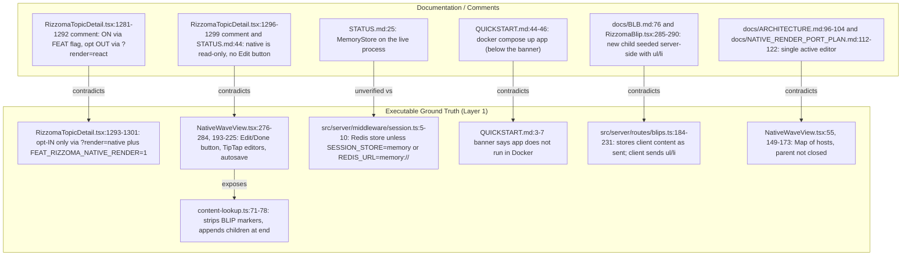
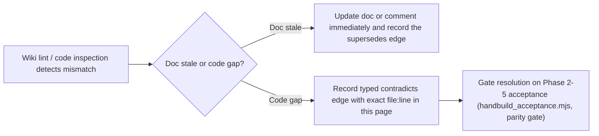

# Decisions & Lint Findings — Active Contradictions, Architectural Gaps, and Security Audit

**¶1** □ Following Andrej Karpathy's `llm-wiki` **Lint** operation and Pavel Kravtsov's Metagraph `contradicts` / `supersedes` edge discipline, this page records every verified contradiction between documentation and code (`src/`), every open Phase 1→Phase 5 architectural gap, and the baseline `secure-agents` audit results for `/mnt/c/Rizzoma`.

**¶1a** ◇ **Re-verification (2026-11-07, HEAD `6cf6fc7a`)**: every entry from the 2026-11-06 revision was re-checked against the working tree and given a status (`STILL TRUE`, `RESOLVED`, `PARTLY STALE`). New entries C6–C12 were added from the re-verification of the other four pages. The working tree carries other sessions' uncommitted edits (notably `src/client/components/blip/RizzomaBlip.tsx` and `src/server/routes/blips.ts`); where an entry depends on uncommitted lines it says so. Nothing was executed in a browser.

---

## 1. Contradiction & Gap Map (`Continuant` — `graph TD`)

---

## 2. Contradiction Resolution Workflow (`Occurrent` — `graph LR`)

---

## 3. Catalog of Verified Contradictions & Code Gaps

### 3.1 `[RESOLVED 2026-11-06 — re-checked 2026-11-07: STILL RESOLVED]` `CLAUDE.md` Dual-Branch Header Contradiction
- **¶2** □ **Finding (original)**: `CLAUDE.md` declared the working branch `feature/native-fractal-port` but kept a stale header `# Rizzoma Project Status (feature/rizzoma-core-features)`.
- **¶3** □ **Status**: `CLAUDE.md:19` states the working branch (`feature/native-fractal-port`), `CLAUDE.md:20` calls docs that say `feature/rizzoma-core-features` deprecated, and the section header at `CLAUDE.md:30` now reads `# Rizzoma Project Status (feature/native-fractal-port)`. The old line numbers (`:18`, `:27`) have shifted. The only remaining mention of the old branch is the intentional deprecation note at `:20`.

### 3.2 `[OPEN — STILL TRUE]` C1: `RizzomaTopicDetail.tsx` comment says opt-out, code is opt-in
- **¶4** □ **Finding**: the block comment at `src/client/components/RizzomaTopicDetail.tsx:1281-1292` says native render is "ON when FEATURES.RIZZOMA_NATIVE_RENDER is enabled (default on this VPS via FEAT_RIZZOMA_NATIVE_RENDER=1 in docker-compose). Opt OUT for one session via `?render=react`". The code directly below (`:1293-1301`) returns `false` when the flag is off (`:1294`) and otherwise `new URLSearchParams(window.location.search).get('render') === 'native'` (`:1300`): **opt-in only**, and only when the build-time flag is also on (`src/shared/featureFlags.ts:45`, wired in `vite.config.ts:35`). Neither `docker-compose.yml` nor `.env*` contains `FEAT_RIZZOMA_NATIVE_RENDER` (grep this session; the live VPS environment was not inspected). The earlier revision cited `:1213-1230`; the block moved by about 68 lines.
- **¶5** ▷ **Rule for Agents**: always pass `?render=native` (and `HB_RENDER=native` for the acceptance script) **and** run a build with `FEAT_RIZZOMA_NATIVE_RENDER=1` to test the native renderer until Phase 5 flips the default.

### 3.3 `[OPEN — NEW]` C2: "native is read-only" (comment and `STATUS.md`) vs. native editing wired in `195dfcde`
- **¶5a** □ **Finding**: `RizzomaTopicDetail.tsx:1296-1299` still says "the native path is still read-only (no Edit button, no per-blip toolbars, no Write-a-reply input)" and `STATUS.md:44` says "READ-ONLY … no Edit button … Editing still goes through the React/TipTap hybrid". Since commit `195dfcde` (2026-11-07) `NativeWaveView.tsx` renders an Edit / Done toolbar button (`:276-284`), mounts a TipTap editor per edited blip (`:89-124`, `:193-225`), autosaves through `PATCH /api/topics/:id` and `PUT /api/blips/:id` (`:60-83`) and creates children on Ctrl+Enter (`:127-186`). `docs/ARCHITECTURE.md:92-93` ("opt-in per session via `?render=native` … true state is measured, see STATUS.md") defers to `STATUS.md`, which was generated 2026-07-16 (`STATUS.md:7`) and has not been regenerated. Whether the native editing actually works end-to-end was **not** tested here (the native acceptance evidence folder exists but its result was not read).
- **¶5b** ▷ **Remediation**: regenerate with `node scripts/gen_status.mjs`; update the comment at `RizzomaTopicDetail.tsx:1296-1299`.

### 3.4 `[OPEN — STILL TRUE, WITH NEW CONSEQUENCE]` C3: `content-lookup.ts` mid-paragraph anchor loss
- **¶6** □ **Finding**: `buildNativeContentLookup()` drops every `BLIP` element parsed from stored HTML (`src/client/native/content-lookup.ts:71-73`: `parseHtmlToContentArray(b.content).filter((el) => el.type !== ModelType.BLIP)`) and appends one synthesized `BlipEl` per tree child **after the parent's own content** (`:74-76`). Header rationale: `:4-25`. (Earlier citation `:71-76` was close but the code is `type`-based, not `params[ModelField.TYPE]`; `ModelField` does not exist.)
- **¶7** ▷ **Impact & Remediation**: every descendant renders to full depth, but each child sits at the end of its parent rather than at its marker. New consequence: now that native editing exists, `NativeWaveView.handleCreateChild` inserts a marker via the TipTap `insertBlipThread` command (`NativeWaveView.tsx:153-155`) and autosaves HTML containing it (`:104-113`); after a reload the lookup discards that marker, so the child moves to the end (read from code, not tested). The earlier remediation hint (use `injectInlineMarkers` before parsing) is **no longer valid**: `injectInlineMarkers` stopped inserting markers by `anchorPosition` on 2026-05-05 (`src/client/components/blip/inlineMarkers.ts:85-100`). The remaining option is to keep persisted markers in the lookup (parser already turns marker spans into `BlipEl`, `src/client/native/parser.ts:169-177`) and only synthesize `BlipEl`s for children whose id has no marker.

### 3.5 `[OPEN — PARTLY STALE]` C4: `MemoryStore` vs. Redis session persistence
- **¶8** □ **Finding (original)**: "`STATUS.md:25` and `src/server/app.ts` confirm that `express-session` uses the in-memory `MemoryStore`". **Re-check**: `src/server/app.ts:57` just calls `sessionMiddleware()`; the store is chosen in `src/server/middleware/session.ts:5-10`: `MemoryStore` only if `SESSION_STORE === 'memory'` or `REDIS_URL === 'memory://'`, otherwise a `connect-redis` `RedisStore` (`:27-36`, default `redis://localhost:6379`, key prefix `rizzoma:sess:`). `docker-compose.yml:17` and `:50` set `REDIS_URL: redis://redis:6379` for the compose services. So the code default is Redis; `SESSION_STORE=memory` is used by CI (`.github/workflows/ci.yml:179`) and by documented dev smokes. `STATUS.md:25` ("MemoryStore on the live process") may still be true of the live VPS if it was started with that variable; **unverified** (VPS not contacted). The claim that `app.ts` hard-codes `MemoryStore` was wrong.

### 3.6 `[PARTLY RESOLVED]` C5: `QUICKSTART.md` Docker-Compose topology
- **¶9** □ **Finding (original)**: `QUICKSTART.md` describes the whole stack in Docker Compose whereas `CLAUDE.md` and `STATUS.md:24` say only CouchDB and Redis are containers. **Re-check**: a "REALITY CHECK (2026-07-14)" banner now sits at `QUICKSTART.md:3-7` and says exactly that (app runs via `npm run dev`; `docker compose up -d app …` lines are historical). The historical instructions are still present below it (`QUICKSTART.md:44-46` "docker compose up -d app couchdb redis rabbitmq sphinx minio clamav", "App runs inside Docker container `rizzoma-app`"). The contradiction is mitigated by the banner, not removed. `CLAUDE.md:21` (earlier cited as the source) is now at `CLAUDE.md:22-23`.

### 3.7 `[OPEN — NEW]` C6: Single-active-editor invariant vs. native `NativeWaveView`
- **¶9a** □ **Finding**: `docs/ARCHITECTURE.md:96-104` and `docs/NATIVE_RENDER_PORT_PLAN.md:112-122` say one TipTap editor exists only for the blip being edited. The hybrid enforces it by the `rizzoma:active-blip-claim` event (`RizzomaBlip.tsx:403-417`). The native host does not: `activeHostsRef` is a `Map` of hosts (`NativeWaveView.tsx:55`), `handleCreateChild` mounts the child editor while the parent host stays mounted (`:149-173`), and no code closes the parent (grep: no `claimActiveEdit` / `attachToBlip` anywhere in `src/`). Read from code, not tested. The earlier wiki pages asserted the opposite.
- **¶9b** ▷ **Gate**: `HB_RENDER=native node scripts/handbuild_acceptance.mjs`; the script does not currently assert that only one `.ProseMirror[contenteditable=true]` exists.

### 3.8 `[OPEN — NEW]` C7: "New child is seeded server-side with `<ul><li>`" vs. `POST /api/blips`
- **¶9c** □ **Finding**: `docs/BLB.md:76` ("A newly created child blip is seeded `<ul><li>

</li></ul>` server-side") and the comment at `src/client/components/blip/RizzomaBlip.tsx:285-290` say the server seeds the body. `POST /api/blips` (`src/server/routes/blips.ts:184-231`) stores `content` exactly as received and rejects an empty one with 400 (`:190-193`); the bulleted body is sent by the clients (`RizzomaTopicDetail.tsx:704`, `NativeWaveView.tsx:135`, nested path in `RizzomaBlip.tsx:731`). Any other client (or an API call) can persist a bare `
`. Mitigation in code: `ensureBulletedBody` on view and edit seeding (`RizzomaBlip.tsx:292-304`).

### 3.9 `[OPEN — NEW, NEEDS SDS DECISION]` C8: Blip deletion authorization
- **¶9d** □ **Finding**: commit `6cf6fc7a` removed the author check from `DELETE /api/blips/:id` (`src/server/routes/blips.ts:326-352`; the replacement is a comment that "any wave participant with edit access can delete replies/comments"). The handler as read applies `requireAuth` only — no wave-membership or permission check is visible in these lines — so any authenticated user who knows a non-root blip id could delete it (and its descendants) (read from code, **not tested**). Also uncommitted in the working tree: `GET /api/blips/:id/history` loses `requireAuth` (`blips.ts:372`, comment "publicly accessible to wave viewers, matching waves.ts"). Whether this is intended product behaviour was not established.

### 3.10 `[OPEN — NEW]` C9: `STATUS.md` and parity gate state
- **¶9e** □ **Finding**: `STATUS.md` (generated 2026-07-16 for `12984319`) lists the latest sweep as `260714-1600-feature-sweep` (`:31`), "44 / 44 programmatic gates PASS" (`:32`), "Uncommitted files 143" (`:16`). On disk the newest sweep folder by name is `screenshots/2611070351-feature-sweep`, an aborted run (0 captures; `Sweep aborted: page.goto: Timeout 30000ms exceeded`), and `node scripts/check-rizzoma-parity-gate.mjs` run this session **FAILED** with five errors (see [`verification/gates-sweeps-and-deployment.md`](../verification/gates-sweeps-and-deployment.md) ¶4a). So no document currently carries a true, green verification state for HEAD.

### 3.11 `[OPEN — NEW]` C10: Wiki self-errors found in revision 1.0.0 (now corrected)
- **¶9f** □ Claims in the 2026-11-06 pages that the code does not support, all corrected in the 1.1.0 revisions: (a) `types.ts` field names `ModelField`, `__TYPE`, `L_BULLETED`, `countBlips`, `findBlipIndex` (none exist; `types.ts` is 97 lines); (b) `WaveView.claimActiveEdit`, `insertInlineReplyAtSelection`, `BlipView.insertSubBlip` / `removeSubBlip`, `BlipEditorHost.attachToBlip`, `BlipThread.mountChildBlip`, `bindContentArray`, `AwarenessController` (none exist); (c) "child `BlipView` lazy-created on first unfold" (it is created eagerly during render); (d) `injectInlineMarkers` "counts characters up to `anchorPosition`" (disabled 2026-05-05); (e) `docs/BLB.md` rules for single active editor, `▸/[+N]` chevrons and green rail, `h1`–`h3` exemption (not in that file); (f) "28 checks" (script yields at most 26 at default depth), "133 screenshots" (no manifest shows it), `npm run status:gen` and `docs/data/status.json` (do not exist), "Gate #47" (hook says #34), test path `tests/unit/native-*.test.ts` (tests are in `src/client/native/__tests__/`). Cause: the pages were written from documentation and memory without re-reading each cited line; the re-verification above is the fix, and every cited line should still be re-read before a page is trusted.

### 3.12 `[OBSERVATION — NEW, UNVERIFIED RISK]` C11: Literal credential-shaped constant in a test script
- **¶9g** □ `scripts/handbuild_acceptance.mjs:39` declares `const PASS = '…'` with a literal password-shaped string (value deliberately not reproduced here) next to a test e-mail; the script's default target is the live host (`:34`). Whether it is a live credential, a throw-away test account, or still valid was **not checked**. Section 4 says the linter found zero secret leaks; that scan evidently does not flag this pattern.

### 3.13 `[OBSERVATION — NEW]` C12: CodeGraph index is stale
- **¶9h** □ `.codegraph-wsl/codegraph.db` was last written 2026-11-06 14:11 and `codegraph status` returns the same counts as the earlier run (365 files, 16,336 nodes, 50,192 edges); `codegraph impact buildNativeContentLookup` reports `RizzomaTopicDetail.tsx:176` and `RizzomaLayout.tsx:54`, whereas the functions are at `:203` and `:55`. Re-index before trusting CodeGraph line anchors for files edited on 2026-11-07.

---

## 4. `secure-agents` Security Audit (baseline 2026-11-06, re-read 2026-11-07)

- **¶10** □ Automated scan via `python3 /mnt/c/Rizzoma/scripts/wiki_lint.py` (`/mnt/g/My Drive/claude-hooks/tools/wiki_and_security_audit.py`). 2026-11-07 run (after this re-verification, see `wiki/log.md`): `Security Audit: 342 tracked files scanned | .env Ignored: True | Secret Leaks: 0 | Injection Sinks: 0` (printed by the tool; its rules were not independently re-implemented here). The three checks below were re-read against source:
  - **Check 1 (Git-Tracked Credential & `.env` Hygiene)**: tool reports 0 leaks, but see C11 for a literal in `scripts/handbuild_acceptance.mjs:39` that the tool does not flag.
  - **Check 2 (SQL / NoSQL / Shell Injection Sinks)**: `src/server/lib/couch.ts:53-66` builds Mango `_find` requests from a selector object (`body: { selector }`, `POST …/_find`); `src/server/lib/virusScan.ts` uses `node:net` (`:1`) and streams a buffer to ClamAV, returning early if `CLAMAV_HOST` is unset (`:3`, `:8-10`). Still true as stated. New server code in `6cf6fc7a` builds a `RegExp` from a blip id with regex metacharacters escaped (`src/server/routes/blips.ts:88-118`, escaping at `:94`), not a shell or query string.
  - **Check 3 (Logging Surface)**: `src/server/lib/logger.ts:5-25` logs method, `req.originalUrl` (which includes the query string), status and duration plus a request id; no cookie or body is logged there. The earlier statement "without dumping … password fields" is true of this file; query-string content is logged as is.
