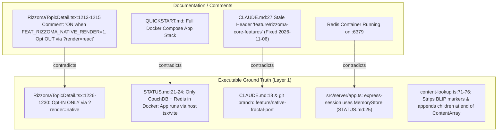
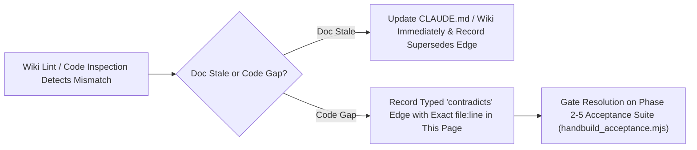

# Decisions & Lint Findings — Active Contradictions, Architectural Gaps, and Security Audit

**¶1** □ Following Andrej Karpathy's `llm-wiki` **Lint** operation and Pavel Kravtsov's Metagraph `contradicts` / `supersedes` edge discipline, this page records every verified contradiction between documentation and code (`src/`), every open Phase 1→Phase 5 architectural gap, and the baseline `secure-agents` audit results for `/mnt/c/Rizzoma`.

---

## 1. Contradiction & Gap Map (`Continuant` — `graph TD`)

---

## 2. Contradiction Resolution Workflow (`Occurrent` — `graph LR`)

---

## 3. Catalog of Verified Contradictions & Code Gaps

### 3.1 `[RESOLVED 2026-11-06]` `CLAUDE.md` Dual-Branch Header Contradiction
- **¶2** □ **Finding**: `CLAUDE.md:18` correctly declared the active working branch as `feature/native-fractal-port`, but `CLAUDE.md:27` retained a stale section header `# Rizzoma Project Status (feature/rizzoma-core-features)` from an earlier sprint.
- **¶3** □ **Resolution**: Cleaned up in `CLAUDE.md` during the 2026-11-06 LLM Wiki initialization so agent instructions no longer name two different branches.

### 3.2 `[OPEN — CODE COMMENT CONTRADICTION]` `RizzomaTopicDetail.tsx:1213-1230` (`?render=react` vs `?render=native`)
- **¶4** □ **Finding**: The block comment at `src/client/components/RizzomaTopicDetail.tsx:1213-1217` states: *"ON when FEATURES.RIZZOMA_NATIVE_RENDER is enabled... Opt OUT for one session via `?render=react` URL flag."* Immediately below, the actual implementation at `src/client/components/RizzomaTopicDetail.tsx:1226-1230` does the exact opposite: *"Opt-IN ONLY via `?render=native` — the native path is still read-only"*, returning `new URLSearchParams(window.location.search).get('render') === 'native'`.
- **¶5** ▷ **Rule for Agents**: Always pass `?render=native` (`HB_RENDER=native`) when testing the native fractal renderer until Phase 5 flips the default.

### 3.3 `[OPEN — ARCHITECTURAL GAP]` `content-lookup.ts:71-76` Mid-Paragraph Anchor Loss in Phase 1 Read-Only Mode
- **¶6** □ **Finding**: In `src/client/native/content-lookup.ts:71-76`, `buildNativeContentLookup()` strips any `ModelType.BLIP` elements parsed from HTML (`parseHtmlToContentArray(b.content).filter(el => el.params?.[ModelField.TYPE] !== ModelType.BLIP)`) and appends one synthesized `BlipEl` per child at the **end** of the parent's `ContentArray` (`base.push(...)`).
- **¶7** ▷ **Impact & Remediation**: While this guarantees every descendant blip in the CouchDB `parentId` tree renders recursively to arbitrary depth (`L1`..`L5+`), children synthesized this way attach after the last line of the parent blip rather than mid-paragraph at `anchorPosition`. Full mid-paragraph fidelity requires either:
  1. Using `injectInlineMarkers` (`src/client/components/blip/inlineMarkers.ts:53`) before `parseHtmlToContentArray` for legacy blips that only have `anchorPosition`, and/or
  2. Persisting `` via `serializeContentArrayToHtml` (`src/client/native/serializer.ts:116-123`) once `BlipEditorHost` (`src/client/native/blip-editor-host.ts:49`) is wired in Phase 2.

### 3.4 `[OPEN — INFRASTRUCTURE GAP]` `MemoryStore` vs. Redis Session Persistence (`STATUS.md:25`)
- **¶8** □ **Finding**: `STATUS.md:25` and `src/server/app.ts` confirm that `express-session` uses the in-memory `MemoryStore` even though Redis is running in Docker (`:6379`) and `connect-redis` is installed. Restarting the backend `tsx` process logs out all sessions.

### 3.5 `[OPEN — DOC DRIFT]` `QUICKSTART.md` Historical Docker-Compose Topology
- **¶9** □ **Finding**: `QUICKSTART.md` describes running the full web and backend stack inside Docker Compose, whereas `CLAUDE.md:21` and `STATUS.md:21-24` establish that only CouchDB and Redis run in Docker while the app runs on the host via `tsx` (`:8000`/`:8100`) and `vite` (`:3000`/`:3100`).

---

## 4. Baseline `secure-agents` Security Audit (`2026-11-06`)

- **¶10** □ Automated scan via `python3 /mnt/c/Rizzoma/scripts/wiki_lint.py` (`/mnt/g/My Drive/claude-hooks/tools/wiki_and_security_audit.py`):
  - **Check 1 (Git-Tracked Credential & `.env` Hygiene)**: `PASS` — `.env` files are git-ignored; zero live API keys or private keys committed in git-tracked source files.
  - **Check 2 (SQL / NoSQL / Shell Injection Sinks)**: `PASS` — CouchDB queries in `src/server/lib/couch.ts:53-66` use structured Mango selector objects (`db.find({ selector })`), and ClamAV scanning in `src/server/lib/virusScan.ts:7` streams buffers over TCP socket rather than interpolating filenames into a shell.
  - **Check 3 (Logging Surface)**: `PASS` — `src/server/lib/logger.ts:5-25` logs request metadata and error messages without dumping raw session cookies or password fields.
