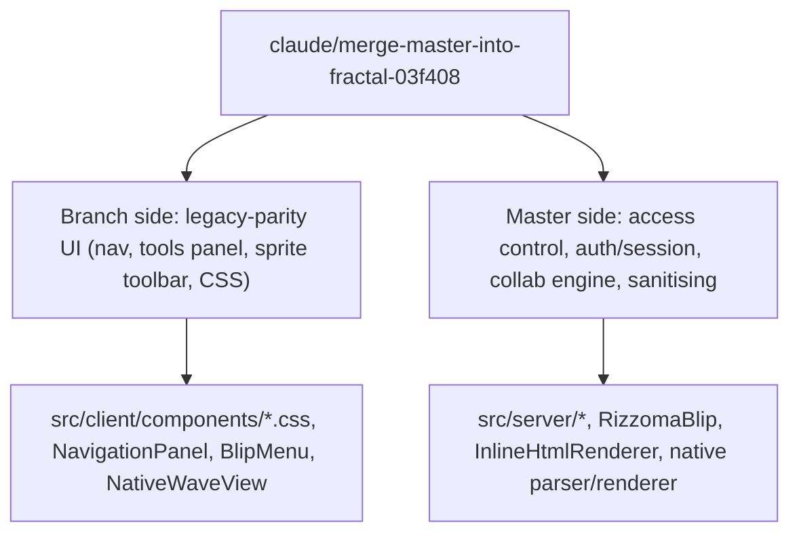
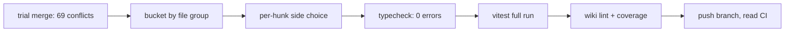

# Merge of `origin/master` into `feature/native-fractal-port` (2026-11-08)

**¶1** □ Branch `claude/merge-master-into-fractal-03f408` was cut from `feature/native-fractal-port` at `73e6c6af` and `origin/master` (`72c54ced`, "Keep blip expansion state stable (#81)") was merged into it. Measured: the trial merge conflicts in **69 paths** (66 content conflicts and 3 modify/delete: the HANDOFF and RESTART notes under docs, the `tiptap.d.ts` shim (formerly in src/types)). `feature/native-fractal-port` itself was not touched. Draft PR #82 was not altered.

**¶2** □ Rule applied: the **branch wins on look and structure** (legacy-parity Surfaces 1 to 6), **master wins on behaviour** it fixed after 2026-02-24 (access control, sessions/OAuth, collaboration generation safety, sanitisation, expansion hand-off). Where both mattered the file was taken from master and the parity element re-applied by hand.

## 0. Shape of the result (`Continuant` — `graph TD`)

## 0b. How it was produced (`Occurrent` — `graph LR`)

## 1. Decisions by file group

| Group | Side taken | Reason |
|---|---|---|
| `CLAUDE.md`, `AGENTS.md`, `RIZZOMA_FEATURES_STATUS.md`, `docs/VISUAL_SCREENSHOT_SWEEP.md`, `docs/VPS_DEPLOYMENT.md`, `docs/worklog-260713.md`, `docs/deprecated/*` | branch | The branch entry points (STATUS.md, wiki, legacy-screenshots rule) are the live ones. Not authoritative either way. |
| docs HANDOFF and RESTART notes | stay deleted | The branch moved these out; master only edited them. |
| `.claude/hooks/visual-sweep-gate.sh` | branch | Gate wiring belongs to the branch's sweep. |
| `.github/workflows/ci.yml` | branch for every hunk, plus master's `ci-gate` job (auto-merged) and `if: always()` on `health-checks` | Keeps `ubuntu-24.04`, no `--no-optional`, the "Create CouchDB database" step and the branch trigger list. Master's equivalent DB step was dropped as duplicate. |
| `package.json`, `package-lock.json` | union of scripts (`parity:gate` and `sharing:count-legacy`); lockfile regenerated with `npm install --package-lock-only` | `@tiptap/suggestion` kept. Lockfile never hand-edited. |
| `Dockerfile`, `docker-compose.yml` | master (hardened `app-prod`, clamav health, `FEAT_ALL`), with the branch's configurable `ALLOWED_ORIGINS` | Master's production path is the tested one. |
| `.gitignore` | both | Union. |
| `src/server/app.ts`, `routes/auth.ts`, `routes/blips.ts`, `routes/topics.ts`, `routes/waves.ts`, `middleware/session.ts`, `types/express-session.d.ts` | master | Role-checked access, OAuth state transactions, password reset, session revocation, Yjs generation checks. The branch had none of these. |
| `src/server/lib/couch.ts` | both | Union of index lists (branch `idx_participant_by_wave` + master's 15 indexes). |
| `src/server/config.ts`, backend port | master: **default 8788** | First attempt kept 8000; CI `Wait for dev stack` (master's step) polls 8788 and master's `socket.ts` connects the browser to 8788 when served from :3000, so 8000 broke browser-smokes. The live deployment must set `PORT`/`VITE_API_TARGET` explicitly or move to 8788; **not verified here**. |
| `src/shared/featureFlags.ts`, `vite.config.ts` | branch, proxy default 8788 | `RIZZOMA_PARITY_RENDER` stays on by default (parity). |
| the `tiptap.d.ts` shim (formerly in src/types) | deleted (master) | It shadowed the real TipTap types and hid errors; master's code needs the real types. |
| `perf-harness.mjs`, `scripts/perf-budget.mjs` | master | Paired; the budget script reads the harness's new output. |
| `scripts/visual-feature-sweep.mjs`, `scripts/rizzoma_sanity_sweep.mjs` | branch | Selectors for the legacy DOM. |
| All six `src/tests/*` conflicts, `native/__tests__/*` | master | Tests describe master's server/auth behaviour. |
| `src/client/native/parser.ts`, `renderer.ts` | master | `isSafeRichUrl` link/src filtering. |
| `src/client/native/tiptap-adapter.ts`, `blip-editor-host.ts` | branch | Phase 2 native editing needs `onUpdate`, `raw`, `getView`. |
| `src/client/main.tsx`, `RizzomaApp.tsx`, `index.html`, `AuthPanel.tsx`, `RizzomaLayout.tsx` | master | `AuthProvider`, calendar-banner dismiss, invite-only registration and password reset, offline read-only banner, resizable panes. |
| `CollaborativeCursors.tsx`, `BlipKeyboardShortcuts.ts`, `InlineHtmlRenderer.tsx` | master, except hashtag rendering, empty-bullet suppression and unread test, which stay the branch's | Authenticated cursor identity, BLB Enter/Backspace guards, `sanitizeRichHtml`, durable task widgets. |
| `NavigationPanel.tsx`/`.css`, `RightToolsPanel.tsx`/`.css`, `RizzomaTopicsList.tsx` (+ avatar hunk), all other `.css` | branch | Legacy tab strip, sprite fold buttons, small avatar. `RightToolsPanel` Next buttons additionally carry master's `next-button` class so the Follow-the-Green tests can find them. |
| `RizzomaBlip.tsx` (41 hunks) | master for 36, branch for 5 | Master's collaboration engine (`collabReady`, `persistLatestProjection`, `ActiveBlipContext`, ensure-expanded hand-off) replaces the branch's ported single-active code. Kept from the branch: `ACTIVE_BLIP_CLAIM_EVENT` export, `formatRizzomaDate`, avatar image, `contentHeader`, range menu. Re-applied by hand: reply creation sends `isFoldedByDefault: true` (hidden-by-default parity). |
| `RizzomaTopicDetail.tsx` (28 hunks) | master for logic, branch for the wave-panel `BlipMenu` toolbar and the native lookup (`buildNativeContentLookup`) | The toolbar still uses `canEdit={isAuthed}`; tightening to `topicCanEdit` is a follow-up. |
| `BlipMenu.tsx`, `NativeWaveView.tsx` | branch | Sprite toolbar/Done bar; Phase 2 native editing. |

## 2. Hand fixes after the textual merge

- `RizzomaBlip.tsx`: removed a duplicate `isTopicRoot` and a duplicate `handleStartEdit` (kept the `useCallback` slot, master's body, plus the `onStartEdit` override); closed a ternary with `))}`.
- `waves.ts`: the branch's unauthenticated `PUT`/`PATCH /api/waves/:id` alias routes had auto-merged next to master's access control and were **removed** (the client uses `/api/topics` and `/api/blips`). `flattenBlips` restored; unused `loadWaveBlipOrder` and `User` removed.
- `blips.ts`: unused `removeInlineMarkerFromParent` removed (master cleans markers another way).
- `TopicAvatar` taken from master (safe-URL check, initials fallback) with master's avatar CSS appended; the parity `anonim.png` placeholder is therefore not shown for users without an avatar. Deviation from the legacy screenshots, recorded here.
- CSS appended for master's tests: in-flow mobile toolbar rules (`BlipMenu.css`) and active-only toolbar rules (`RizzomaBlip.css`).
- `NavigationPanel.tsx`: dropped unused lucide imports, mentions badge prop `unreadCount` kept.

## 3. Verification (this session, WSL clone `~/rizzoma-merge`)

See `wiki/log.md` entry of 2026-11-08 for the measured numbers (typecheck, vitest, lint, CI).

## 4. Known gaps

- ▷ Visual parity was **not** re-measured after the merge (no sweep run); master's TopicDetail/Blip logic changed render paths.
- ▷ `BlipMenu` tests (14) still fail: they assert master's emoji toolbar, the branch has the sprite toolbar. `collapsePreferences` (1) also fails. Both were failing on the branch before the merge.
- ▷ Backend default port is now 8788 (master's). Anything on this branch's line that assumed 8000 (nginx, systemd, nohup recipe in CLAUDE.md, `scripts/gen_status.mjs`) is unverified.

## 5. CI status at the end of the session

- □ CI is **green** on this branch since run 42537452651 (a35df20c); history of the red runs and their causes is in `wiki/log.md`. Tests and smokes were aligned to the legacy toolbar and the Next button carries `has-unread`.

(Receipt filed 2026-11-08T14:44:38Z; no code changed after the CI runs above.)
(final check)

(Receipt for CI diagnosis filed 2026-11-08T17:25:51Z.)
(receipt 2026-11-08T17:26:36Z)
