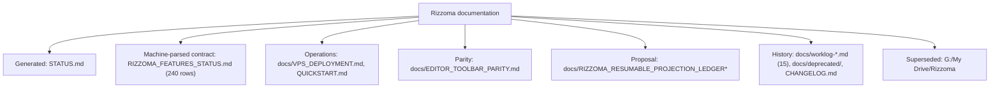
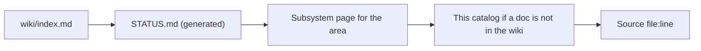

# Rizzoma Document Catalog

**¶1** □ The first wiki ingest covered 8 spine docs. This page catalogs the rest, with the header-stated status of each. Read the file itself before relying on it.

## 1. Catalog (`Continuant` — `graph TD`)

| Doc | Status stated in its own header | Use |
|---|---|---|
| [`RIZZOMA_FEATURES_STATUS.md`](../RIZZOMA_FEATURES_STATUS.md) | Part 1, the 240-row comparison table, is the **machine-parsed contract** read by `scripts/visual-feature-sweep.mjs` and `visual-feature-coverage.mjs`. Part 2, the prose summary, is **historical**; do not cite it as status. | Edit the table, never the prose, when a feature changes. |
| [`QUICKSTART.md`](../QUICKSTART.md) | Reality check dated 2026-07-14: the app does not run in Docker; only CouchDB and Redis are containers. Local dev is `docker compose up -d couchdb redis` then `FEAT_ALL=1 FEAT_RIZZOMA_PARITY_RENDER=1 npm run dev` (server :8000, vite :3000). Lower `docker compose up app` lines are historical. | See the QUICKSTART drift in the decisions page. |
| [`docs/VPS_DEPLOYMENT.md`](../docs/VPS_DEPLOYMENT.md) | Last updated 2026-07-14 00:40 CEST per its header (257 lines); host 138.201.62.161, ports 3000 and 8000, nginx proxy with Let's Encrypt. | Possibly out of date; STATUS.md is the live topology. |
| [`docs/EDITOR_TOOLBAR_PARITY.md`](../docs/EDITOR_TOOLBAR_PARITY.md) | Tracker of the two-level toolbar (topic-level always visible, blip-level only when expanded) against the original CoffeeScript menu template. | Read before touching `BlipMenu.tsx`; see also [legacy visual parity](subsystems/legacy-visual-parity.md). |
| [`docs/RIZZOMA_RESUMABLE_PROJECTION_LEDGER.md`](../docs/RIZZOMA_RESUMABLE_PROJECTION_LEDGER.md) | "Status: implementation proposal", last verified 2026-08-21. Concerns publishing to Rizzoma topics resumably (content identity and verified-effect receipts instead of ordinal retry). It is about the documentation-publication pipeline, not the app code. Companion `.blb.md`, `.contract.json` and `.shell.*` files exist. | Proposal only; do not treat as implemented. |
| `docs/worklog-*.md` | 15 dated files, 2025-12-08 to 2026-07-14. | History; search with grep, not as authority. |
| [`docs/deprecated/`](../docs/deprecated) | Not authoritative (stated in `AGENTS.md`). | Ignore. |
| `G:\My Drive\Rizzoma` | Its `DEPRECATED.md` says the active workspace is `/mnt/c/Rizzoma`. Contains `MODERNIZATION_STRATEGY.md` (Node 0.10 to 20, CoffeeScript to TypeScript, cradle to direct Mango, a phased plan), `BUG_SUBBLIP_NESTING.md` (2026-04-16, status fixed in `222efc97`, issue HCSS-StratBase/rizzoma#40), `README_MODERNIZATION.md`. | Historical context only. |

## 2. Reading order (`Occurrent` — `graph LR`)

