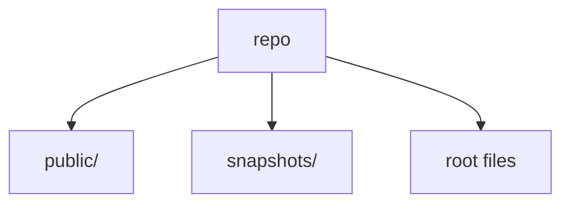
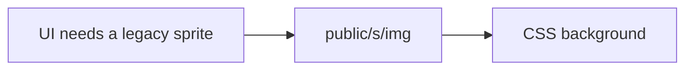

# Assets, Snapshots and Root Files

**¶1** □ GENERATED. `public/` 242 files (original-Rizzoma sprites and images under `public/s/`), `snapshots/` 139 files, 48 root files.

## Structure (`Continuant` — `graph TD`)

## How to use it (`Occurrent` — `graph LR`)

## public/ by folder

| Folder | Files |
|---|---:|
| `public` | 4 |
| `public\icons` | 9 |
| `public\landing` | 6 |
| `public\s\img` | 136 |
| `public\s\img\auth` | 15 |
| `public\s\img\gdrive` | 33 |
| `public\s\img\introduce` | 6 |
| `public\s\img\jquery-lightbox` | 5 |
| `public\s\img\logo` | 14 |
| `public\s\img\mail` | 5 |
| `public\s\img\mail\first-visit` | 9 |

## snapshots/ by folder

| Folder | Files | Description |
|---|---:|---|
| `snapshots/blb` | 72 | — |
| `snapshots/follow-the-green` | 19 | — |
| `snapshots/inline-comments` | 1 | — |
| `snapshots/perf` | 32 | — |
| `snapshots/presence` | 1 | — |
| `snapshots/toolbar-inline` | 13 | — |
| `snapshots/uploads` | 1 | — |

## Root files

| File | First fact |
|---|---|
| `.editorconfig` | — |
| `.eslintrc.json` | — |
| `.gitignore` | — |
| `.prettierrc.json` | — |
| `.server.pid` | — |
| `2025-11-06T00_20_48_285Z-debug-0.log` | — |
| `AGENTS.md` | — |
| `AGENTS.md.bak` | — |
| `CHANGELOG.md` | — |
| `CLAUDE.md` | — |
| `Cakefile` | — |
| `Dockerfile` | — |
| `Dockerfile.bak` | — |
| `GEMINI.md` | — |
| `LICENSE` | — |
| `MODERNIZATION_STRATEGY.md.bak` | — |
| `QUICKSTART.md` | — |
| `README_MODERNIZATION.md.bak` | — |
| `RIZZOMA_FEATURES_STATUS.md` | — |
| `STATUS.md` | — |
| `aggregate_stats.py` | — |
| `app.js` | coffee-script wrapper |
| `create-demo-topic.cjs` | Create a topic |
| `docker-compose.yml` | — |
| `jest.config.cjs` | — |
| `npm-error.log` | — |
| `open-browser-test.sh` | — |
| `open-test-browser.sh` | — |
| `package-lock.json` | — |
| `package.json` | — |
| `package.json.backup` | — |
| `perf-harness.mjs` | — |
| `rizzoma.html` | — |
| `test-blb-snapshots.mjs` | — |
| `test-editor.html` | Set feature flags before module loading |
| `test-features.html` | — |
| `test-follow-green-smoke.mjs` | — |
| `test-playwright-features.js` | Take screenshot of test editor |
| `test-rizzoma-simple.mjs` | Launch browser in headed mode so you can watch |
| `test-rizzoma.mjs` | Create a test script that playwright can run |
| `test-standalone-editor.html` | Set feature flags before any imports |
| `test-toolbar-inline-smoke.mjs` | — |
| `tsconfig.json` | — |
| `tsconfig.json.bak` | — |
| `tsconfig.server.json` | — |
| `verify-features.sh` | Check if server is running |
| `vite.config.ts` | Pass feature flags to the browser bundle. Production builds default to |
| `vitest.config.ts` | — |
