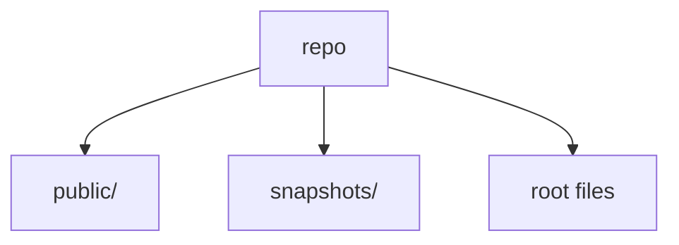
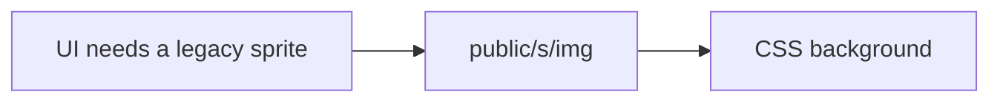

# Assets, Snapshots and Root Files

**¶1** □ GENERATED. `public/` 256 files (original-Rizzoma sprites and images under `public/s/`), `snapshots/` 139 files, 69 root files.

## Structure (`Continuant` — `graph TD`)

## How to use it (`Occurrent` — `graph LR`)

## public/ by folder

| Folder | Files |
|---|---:|
| `public` | 4 |
| `public/gadgets/apps` | 3 |
| `public/gadgets/apps/calendar-planner` | 2 |
| `public/gadgets/apps/focus-timer` | 2 |
| `public/gadgets/apps/kanban-board` | 2 |
| `public/gadgets/apps/notes-scratchpad` | 2 |
| `public/icons` | 9 |
| `public/landing` | 6 |
| `public/s/img` | 136 |
| `public/s/img/auth` | 15 |
| `public/s/img/gdrive` | 33 |
| `public/s/img/introduce` | 6 |
| `public/s/img/jquery-lightbox` | 5 |
| `public/s/img/logo` | 14 |
| `public/s/img/mail` | 5 |
| `public/s/img/mail/first-visit` | 9 |
| `public/s/img/user` | 3 |

## snapshots/ by folder

| Folder | Files | Description |
|---|---:|---|
| `snapshots/blb` | 72 | — |
| `snapshots/follow-the-green` | 19 | — |
| `snapshots/inline-comments` | 1 | — |
| `snapshots/perf` | 32 | — |
| `snapshots/presence` | 1 | — |
| `snapshots/toolbar-inline` | 13 | — |
| `snapshots/uploads` | 1 | — |

## Root files

| File | First fact |
|---|---|
| `.editorconfig` | — |
| `.eslintrc.json` | — |
| `.gitattributes` | — |
| `.gitignore` | — |
| `.prettierrc.json` | — |
| `.server.pid` | — |
| `2025-11-06T00_20_48_285Z-debug-0.log` | — |
| `AGENTS.md` | — |
| `AGENTS.md.bak` | — |
| `CHANGELOG.md` | — |
| `CLAUDE.md` | — |
| `Cakefile` | — |
| `Dockerfile` | — |
| `Dockerfile.bak` | — |
| `GEMINI.md` | — |
| `LICENSE` | — |
| `MODERNIZATION_STRATEGY.md.bak` | — |
| `QUICKSTART.md` | — |
| `README_MODERNIZATION.md.bak` | — |
| `RIZZOMA_FEATURES_STATUS.md` | — |
| `STATUS.md` | — |
| `aggregate_stats.py` | — |
| `app.js` | coffee-script wrapper |
| `capacitor.config.ts` | Capacitor configuration for the Rizzoma native wrappers |
| `create-demo-topic.cjs` | Create a topic |
| `docker-compose.yml` | — |
| `jest.config.cjs` | — |
| `npm-error.log` | — |
| `open-browser-test.sh` | — |
| `open-test-browser.sh` | — |
| `package-lock.json` | — |
| `package.json` | — |
| `package.json.backup` | — |
| `perf-harness.mjs` | — |
| `rizzoma.html` | — |
| `test-blb-snapshots.mjs` | — |
| `test-blip-body-text-smoke.mjs` | Computed-style smoke: every piece of blip BODY text has the same size, line-height and |
| `test-click-caret-smoke.mjs` | Regression smoke: a click into the MIDDLE of a view-state blip puts the caret at the clicked place, |
| `test-clipboard-paste-smoke.mjs` | Copy / Cut on one blip, Paste on ANOTHER blip (real clicks on the gear menu, what the person sees). |
| `test-collab-smoke.mjs` | Real-time collab smoke test (Playwright, two browser contexts). |
| `test-collapse-control-smoke.mjs` | The [-] control of an expanded blip must be reachable: a real click (desktop 1366 x 900) and a real tap (phone 390 x 844) |
| `test-done-flush-smoke.mjs` | Done right after typing must not lose the text (real keys, real clicks, what the person SEES after a reload). |
| `test-edit-meta-smoke.mjs` | Copy / Cut on one blip, Paste on ANOTHER blip (real clicks on the gear menu, what the person sees). |
| `test-editor.html` | Set feature flags before module loading |
| `test-embed-console-smoke.mjs` | An embedded frame (iFrame gadget) must read back without console errors (real clicks, real keys, reload, read view). |
| `test-features.html` | — |
| `test-follow-green-smoke.mjs` | — |
| `test-gadget-apps-smoke.mjs` | Real insert-and-render smoke for the four sandboxed gadget apps |
| `test-gadgets-render-smoke.mjs` | Regression smoke: gadgets must RENDER, not merely be stored. Inserts Code, Poll, LaTeX, YouTube, Sheet and Image |
| `test-liliia-smoke.mjs` | Regression smoke for two defects in Liliia's 19 Nov 2026 review, judged as a NON-OWNER in a clean context: |
| `test-native-ctrl-enter-smoke.mjs` | Native render path (?render=native) regression smoke for the 18 Nov 2026 tester feedback: |
| `test-nested-pointer-focus-smoke.mjs` | Regression smoke: clicking into an OPEN nested blip puts the caret in THAT blip, not in an ancestor. |
| `test-phone-layout-smoke.mjs` | Phone layout smoke (390 x 844, 360 x 740, 430 x 932 with REAL touch taps) and the desktop guard. |
| `test-playwright-features.js` | Take screenshot of test editor |
| `test-rizzoma-simple.mjs` | Launch browser in headed mode so you can watch |
| `test-rizzoma.mjs` | Create a test script that playwright can run |
| `test-select-all-edit-smoke.mjs` | Editing over a selection: Ctrl+A then type, Backspace, Delete and paste over a selection (real key presses, real clipboard). |
| `test-standalone-editor.html` | Set feature flags before any imports |
| `test-tester-feedback-smoke.mjs` | Regression smoke for the 18 Nov 2026 tester feedback (Liliia): editing sub-blips, a |
| `test-toolbar-inline-smoke.mjs` | — |
| `test-topic-readmode-seed-smoke.mjs` | Read-mode topic seed smoke (Playwright). |
| `test-topics-filter-smoke.mjs` | Topics list filter: All, Inbox and By me narrow the list (real clicks on the dropdown, what the person sees). |
| `test-upload-signature-smoke.mjs` | Image upload through the blip toolbar: a real PNG shows as a picture, a text file that only CLAIMS to be a PNG must be refused |
| `tsconfig.json` | — |
| `tsconfig.json.bak` | — |
| `tsconfig.server.json` | — |
| `verify-features.sh` | Check if server is running |
| `vite.config.ts` | Pass feature flags to the browser bundle. Production builds default to |
| `vitest.config.ts` | — |
