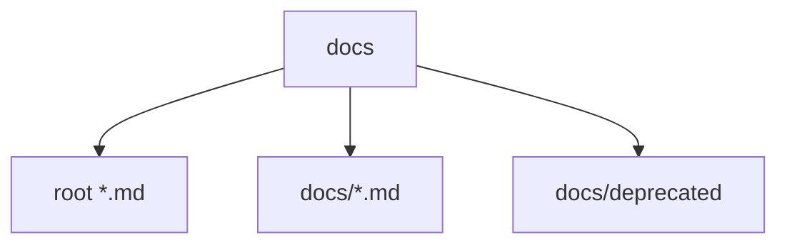
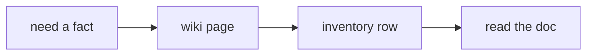

# Documentation Inventory

**¶1** □ GENERATED. 68 markdown files. Title is the first heading; Status is the first status/updated/verified line in the first 25 lines, if any. Authority notes are in [the doc catalog](../reference-doc-catalog.md); `docs/deprecated/` is NOT authoritative.

## Structure (`Continuant` — `graph TD`)

## How to use it (`Occurrent` — `graph LR`)

| Doc | Title | Status line |
|---|---|---|
| [`AGENTS.md`](../../AGENTS.md) |  | Read `STATUS .md` (generated) for current state and **`wiki ⁄ index.md`** (`wiki ⁄ SCHEMA.md`) for the compounding LLM Wiki, BFO subsystem diagrams, and `~/.lo… |
| [`CHANGELOG.md`](../../CHANGELOG.md) | Changelog |  |
| [`CLAUDE.md`](../../CLAUDE.md) | CLAUDE .md — Rizzoma (entry point) | \| Current state (branch, deployment, gates, open failures) \| **`STATUS .md`** — GENERATED (`node scripts ⁄ gen_status.mjs`); never hand-write status \| |
| [`GEMINI.md`](../../GEMINI.md) | GEMINI.md – Rizzoma | 4. Current state: `STATUS .md` (generated, never edit). |
| [`QUICKSTART.md`](../../QUICKSTART.md) | QUICKSTART | Live/staging topology (nohup tsx + vite behind nginx) is in **`STATUS .md`**. |
| [`RIZZOMA_FEATURES_STATUS.md`](../../RIZZOMA_FEATURES_STATUS.md) | 🚀 Rizzoma Core Features Implementation Status | Do not cite it as status** — status is generated into `STATUS .md`. |
| [`STATUS.md`](../../STATUS.md) | STATUS — Rizzoma (GENERATED, do not hand-edit) | STATUS — Rizzoma (GENERATED, do not hand-edit) |
| [`docs/ARCHITECTURE.md`](../../docs/ARCHITECTURE.md) | Architecture | Status:** AUTHORITATIVE. Supersedes `deprecated ⁄ ARCHITECTURE.md`, |
| [`docs/BLB.md`](../../docs/BLB.md) | BLB — the Bullet-Label-Blip specification | Status:** AUTHORITATIVE. Supersedes `deprecated ⁄ BLB_LOGIC_AND_PHILOSOPHY.md`, |
| [`docs/EDITOR_TOOLBAR_PARITY.md`](../../docs/EDITOR_TOOLBAR_PARITY.md) | Toolbar Parity Tracker | \| Element \| Function \| Modern Status \| |
| [`docs/GITHUB_DOCUMENTATION_SPINE.md`](../../docs/GITHUB_DOCUMENTATION_SPINE.md) | GitHub Documentation Spine and Rizzoma Synchronization | Status: proposed architecture; the first human-facing design is published and verified, but the synchronizer and cross-project repository have not been impleme… |
| [`docs/NATIVE_RENDER_PORT_PLAN.md`](../../docs/NATIVE_RENDER_PORT_PLAN.md) | Native fractal-render port: detailed plan |  |
| [`docs/ORIGINAL_FRACTAL_LOGIC_AND_WHY_OURS_DOESNT_MATCH.md`](../../docs/ORIGINAL_FRACTAL_LOGIC_AND_WHY_OURS_DOESNT_MATCH.md) | Original Rizzoma's fractal blip-nesting logic — and why our React/TipTap hybrid keeps cra… |  |
| [`docs/RIZZOMA_KARPATHY_LLM_WIKI.md`](../../docs/RIZZOMA_KARPATHY_LLM_WIKI.md) | Rizzoma Complete Architectural & Behavioral LLM-Wiki | Status: CANONICAL REFERENCE & UNIVERSAL GROUNDING WIKI |
| [`docs/RIZZOMA_RESUMABLE_PROJECTION_LEDGER.blb.md`](../../docs/RIZZOMA_RESUMABLE_PROJECTION_LEDGER.blb.md) |  |  |
| [`docs/RIZZOMA_RESUMABLE_PROJECTION_LEDGER.md`](../../docs/RIZZOMA_RESUMABLE_PROJECTION_LEDGER.md) | Resumable Projection Ledger | Status: implementation proposal |
| [`docs/RIZZOMA_RESUMABLE_PROJECTION_LEDGER.shell.blb.md`](../../docs/RIZZOMA_RESUMABLE_PROJECTION_LEDGER.shell.blb.md) |  |  |
| [`docs/VISUAL_SCREENSHOT_SWEEP.md`](../../docs/VISUAL_SCREENSHOT_SWEEP.md) | Visual Screenshot Sweep | `npm run parity:gate` runs scripts ⁄ check-rizzoma-parity-gate.mjs. It blocks if today's UI/sweep/status work lacks any of the following: |
| [`docs/VPS_DEPLOYMENT.md`](../../docs/VPS_DEPLOYMENT.md) | VPS Deployment — Rizzoma on 138.201.62.161 | Last updated**: 2026-07-14 00:40 CEST (public checkout includes parity gate/audit evidence checkpoint `ac6a6f9d` plus status-doc sync commits) |
| [`docs/deprecated/ARCHITECTURE.md`](../../docs/deprecated/ARCHITECTURE.md) | Rizzoma Architecture & Configuration Reference |  |
| [`docs/deprecated/BLB_LOGIC_AND_PHILOSOPHY.md`](../../docs/deprecated/BLB_LOGIC_AND_PHILOSOPHY.md) | Rizzoma BLB Logic & Philosophy |  |
| [`docs/deprecated/BLB_PARITY_CHECKLIST.md`](../../docs/deprecated/BLB_PARITY_CHECKLIST.md) | BLB Parity Checklist (Legacy vs Modern) |  |
| [`docs/deprecated/CLAUDE_SESSION.md`](../../docs/deprecated/CLAUDE_SESSION.md) | Claude Session Context (2026-05-12) |  |
| [`docs/deprecated/DEPENDENCY_UPGRADE_AUDIT.md`](../../docs/deprecated/DEPENDENCY_UPGRADE_AUDIT.md) | Dependency Upgrade Audit (feature/rizzoma-core-features) |  |
| [`docs/deprecated/EDITOR.md`](../../docs/deprecated/EDITOR.md) | Editor (TipTap + Yjs) | Status: Milestone B+ (IN PROGRESS). Feature‑flagged; safe to keep merged. |
| [`docs/deprecated/EDITOR_REALTIME.md`](../../docs/deprecated/EDITOR_REALTIME.md) | Editor Realtime — Summary |  |
| [`docs/deprecated/HANDOFF.md`](../../docs/deprecated/HANDOFF.md) |  | Last Updated: 2026-07-14 (parity gate/audit checkpoint synced everywhere · VPS includes ac6a6f9d plus status-doc sync) |
| [`docs/deprecated/INLINE_COMMENTS_VS_REPLIES.md`](../../docs/deprecated/INLINE_COMMENTS_VS_REPLIES.md) | STALE TERMINOLOGY WARNING |  |
| [`docs/deprecated/LEGACY_ASSETS_AUDIT.md`](../../docs/deprecated/LEGACY_ASSETS_AUDIT.md) | Legacy Assets Audit (Reference vs Active) |  |
| [`docs/deprecated/MANUAL_TEST_CHECKLIST.md`](../../docs/deprecated/MANUAL_TEST_CHECKLIST.md) | 🧪 Rizzoma Manual Testing Checklist |  |
| [`docs/deprecated/MODERNIZATION_COMPLETE.md`](../../docs/deprecated/MODERNIZATION_COMPLETE.md) | Rizzoma Modernization - Complete | Status:** Complete |
| [`docs/deprecated/MODERNIZATION_STRATEGY.md`](../../docs/deprecated/MODERNIZATION_STRATEGY.md) | Rizzoma Modernization Strategy | Historical planning doc**: The phase timelines below are historical. For the active branch, use `docs ⁄ HANDOFF.md`, `docs ⁄ RESTART.md`, and `RIZZOMA_FEATURES… |
| [`docs/deprecated/NATIVE_PORT_PM.md`](../../docs/deprecated/NATIVE_PORT_PM.md) | 🚀 Native Fractal-Render Port — Live Project Tracker | Source of truth**: this file. Updated after every commit on `feature/native-fractal-port`. |
| [`docs/deprecated/NATIVE_RENDER_ARCHITECTURE.md`](../../docs/deprecated/NATIVE_RENDER_ARCHITECTURE.md) | Native fractal-render — architecture | Status (2026-05-06)**: Phases 0-4 done, Phase 5 6/11 done + 1 WIP + 5 deferred. The native render path is opt-in via `?render=native` URL flag and the `FEAT_RI… |
| [`docs/deprecated/PARALLEL_DEVELOPMENT_PLAN.md`](../../docs/deprecated/PARALLEL_DEVELOPMENT_PLAN.md) | 🚀 Parallel Development Plan for Rizzoma Features |  |
| [`docs/deprecated/README.md`](../../docs/deprecated/README.md) | Deprecated documentation — nothing here is authoritative | \| **Current state** (branch, deployment, gate results, open failures) \| `../.. ⁄ STATUS .md` — **GENERATED**; regenerate with `node scripts ⁄ gen_status.mjs`… |
| [`docs/deprecated/README_MODERNIZATION.md`](../../docs/deprecated/README_MODERNIZATION.md) | Rizzoma Modernization Guide | For live project status and the restart checklist, see `docs ⁄ HANDOFF.md` and `docs ⁄ RESTART.md`. |
| [`docs/deprecated/RESTART.md`](../../docs/deprecated/RESTART.md) |  | Active branch (this session arc): `feature/native-fractal-port` (sibling of `feature/rizzoma-core-features`). Always cite branch + date when sharing status. |
| [`docs/deprecated/RESTORE_POINT.md`](../../docs/deprecated/RESTORE_POINT.md) | RESTORE POINT |  |
| [`docs/deprecated/RIZZOMA_COMPARISON.md`](../../docs/deprecated/RIZZOMA_COMPARISON.md) | Rizzoma: Original vs Modern - Exhaustive Comparison | Status:** Modernization Complete |
| [`docs/deprecated/RIZZOMA_FULL_COMPARISON.md`](../../docs/deprecated/RIZZOMA_FULL_COMPARISON.md) | Rizzoma Complete Feature Comparison: Original vs Modern |  |
| [`docs/deprecated/TECH_STACK_OLD_VS_NEW.md`](../../docs/deprecated/TECH_STACK_OLD_VS_NEW.md) | Old vs New Tech Stack |  |
| [`docs/deprecated/TESTING_GUIDE.md`](../../docs/deprecated/TESTING_GUIDE.md) | 🧪 Testing Rizzoma Core Features |  |
| [`docs/deprecated/TESTING_STATUS.md`](../../docs/deprecated/TESTING_STATUS.md) | Rizzoma Feature Testing Status | Rizzoma Feature Testing Status |
| [`docs/deprecated/TOPIC_RENDER_UNIFICATION.md`](../../docs/deprecated/TOPIC_RENDER_UNIFICATION.md) | Topic Render Unification Plan | Status |
| [`docs/deprecated/arch-old-vs-new.md`](../../docs/deprecated/arch-old-vs-new.md) | Rizzoma: Legacy (CoffeeScript) vs Modern (React/Vite) Architecture (2025-12 snapshot on f… |  |
| [`docs/deprecated/rizzoma_fresh_setup_guide.md`](../../docs/deprecated/rizzoma_fresh_setup_guide.md) | Rizzoma Fresh Setup Guide |  |
| [`docs/deprecated/rizzoma_setup_guide.md`](../../docs/deprecated/rizzoma_setup_guide.md) | Rizzoma Setup Guide |  |
| [`docs/deprecated/skills-fork/how_to_post_rizzoma.md`](../../docs/deprecated/skills-fork/how_to_post_rizzoma.md) | Skill: How to Post on Rizzoma |  |
| [`docs/deprecated/skills-fork/how_to_read_rizzoma.md`](../../docs/deprecated/skills-fork/how_to_read_rizzoma.md) | Skill: How to Read Rizzoma Topics |  |
| [`docs/worklog-251208.md`](../../docs/worklog-251208.md) | Worklog — 2025-12-08 (feature/rizzoma-core-features) | Checked worktree status (`git status -sb`): very dirty across docs/config/server/client/tests; README .md deleted; new scripts, shared d.ts/js outputs, `src/se… |
| [`docs/worklog-260202.md`](../../docs/worklog-260202.md) | Worklog 260202 | Updated `client.collapsePreferences` test expectation to match default false. |
| [`docs/worklog-260203.md`](../../docs/worklog-260203.md) | Worklog 2026-02-03 | Updated HANDOFF/RESTORE_POINT/CHANGELOG to reflect the new operational rule. |
| [`docs/worklog-260204.md`](../../docs/worklog-260204.md) | Worklog 2026-02-04 | Updated `CHANGELOG.md` for the toolbar visibility fix and snapshot refresh. |
| [`docs/worklog-260424.md`](../../docs/worklog-260424.md) | Worklog 260424 | Updated perf metrics to record `renderProfile` and `perfMode`. |
| [`docs/worklog-260425.md`](../../docs/worklog-260425.md) | Worklog 260425 | Updated Markdown/status references and perf metric metadata that pointed to renamed screenshot folders. |
| [`docs/worklog-260502.md`](../../docs/worklog-260502.md) | Worklog 260502 |  |
| [`docs/worklog-260504.md`](../../docs/worklog-260504.md) | Worklog 2026-05-04 — Hryhorii test feedback fixes (4 issues, all verified live) |  |
| [`docs/worklog-260510.md`](../../docs/worklog-260510.md) | Worklog — 2026-05-07..10 (Native fractal-port session) | \| Bug \| Status \| Wallclock \| Commit(s) \| |
| [`docs/worklog-260511.md`](../../docs/worklog-260511.md) | Worklog — 2026-05-11 (Bug C closure + 44/44 sweep + Task #191 investigation) |  |
| [`docs/worklog-260512.md`](../../docs/worklog-260512.md) | Worklog — 2026-05-12 (Coverage lift to 97% + CouchDB participants index + autosave fix on… |  |
| [`docs/worklog-260518.md`](../../docs/worklog-260518.md) | Worklog 2026-05-18 — Claude's Rizzoma training topic (live rizzoma.com) | HONEST status of Progress (a regression I caused, then partially recovered) |
| [`docs/worklog-260612.md`](../../docs/worklog-260612.md) | Worklog 2026-06-12 — Fishman topic skeleton and Rizzoma skill extension |  |
| [`docs/worklog-260713.md`](../../docs/worklog-260713.md) | Worklog — 2026-07-13 | updated `src/tests ⁄ routes.waves.prev.test.ts` for the direct CouchDB `_find` path and fixed the empty-order `/prev` edge case |
| [`docs/worklog-260714.md`](../../docs/worklog-260714.md) | Worklog — 2026-07-14 | Status/doc/VPS sync after parity-gate checkpoint |
| [`docs/worklog-261107.md`](../../docs/worklog-261107.md) | Worklog: 2026-11-07 — Playback, Ctrl+Enter, Visual Parity & Canonical Karpathy LLM-Wiki |  |
| [`docs/worklog-261108.md`](../../docs/worklog-261108.md) | Worklog — 2026-11-08 (Structural Parity & Visual Regression Elimination) |  |
| [`public/s/img/gdrive/README.md`](../../public/s/img/gdrive/README.md) |  |  |
