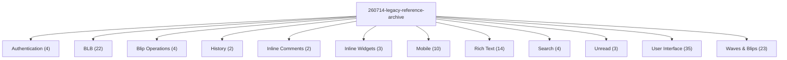

# Legacy Rizzoma Reference Screenshots

**¶1** □ The original Rizzoma's look and behaviour is documented in `screenshots/260714-legacy-reference-archive/`: **126 PNG screenshots** captured from the live original rizzoma.com, each with a description file next to it (`<name>.md`: title, section, capture date, what it shows). 126 of 126 images have a description file. **Open the image and its `.md` before changing the layout or interaction of anything.** This wiki page does NOT copy the descriptions; they live with the images.

**¶2** □ Existing index: [`ARCHIVE_MANIFEST.md`](../../screenshots/260714-legacy-reference-archive/ARCHIVE_MANIFEST.md) lists 57 images by section, but its header says "Captured: 56", so 69 of the 126 images are NOT in it (e.g. 200-crop-left-rail-full.png, 201-crop-new-topic-btn.png, 202-crop-mentions-tab-badge.png, 203-crop-tasks-tab-pro.png). Use the section list below or `ls` the folder for the full set; each image name starts with a 3-digit number.

**¶3** □ Related references: other original-vs-ours material is listed in [screenshot folders](screenshot-folders-catalog.md); how the pixel comparison is done is in [legacy visual parity](../subsystems/legacy-visual-parity.md); `docs/BLB.md` and `docs/VISUAL_SCREENSHOT_SWEEP.md` already cite this archive.

## Structure (`Continuant` — `graph TD`)

## How to use it (`Occurrent` — `graph LR`)

## Sections in the archive (count of images)

| Section | Images |
|---|---:|
| User Interface | 35 |
| Waves & Blips | 23 |
| BLB | 22 |
| Rich Text | 14 |
| Mobile | 10 |
| Authentication | 4 |
| Search | 4 |
| Blip Operations | 4 |
| Inline Widgets | 3 |
| Unread | 3 |
| Inline Comments | 2 |
| History | 2 |

## Every image, by section (file names only; the description is in the `.md` beside each)

**Authentication** (4): [001-landing-logged-out](../../screenshots/260714-legacy-reference-archive/001-landing-logged-out.png) · [002-signin-form](../../screenshots/260714-legacy-reference-archive/002-signin-form.png) · [003-signup-form](../../screenshots/260714-legacy-reference-archive/003-signup-form.png) · [004-anon-wall-private-topic](../../screenshots/260714-legacy-reference-archive/004-anon-wall-private-topic.png)

**BLB** (22): [051-fractal-unfold-level-1](../../screenshots/260714-legacy-reference-archive/051-fractal-unfold-level-1.png) · [052-fractal-unfold-level-2](../../screenshots/260714-legacy-reference-archive/052-fractal-unfold-level-2.png) · [053-fractal-unfold-level-3](../../screenshots/260714-legacy-reference-archive/053-fractal-unfold-level-3.png) · [054-fractal-unfold-level-4](../../screenshots/260714-legacy-reference-archive/054-fractal-unfold-level-4.png) · [055-fractal-unfold-level-5](../../screenshots/260714-legacy-reference-archive/055-fractal-unfold-level-5.png) · [056-fractal-unfold-level-6](../../screenshots/260714-legacy-reference-archive/056-fractal-unfold-level-6.png) · [057-fractal-unfold-level-7](../../screenshots/260714-legacy-reference-archive/057-fractal-unfold-level-7.png) · [058-fractal-unfold-level-8](../../screenshots/260714-legacy-reference-archive/058-fractal-unfold-level-8.png) · [059-fractal-refolded](../../screenshots/260714-legacy-reference-archive/059-fractal-refolded.png) · [220-crop-blb-bullet-with-plus](../../screenshots/260714-legacy-reference-archive/220-crop-blb-bullet-with-plus.png) · [221-crop-fold-button](../../screenshots/260714-legacy-reference-archive/221-crop-fold-button.png) · [225-crop-expanded-inline-thread](../../screenshots/260714-legacy-reference-archive/225-crop-expanded-inline-thread.png) · [226-crop-unfold-minus](../../screenshots/260714-legacy-reference-archive/226-crop-unfold-minus.png) · [2801-topic-0-unfold-1](../../screenshots/260714-legacy-reference-archive/2801-topic-0-unfold-1.png) · [2802-topic-0-unfold-2](../../screenshots/260714-legacy-reference-archive/2802-topic-0-unfold-2.png) · [2811-topic-1-unfold-1](../../screenshots/260714-legacy-reference-archive/2811-topic-1-unfold-1.png) · [2812-topic-1-unfold-2](../../screenshots/260714-legacy-reference-archive/2812-topic-1-unfold-2.png) · [2821-topic-2-unfold-1](../../screenshots/260714-legacy-reference-archive/2821-topic-2-unfold-1.png) · [2822-topic-2-unfold-2](../../screenshots/260714-legacy-reference-archive/2822-topic-2-unfold-2.png) · [2832-topic-3-unfold-2](../../screenshots/260714-legacy-reference-archive/2832-topic-3-unfold-2.png) · [311-w1280-fractal-open](../../screenshots/260714-legacy-reference-archive/311-w1280-fractal-open.png) · [322-sandbox-unfold-9](../../screenshots/260714-legacy-reference-archive/322-sandbox-unfold-9.png)

**Blip Operations** (4): [060-blip-activated-menu](../../screenshots/260714-legacy-reference-archive/060-blip-activated-menu.png) · [061-blip-gear-menu](../../screenshots/260714-legacy-reference-archive/061-blip-gear-menu.png) · [062-gear-closed](../../screenshots/260714-legacy-reference-archive/062-gear-closed.png) · [209-crop-blip-menu-bar](../../screenshots/260714-legacy-reference-archive/209-crop-blip-menu-bar.png)

**History** (2): [069-playback-ui](../../screenshots/260714-legacy-reference-archive/069-playback-ui.png) · [070-playback-closed](../../screenshots/260714-legacy-reference-archive/070-playback-closed.png)

**Inline Comments** (2): [041-hide-all-comments](../../screenshots/260714-legacy-reference-archive/041-hide-all-comments.png) · [042-show-all-comments](../../screenshots/260714-legacy-reference-archive/042-show-all-comments.png)

**Inline Widgets** (3): [017-nav-store](../../screenshots/260714-legacy-reference-archive/017-nav-store.png) · [082-store-catalog](../../screenshots/260714-legacy-reference-archive/082-store-catalog.png) · [324-store-scrolled](../../screenshots/260714-legacy-reference-archive/324-store-scrolled.png)

**Mobile** (10): [090-mobile-topics-list](../../screenshots/260714-legacy-reference-archive/090-mobile-topics-list.png) · [091-mobile-topic-view](../../screenshots/260714-legacy-reference-archive/091-mobile-topic-view.png) · [092-mobile-topic-scrolled](../../screenshots/260714-legacy-reference-archive/092-mobile-topic-scrolled.png) · [093-mobile-fractal-expanded](../../screenshots/260714-legacy-reference-archive/093-mobile-fractal-expanded.png) · [300-mobile-nav-mentions](../../screenshots/260714-legacy-reference-archive/300-mobile-nav-mentions.png) · [301-mobile-nav-tasks](../../screenshots/260714-legacy-reference-archive/301-mobile-nav-tasks.png) · [302-mobile-nav-publics](../../screenshots/260714-legacy-reference-archive/302-mobile-nav-publics.png) · [303-mobile-search](../../screenshots/260714-legacy-reference-archive/303-mobile-search.png) · [304-mobile-mindmap](../../screenshots/260714-legacy-reference-archive/304-mobile-mindmap.png) · [305-mobile-share-modal](../../screenshots/260714-legacy-reference-archive/305-mobile-share-modal.png)

**Rich Text** (14): [063-root-edit-mode-ribbon](../../screenshots/260714-legacy-reference-archive/063-root-edit-mode-ribbon.png) · [064-edit-link-popup](../../screenshots/260714-legacy-reference-archive/064-edit-link-popup.png) · [065-link-popup-closed](../../screenshots/260714-legacy-reference-archive/065-link-popup-closed.png) · [066-edit-done-back-to-view](../../screenshots/260714-legacy-reference-archive/066-edit-done-back-to-view.png) · [230-crop-ribbon-full](../../screenshots/260714-legacy-reference-archive/230-crop-ribbon-full.png) · [231-crop-ribbon-bold-group](../../screenshots/260714-legacy-reference-archive/231-crop-ribbon-bold-group.png) · [232-crop-ribbon-lists](../../screenshots/260714-legacy-reference-archive/232-crop-ribbon-lists.png) · [233-crop-ribbon-link-btn](../../screenshots/260714-legacy-reference-archive/233-crop-ribbon-link-btn.png) · [234-edit-size-dropdown](../../screenshots/260714-legacy-reference-archive/234-edit-size-dropdown.png) · [235-edit-format-dropdown](../../screenshots/260714-legacy-reference-archive/235-edit-format-dropdown.png) · [236-edit-bg-palette](../../screenshots/260714-legacy-reference-archive/236-edit-bg-palette.png) · [237-edit-color-palette](../../screenshots/260714-legacy-reference-archive/237-edit-color-palette.png) · [238-edit-gadget-picker](../../screenshots/260714-legacy-reference-archive/238-edit-gadget-picker.png) · [274-crop-ribbon-mention-task](../../screenshots/260714-legacy-reference-archive/274-crop-ribbon-mention-task.png)

**Search** (4): [011-topics-search-typed](../../screenshots/260714-legacy-reference-archive/011-topics-search-typed.png) · [012-topics-search-results](../../screenshots/260714-legacy-reference-archive/012-topics-search-results.png) · [013-topics-search-cleared](../../screenshots/260714-legacy-reference-archive/013-topics-search-cleared.png) · [204-crop-search-box](../../screenshots/260714-legacy-reference-archive/204-crop-search-box.png)

**Unread** (3): [202-crop-mentions-tab-badge](../../screenshots/260714-legacy-reference-archive/202-crop-mentions-tab-badge.png) · [210-crop-next-topic-btn](../../screenshots/260714-legacy-reference-archive/210-crop-next-topic-btn.png) · [270-crop-unread-badge](../../screenshots/260714-legacy-reference-archive/270-crop-unread-badge.png)

**User Interface** (35): [010-topics-list-default](../../screenshots/260714-legacy-reference-archive/010-topics-list-default.png) · [014-nav-mentions](../../screenshots/260714-legacy-reference-archive/014-nav-mentions.png) · [015-nav-tasks](../../screenshots/260714-legacy-reference-archive/015-nav-tasks.png) · [016-nav-publics](../../screenshots/260714-legacy-reference-archive/016-nav-publics.png) · [018-nav-teams](../../screenshots/260714-legacy-reference-archive/018-nav-teams.png) · [020-settings-menu](../../screenshots/260714-legacy-reference-archive/020-settings-menu.png) · [031-topic-header-bar](../../screenshots/260714-legacy-reference-archive/031-topic-header-bar.png) · [032-share-modal](../../screenshots/260714-legacy-reference-archive/032-share-modal.png) · [033-share-modal-closed](../../screenshots/260714-legacy-reference-archive/033-share-modal-closed.png) · [034-manage-members](../../screenshots/260714-legacy-reference-archive/034-manage-members.png) · [035-members-closed](../../screenshots/260714-legacy-reference-archive/035-members-closed.png) · [036-text-view](../../screenshots/260714-legacy-reference-archive/036-text-view.png) · [037-mindmap-view](../../screenshots/260714-legacy-reference-archive/037-mindmap-view.png) · [038-mindmap-short](../../screenshots/260714-legacy-reference-archive/038-mindmap-short.png) · [039-mindmap-expanded](../../screenshots/260714-legacy-reference-archive/039-mindmap-expanded.png) · [040-back-to-text-view](../../screenshots/260714-legacy-reference-archive/040-back-to-text-view.png) · [068-insert-reply-sidebar](../../screenshots/260714-legacy-reference-archive/068-insert-reply-sidebar.png) · [080-publics-list](../../screenshots/260714-legacy-reference-archive/080-publics-list.png) · [100-w1280-topics-list](../../screenshots/260714-legacy-reference-archive/100-w1280-topics-list.png) · [101-w1280-topic-view](../../screenshots/260714-legacy-reference-archive/101-w1280-topic-view.png) · [200-crop-left-rail-full](../../screenshots/260714-legacy-reference-archive/200-crop-left-rail-full.png) · [203-crop-tasks-tab-pro](../../screenshots/260714-legacy-reference-archive/203-crop-tasks-tab-pro.png) · [206-crop-shortcut-legend](../../screenshots/260714-legacy-reference-archive/206-crop-shortcut-legend.png) · [207-crop-topic-header](../../screenshots/260714-legacy-reference-archive/207-crop-topic-header.png) · [208-crop-share-btn](../../screenshots/260714-legacy-reference-archive/208-crop-share-btn.png) · [211-crop-text-mindmap-toggle](../../screenshots/260714-legacy-reference-archive/211-crop-text-mindmap-toggle.png) · [260-mindmap-real-topic](../../screenshots/260714-legacy-reference-archive/260-mindmap-real-topic.png) · [261-mindmap-real-topic-short](../../screenshots/260714-legacy-reference-archive/261-mindmap-real-topic-short.png) · [262-text-view-real-topic](../../screenshots/260714-legacy-reference-archive/262-text-view-real-topic.png) · [272-settings-open-menu](../../screenshots/260714-legacy-reference-archive/272-settings-open-menu.png) · [273-settings-first-page](../../screenshots/260714-legacy-reference-archive/273-settings-first-page.png) · [290-help-overlay](../../screenshots/260714-legacy-reference-archive/290-help-overlay.png) · [310-w1280-mindmap](../../screenshots/260714-legacy-reference-archive/310-w1280-mindmap.png) · [312-w1280-mentions](../../screenshots/260714-legacy-reference-archive/312-w1280-mentions.png) · [323-topics-list-scrolled](../../screenshots/260714-legacy-reference-archive/323-topics-list-scrolled.png)

**Waves & Blips** (23): [019-new-topic-button](../../screenshots/260714-legacy-reference-archive/019-new-topic-button.png) · [030-topic-view-default](../../screenshots/260714-legacy-reference-archive/030-topic-view-default.png) · [067-reply-box](../../screenshots/260714-legacy-reference-archive/067-reply-box.png) · [081-public-topic-view](../../screenshots/260714-legacy-reference-archive/081-public-topic-view.png) · [201-crop-new-topic-btn](../../screenshots/260714-legacy-reference-archive/201-crop-new-topic-btn.png) · [205-crop-topic-row](../../screenshots/260714-legacy-reference-archive/205-crop-topic-row.png) · [222-crop-root-blip-body](../../screenshots/260714-legacy-reference-archive/222-crop-root-blip-body.png) · [223-crop-reply-box](../../screenshots/260714-legacy-reference-archive/223-crop-reply-box.png) · [224-crop-blip-avatar-date](../../screenshots/260714-legacy-reference-archive/224-crop-blip-avatar-date.png) · [240-topic-content-0-russian-red-lines-2026-r](../../screenshots/260714-legacy-reference-archive/240-topic-content-0-russian-red-lines-2026-r.png) · [241-topic-content-1-maneuver-position-dialec](../../screenshots/260714-legacy-reference-archive/241-topic-content-1-maneuver-position-dialec.png) · [242-topic-content-2-htu-hth-stratbase-hcss-s](../../screenshots/260714-legacy-reference-archive/242-topic-content-2-htu-hth-stratbase-hcss-s.png) · [243-topic-content-3-cossackdom-oneliner-back](../../screenshots/260714-legacy-reference-archive/243-topic-content-3-cossackdom-oneliner-back.png) · [244-topic-content-4-hcss-team-ukraine-hcsshr](../../screenshots/260714-legacy-reference-archive/244-topic-content-4-hcss-team-ukraine-hcsshr.png) · [245-topic-content-5-geomics-hcss-stratbase-g](../../screenshots/260714-legacy-reference-archive/245-topic-content-5-geomics-hcss-stratbase-g.png) · [246-topic-content-6-claude-s-rizzoma-trainin](../../screenshots/260714-legacy-reference-archive/246-topic-content-6-claude-s-rizzoma-trainin.png) · [247-topic-content-7-liliia-hudziuk-hcss-one-](../../screenshots/260714-legacy-reference-archive/247-topic-content-7-liliia-hudziuk-hcss-one-.png) · [248-topic-content-8--](../../screenshots/260714-legacy-reference-archive/248-topic-content-8--.png) · [249-topic-content-9-russian-ukrainian-war-co](../../screenshots/260714-legacy-reference-archive/249-topic-content-9-russian-ukrainian-war-co.png) · [250-topic-content-10-virtual-machinery-hcss-r](../../screenshots/260714-legacy-reference-archive/250-topic-content-10-virtual-machinery-hcss-r.png) · [251-topic-content-11-htu-licenses-creds-passw](../../screenshots/260714-legacy-reference-archive/251-topic-content-11-htu-licenses-creds-passw.png) · [320-public-topic-2](../../screenshots/260714-legacy-reference-archive/320-public-topic-2.png) · [321-public-topic-3](../../screenshots/260714-legacy-reference-archive/321-public-topic-3.png)

