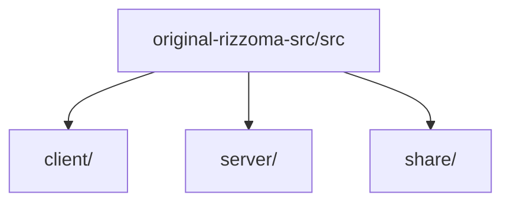

# Original Rizzoma Source Map

**¶1** □ GENERATED from the file system, because `original-rizzoma-src/` is git-ignored and exists only in local checkouts. It is the 2013-era CoffeeScript original that the modern app ports; it is the ground truth for behaviour questions. Each file appears once with its length and first comment. The modern counterparts are in [source map](source-map.md); how the two compare is in [content array vs React hybrid](../architecture/content-array-vs-react-hybrid.md) and [native render port](../subsystems/native-render-port.md).

## Structure (`Continuant` — `graph TD`)

## How to use it (`Occurrent` — `graph LR`)

## Folders

| Folder | Files |
|---|---:|
| client | 2 |
| client/account_merge | 2 |
| client/account_setup_wizard | 6 |
| client/active_topic_controls | 1 |
| client/analytics | 2 |
| client/auth | 1 |
| client/blip | 29 |
| client/chrome_app_popup | 2 |
| client/collection | 2 |
| client/contact_picker | 2 |
| client/creating_topic_wizard | 2 |
| client/crowd_popup | 2 |
| client/dev | 4 |
| client/editor | 24 |
| client/error_logger | 2 |
| client/export | 3 |
| client/file | 2 |
| client/introduce | 2 |
| client/linkedin_popup | 1 |
| client/market_panel | 3 |
| client/mindmap | 11 |
| client/modules | 17 |
| client/navigation | 5 |
| client/ot | 1 |
| client/playback | 11 |
| client/popup | 4 |
| client/search_panel | 26 |
| client/session | 2 |
| client/tag | 2 |
| client/tips_video | 1 |
| client/user | 4 |
| client/utils | 16 |
| client/wave | 31 |
| client/widget | 5 |
| client_index.coffee | 1 |
| mobile_index.coffee | 1 |
| server | 2 |
| server/app_roles | 22 |
| server/auth | 12 |
| server/blip | 22 |
| server/changes_digest | 1 |
| server/common | 19 |
| server/conf | 2 |
| server/contacts | 6 |
| server/couch_views | 26 |
| server/dev | 4 |
| server/export | 7 |
| server/file | 12 |
| server/gadget | 1 |
| server/gdrive | 1 |
| server/gtag | 4 |
| server/import | 11 |
| server/message | 6 |
| server/messaging | 2 |
| server/notification | 11 |
| server/ot | 13 |
| server/playback | 2 |
| server/ptag | 1 |
| server/search | 14 |
| server/settings | 8 |
| server/sitemap | 1 |
| server/store | 6 |
| server/task | 8 |
| server/team | 5 |
| server/templates | 1 |
| server/test | 2 |
| server/tip_list | 5 |
| server/url_alias | 4 |
| server/user | 14 |
| server/utils | 25 |
| server/wave | 14 |
| settings_index.coffee | 1 |
| share | 11 |
| share/contacts | 1 |
| share/model | 1 |
| share/user | 1 |
| share/utils | 4 |
| static/jquery.autocomplete | 2 |
| static/jquery.calendrical | 1 |
| static/jquery.selectbox | 2 |
| static/js | 92 |
| static/node-date-utils | 2 |
| static/tests | 5 |
| static/zeroclipboard | 1 |
| tests | 1 |
| tests/client | 9 |
| tests/server | 44 |
| tests/share | 8 |

## client (2)

| File | Lines | First comment |
|---|---:|---|
| client/app.coffee | 6 | — |
| client/mobile_app.coffee | 5 | — |

## client/account_merge (2)

| File | Lines | First comment |
|---|---:|---|
| client/account_merge/index.coffee | 179 | — |
| client/account_merge/merge_successful_message.coffee | 34 | — |

## client/account_setup_wizard (6)

| File | Lines | First comment |
|---|---:|---|
| client/account_setup_wizard/account_type_select.coffee | 23 | — |
| client/account_setup_wizard/create_team.coffee | 210 | — |
| client/account_setup_wizard/enterprise_request.coffee | 73 | — |
| client/account_setup_wizard/index.coffee | 63 | — |
| client/account_setup_wizard/processor.coffee | 108 | — |
| client/account_setup_wizard/template.coffee | 153 | — |

## client/active_topic_controls (1)

| File | Lines | First comment |
|---|---:|---|
| client/active_topic_controls/module.coffee | 147 | — |

## client/analytics (2)

| File | Lines | First comment |
|---|---:|---|
| client/analytics/ping.coffee | 120 | — |
| client/analytics/style_for_auto_popup.coffee | 80 | — |

## client/auth (1)

| File | Lines | First comment |
|---|---:|---|
| client/auth/index.coffee | 480 | — |

## client/blip (29)

| File | Lines | First comment |
|---|---:|---|
| client/blip/blip_thread.coffee | 183 | — |
| client/blip/contributors/author.coffee | 37 | — |
| client/blip/contributors/index.coffee | 139 | — |
| client/blip/contributors/template.coffee | 18 | — |
| client/blip/index.coffee | 9 | — |
| client/blip/index_base.coffee | 159 | — |
| client/blip/index_mobile.coffee | 9 | — |
| client/blip/interactor/blip_events.coffee | 142 | — |
| client/blip/interactor/index.coffee | 277 | — |
| client/blip/interactor/key_interactor.coffee | 89 | — |
| client/blip/menu/index.coffee | 481 | — |
| client/blip/menu/mobile.coffee | 52 | — |
| client/blip/menu/range_menu.coffee | 110 | — |
| client/blip/menu/template.coffee | 135 | — |
| client/blip/model.coffee | 118 | — |
| client/blip/processor.coffee | 37 | — |
| client/blip/processor_base.coffee | 174 | — |
| client/blip/processor_mobile.coffee | 14 | — |
| client/blip/recipient/index.coffee | 200 | — |
| client/blip/recipient/template.coffee | 37 | — |
| client/blip/task_recipient/index.coffee | 147 | — |
| client/blip/task_recipient/input.coffee | 176 | — |
| client/blip/task_recipient/popup.coffee | 186 | — |
| client/blip/template.coffee | 25 | — |
| client/blip/undoredo.coffee | 172 | — |
| client/blip/user_picker.coffee | 92 | — |
| client/blip/view.coffee | 1014 | — |
| client/blip/view_base.coffee | 137 | — |
| client/blip/view_mobile.coffee | 795 | — |

## client/chrome_app_popup (2)

| File | Lines | First comment |
|---|---:|---|
| client/chrome_app_popup/index.coffee | 54 | — |
| client/chrome_app_popup/template.coffee | 45 | — |

## client/collection (2)

| File | Lines | First comment |
|---|---:|---|
| client/collection/module.coffee | 156 | — |
| client/collection/picker.coffee | 261 | — |

## client/contact_picker (2)

| File | Lines | First comment |
|---|---:|---|
| client/contact_picker/index.coffee | 277 | — |
| client/contact_picker/template.coffee | 48 | — |

## client/creating_topic_wizard (2)

| File | Lines | First comment |
|---|---:|---|
| client/creating_topic_wizard/index.coffee | 139 | — |
| client/creating_topic_wizard/template.coffee | 83 | — |

## client/crowd_popup (2)

| File | Lines | First comment |
|---|---:|---|
| client/crowd_popup/index.coffee | 70 | — |
| client/crowd_popup/template.coffee | 30 | — |

## client/dev (4)

| File | Lines | First comment |
|---|---:|---|
| client/dev/perfomance/blip/processor.coffee | 10 | — |
| client/dev/perfomance/index.coffee | 211 | — |
| client/dev/perfomance/network/network_router.coffee | 109 | — |
| client/dev/perfomance/root_router.coffee | 21 | — |

## client/editor (24)

| File | Lines | First comment |
|---|---:|---|
| client/editor/attachment/index.coffee | 29 | — |
| client/editor/buffer.coffee | 96 | — |
| client/editor/buffer/text.coffee | 124 | — |
| client/editor/cached_range.coffee | 139 | — |
| client/editor/common.coffee | 20 | — |
| client/editor/editor_mobile.coffee | 376 | — |
| client/editor/editor_mobile_polyfill.coffee | 316 | — |
| client/editor/editor_mobile_v2.coffee | 561 | — |
| client/editor/editor_v2.coffee | 2446 | — |
| client/editor/file/index.coffee | 63 | — |
| client/editor/file/template.coffee | 77 | — |
| client/editor/file/upload_form.coffee | 242 | — |
| client/editor/file/viewer.coffee | 176 | — |
| client/editor/gadget/gadget_link_editor.coffee | 92 | — |
| client/editor/gadget/index.coffee | 48 | — |
| client/editor/link_editor/index.coffee | 115 | — |
| client/editor/link_editor/link_popup.coffee | 83 | — |
| client/editor/link_editor/template.coffee | 33 | — |
| client/editor/model/index.coffee | 2 | — |
| client/editor/parser.coffee | 103 | — |
| client/editor/renderer.coffee | 1072 | — |
| client/editor/selection/html_selection_helper.coffee | 174 | — |
| client/editor/tag/index.coffee | 106 | — |
| client/editor/utils/diff.coffee | 19 | — |

## client/error_logger (2)

| File | Lines | First comment |
|---|---:|---|
| client/error_logger/module.coffee | 58 | — |
| client/error_logger/module_mobile.coffee | 9 | — |

## client/export (3)

| File | Lines | First comment |
|---|---:|---|
| client/export/index.coffee | 85 | — |
| client/export/processor.coffee | 15 | — |
| client/export/template.coffee | 31 | — |

## client/file (2)

| File | Lines | First comment |
|---|---:|---|
| client/file/module.coffee | 10 | — |
| client/file/processor.coffee | 64 | — |

## client/introduce (2)

| File | Lines | First comment |
|---|---:|---|
| client/introduce/index.coffee | 104 | — |
| client/introduce/template.coffee | 46 | — |

## client/linkedin_popup (1)

| File | Lines | First comment |
|---|---:|---|
| client/linkedin_popup/index.coffee | 51 | — |

## client/market_panel (3)

| File | Lines | First comment |
|---|---:|---|
| client/market_panel/index.coffee | 143 | — |
| client/market_panel/processor.coffee | 30 | — |
| client/market_panel/template.coffee | 32 | — |

## client/mindmap (11)

| File | Lines | First comment |
|---|---:|---|
| client/mindmap/const.coffee | 53 | — |
| client/mindmap/index.coffee | 468 | — |
| client/mindmap/node.coffee | 285 | — |
| client/mindmap/nodeblock/base.coffee | 522 | — |
| client/mindmap/nodeblock/real.coffee | 459 | — |
| client/mindmap/nodeblock/virtual.coffee | 30 | — |
| client/mindmap/text_node.coffee | 169 | — |
| client/mindmap/thread/base.coffee | 228 | — |
| client/mindmap/thread/real.coffee | 397 | — |
| client/mindmap/thread/virtual.coffee | 33 | — |
| client/mindmap/utils.coffee | 70 | — |

## client/modules (17)

| File | Lines | First comment |
|---|---:|---|
| client/modules/navigation.coffee | 81 | — |
| client/modules/navigation_mobile.coffee | 29 | — |
| client/modules/network/network_router.coffee | 320 | — |
| client/modules/network/sync_board.coffee | 50 | — |
| client/modules/network/transports/nodesocket.coffee | 73 | — |
| client/modules/network/transports/rest.coffee | 103 | — |
| client/modules/network/transports/sockjs.coffee | 125 | — |
| client/modules/page_error/index.coffee | 86 | — |
| client/modules/page_error/index_mobile.coffee | 15 | — |
| client/modules/page_error/template.coffee | 17 | — |
| client/modules/root_router.coffee | 66 | — |
| client/modules/root_router_base.coffee | 48 | — |
| client/modules/root_router_mobile.coffee | 39 | — |
| client/modules/rtc.coffee | 389 | — |
| client/modules/wave.coffee | 490 | — |
| client/modules/wave_base.coffee | 200 | — |
| client/modules/wave_mobile.coffee | 195 | — |

## client/navigation (5)

| File | Lines | First comment |
|---|---:|---|
| client/navigation/help_menu.coffee | 115 | — |
| client/navigation/index.coffee | 204 | — |
| client/navigation/mobile.coffee | 132 | — |
| client/navigation/resizer.coffee | 160 | — |
| client/navigation/template.coffee | 78 | — |

## client/ot (1)

| File | Lines | First comment |
|---|---:|---|
| client/ot/processor.coffee | 256 | — |

## client/playback (11)

| File | Lines | First comment |
|---|---:|---|
| client/playback/blip_menu.coffee | 176 | — |
| client/playback/blip_model.coffee | 89 | — |
| client/playback/blip_view.coffee | 51 | — |
| client/playback/blip_view_model.coffee | 147 | — |
| client/playback/constants.coffee | 3 | — |
| client/playback/events.coffee | 39 | — |
| client/playback/interactor.coffee | 195 | — |
| client/playback/module.coffee | 51 | — |
| client/playback/template.coffee | 48 | — |
| client/playback/wave_view.coffee | 36 | — |
| client/playback/wave_view_model.coffee | 100 | — |

## client/popup (4)

| File | Lines | First comment |
|---|---:|---|
| client/popup/index.coffee | 152 | — |
| client/popup/template.coffee | 14 | — |
| client/popup/user_popup/index.coffee | 73 | — |
| client/popup/user_popup/template.coffee | 37 | — |

## client/search_panel (26)

| File | Lines | First comment |
|---|---:|---|
| client/search_panel/base.coffee | 264 | — |
| client/search_panel/base_mobile.coffee | 264 | — |
| client/search_panel/base_processor.coffee | 21 | — |
| client/search_panel/base_topic.coffee | 134 | — |
| client/search_panel/base_topic_processor.coffee | 17 | — |
| client/search_panel/mention/panel_desktop.coffee | 95 | — |
| client/search_panel/mention/panel_mobile.coffee | 30 | — |
| client/search_panel/mention/processor.coffee | 19 | — |
| client/search_panel/mention/template.coffee | 36 | — |
| client/search_panel/public_topic/panel_desktop.coffee | 50 | — |
| client/search_panel/public_topic/panel_mobile.coffee | 28 | — |
| client/search_panel/public_topic/processor.coffee | 18 | — |
| client/search_panel/public_topic/template.coffee | 45 | — |
| client/search_panel/renderer_mobile.coffee | 111 | — |
| client/search_panel/task/common.coffee | 15 | — |
| client/search_panel/task/constants.coffee | 4 | — |
| client/search_panel/task/panel_desktop.coffee | 315 | — |
| client/search_panel/task/panel_mobile.coffee | 97 | — |
| client/search_panel/task/processor.coffee | 33 | — |
| client/search_panel/task/template.coffee | 57 | — |
| client/search_panel/template.coffee | 17 | — |
| client/search_panel/timer.coffee | 99 | — |
| client/search_panel/topic/panel_desktop.coffee | 197 | — |
| client/search_panel/topic/panel_mobile.coffee | 25 | — |
| client/search_panel/topic/processor.coffee | 18 | — |
| client/search_panel/topic/template.coffee | 62 | — |

## client/session (2)

| File | Lines | First comment |
|---|---:|---|
| client/session/module.coffee | 11 | — |
| client/session/view.coffee | 31 | — |

## client/tag (2)

| File | Lines | First comment |
|---|---:|---|
| client/tag/constants.coffee | 1 | — |
| client/tag/processor.coffee | 46 | — |

## client/tips_video (1)

| File | Lines | First comment |
|---|---:|---|
| client/tips_video/index.coffee | 55 | — |

## client/user (4)

| File | Lines | First comment |
|---|---:|---|
| client/user/models.coffee | 146 | — |
| client/user/processor.coffee | 84 | — |
| client/user/template.coffee | 31 | — |
| client/user/utils.coffee | 22 | — |

## client/utils (16)

| File | Lines | First comment |
|---|---:|---|
| client/utils/browser_events.coffee | 218 | — |
| client/utils/browser_support.coffee | 45 | — |
| client/utils/browser_support_mobile.coffee | 58 | — |
| client/utils/date_time_picker.coffee | 161 | — |
| client/utils/dom.coffee | 1 | — |
| client/utils/emit_model.coffee | 19 | — |
| client/utils/geom2D.coffee | 15 | — |
| client/utils/history_navigation.coffee | 127 | — |
| client/utils/interactable.coffee | 23 | — |
| client/utils/key_codes.coffee | 70 | — |
| client/utils/localStorage.coffee | 221 | — |
| client/utils/microevent.coffee | 62 | — |
| client/utils/random_string.coffee | 20 | — |
| client/utils/social.coffee | 20 | — |
| client/utils/string.coffee | 1 | — |
| client/utils/url.coffee | 12 | — |

## client/wave (31)

| File | Lines | First comment |
|---|---:|---|
| client/wave/account_menu.coffee | 238 | — |
| client/wave/embedded_code_generator_window.coffee | 76 | — |
| client/wave/event_interactor.coffee | 37 | — |
| client/wave/grant_access_window.coffee | 44 | — |
| client/wave/index.coffee | 61 | — |
| client/wave/index_base.coffee | 456 | — |
| client/wave/index_mobile.coffee | 43 | — |
| client/wave/insert_gadget_popup.coffee | 95 | — |
| client/wave/message.coffee | 191 | — |
| client/wave/model.coffee | 84 | — |
| client/wave/notification/anonymous_notification.coffee | 42 | — |
| client/wave/notification/error.coffee | 31 | — |
| client/wave/notification/log_out.coffee | 78 | — |
| client/wave/notification/notification.coffee | 19 | — |
| client/wave/notification/template.coffee | 61 | — |
| client/wave/notification/warning.coffee | 28 | — |
| client/wave/opensocial.coffee | 200 | — |
| client/wave/participants/add_form.coffee | 253 | — |
| client/wave/participants/constants.coffee | 14 | — |
| client/wave/participants/index.coffee | 304 | — |
| client/wave/participants/manage_participants.coffee | 296 | — |
| client/wave/participants/mobile.coffee | 46 | — |
| client/wave/participants/template.coffee | 62 | — |
| client/wave/participants/utils.coffee | 15 | — |
| client/wave/processor.coffee | 329 | — |
| client/wave/role_select_popup.coffee | 32 | — |
| client/wave/settings_menu.coffee | 124 | — |
| client/wave/template.coffee | 213 | — |
| client/wave/view.coffee | 1414 | — |
| client/wave/view_base.coffee | 29 | — |
| client/wave/view_mobile.coffee | 501 | — |

## client/widget (5)

| File | Lines | First comment |
|---|---:|---|
| client/widget/window/centered_window.coffee | 35 | — |
| client/widget/window/index.coffee | 93 | — |
| client/widget/window/modal_window.coffee | 12 | — |
| client/widget/window/template.coffee | 18 | — |
| client/widget/window/warning.coffee | 48 | — |

## client_index.coffee (1)

| File | Lines | First comment |
|---|---:|---|
| client_index.coffee | 8 | — |

## mobile_index.coffee (1)

| File | Lines | First comment |
|---|---:|---|
| mobile_index.coffee | 36 | — |

## server (2)

| File | Lines | First comment |
|---|---:|---|
| server/app.coffee | 45 | — |
| server/settings.coffee | 427 | — |

## server/app_roles (22)

| File | Lines | First comment |
|---|---:|---|
| server/app_roles/default.coffee | 19 | — |
| server/app_roles/email_reply_fetcher.coffee | 3 | — |
| server/app_roles/export.coffee | 3 | — |
| server/app_roles/indexer.coffee | 5 | — |
| server/app_roles/mainpage.coffee | 6 | — |
| server/app_roles/plugin_autosender.coffee | 1 | — |
| server/app_roles/searcher.coffee | 9 | — |
| server/app_roles/wave.coffee | 26 | — |
| server/app_roles/wave_backend.coffee | 9 | — |
| server/app_roles/web_accounts_merge.coffee | 70 | — |
| server/app_roles/web_authentication.coffee | 148 | — |
| server/app_roles/web_base.coffee | 67 | — |
| server/app_roles/web_contacts.coffee | 95 | — |
| server/app_roles/web_drive.coffee | 66 | — |
| server/app_roles/web_export.coffee | 76 | — |
| server/app_roles/web_file.coffee | 24 | — |
| server/app_roles/web_gw_redirect.coffee | 32 | — |
| server/app_roles/web_hangout.coffee | 20 | — |
| server/app_roles/web_import.coffee | 26 | — |
| server/app_roles/web_main.coffee | 30 | — |
| server/app_roles/web_tag.coffee | 18 | — |
| server/app_roles/web_wave.coffee | 415 | — |

## server/auth (12)

| File | Lines | First comment |
|---|---:|---|
| server/auth/configurator.coffee | 46 | — |
| server/auth/controller.coffee | 169 | — |
| server/auth/couch_converter.coffee | 85 | — |
| server/auth/couch_processor.coffee | 28 | — |
| server/auth/exceptions.coffee | 20 | — |
| server/auth/factory.coffee | 15 | — |
| server/auth/google-oauth-by-token/index.coffee | 1 | — |
| server/auth/google-oauth-by-token/strategy.coffee | 36 | — |
| server/auth/model.coffee | 186 | — |
| server/auth/password/model.coffee | 97 | — |
| server/auth/password/views.coffee | 310 | — |
| server/auth/utils.coffee | 25 | — |

## server/blip (22)

| File | Lines | First comment |
|---|---:|---|
| server/blip/comment_notificator.coffee | 247 | — |
| server/blip/constants.coffee | 8 | — |
| server/blip/controller.coffee | 190 | — |
| server/blip/couch_converter.coffee | 24 | — |
| server/blip/couch_processor.coffee | 186 | — |
| server/blip/email_reply_fetcher/amqp_saver.coffee | 106 | — |
| server/blip/email_reply_fetcher/body_parser.coffee | 235 | — |
| server/blip/email_reply_fetcher/imap_fetcher.coffee | 100 | — |
| server/blip/email_reply_fetcher/index.coffee | 91 | — |
| server/blip/email_reply_fetcher/parsed_mail.coffee | 13 | — |
| server/blip/email_reply_fetcher/saver.coffee | 217 | — |
| server/blip/exceptions.coffee | 16 | — |
| server/blip/generator.coffee | 19 | — |
| server/blip/models.coffee | 422 | — |
| server/blip/ot_converter.coffee | 27 | — |
| server/blip/plugin_autosender.coffee | 257 | — |
| server/blip/plugin_autosender_manager.coffee | 72 | — |
| server/blip/plugin_model.coffee | 87 | — |
| server/blip/processor.coffee | 254 | — |
| server/blip/processor_backend.coffee | 80 | — |
| server/blip/search_controller.coffee | 203 | — |
| server/blip/search_converter.coffee | 24 | — |

## server/changes_digest (1)

| File | Lines | First comment |
|---|---:|---|
| server/changes_digest/index.coffee | 308 | — |

## server/common (19)

| File | Lines | First comment |
|---|---:|---|
| server/common/amqp/index.coffee | 140 | — |
| server/common/communication.coffee | 58 | — |
| server/common/converter.coffee | 25 | — |
| server/common/db/couch_converter.coffee | 47 | — |
| server/common/db/couch_processor.coffee | 454 | — |
| server/common/db/exceptions.coffee | 9 | — |
| server/common/db/migration/index.coffee | 216 | — |
| server/common/exceptions.coffee | 60 | — |
| server/common/generator.coffee | 169 | — |
| server/common/logger/categoried_stdout.coffee | 98 | — |
| server/common/logger/graylog2.coffee | 74 | — |
| server/common/logger/utils.coffee | 117 | — |
| server/common/model.coffee | 37 | — |
| server/common/network/index.coffee | 14 | — |
| server/common/network/transports/rest.coffee | 111 | — |
| server/common/network/transports/sockjs.coffee | 104 | — |
| server/common/ot/converter.coffee | 40 | — |
| server/common/query.coffee | 130 | — |
| server/common/root_router.coffee | 39 | — |

## server/conf (2)

| File | Lines | First comment |
|---|---:|---|
| server/conf/conf.coffee | 394 | — |
| server/conf/index.coffee | 29 | — |

## server/contacts (6)

| File | Lines | First comment |
|---|---:|---|
| server/contacts/contacts_factory.coffee | 263 | — |
| server/contacts/contacts_fetcher.coffee | 315 | — |
| server/contacts/controller.coffee | 199 | — |
| server/contacts/couch_converter.coffee | 35 | — |
| server/contacts/couch_processor.coffee | 27 | — |
| server/contacts/model.coffee | 147 | — |

## server/couch_views (26)

| File | Lines | First comment |
|---|---:|---|
| server/couch_views/main/auth_by_user_id.js | 20 | — |
| server/couch_views/main/blip.js | 18 | — |
| server/couch_views/main/blip_by_need_notificate.js | 20 | — |
| server/couch_views/main/blip_child_ids_by_wave_id_1.js | 31 | — |
| server/couch_views/main/blip_parent_id_by_id.js | 37 | — |
| server/couch_views/main/blip_real_parent_id_by_id.js | 27 | — |
| server/couch_views/main/blip_version_by_id.js | 19 | — |
| server/couch_views/main/docs_by_timestamp.js | 19 | — |
| server/couch_views/main/file_size_by_user_id.js | 20 | — |
| server/couch_views/main/files_for_compare.js | 38 | — |
| server/couch_views/main/nonremoved_blips_by_wave_id.js | 19 | — |
| server/couch_views/main/nonsent_blips_by_time.js | 34 | — |
| server/couch_views/main/read_blip_count_by_wave_id_and_participant_id_2.js | 27 | — |
| server/couch_views/main/sequence.js | 27 | — |
| server/couch_views/main/store_item_by_category_2.js | 22 | — |
| server/couch_views/main/tags_by_blip_id.js | 26 | — |
| server/couch_views/main/total_blip_count_by_wave_id_2.js | 22 | — |
| server/couch_views/main/user_by_digest_3.js | 36 | — |
| server/couch_views/main/user_by_email_1.js | 25 | — |
| server/couch_views/main/user_by_first_visit.js | 19 | — |
| server/couch_views/main/user_by_notification_id.js | 18 | — |
| server/couch_views/main/wave_by_topic_type_and_user_id.js | 24 | — |
| server/couch_views/main/waves_by_container_blip_id.js | 18 | — |
| server/couch_views/main/waves_by_creation_date.js | 19 | — |
| server/couch_views/main/waves_by_url_2.js | 23 | — |
| server/couch_views/operations/ot_1.js | 22 | — |

## server/dev (4)

| File | Lines | First comment |
|---|---:|---|
| server/dev/index.coffee | 1 | — |
| server/dev/object.js | 79 | Module dependencies |
| server/dev/objectreporter.coffee | 57 | — |
| server/dev/readdir.coffee | 42 | — |

## server/export (7)

| File | Lines | First comment |
|---|---:|---|
| server/export/blip.coffee | 211 | — |
| server/export/common.coffee | 8 | — |
| server/export/controller.coffee | 65 | — |
| server/export/module.coffee | 19 | — |
| server/export/multi.coffee | 227 | — |
| server/export/utils.coffee | 12 | — |
| server/export/wave.coffee | 107 | — |

## server/file (12)

| File | Lines | First comment |
|---|---:|---|
| server/file/constants.coffee | 3 | — |
| server/file/converter.coffee | 71 | — |
| server/file/couch_converter.coffee | 21 | — |
| server/file/couch_processor.coffee | 42 | — |
| server/file/file_cleaner.coffee | 89 | — |
| server/file/local/processor.coffee | 14 | — |
| server/file/model.coffee | 68 | — |
| server/file/module.coffee | 21 | — |
| server/file/processor.coffee | 190 | — |
| server/file/s3/processor.coffee | 70 | — |
| server/file/storage_processor.coffee | 26 | — |
| server/file/view.coffee | 110 | — |

## server/gadget (1)

| File | Lines | First comment |
|---|---:|---|
| server/gadget/model.coffee | 43 | — |

## server/gdrive (1)

| File | Lines | First comment |
|---|---:|---|
| server/gdrive/controller.coffee | 240 | — |

## server/gtag (4)

| File | Lines | First comment |
|---|---:|---|
| server/gtag/couch_processor.coffee | 30 | — |
| server/gtag/model.coffee | 49 | — |
| server/gtag/module.coffee | 20 | — |
| server/gtag/search_controller.coffee | 38 | — |

## server/import (11)

| File | Lines | First comment |
|---|---:|---|
| server/import/couch/import.js | 829 | — |
| server/import/couch/imported.js | 17 | — |
| server/import/couch/stat_import.js | 65 | — |
| server/import/couch_converter.coffee | 20 | — |
| server/import/couch_processor.coffee | 44 | — |
| server/import/exceptions.coffee | 28 | — |
| server/import/importer.coffee | 132 | — |
| server/import/models.coffee | 20 | — |
| server/import/source_parser.coffee | 505 | — |
| server/import/source_saver.coffee | 86 | — |
| server/import/views.coffee | 170 | — |

## server/message (6)

| File | Lines | First comment |
|---|---:|---|
| server/message/autosender.coffee | 30 | — |
| server/message/controller.coffee | 152 | — |
| server/message/exceptions.coffee | 12 | — |
| server/message/model.coffee | 176 | — |
| server/message/module.coffee | 48 | — |
| server/message/search_controller.coffee | 81 | — |

## server/messaging (2)

| File | Lines | First comment |
|---|---:|---|
| server/messaging/controller.coffee | 285 | — |
| server/messaging/module.coffee | 135 | — |

## server/notification (11)

| File | Lines | First comment |
|---|---:|---|
| server/notification/constants.coffee | 6 | — |
| server/notification/exceptions.coffee | 14 | — |
| server/notification/index.coffee | 159 | — |
| server/notification/transport/facebook-xmpp/index.coffee | 130 | — |
| server/notification/transport/index.coffee | 59 | — |
| server/notification/transport/mandrill-api/index.coffee | 84 | — |
| server/notification/transport/mandrill-smtp/index.coffee | 26 | — |
| server/notification/transport/smtp/index.coffee | 112 | — |
| server/notification/transport/switching/index.coffee | 81 | — |
| server/notification/transport/xmpp/index.coffee | 145 | — |
| server/notification/utils.coffee | 57 | — |

## server/ot (13)

| File | Lines | First comment |
|---|---:|---|
| server/ot/amqp_backend_helper.coffee | 68 | — |
| server/ot/amqp_frontend_helper.coffee | 95 | — |
| server/ot/amqp_helper.coffee | 81 | — |
| server/ot/constants.coffee | 7 | — |
| server/ot/exceptions.coffee | 10 | — |
| server/ot/model.coffee | 37 | — |
| server/ot/operation_couch_converter.coffee | 26 | — |
| server/ot/operation_couch_processor.coffee | 62 | — |
| server/ot/operation_ot_converter.coffee | 21 | — |
| server/ot/processor_backend.coffee | 103 | — |
| server/ot/processor_frontend.coffee | 247 | — |
| server/ot/queue_processor_client.coffee | 102 | — |
| server/ot/utils.coffee | 83 | — |

## server/playback (2)

| File | Lines | First comment |
|---|---:|---|
| server/playback/controller.coffee | 119 | — |
| server/playback/module.coffee | 30 | — |

## server/ptag (1)

| File | Lines | First comment |
|---|---:|---|
| server/ptag/index.coffee | 98 | — |

## server/search (14)

| File | Lines | First comment |
|---|---:|---|
| server/search/controller.coffee | 97 | — |
| server/search/couch_processor.coffee | 193 | — |
| server/search/exceptions.coffee | 60 | — |
| server/search/indexer/full/index.coffee | 78 | — |
| server/search/indexer/full/index_source_generator.coffee | 71 | — |
| server/search/indexer/full/state.coffee | 28 | — |
| server/search/indexer/index.coffee | 25 | — |
| server/search/indexer/index_source_generator.coffee | 104 | — |
| server/search/indexer/indexer.coffee | 39 | — |
| server/search/indexer/state.coffee | 36 | — |
| server/search/indexer/transport.coffee | 262 | — |
| server/search/processor.coffee | 35 | — |
| server/search/searcher.coffee | 80 | — |
| server/search/transport.coffee | 146 | — |

## server/settings (8)

| File | Lines | First comment |
|---|---:|---|
| server/settings/account_view.coffee | 128 | — |
| server/settings/helper.coffee | 87 | — |
| server/settings/notifications_view.coffee | 99 | — |
| server/settings/password_view.coffee | 46 | — |
| server/settings/settings_group_view.coffee | 49 | — |
| server/settings/storage_view.coffee | 22 | — |
| server/settings/team_view.coffee | 57 | — |
| server/settings/view.coffee | 61 | — |

## server/sitemap (1)

| File | Lines | First comment |
|---|---:|---|
| server/sitemap/index.coffee | 161 | — |

## server/store (6)

| File | Lines | First comment |
|---|---:|---|
| server/store/controller.coffee | 102 | — |
| server/store/couch_converter.coffee | 22 | — |
| server/store/couch_processor.coffee | 24 | — |
| server/store/exceptions.coffee | 12 | — |
| server/store/model.coffee | 142 | — |
| server/store/module.coffee | 67 | — |

## server/task (8)

| File | Lines | First comment |
|---|---:|---|
| server/task/autosender.coffee | 33 | — |
| server/task/constants.coffee | 4 | — |
| server/task/controller.coffee | 169 | — |
| server/task/exceptions.coffee | 25 | — |
| server/task/model.coffee | 248 | — |
| server/task/module.coffee | 67 | — |
| server/task/search_controller.coffee | 109 | — |
| server/task/utils.coffee | 24 | — |

## server/team (5)

| File | Lines | First comment |
|---|---:|---|
| server/team/constants.coffee | 9 | — |
| server/team/controller.coffee | 265 | — |
| server/team/couch_processor.coffee | 18 | — |
| server/team/model.coffee | 173 | — |
| server/team/module.coffee | 44 | — |

## server/templates (1)

| File | Lines | First comment |
|---|---:|---|
| server/templates/filters/index.coffee | 139 | — |

## server/test (2)

| File | Lines | First comment |
|---|---:|---|
| server/test/index.coffee | 44 | — |
| server/test/test_runner.coffee | 63 | — |

## server/tip_list (5)

| File | Lines | First comment |
|---|---:|---|
| server/tip_list/constants.coffee | 2 | — |
| server/tip_list/controller.coffee | 73 | — |
| server/tip_list/couch_converter.coffee | 16 | — |
| server/tip_list/couch_processor.coffee | 23 | — |
| server/tip_list/model.coffee | 63 | — |

## server/url_alias (4)

| File | Lines | First comment |
|---|---:|---|
| server/url_alias/couch_converter.coffee | 14 | — |
| server/url_alias/couch_processor.coffee | 12 | — |
| server/url_alias/model.coffee | 18 | — |
| server/url_alias/utils.coffee | 19 | — |

## server/user (14)

| File | Lines | First comment |
|---|---:|---|
| server/user/anonymous.coffee | 4 | — |
| server/user/constants.coffee | 44 | — |
| server/user/controller.coffee | 246 | — |
| server/user/couch_converter.coffee | 61 | — |
| server/user/couch_processor.coffee | 327 | — |
| server/user/exceptions.coffee | 40 | — |
| server/user/first_visit_notificator.coffee | 89 | — |
| server/user/generator.coffee | 13 | — |
| server/user/merge_controller.coffee | 182 | — |
| server/user/model.coffee | 460 | — |
| server/user/module.coffee | 99 | — |
| server/user/notification.coffee | 121 | — |
| server/user/prepare_merge_controller.coffee | 89 | — |
| server/user/utils.coffee | 55 | — |

## server/utils (25)

| File | Lines | First comment |
|---|---:|---|
| server/utils/amqp_test.coffee | 46 | — |
| server/utils/auth_utils.coffee | 55 | — |
| server/utils/cake_commands.coffee | 114 | — |
| server/utils/date_utils.coffee | 42 | — |
| server/utils/deploy/auth_form.coffee | 37 | — |
| server/utils/deploy/index.coffee | 58 | — |
| server/utils/deploy/static_concat.coffee | 154 | — |
| server/utils/deploy/static_version.coffee | 147 | — |
| server/utils/email_reply_parser.js | 311 | EmailReplyParser is a small library to parse plain text email content. The |
| server/utils/export_utils.coffee | 30 | — |
| server/utils/express.coffee | 32 | — |
| server/utils/hash_utils.coffee | 19 | — |
| server/utils/http_request.coffee | 8 | — |
| server/utils/id_utils.coffee | 50 | — |
| server/utils/marketing_mails.coffee | 77 | — |
| server/utils/middleware/everyauth_to_passport_migration.coffee | 12 | — |
| server/utils/middleware/jquery_form_limit.coffee | 56 | — |
| server/utils/middleware/logged_in.coffee | 7 | — |
| server/utils/middleware/proxy-middleware.coffee | 17 | — |
| server/utils/middleware/user-info-middleware.coffee | 81 | — |
| server/utils/process_utils.coffee | 40 | — |
| server/utils/queue.coffee | 79 | — |
| server/utils/stress_tests/average_man_helper.coffee | 176 | — |
| server/utils/stress_tests/posting_to_blip.coffee | 70 | — |
| server/utils/stress_tests/world_helper.coffee | 64 | — |

## server/wave (14)

| File | Lines | First comment |
|---|---:|---|
| server/wave/constants.coffee | 75 | — |
| server/wave/controller.coffee | 419 | — |
| server/wave/couch_converter.coffee | 38 | — |
| server/wave/couch_processor.coffee | 63 | — |
| server/wave/exceptions.coffee | 25 | — |
| server/wave/generator.coffee | 13 | — |
| server/wave/models.coffee | 459 | — |
| server/wave/module.coffee | 308 | — |
| server/wave/notificator.coffee | 75 | — |
| server/wave/ot_converter.coffee | 28 | — |
| server/wave/permissions.coffee | 347 | — |
| server/wave/processor.coffee | 217 | — |
| server/wave/processor_backend.coffee | 135 | — |
| server/wave/welcome_wave.coffee | 360 | — |

## settings_index.coffee (1)

| File | Lines | First comment |
|---|---:|---|
| settings_index.coffee | 23 | — |

## share (11)

| File | Lines | First comment |
|---|---:|---|
| share/base_module.coffee | 75 | — |
| share/base_router.coffee | 79 | — |
| share/client_transport.coffee | 53 | — |
| share/communication.coffee | 66 | — |
| share/constants.coffee | 39 | — |
| share/exceptions.coffee | 63 | — |
| share/file.coffee | 19 | — |
| share/formatted_text.coffee | 652 | — |
| share/parser.coffee | 376 | — |
| share/test.coffee | 13 | — |
| share/volna_sharejs_type.coffee | 75 | — |

## share/contacts (1)

| File | Lines | First comment |
|---|---:|---|
| share/contacts/constants.coffee | 5 | — |

## share/model (1)

| File | Lines | First comment |
|---|---:|---|
| share/model/index.coffee | 72 | — |

## share/user (1)

| File | Lines | First comment |
|---|---:|---|
| share/user/utils.coffee | 5 | — |

## share/utils (4)

| File | Lines | First comment |
|---|---:|---|
| share/utils/date_converter.coffee | 55 | — |
| share/utils/datetime.coffee | 84 | — |
| share/utils/dom.coffee | 386 | — |
| share/utils/string.coffee | 189 | — |

## static/jquery.autocomplete (2)

| File | Lines | First comment |
|---|---:|---|
| static/jquery.autocomplete/jquery.autocomplete.js | 1158 | — |
| static/jquery.autocomplete/jquery.autocomplete.min.js | 8 | — |

## static/jquery.calendrical (1)

| File | Lines | First comment |
|---|---:|---|
| static/jquery.calendrical/jquery.calendrical.js | 526 | — |

## static/jquery.selectbox (2)

| File | Lines | First comment |
|---|---:|---|
| static/jquery.selectbox/jquery.selectBox.js | 915 | jQuery selectBox - A cosmetic, styleable replacement for SELECT elements |
| static/jquery.selectbox/jquery.selectBox.min.js | 10 | jQuery selectBox - A cosmetic, styleable replacement for SELECT elements |

## static/js (92)

| File | Lines | First comment |
|---|---:|---|
| static/js/ace.js | 122 | — |
| static/js/coffeekup.js | 376 | — |
| static/js/console_polyfill-0.1.0.js | 16 | Console-polyfill. MIT license. |
| static/js/core_rpc_shindig-container.c_1-min.js | 1 | — |
| static/js/core_rpc_shindig-container.c_1.js | 45 | — |
| static/js/diff_match_patch_20121119/diff_match_patch.js | 50 | — |
| static/js/diff_match_patch_20121119/diff_match_patch_test.js | 939 | Test Harness for Diff Match and Patch |
| static/js/diff_match_patch_20121119/diff_match_patch_uncompressed.js | 2194 | Diff Match and Patch |
| static/js/gadget_sample.js | 90 | — |
| static/js/getUserMediaAdapter.js | 176 | This function is used for logging. |
| static/js/globalize/globalize.culture.en-US.js | 34 | Globalize Culture en-US |
| static/js/globalize/globalize.js | 1577 | Globalize |
| static/js/history.js.1.8b1/bundled/html4+html5/dojo.history.js | 1 | — |
| static/js/history.js.1.8b1/bundled/html4+html5/extjs.history.js | 1 | — |
| static/js/history.js.1.8b1/bundled/html4+html5/jquery.history.js | 1 | — |
| static/js/history.js.1.8b1/bundled/html4+html5/mootools.history.js | 1 | — |
| static/js/history.js.1.8b1/bundled/html4+html5/native.history.js | 1 | — |
| static/js/history.js.1.8b1/bundled/html4+html5/right.history.js | 1 | — |
| static/js/history.js.1.8b1/bundled/html4+html5/zepto.history.js | 1 | — |
| static/js/history.js.1.8b1/bundled/html5/dojo.history.js | 1 | — |
| static/js/history.js.1.8b1/bundled/html5/extjs.history.js | 1 | — |
| static/js/history.js.1.8b1/bundled/html5/jquery.history.js | 1 | — |
| static/js/history.js.1.8b1/bundled/html5/mootools.history.js | 1 | — |
| static/js/history.js.1.8b1/bundled/html5/native.history.js | 1 | — |
| static/js/history.js.1.8b1/bundled/html5/right.history.js | 1 | — |
| static/js/history.js.1.8b1/bundled/html5/zepto.history.js | 1 | — |
| static/js/history.js.1.8b1/compressed/history.adapter.dojo.js | 1 | — |
| static/js/history.js.1.8b1/compressed/history.adapter.extjs.js | 1 | — |
| static/js/history.js.1.8b1/compressed/history.adapter.jquery.js | 1 | — |
| static/js/history.js.1.8b1/compressed/history.adapter.mootools.js | 1 | — |
| static/js/history.js.1.8b1/compressed/history.adapter.native.js | 1 | — |
| static/js/history.js.1.8b1/compressed/history.adapter.right.js | 1 | — |
| static/js/history.js.1.8b1/compressed/history.adapter.zepto.js | 1 | — |
| static/js/history.js.1.8b1/compressed/history.html4.js | 1 | — |
| static/js/history.js.1.8b1/compressed/history.js | 1 | — |
| static/js/history.js.1.8b1/compressed/json2.js | 1 | — |
| static/js/history.js.1.8b1/uncompressed/history.adapter.dojo.js | 122 | History.js Dojo Adapter |
| static/js/history.js.1.8b1/uncompressed/history.adapter.extjs.js | 92 | History.js ExtJS Adapter |
| static/js/history.js.1.8b1/uncompressed/history.adapter.jquery.js | 78 | History.js jQuery Adapter |
| static/js/history.js.1.8b1/uncompressed/history.adapter.mootools.js | 85 | History.js MooTools Adapter |
| static/js/history.js.1.8b1/uncompressed/history.adapter.native.js | 122 | History.js Native Adapter |
| static/js/history.js.1.8b1/uncompressed/history.adapter.right.js | 79 | History.js RightJS Adapter |
| static/js/history.js.1.8b1/uncompressed/history.adapter.zepto.js | 75 | History.js Zepto Adapter |
| static/js/history.js.1.8b1/uncompressed/history.html4.js | 686 | History.js HTML4 Support |
| static/js/history.js.1.8b1/uncompressed/history.js | 2045 | History.js Core |
| static/js/history.js.1.8b1/uncompressed/json2.js | 486 | — |
| static/js/historyjs/bundled/html4+html5/jquery.history.js | 1 | — |
| static/js/historyjs/bundled/html4+html5/mootools.history.js | 1 | — |
| static/js/historyjs/bundled/html4+html5/native.history.js | 1 | — |
| static/js/historyjs/bundled/html4+html5/right.history.js | 1 | — |
| static/js/historyjs/bundled/html4+html5/zepto.history.js | 1 | — |
| static/js/historyjs/bundled/html5/jquery.history.js | 1 | — |
| static/js/historyjs/bundled/html5/mootools.history.js | 1 | — |
| static/js/historyjs/bundled/html5/native.history.js | 1 | — |
| static/js/historyjs/bundled/html5/right.history.js | 1 | — |
| static/js/historyjs/bundled/html5/zepto.history.js | 1 | — |
| static/js/historyjs/compressed/history.adapter.jquery.js | 1 | — |
| static/js/historyjs/compressed/history.adapter.mootools.js | 1 | — |
| static/js/historyjs/compressed/history.adapter.native.js | 1 | — |
| static/js/historyjs/compressed/history.adapter.right.js | 1 | — |
| static/js/historyjs/compressed/history.adapter.zepto.js | 1 | — |
| static/js/historyjs/compressed/history.html4.js | 1 | — |
| static/js/historyjs/compressed/history.js | 1 | — |
| static/js/historyjs/compressed/json2.js | 1 | — |
| static/js/historyjs/uncompressed/history.adapter.jquery.js | 78 | History.js jQuery Adapter |
| static/js/historyjs/uncompressed/history.adapter.mootools.js | 85 | History.js MooTools Adapter |
| static/js/historyjs/uncompressed/history.adapter.native.js | 122 | History.js Native Adapter |
| static/js/historyjs/uncompressed/history.adapter.right.js | 79 | History.js RightJS Adapter |
| static/js/historyjs/uncompressed/history.adapter.zepto.js | 75 | History.js Zepto Adapter |
| static/js/historyjs/uncompressed/history.html4.js | 622 | History.js HTML4 Support |
| static/js/historyjs/uncompressed/history.js | 1944 | History.js Core |
| static/js/historyjs/uncompressed/json2.js | 481 | — |
| static/js/ie8.js | 91 | — |
| static/js/ios-orientationchange-fix.js | 56 | ! A fix for the iOS orientationchange zoom bug. |
| static/js/jquery-1.6.2.js | 8982 | jQuery JavaScript Library v1.6.2 |
| static/js/jquery-1.7.1.js | 9267 | jQuery JavaScript Library v1.7.1 |
| static/js/jquery-1.7.2.js | 9405 | jQuery JavaScript Library v1.7.2 |
| static/js/jquery-1.7.2.min.js | 4 | ! jQuery v1.7.2 jquery.com \| jquery.org/license |
| static/js/jquery-lightbox/jquery.js | 32 | jQuery 1.2.3 - New Wave Javascript |
| static/js/jquery-lightbox/jquery.lightbox-0.5.js | 449 | jQuery lightBox plugin |
| static/js/jquery-lightbox/jquery.lightbox-0.5.min.js | 42 | jQuery lightBox plugin |
| static/js/jquery-lightbox/jquery.lightbox-0.5.pack.js | 14 | jQuery lightBox plugin |
| static/js/jquery.cookies.js | 95 | Cookie plugin |
| static/js/jquery.form.js | 1052 | jQuery Form Plugin |
| static/js/jquery.placeholder.min.js | 2 | ! http://mths.be/placeholder v2.0.7 by @mathias |
| static/js/jquery/jquery.mousewheel.js | 60 | ! Copyright (c) 2009 Brandon Aaron (http://brandonaaron.net) |
| static/js/jquery/jquery.tmpl.js | 485 | jQuery Templates Plugin 1.0.0pre |
| static/js/sockjs-0.3.4.js | 2390 | SockJS client, version 0.3.4.10.g3f7e, http://sockjs.org, MIT License |
| static/js/underscore.js | 840 | Underscore.js 1.1.7 |
| static/js/visibility/mozvisibility-0.6.min.js | 10 | mozVisibility.js library v0.6 |
| static/js/visibility/visibility.fallback.min.js | 1 | — |
| static/js/visibility/visibility.min.js | 1 | — |

## static/node-date-utils (2)

| File | Lines | First comment |
|---|---:|---|
| static/node-date-utils/date-utils.js | 780 | © 2011 by Jerry Sievert |
| static/node-date-utils/date-utils.min.js | 18 | — |

## static/tests (5)

| File | Lines | First comment |
|---|---:|---|
| static/tests/adapter.js | 155 | This function is used for logging. |
| static/tests/mobile.js | 30 | — |
| static/tests/rtc.js | 586 | — |
| static/tests/userMedia.js | 20 | var mediaConstraints = {"audio": true, "video": {"mandatory": {}, "optional": []}}; |
| static/tests/util.js | 40 | — |

## static/zeroclipboard (1)

| File | Lines | First comment |
|---|---:|---|
| static/zeroclipboard/ZeroClipboard.js | 330 | Simple Set Clipboard System |

## tests (1)

| File | Lines | First comment |
|---|---:|---|
| tests/runner.coffee | 130 | — |

## tests/client (9)

| File | Lines | First comment |
|---|---:|---|
| tests/client/blip/test_model.coffee | 49 | — |
| tests/client/blip/test_processor.coffee | 88 | — |
| tests/client/blip/test_view_model.coffee | 95 | — |
| tests/client/modules/network/test_network_router.coffee | 68 | — |
| tests/client/modules/network/transports/test_websocket.coffee | 37 | — |
| tests/client/ot/test_processor.coffee | 72 | — |
| tests/client/utils/test_datetime.coffee | 57 | — |
| tests/client/wave/test_processor.coffee | 164 | — |
| tests/client/wave/test_view_model.coffee | 73 | — |

## tests/server (44)

| File | Lines | First comment |
|---|---:|---|
| tests/server/blip/email_reply_fetcher/test_email_body_parser.coffee | 324 | — |
| tests/server/blip/test_couch_processor.coffee | 47 | — |
| tests/server/blip/test_model.coffee | 136 | — |
| tests/server/blip/test_processor.coffee | 259 | — |
| tests/server/blip/test_query_builder.coffee | 51 | — |
| tests/server/blip/test_search_result_processor.coffee | 166 | — |
| tests/server/changes_digest/test_index.coffee | 30 | — |
| tests/server/common/db/test_couch_processor.coffee | 627 | — |
| tests/server/common/migration/test_index.coffee | 36 | — |
| tests/server/common/network/transports/test_websocket.coffee | 32 | — |
| tests/server/common/test_generator.coffee | 143 | — |
| tests/server/conf/test_conf_db_methods.coffee | 192 | — |
| tests/server/export/test_blip.coffee | 226 | — |
| tests/server/export/test_wave.coffee | 52 | — |
| tests/server/file/test_file_cleaner.coffee | 505 | — |
| tests/server/import/notification/test_notificator.coffee | 164 | — |
| tests/server/import/test_source_parser.coffee | 725 | — |
| tests/server/message/test_model.coffee | 67 | — |
| tests/server/message/test_processor.coffee | 144 | — |
| tests/server/message/test_search_result_processor.coffee | 116 | — |
| tests/server/notification/test_notificator.coffee | 165 | — |
| tests/server/notification/transport/test_smtp.coffee | 84 | — |
| tests/server/notification/transport/test_xmpp.coffee | 126 | — |
| tests/server/ot/test_client_converter.coffee | 91 | — |
| tests/server/ot/test_couch_converter.coffee | 185 | — |
| tests/server/ot/test_processor.coffee | 396 | — |
| tests/server/ot/test_queue_processor.coffee | 39 | — |
| tests/server/ptag/test_index.coffee | 45 | — |
| tests/server/search/indexer/test_index_source_generator.coffee | 133 | — |
| tests/server/search/test_couch_processor.coffee | 205 | — |
| tests/server/search/test_module.coffee | 135 | — |
| tests/server/search/test_result_processor.coffee | 71 | — |
| tests/server/user/test_models.coffee | 198 | — |
| tests/server/user/test_utils.coffee | 30 | — |
| tests/server/utils/test_http_request.coffee | 37 | — |
| tests/server/utils/test_queue.coffee | 55 | — |
| tests/server/utils/test_referer-middleware.coffee | 35 | — |
| tests/server/wave/test_controller.coffee | 164 | — |
| tests/server/wave/test_couch_converter.coffee | 59 | — |
| tests/server/wave/test_couch_processor.coffee | 11 | — |
| tests/server/wave/test_model.coffee | 161 | — |
| tests/server/wave/test_module.coffee | 297 | — |
| tests/server/wave/test_permissions.coffee | 93 | — |
| tests/server/wave/test_processor.coffee | 146 | — |

## tests/share (8)

| File | Lines | First comment |
|---|---:|---|
| tests/share/features/formatted_text/step_definitions/formatted_text.coffee | 117 | — |
| tests/share/features/network_proxy.coffee | 57 | — |
| tests/share/features/volna_type/step_definitions/volna_type.coffee | 118 | — |
| tests/share/test_base_module.coffee | 33 | — |
| tests/share/test_base_router.coffee | 87 | — |
| tests/share/test_communication.coffee | 55 | — |
| tests/share/test_transport.coffee | 21 | — |
| tests/share/utils/test_string.coffee | 157 | — |

