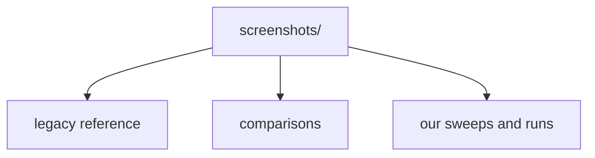
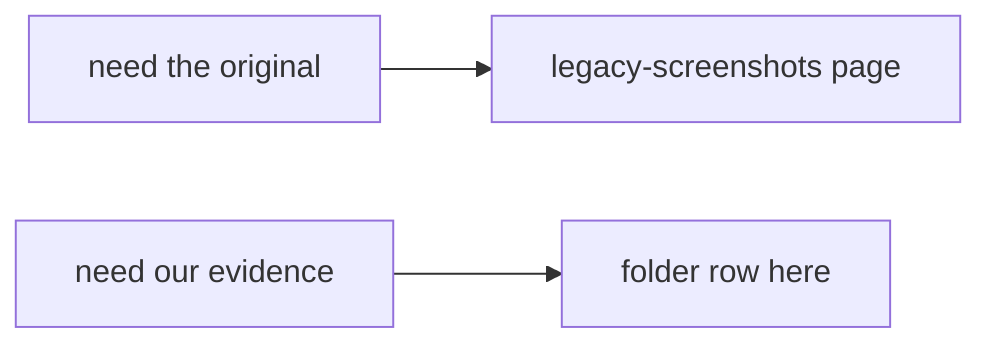

# Screenshot Folders Catalog

**¶1** □ GENERATED. `screenshots/` has 60 tracked folders and 1 loose files in git. The authority for the ORIGINAL is the [legacy archive](legacy-screenshots.md) plus the folders marked LEGACY REFERENCE or comparison below; sweep and handbuild folders are evidence about OUR build. The Kind column is a guess from the folder name only; read the folder's README/manifest where one exists.

## Structure (`Continuant` — `graph TD`)

## How to use it (`Occurrent` — `graph LR`)

| Folder | Images | Other files | Kind (name-based guess) | Description file |
|---|---:|---:|---|---|
| `251207-2200-local-toolbar-emoji-smoke` | 4 | 0 | other / unknown | — |
| `260206-2140-local-blb-study` | 28 | 1 | other / unknown | — |
| `260208-1427-editor-code-mention-smoke` | 3 | 0 | other / unknown | — |
| `260210-0108-mobile-responsive-layout-smoke` | 9 | 0 | other / unknown | — |
| `260224-2343-rizzoma-live-reference` | 24 | 24 | LEGACY REFERENCE (original rizzoma.com) | — |
| `260423-0249-hetzner-blb-additions` | 3 | 0 | other / unknown | — |
| `260424-0010-prod-perf-baseline` | 2 | 3 | other / unknown | — |
| `260424-0010-prod-toolbar-scoped` | 1 | 0 | other / unknown | — |
| `260424-003739-feature-sweep` | 42 | 4 | our build, automated feature sweep | [manifest.md](../../screenshots/260424-003739-feature-sweep/manifest.md) |
| `260424-015008-feature-sweep` | 42 | 5 | our build, automated feature sweep | [manifest.md](../../screenshots/260424-015008-feature-sweep/manifest.md) |
| `260424-025320-feature-sweep` | 43 | 5 | our build, automated feature sweep | [manifest.md](../../screenshots/260424-025320-feature-sweep/manifest.md) |
| `260424-2256-mobile-selection-annotation-verify` | 4 | 0 | other / unknown | — |
| `260424-2256-public-mobile-selection-annotation-verify` | 4 | 0 | other / unknown | — |
| `260424-2319-real-device-pixel9proxl-local` | 25 | 1 | our build, real-device capture | [README.md](../../screenshots/260424-2319-real-device-pixel9proxl-local/README.md) |
| `260424-2350-real-device-pixel9proxl-public` | 6 | 1 | our build, real-device capture | [README.md](../../screenshots/260424-2350-real-device-pixel9proxl-public/README.md) |
| `260504-issue-47-edit-mode-inline-blip` | 1 | 0 | other / unknown | — |
| `260505-blb-fractal-comparison` | 4 | 1 | other / unknown | [README.md](../../screenshots/260505-blb-fractal-comparison/README.md) |
| `260505-newriz-depth10` | 0 | 1 | other / unknown | — |
| `260505-rizzoma-com-vs-mine` | 18 | 3 | comparison original vs ours | [README.md](../../screenshots/260505-rizzoma-com-vs-mine/README.md) |
| `260506-FINAL-feature-sweep` | 45 | 2 | our build, automated feature sweep | [manifest.md](../../screenshots/260506-FINAL-feature-sweep/manifest.md) |
| `260506-GATED-sweep` | 45 | 2 | our build, automated feature sweep | [manifest.md](../../screenshots/260506-GATED-sweep/manifest.md) |
| `260507-FULL-VERIFY-sweep-feature-sweep` | 45 | 2 | our build, automated feature sweep | [manifest.md](../../screenshots/260507-FULL-VERIFY-sweep-feature-sweep/manifest.md) |
| `260507-GATES-FIXED-sweep-feature-sweep` | 45 | 2 | our build, automated feature sweep | [manifest.md](../../screenshots/260507-GATES-FIXED-sweep-feature-sweep/manifest.md) |
| `260507-bug-AB-verify` | 6 | 1 | other / unknown | — |
| `260511-036-FIX-sweep-feature-sweep` | 44 | 2 | our build, automated feature sweep | [manifest.md](../../screenshots/260511-036-FIX-sweep-feature-sweep/manifest.md) |
| `260511-AUTOSAVE-FIX-sweep-feature-sweep` | 44 | 2 | our build, automated feature sweep | [manifest.md](../../screenshots/260511-AUTOSAVE-FIX-sweep-feature-sweep/manifest.md) |
| `260511-BUG-C-FIXED-sweep-feature-sweep` | 44 | 2 | our build, automated feature sweep | [manifest.md](../../screenshots/260511-BUG-C-FIXED-sweep-feature-sweep/manifest.md) |
| `260511-COV-LIFT-2-sweep-feature-sweep` | 45 | 2 | our build, automated feature sweep | [manifest.md](../../screenshots/260511-COV-LIFT-2-sweep-feature-sweep/manifest.md) |
| `260511-COV-LIFT-3-sweep-feature-sweep` | 45 | 2 | our build, automated feature sweep | [manifest.md](../../screenshots/260511-COV-LIFT-3-sweep-feature-sweep/manifest.md) |
| `260511-COV-LIFT-sweep-feature-sweep` | 45 | 2 | our build, automated feature sweep | [manifest.md](../../screenshots/260511-COV-LIFT-sweep-feature-sweep/manifest.md) |
| `260511-IDX-WIN-sweep-feature-sweep` | 45 | 2 | our build, automated feature sweep | [manifest.md](../../screenshots/260511-IDX-WIN-sweep-feature-sweep/manifest.md) |
| `260512-COV-LIFT-FINAL2-sweep-feature-sweep` | 45 | 2 | our build, automated feature sweep | [manifest.md](../../screenshots/260512-COV-LIFT-FINAL2-sweep-feature-sweep/manifest.md) |
| `260512-COV-LIFT-FINAL3-sweep-feature-sweep` | 45 | 2 | our build, automated feature sweep | [manifest.md](../../screenshots/260512-COV-LIFT-FINAL3-sweep-feature-sweep/manifest.md) |
| `260713-152256-dev-https-blb-fractal-proof-clean` | 4 | 1 | other / unknown | — |
| `260713-223655-public-blb-fractal-proof-after-sso-502-fix` | 4 | 1 | other / unknown | — |
| `260713-225006-public-active-terminal-toolbar-proof` | 5 | 1 | other / unknown | — |
| `260713-225614-public-parity-sweep-feature-sweep` | 54 | 5 | our build, automated feature sweep | [manifest.md](../../screenshots/260713-225614-public-parity-sweep-feature-sweep/manifest.md) |
| `260714-021500-feature-sweep` | 69 | 5 | our build, automated feature sweep | [manifest.md](../../screenshots/260714-021500-feature-sweep/manifest.md) |
| `260714-1500-feature-sweep` | 70 | 5 | our build, automated feature sweep | [manifest.md](../../screenshots/260714-1500-feature-sweep/manifest.md) |
| `260714-1600-feature-sweep` | 71 | 5 | our build, automated feature sweep | [manifest.md](../../screenshots/260714-1600-feature-sweep/manifest.md) |
| `260714-blb-layout` | 12 | 0 | other / unknown | — |
| `260714-final-regression2` | 7 | 0 | other / unknown | — |
| `260714-handbuild-d10` | 12 | 0 | our build, handbuild acceptance run | — |
| `260714-handbuild-d10-run2` | 33 | 0 | our build, handbuild acceptance run | — |
| `260714-handbuild-d10-run4` | 33 | 0 | our build, handbuild acceptance run | — |
| `260714-legacy-reference-archive` | 126 | 127 | LEGACY REFERENCE (original rizzoma.com) | [ARCHIVE_MANIFEST.md](../../screenshots/260714-legacy-reference-archive/ARCHIVE_MANIFEST.md) |
| `260714-native-vs-react` | 4 | 0 | other / unknown | — |
| `260716-native-read-acceptance` | 2 | 0 | other / unknown | — |
| `depth10-fractal-260506` | 7 | 0 | other / unknown | — |
| `native-vs-react-260506` | 9 | 0 | other / unknown | — |
| `newriz-FULL-SWEEP-260506` | 18 | 0 | other / unknown | — |
| `newriz-depth10-260506` | 37 | 0 | other / unknown | — |
| `newriz-depth10-260506-FIXED` | 16 | 0 | other / unknown | — |
| `newriz-depth10-260506-FIXED-v2` | 18 | 0 | other / unknown | — |
| `newriz-depth10-260506-clean` | 20 | 0 | other / unknown | — |
| `side-by-side-260506` | 10 | 0 | comparison original vs ours | — |
| `side-by-side-260506-CLEAN` | 19 | 0 | comparison original vs ours | — |
| `side-by-side-260506-FIXED` | 17 | 0 | comparison original vs ours | — |
| `side-by-side-260506-FIXED-v2` | 19 | 0 | comparison original vs ours | — |
| `side-by-side-FULL-SWEEP-260506` | 19 | 0 | comparison original vs ours | — |

## Loose files at `screenshots/`

- [README.md](../../screenshots/README.md)
