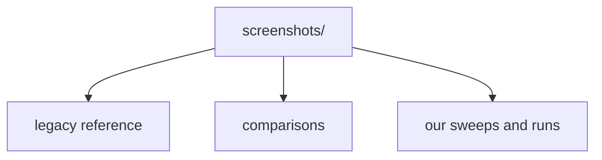

# Screenshot Folders Catalog

**¶1** □ GENERATED. `screenshots/` has 237 tracked folders and 31 loose files in git. The authority for the ORIGINAL is the [legacy archive](legacy-screenshots.md) plus the folders marked LEGACY REFERENCE or comparison below; sweep and handbuild folders are evidence about OUR build. The Kind column is a guess from the folder name only; read the folder's README/manifest where one exists.

## Structure (`Continuant` — `graph TD`)

## How to use it (`Occurrent` — `graph LR`)

| Folder | Images | Other files | Kind (name-based guess) | Description file |
|---|---:|---:|---|---|
| `251207-2200-local-toolbar-emoji-smoke` | 4 | 0 | other / unknown | — |
| `260206-2140-local-blb-study` | 28 | 1 | other / unknown | — |
| `260208-1427-editor-code-mention-smoke` | 3 | 0 | other / unknown | — |
| `260210-0108-mobile-responsive-layout-smoke` | 9 | 0 | other / unknown | — |
| `260224-2343-rizzoma-live-reference` | 24 | 24 | LEGACY REFERENCE (original rizzoma.com) | — |
| `260225` | 433 | 316 | other / unknown | — |
| `260329-dirty-batch` | 5 | 2 | other / unknown | — |
| `260329-live` | 3 | 3 | other / unknown | — |
| `260330-app-runtime` | 11 | 27 | other / unknown | — |
| `260330-embed-adapters` | 10 | 10 | other / unknown | — |
| `260330-live-poll` | 23 | 23 | other / unknown | — |
| `260330-live-ui` | 10 | 10 | other / unknown | — |
| `260330-poll-fix` | 5 | 5 | other / unknown | — |
| `260331-app-runtime` | 2 | 4 | other / unknown | — |
| `260331-blb-inline` | 1 | 1 | other / unknown | — |
| `260331-blb-live-scenario` | 3 | 4 | other / unknown | — |
| `260331-blb-live-scenario-mobile` | 1 | 1 | other / unknown | — |
| `260331-blb-mixed` | 1 | 1 | other / unknown | — |
| `260331-blb-parity` | 1 | 1 | other / unknown | — |
| `260331-blb-toolbar` | 1 | 1 | other / unknown | — |
| `260331-blb-unread` | 1 | 1 | other / unknown | — |
| `260331-complex-workflow` | 11 | 3 | other / unknown | — |
| `260331-complex-workflow-pass10` | 11 | 13 | other / unknown | — |
| `260331-complex-workflow-pass11` | 11 | 13 | other / unknown | — |
| `260331-complex-workflow-pass12` | 11 | 13 | other / unknown | — |
| `260331-complex-workflow-pass13` | 11 | 13 | other / unknown | — |
| `260331-complex-workflow-pass14` | 11 | 13 | other / unknown | — |
| `260331-complex-workflow-pass15` | 11 | 13 | other / unknown | — |
| `260331-complex-workflow-pass16` | 11 | 13 | other / unknown | — |
| `260331-complex-workflow-pass17` | 11 | 13 | other / unknown | — |
| `260331-complex-workflow-pass17b` | 11 | 13 | other / unknown | — |
| `260331-complex-workflow-pass17c` | 11 | 13 | other / unknown | — |
| `260331-complex-workflow-pass17d` | 11 | 13 | other / unknown | — |
| `260331-complex-workflow-pass18` | 11 | 13 | other / unknown | — |
| `260331-complex-workflow-pass18b` | 11 | 13 | other / unknown | — |
| `260331-complex-workflow-pass19` | 11 | 13 | other / unknown | — |
| `260331-complex-workflow-pass2` | 11 | 2 | other / unknown | — |
| `260331-complex-workflow-pass20` | 11 | 13 | other / unknown | — |
| `260331-complex-workflow-pass21` | 11 | 13 | other / unknown | — |
| `260331-complex-workflow-pass22` | 11 | 13 | other / unknown | — |
| `260331-complex-workflow-pass23` | 11 | 13 | other / unknown | — |
| `260331-complex-workflow-pass24` | 11 | 13 | other / unknown | — |
| `260331-complex-workflow-pass3` | 11 | 2 | other / unknown | — |
| `260331-complex-workflow-pass4` | 11 | 2 | other / unknown | — |
| `260331-complex-workflow-pass5` | 11 | 2 | other / unknown | — |
| `260331-complex-workflow-pass6` | 11 | 2 | other / unknown | — |
| `260331-complex-workflow-pass7` | 11 | 2 | other / unknown | — |
| `260331-complex-workflow-pass8` | 11 | 13 | other / unknown | — |
| `260331-complex-workflow-pass9` | 11 | 13 | other / unknown | — |
| `260331-gadget-entry` | 1 | 1 | other / unknown | — |
| `260331-inline-comment-audit-pass1` | 3 | 5 | other / unknown | — |
| `260331-inline-comment-audit-pass10` | 3 | 3 | other / unknown | — |
| `260331-inline-comment-audit-pass11` | 3 | 3 | other / unknown | — |
| `260331-inline-comment-audit-pass2` | 3 | 5 | other / unknown | — |
| `260331-inline-comment-audit-pass3` | 5 | 7 | other / unknown | — |
| `260331-inline-comment-audit-pass4` | 5 | 7 | other / unknown | — |
| `260331-inline-comment-audit-pass5` | 5 | 7 | other / unknown | — |
| `260331-inline-comment-audit-pass6` | 7 | 7 | other / unknown | — |
| `260331-inline-comment-audit-pass7` | 3 | 3 | other / unknown | — |
| `260331-inline-comment-audit-pass8` | 4 | 4 | other / unknown | — |
| `260331-inline-comment-audit-pass9` | 3 | 3 | other / unknown | — |
| `260331-store-lifecycle` | 8 | 8 | other / unknown | — |
| `260331-store-lifecycle-server` | 4 | 4 | other / unknown | — |
| `260331-store-lifecycle-session` | 4 | 4 | other / unknown | — |
| `260331-store-lifecycle-session2` | 4 | 4 | other / unknown | — |
| `260331-store-lifecycle-session4` | 4 | 4 | other / unknown | — |
| `260331-store-lifecycle-session6` | 4 | 4 | other / unknown | — |
| `260331-store-lifecycle-session7` | 4 | 4 | other / unknown | — |
| `260331-workflow-exploration` | 1 | 2 | other / unknown | — |
| `260401-inline-comment-audit-pass12` | 3 | 3 | other / unknown | — |
| `260401-inline-comment-audit-pass13` | 3 | 3 | other / unknown | — |
| `260401-inline-comment-audit-pass14` | 3 | 3 | other / unknown | — |
| `260401-inline-comment-audit-pass15` | 4 | 4 | other / unknown | — |
| `260401-inline-comment-audit-pass16` | 4 | 4 | other / unknown | — |
| `260401-inline-comment-audit-pass17` | 4 | 4 | other / unknown | — |
| `260401-inline-comment-audit-pass18` | 4 | 4 | other / unknown | — |
| `260401-inline-comment-audit-pass19` | 5 | 5 | other / unknown | — |
| `260401-inline-comment-audit-pass20` | 5 | 5 | other / unknown | — |
| `260401-inline-comment-audit-pass21` | 5 | 5 | other / unknown | — |
| `260401-inline-comment-audit-pass22` | 5 | 5 | other / unknown | — |
| `260401-inline-comment-audit-pass23` | 5 | 5 | other / unknown | — |
| `260401-inline-comment-audit-pass24` | 5 | 5 | other / unknown | — |
| `260401-inline-comment-audit-pass25` | 7 | 9 | other / unknown | — |
| `260401-inline-comment-audit-pass26` | 7 | 9 | other / unknown | — |
| `260401-inline-comment-audit-pass27` | 7 | 9 | other / unknown | — |
| `260401-inline-comment-audit-pass28` | 7 | 9 | other / unknown | — |
| `260401-inline-comment-audit-pass29` | 7 | 9 | other / unknown | — |
| `260401-inline-comment-audit-pass30` | 7 | 9 | other / unknown | — |
| `260401-inline-comment-audit-pass31` | 7 | 9 | other / unknown | — |
| `260401-inline-comment-audit-pass32` | 7 | 9 | other / unknown | — |
| `260401-inline-comment-audit-pass33` | 7 | 9 | other / unknown | — |
| `260401-inline-comment-audit-pass34` | 7 | 9 | other / unknown | — |
| `260401-inline-comment-audit-pass35` | 7 | 9 | other / unknown | — |
| `260401-inline-comment-audit-pass36` | 7 | 9 | other / unknown | — |
| `260401-inline-comment-audit-pass38` | 2 | 2 | other / unknown | — |
| `260401-inline-comment-audit-pass39` | 7 | 9 | other / unknown | — |
| `260401-inline-comment-audit-pass40` | 7 | 9 | other / unknown | — |
| `260401-inline-comment-audit-pass41` | 7 | 9 | other / unknown | — |
| `260401-inline-comment-audit-pass42` | 7 | 9 | other / unknown | — |
| `260401-inline-comment-audit-pass43` | 7 | 9 | other / unknown | — |
| `260401-inline-comment-audit-pass44` | 7 | 9 | other / unknown | — |
| `260401-inline-comment-audit-pass45` | 7 | 9 | other / unknown | — |
| `260401-inline-comment-audit-pass46` | 7 | 9 | other / unknown | — |
| `260401-inline-comment-audit-pass47` | 7 | 9 | other / unknown | — |
| `260401-inline-comment-audit-pass48` | 7 | 9 | other / unknown | — |
| `260401-inline-comment-audit-pass49` | 7 | 9 | other / unknown | — |
| `260401-inline-comment-audit-pass50` | 7 | 9 | other / unknown | — |
| `260402-inline-comment-audit-pass51` | 7 | 9 | other / unknown | — |
| `260402-inline-comment-audit-pass52` | 7 | 9 | other / unknown | — |
| `260402-inline-comment-audit-pass53` | 7 | 9 | other / unknown | — |
| `260402-inline-comment-audit-pass54` | 7 | 9 | other / unknown | — |
| `260413-blb-asymmetric-pass1` | 3 | 5 | other / unknown | — |
| `260413-blb-asymmetric-pass2` | 3 | 5 | other / unknown | — |
| `260413-blb-hierarchy-pass1` | 3 | 5 | other / unknown | — |
| `260413-blb-hierarchy-pass2` | 3 | 5 | other / unknown | — |
| `260413-blb-hierarchy-pass3` | 3 | 5 | other / unknown | — |
| `260413-blb-live-scenario` | 1 | 3 | other / unknown | — |
| `260413-edit-determinism-pass1` | 6 | 8 | other / unknown | — |
| `260413-full-page-parity` | 3 | 3 | other / unknown | — |
| `260413-inline-comment-audit-pass55` | 7 | 9 | other / unknown | — |
| `260413-inline-comment-audit-pass56` | 7 | 9 | other / unknown | — |
| `260413-inline-comment-audit-pass57` | 7 | 9 | other / unknown | — |
| `260413-inline-comment-audit-pass58` | 7 | 9 | other / unknown | — |
| `260413-inline-comment-audit-pass59` | 7 | 9 | other / unknown | — |
| `260413-inline-comment-audit-pass60` | 7 | 9 | other / unknown | — |
| `260413-inline-comment-audit-pass61` | 7 | 9 | other / unknown | — |
| `260413-inline-comment-audit-pass62` | 7 | 9 | other / unknown | — |
| `260413-inline-comments-playback-pass1` | 1 | 1 | other / unknown | — |
| `260413-inline-comments-playback-pass2` | 1 | 1 | other / unknown | — |
| `260413-inline-comments-playback-pass3-stress` | 1 | 1 | other / unknown | — |
| `260413-inline-comments-playback-pass4-lazy` | 1 | 1 | other / unknown | — |
| `260413-lazy-mount-pass1` | 2 | 1 | other / unknown | — |
| `260413-live-bugfix-pass1` | 20 | 0 | other / unknown | — |
| `260413-notes-scratchpad` | 1 | 2 | other / unknown | — |
| `260413-parity-side-by-side` | 105 | 54 | comparison original vs ours | — |
| `260413-subblip-siblings-pass1` | 6 | 8 | other / unknown | — |
| `260413-subblip-siblings-pass2` | 6 | 8 | other / unknown | — |
| `260413-subblip-siblings-pass3` | 6 | 8 | other / unknown | — |
| `260413-subblip-siblings-pass4` | 6 | 8 | other / unknown | — |
| `260413-subblip-siblings-pass5` | 4 | 6 | other / unknown | — |
| `260413-subblip-siblings-pass6` | 4 | 6 | other / unknown | — |
| `260413-subblip-siblings-pass8` | 4 | 6 | other / unknown | — |
| `260413-subblip-view-pass1` | 2 | 2 | other / unknown | — |
| `260413-subblip-view-pass2` | 2 | 2 | other / unknown | — |
| `260414-streamlined-pass1` | 3 | 0 | other / unknown | — |
| `260415-feature-flows` | 253 | 626 | other / unknown | — |
| `260415-ftg-collab-audit` | 9 | 0 | other / unknown | — |
| `260415-parity-sweep` | 24 | 0 | our build, automated feature sweep | — |
| `260416-depth-test` | 5 | 0 | other / unknown | — |
| `260416-firefox-smoke` | 11 | 0 | other / unknown | — |
| `260416-grandchild-test` | 8 | 0 | other / unknown | — |
| `260416-original-rizzoma-grandchild` | 7 | 0 | other / unknown | — |
| `260417-gap-fix` | 3 | 0 | other / unknown | — |
| `260417-reply-gap` | 5 | 0 | other / unknown | — |
| `260421-bug40-subblip-nesting` | 3 | 1 | other / unknown | [README.md](../../screenshots/260421-bug40-subblip-nesting/README.md) |
| `260421-bug43-delete-blip` | 10 | 1 | other / unknown | [README.md](../../screenshots/260421-bug43-delete-blip/README.md) |
| `260421-plus-marker-persistence` | 2 | 1 | other / unknown | [README.md](../../screenshots/260421-plus-marker-persistence/README.md) |
| `260422-cleanup-verifications` | 1 | 0 | other / unknown | — |
| `260422-deep-editing-verification` | 4 | 1 | other / unknown | [README.md](../../screenshots/260422-deep-editing-verification/README.md) |
| `260422-deeper-features-at-depth` | 6 | 1 | other / unknown | [README.md](../../screenshots/260422-deeper-features-at-depth/README.md) |
| `260422-depth10-test` | 4 | 1 | other / unknown | [README.md](../../screenshots/260422-depth10-test/README.md) |
| `260423-0249-hetzner-blb-additions` | 3 | 0 | other / unknown | — |
| `260424-0010-prod-perf-baseline` | 2 | 3 | other / unknown | — |
| `260424-0010-prod-toolbar-scoped` | 1 | 0 | other / unknown | — |
| `260424-003739-feature-sweep` | 42 | 4 | our build, automated feature sweep | [manifest.md](../../screenshots/260424-003739-feature-sweep/manifest.md) |
| `260424-015008-feature-sweep` | 42 | 5 | our build, automated feature sweep | [manifest.md](../../screenshots/260424-015008-feature-sweep/manifest.md) |
| `260424-025320-feature-sweep` | 43 | 5 | our build, automated feature sweep | [manifest.md](../../screenshots/260424-025320-feature-sweep/manifest.md) |
| `260424-2256-mobile-selection-annotation-verify` | 4 | 0 | other / unknown | — |
| `260424-2256-public-mobile-selection-annotation-verify` | 4 | 0 | other / unknown | — |
| `260424-2319-real-device-pixel9proxl-local` | 25 | 1 | our build, real-device capture | [README.md](../../screenshots/260424-2319-real-device-pixel9proxl-local/README.md) |
| `260424-2350-real-device-pixel9proxl-public` | 6 | 1 | our build, real-device capture | [README.md](../../screenshots/260424-2350-real-device-pixel9proxl-public/README.md) |
| `260504-issue-47-edit-mode-inline-blip` | 1 | 0 | other / unknown | — |
| `260505-blb-fractal-comparison` | 4 | 1 | other / unknown | [README.md](../../screenshots/260505-blb-fractal-comparison/README.md) |
| `260505-newriz-depth10` | 0 | 1 | other / unknown | — |
| `260505-rizzoma-com-vs-mine` | 18 | 3 | comparison original vs ours | [README.md](../../screenshots/260505-rizzoma-com-vs-mine/README.md) |
| `260506-FINAL-feature-sweep` | 45 | 2 | our build, automated feature sweep | [manifest.md](../../screenshots/260506-FINAL-feature-sweep/manifest.md) |
| `260506-GATED-sweep` | 45 | 2 | our build, automated feature sweep | [manifest.md](../../screenshots/260506-GATED-sweep/manifest.md) |
| `260507-FULL-VERIFY-sweep-feature-sweep` | 45 | 2 | our build, automated feature sweep | [manifest.md](../../screenshots/260507-FULL-VERIFY-sweep-feature-sweep/manifest.md) |
| `260507-GATES-FIXED-sweep-feature-sweep` | 45 | 2 | our build, automated feature sweep | [manifest.md](../../screenshots/260507-GATES-FIXED-sweep-feature-sweep/manifest.md) |
| `260507-bug-AB-verify` | 6 | 1 | other / unknown | — |
| `260511-036-FIX-sweep-feature-sweep` | 44 | 2 | our build, automated feature sweep | [manifest.md](../../screenshots/260511-036-FIX-sweep-feature-sweep/manifest.md) |
| `260511-AUTOSAVE-FIX-sweep-feature-sweep` | 44 | 2 | our build, automated feature sweep | [manifest.md](../../screenshots/260511-AUTOSAVE-FIX-sweep-feature-sweep/manifest.md) |
| `260511-BUG-C-FIXED-sweep-feature-sweep` | 44 | 2 | our build, automated feature sweep | [manifest.md](../../screenshots/260511-BUG-C-FIXED-sweep-feature-sweep/manifest.md) |
| `260511-COV-LIFT-2-sweep-feature-sweep` | 45 | 2 | our build, automated feature sweep | [manifest.md](../../screenshots/260511-COV-LIFT-2-sweep-feature-sweep/manifest.md) |
| `260511-COV-LIFT-3-sweep-feature-sweep` | 45 | 2 | our build, automated feature sweep | [manifest.md](../../screenshots/260511-COV-LIFT-3-sweep-feature-sweep/manifest.md) |
| `260511-COV-LIFT-sweep-feature-sweep` | 45 | 2 | our build, automated feature sweep | [manifest.md](../../screenshots/260511-COV-LIFT-sweep-feature-sweep/manifest.md) |
| `260511-IDX-WIN-sweep-feature-sweep` | 45 | 2 | our build, automated feature sweep | [manifest.md](../../screenshots/260511-IDX-WIN-sweep-feature-sweep/manifest.md) |
| `260512-COV-LIFT-FINAL2-sweep-feature-sweep` | 45 | 2 | our build, automated feature sweep | [manifest.md](../../screenshots/260512-COV-LIFT-FINAL2-sweep-feature-sweep/manifest.md) |
| `260512-COV-LIFT-FINAL3-sweep-feature-sweep` | 45 | 2 | our build, automated feature sweep | [manifest.md](../../screenshots/260512-COV-LIFT-FINAL3-sweep-feature-sweep/manifest.md) |
| `260712-0313-pr57-release-gates` | 7 | 3 | other / unknown | [README.md](../../screenshots/260712-0313-pr57-release-gates/README.md) |
| `260712-0530-pr60-production-final` | 8 | 3 | other / unknown | [README.md](../../screenshots/260712-0530-pr60-production-final/README.md) |
| `260712-1152-production-service-candidate` | 0 | 2 | other / unknown | [README.md](../../screenshots/260712-1152-production-service-candidate/README.md) |
| `260712-1203-database-exposure-closure` | 0 | 1 | other / unknown | [README.md](../../screenshots/260712-1203-database-exposure-closure/README.md) |
| `260712-1218-redis-incident-response` | 0 | 1 | other / unknown | [README.md](../../screenshots/260712-1218-redis-incident-response/README.md) |
| `260712-122218-sharing-access-ui` | 8 | 2 | other / unknown | [README.md](../../screenshots/260712-122218-sharing-access-ui/README.md) |
| `260712-1300-managed-production-candidate` | 0 | 1 | other / unknown | [README.md](../../screenshots/260712-1300-managed-production-candidate/README.md) |
| `260712-1348-offline-auth-isolation` | 24 | 3 | other / unknown | [README.md](../../screenshots/260712-1348-offline-auth-isolation/README.md) |
| `260712-1449-clamav-preflight` | 0 | 2 | other / unknown | [README.md](../../screenshots/260712-1449-clamav-preflight/README.md) |
| `260712-1723-password-recovery-ui` | 10 | 3 | other / unknown | [README.md](../../screenshots/260712-1723-password-recovery-ui/README.md) |
| `260712-1928-final-candidate-ui` | 28 | 4 | other / unknown | [README.md](../../screenshots/260712-1928-final-candidate-ui/README.md) |
| `260712-2159-production-acceptance` | 3 | 5 | other / unknown | [README.md](../../screenshots/260712-2159-production-acceptance/README.md) |
| `260713-010554-production-final` | 2 | 5 | other / unknown | [README.md](../../screenshots/260713-010554-production-final/README.md) |
| `260713-0130-public-blb-creation-failure` | 7 | 2 | other / unknown | [README.md](../../screenshots/260713-0130-public-blb-creation-failure/README.md) |
| `260713-0258-private-green-blb-acceptance` | 2 | 2 | other / unknown | [README.md](../../screenshots/260713-0258-private-green-blb-acceptance/README.md) |
| `260713-0354-private-green-blb-acceptance` | 1 | 2 | other / unknown | [README.md](../../screenshots/260713-0354-private-green-blb-acceptance/README.md) |
| `260713-0356-private-green-inspect` | 1 | 2 | other / unknown | [README.md](../../screenshots/260713-0356-private-green-inspect/README.md) |
| `260713-1050-private-green-blb-acceptance` | 1 | 2 | other / unknown | [README.md](../../screenshots/260713-1050-private-green-blb-acceptance/README.md) |
| `260713-1052-private-green-inspect-failed-handoff` | 1 | 2 | other / unknown | [README.md](../../screenshots/260713-1052-private-green-inspect-failed-handoff/README.md) |
| `260713-152256-dev-https-blb-fractal-proof-clean` | 4 | 1 | other / unknown | — |
| `260713-223655-public-blb-fractal-proof-after-sso-502-fix` | 4 | 1 | other / unknown | — |
| `260713-225006-public-active-terminal-toolbar-proof` | 5 | 1 | other / unknown | — |
| `260713-225614-public-parity-sweep-feature-sweep` | 54 | 5 | our build, automated feature sweep | [manifest.md](../../screenshots/260713-225614-public-parity-sweep-feature-sweep/manifest.md) |
| `260714-021500-feature-sweep` | 69 | 5 | our build, automated feature sweep | [manifest.md](../../screenshots/260714-021500-feature-sweep/manifest.md) |
| `260714-1500-feature-sweep` | 70 | 5 | our build, automated feature sweep | [manifest.md](../../screenshots/260714-1500-feature-sweep/manifest.md) |
| `260714-1600-feature-sweep` | 71 | 5 | our build, automated feature sweep | [manifest.md](../../screenshots/260714-1600-feature-sweep/manifest.md) |
| `260714-blb-layout` | 12 | 0 | other / unknown | — |
| `260714-final-regression2` | 7 | 0 | other / unknown | — |
| `260714-handbuild-d10` | 12 | 0 | our build, handbuild acceptance run | — |
| `260714-handbuild-d10-run2` | 33 | 0 | our build, handbuild acceptance run | — |
| `260714-handbuild-d10-run4` | 33 | 0 | our build, handbuild acceptance run | — |
| `260714-legacy-reference-archive` | 126 | 127 | LEGACY REFERENCE (original rizzoma.com) | [ARCHIVE_MANIFEST.md](../../screenshots/260714-legacy-reference-archive/ARCHIVE_MANIFEST.md) |
| `260714-native-vs-react` | 4 | 0 | other / unknown | — |
| `260716-native-read-acceptance` | 2 | 0 | other / unknown | — |
| `debug-blank` | 3 | 1 | other / unknown | — |
| `depth10-fractal-260506` | 7 | 0 | other / unknown | — |
| `native-vs-react-260506` | 9 | 0 | other / unknown | — |
| `newriz-FULL-SWEEP-260506` | 18 | 0 | other / unknown | — |
| `newriz-depth10-260506` | 37 | 0 | other / unknown | — |
| `newriz-depth10-260506-FIXED` | 16 | 0 | other / unknown | — |
| `newriz-depth10-260506-FIXED-v2` | 18 | 0 | other / unknown | — |
| `newriz-depth10-260506-clean` | 20 | 0 | other / unknown | — |
| `parity-2026-02-24` | 72 | 3 | other / unknown | — |
| `side-by-side-260506` | 10 | 0 | comparison original vs ours | — |
| `side-by-side-260506-CLEAN` | 19 | 0 | comparison original vs ours | — |
| `side-by-side-260506-FIXED` | 17 | 0 | comparison original vs ours | — |
| `side-by-side-260506-FIXED-v2` | 19 | 0 | comparison original vs ours | — |
| `side-by-side-FULL-SWEEP-260506` | 19 | 0 | comparison original vs ours | — |

## Loose files at `screenshots/`

- [2026-04-14_04-17-58.png](../../screenshots/2026-04-14_04-17-58.png)
- [260417-hryhorii-reply.png](../../screenshots/260417-hryhorii-reply.png)
- [260417-hryhorii-screenshot-1.png](../../screenshots/260417-hryhorii-screenshot-1.png)
- [260417-hryhorii-screenshot-2.png](../../screenshots/260417-hryhorii-screenshot-2.png)
- [260417-hryhorii-screenshot-enlarged.png](../../screenshots/260417-hryhorii-screenshot-enlarged.png)
- [README.md](../../screenshots/README.md)
- [Screenshot_20260414-215234.png](../../screenshots/Screenshot_20260414-215234.png)
- [Screenshot_20260414-221017.png](../../screenshots/Screenshot_20260414-221017.png)
- [Screenshot_20260414-221106.png](../../screenshots/Screenshot_20260414-221106.png)
- [Screenshot_20260414-221120.png](../../screenshots/Screenshot_20260414-221120.png)
- [Screenshot_20260414-221158.png](../../screenshots/Screenshot_20260414-221158.png)
- [Screenshot_20260414-221224.png](../../screenshots/Screenshot_20260414-221224.png)
- [Screenshot_20260414-221246.png](../../screenshots/Screenshot_20260414-221246.png)
- [Screenshot_20260414-222922.png](../../screenshots/Screenshot_20260414-222922.png)
- [Screenshot_20260414-223641.png](../../screenshots/Screenshot_20260414-223641.png)
- [hryhorii-reply-check.png](../../screenshots/hryhorii-reply-check.png)
- [next-topic-green_new-260414-0352.png](../../screenshots/next-topic-green_new-260414-0352.png)
- [topic-edit-markers-fixed_new-260414-0151.png](../../screenshots/topic-edit-markers-fixed_new-260414-0151.png)
- [topic-edit-markers_new-260414-0121.png](../../screenshots/topic-edit-markers_new-260414-0121.png)
- [topic-edit-toolbar_new-260414-0100.png](../../screenshots/topic-edit-toolbar_new-260414-0100.png)
- [topic-edit-unified_new-260414-0319.png](../../screenshots/topic-edit-unified_new-260414-0319.png)
- [topic-view-expanded-child-clean_new-260414-0223.png](../../screenshots/topic-view-expanded-child-clean_new-260414-0223.png)
- [topic-view-expanded-child-level1_new-260414-0232.png](../../screenshots/topic-view-expanded-child-level1_new-260414-0232.png)
- [topic-view-extra-bullet_new-260414-0158.png](../../screenshots/topic-view-extra-bullet_new-260414-0158.png)
- [topic-view-markers_new-260414-0120.png](../../screenshots/topic-view-markers_new-260414-0120.png)
- [topic-view-mode-audit_new-260414-0102.png](../../screenshots/topic-view-mode-audit_new-260414-0102.png)
- [topic-view-mode-wide_new-260414-0103.png](../../screenshots/topic-view-mode-wide_new-260414-0103.png)
- [topic-view-no-orphan-bullet_new-260414-0204.png](../../screenshots/topic-view-no-orphan-bullet_new-260414-0204.png)
- [topic-view-relevant-links-clean_new-260414-0210.png](../../screenshots/topic-view-relevant-links-clean_new-260414-0210.png)
- [topic-view-relevant-links-zoom_new-260414-0206.png](../../screenshots/topic-view-relevant-links-zoom_new-260414-0206.png)
- [topic-view-unified_new-260414-0319.png](../../screenshots/topic-view-unified_new-260414-0319.png)
