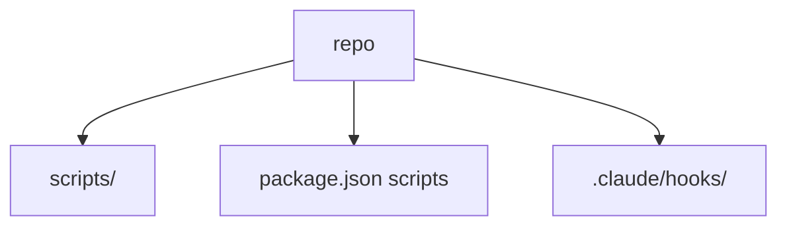
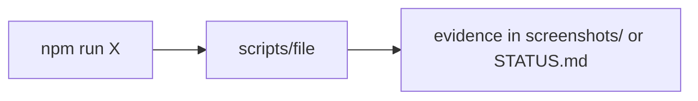

# Scripts Catalog

**¶1** □ GENERATED. 169 files in `scripts/`, 42 npm scripts, 10 project hooks in `.claude/hooks/`. Purpose text is each file's own header; `(no header comment...)` means none exists. See [gates and sweeps](../verification/gates-sweeps-and-deployment.md) and [legacy visual parity](../subsystems/legacy-visual-parity.md).

## Structure (`Continuant` — `graph TD`)

## How to use it (`Occurrent` — `graph LR`)

## npm scripts (`package.json`)

| Name | Command |
|---|---|
| `dev` | `node node_modules/concurrently/dist/bin ⁄ concurrently.js "npm:dev:*"` |
| `dev:features` | `echo 'Use FEAT_ALL=1 npm run dev instead'` |
| `dev:server` | `node --import tsx/esm --watch src/server ⁄ app.ts` |
| `dev:client` | `node node_modules/vite/bin ⁄ vite.js` |
| `build` | `npm run build:server && npm run build:client` |
| `build:server` | `node node_modules/typescript/bin/tsc -p tsconfig.server.json && node node_modules/tsc-alias/dist ⁄ index.js` |
| `build:client` | `node node_modules/vite/bin ⁄ vite.js build` |
| `start` | `node dist/server/server ⁄ app.js` |
| `test` | `node node_modules/vitest ⁄ vitest.mjs run --config vitest.config.ts` |
| `test:watch` | `node node_modules/vitest ⁄ vitest.mjs --config vitest.config.ts` |
| `test:e2e` | `node node_modules/cypress/bin/cypress run` |
| `lint` | `node node_modules/eslint/bin ⁄ eslint.js src --ext .ts,.tsx` |
| `format` | `node node_modules/prettier/bin ⁄ prettier.cjs --write "src/**/*.{ts,tsx,json,css,md}"` |
| `typecheck` | `node node_modules/typescript/bin/tsc --noEmit` |
| `migrate:coffee` | `node scripts ⁄ migrate-coffee-to-ts.js` |
| `prep:views` | `mkdir -p src/server/couch_views && cp -r rizzoma/src/server/couch_views/* src/server/couch_views/` |
| `deploy:views` | `node scripts ⁄ deploy-views.js` |
| `docker:dev` | `docker-compose up -d` |
| `docker:build` | `docker build -t rizzoma:latest .` |
| `start:all` | `bash scripts ⁄ start-all.sh` |
| `stop:all` | `bash scripts ⁄ stop-all.sh` |
| `restart:all` | `npm run stop:all && npm run start:all` |
| `logs` | `docker compose logs -f` |
| `logs:app` | `docker compose logs -f app` |
| `status` | `docker compose ps && echo ' API Health:' && curl -s http://localhost:8788/api/health \|\| echo 'API not responding'` |
| `test:toolbar-inline` | `node test-toolbar-inline-smoke.mjs` |
| `test:follow-green` | `node test-follow-green-smoke.mjs` |
| `test:collab` | `node test-collab-smoke.mjs` |
| `test:health` | `node node_modules/vitest ⁄ vitest.mjs run --config vitest.config.ts src/tests ⁄ server.health.test.ts src/tests ⁄ routes.comments.inlineHealth.test.ts src/test…` |
| `perf:harness` | `node perf-harness.mjs` |
| `perf:budget` | `node scripts ⁄ perf-budget.mjs` |
| `visual:sweep` | `node scripts ⁄ visual-feature-sweep.mjs` |
| `visual:coverage` | `node scripts ⁄ visual-feature-coverage.mjs` |
| `parity:gate` | `node scripts ⁄ check-rizzoma-parity-gate.mjs` |
| `sharing:count-legacy` | `node scripts ⁄ count-missing-sharing-policies.mjs` |
| `snapshots:pull` | `bash scripts ⁄ fetch-latest-snapshots.sh` |
| `lint:branch-context` | `node scripts ⁄ check-branch-state.cjs` |
| `cap:sync` | `npm run build && node node_modules/@capacitor/cli/bin/capacitor sync` |
| `cap:open:android` | `node node_modules/@capacitor/cli/bin/capacitor open android` |
| `cap:open:ios` | `node node_modules/@capacitor/cli/bin/capacitor open ios` |
| `cap:run:android` | `node node_modules/@capacitor/cli/bin/capacitor run android` |
| `cap:run:ios` | `node node_modules/@capacitor/cli/bin/capacitor run ios` |

## scripts/ (169)

| File | Lines | Header / first fact |
|---|---:|---|
| `scripts/analyze_bullets.py` | 50 | Focus on the left edge where bullets appear (x: 0 to 60) |
| `scripts/append_workflow_note.py` | 25 | — |
| `scripts/backup-bundle.sh` | 93 | Hard Gap #23 (2026-04-13): one-shot bundle + GDrive copy script. |
| `scripts/backup-to-gdrive.ps1` | — | — |
| `scripts/backup-to-gdrive.sh` | 15 | — |
| `scripts/backup.sh` | 149 | Rizzoma Backup Automation Script |
| `scripts/build_depth10_fractal.mjs` | 130 | Build a depth-10 fractal in the Try topic via Playwright. |
| `scripts/build_native_pm.mjs` | 1411 | Build the HTML PM dashboard for the native fractal-render port. |
| `scripts/build_parity_comparisons.py` | 93 | Build legacy/current side-by-side comparison sheets for the parity gate. |
| `scripts/build_try_step_by_step_new.mjs` | 337 | Build a fresh Try topic in the NEW Rizzoma step-by-step via Ctrl+Enter, |
| `scripts/build_try_topic.mjs` | 158 | Build a "Try" topic on our Rizzoma matching the rizzoma.com Try fractal exactly: |
| `scripts/build_zoomed_parity_comparisons.py` | 76 | Build true zoomed component-level side-by-side comparison sheets. |
| `scripts/capture-child-blip-edit.mjs` | 90 | — |
| `scripts/capture-edit-mode.mjs` | 76 | — |
| `scripts/capture-exact-legacy-viewport.mjs` | 97 | — |
| `scripts/capture-feature-flows-fix.mjs` | 135 | Re-run the 7 editor features that failed in capture-feature-flows.mjs. |
| `scripts/capture-feature-flows-pass2.mjs` | 648 | Feature flow sweep — PASS 2 (2026-04-16). |
| `scripts/capture-feature-flows-pass3.mjs` | 883 | Feature flow sweep — PASS 3 (2026-04-16). |
| `scripts/capture-feature-flows-pass4.mjs` | 800 | Feature flow sweep — PASS 4 (2026-04-16). |
| `scripts/capture-feature-flows-pass5.mjs` | 795 | Feature flow sweep — PASS 5 (2026-04-16). |
| `scripts/capture-feature-flows-pass6.mjs` | 816 | Feature flow sweep — PASS 6 (2026-04-16). |
| `scripts/capture-feature-flows-pass7.mjs` | 391 | Feature flow sweep — PASS 7 (2026-04-16). |
| `scripts/capture-feature-flows-pass8.mjs` | 211 | Feature flow sweep — PASS 8 (2026-04-16) — FINAL. |
| `scripts/capture-feature-flows.mjs` | 651 | Feature-flow capture script. |
| `scripts/capture-final-4.mjs` | 136 | — |
| `scripts/capture-ftg-keyboard.mjs` | 123 | Two-user FtG keyboard capture for features 54 (jkgG) and 55 (Ctrl+Space). |
| `scripts/capture-offline-auth-ui.mjs` | 112 | — |
| `scripts/capture-public-blb-creation-contract.mjs` | 178 | — |
| `scripts/capture_blb_hierarchy.cjs` | 178 | Focused live verifier for Hard Gap #13 (BLB hierarchy legibility). |
| `scripts/capture_blb_inline_probe.cjs` | 129 | — |
| `scripts/capture_blb_live_scenario.cjs` | 574 | Hard Gap #14 (2026-04-13): replaced the previous fixed waitForTimeout(1500) |
| `scripts/capture_blb_live_scenario_asymmetric.cjs` | 291 | Focused live verifier for Hard Gap #17 (less scripted live-topic |
| `scripts/capture_blb_live_scenario_mobile.cjs` | 300 | — |
| `scripts/capture_blb_probe.cjs` | 428 | — |
| `scripts/capture_complex_live_workflow.cjs` | 158 | — |
| `scripts/capture_edit_determinism.cjs` | 194 | Focused live verifier for Hard Gap #12 (deterministic Edit semantics). |
| `scripts/capture_full_page_parity.cjs` | 92 | Honest side-by-side capture. Takes a full-viewport screenshot of the |
| `scripts/capture_full_render_lazy_mount.cjs` | 143 | Verifies that full-render topic-root waves with more than |
| `scripts/capture_inline_comments_playback_perf.cjs` | 235 | Perf/resilience verifier for inline comments + wave-level playback |
| `scripts/capture_live_inline_comment_flow.cjs` | 213 | — |
| `scripts/capture_live_store_install_lifecycle.cjs` | 170 | — |
| `scripts/capture_live_store_panel.cjs` | 43 | — |
| `scripts/capture_live_subblip_siblings.cjs` | 294 | Focused live verifier for the subblip parent inline preview (#34) and the |
| `scripts/capture_live_topic.cjs` | 100 | — |
| `scripts/capture_live_topic_app.cjs` | 230 | Hard Gap #21 (2026-04-13): replaced waitForTimeout(1500) with a |
| `scripts/capture_live_topic_gadget_entry.cjs` | 66 | — |
| `scripts/capture_live_topic_gadget_url.cjs` | 131 | — |
| `scripts/capture_live_topic_palette.cjs` | 70 | — |
| `scripts/capture_live_topic_poll.cjs` | 124 | — |
| `scripts/capture_realistic_topic_parity.cjs` | 351 | Honest parity capture against rizzoma-live/feature/rizzoma-core-features/. |
| `scripts/capture_realtime_pair.mjs` | 107 | Standalone two-client realtime capture → 041-real-time-cursor-and-typing-indicator-visible.png |
| `scripts/capture_subblip_view_parity.cjs` | 197 | Captures the subblip drill-down view for parity comparison against |
| `scripts/capture_test_editor_embed.cjs` | 33 | — |
| `scripts/capture_test_editor_poll.cjs` | 32 | — |
| `scripts/check-branch-state.cjs` | 80 | Guardrail: ensure branch-specific status notes mention the active branch. |
| `scripts/check-rizzoma-parity-gate.mjs` | 210 | — |
| `scripts/check_live_modules.mjs` | 14 | — |
| `scripts/clarify_tana_human_provenance_rule.py` | 52 | — |
| `scripts/consolidate_canonical_tana_workflow.py` | 101 | — |
| `scripts/count-missing-sharing-policies.mjs` | 126 | Exact, read-only sharing/owner inventory. Every topic row is emitted; no |
| `scripts/create-bundle.sh` | 136 | Create backup bundle for Google Drive |
| `scripts/create-owner-recovery-token.mjs` | 131 | Admin-only owner recovery for credential-less legacy placeholders. |
| `scripts/debug_bridge_stg.mjs` | 49 | — |
| `scripts/debug_focus_timeline.mjs` | 37 | — |
| `scripts/debug_planner_persistence.cjs` | 226 | — |
| `scripts/debug_root_ce2.mjs` | 68 | — |
| `scripts/debug_subblip_done.cjs` | 100 | — |
| `scripts/deep_visual_comparison.py` | 94 | Deep Visual Parity Comparison between Real Legacy Rizzoma and Modern Rizzoma. |
| `scripts/deploy-updates.sh` | 89 | Automated deployment script for Rizzoma updates |
| `scripts/deploy-views.js` | 167 | Use built-in fetch (Node 18+) |
| `scripts/deploy-vps.sh` | 408 | Build an immutable compiled Rizzoma release on the VPS and start it in an |
| `scripts/dump_blip_dom.mjs` | 34 | — |
| `scripts/explore_live_blip_workflow.cjs` | 156 | — |
| `scripts/fetch-latest-snapshots.sh` | 49 | — |
| `scripts/firefox-smoke.mjs` | 176 | Firefox cross-browser smoke test — top 10 features. |
| `scripts/fix-anonymous-authors.cjs` | 188 | Migration script: Fix "Anonymous" author names on blips |
| `scripts/fix_tana_docs_mirror.py` | 34 | — |
| `scripts/full-deploy.sh` | 141 | MASTER DEPLOYMENT SCRIPT |
| `scripts/gen_status.mjs` | 141 | Generate STATUS .md — the SINGLE authoritative current-state doc. |
| `scripts/generate-ui-exhaustive-pack.mjs` | 445 | — |
| `scripts/git-hooks/pre-push` | — | — |
| `scripts/handbuild_acceptance.mjs` | 276 | HAND-BUILD ACCEPTANCE — the gate for ALL Rizzoma fractal work (SDS 2026-07-14). |
| `scripts/handbuild_depth10.mjs` | 109 | HAND-BUILD a depth-10 fractal on the NEW rizzoma through the REAL UI. |
| `scripts/insert_depth10_spine.mjs` | 123 | Insert a depth-10 spine of blips directly into CouchDB. |
| `scripts/inspect_screenshot_155148.py` | 27 | Find all blue ribbons (#4ea0f1 -> r ~ 78, g ~ 160, b ~ 241) |
| `scripts/inspect_tana_nodes.py` | 25 | — |
| `scripts/inspect_user_screenshot.py` | 33 | Let's inspect horizontal slices of 20px |
| `scripts/install-git-hooks.sh` | 5 | Copy the tracked git hooks into this clone's .git/hooks (existing hooks there are kept). |
| `scripts/install-vps-systemd.sh` | 186 | Installation and reconciliation of the managed blue/green service template. |
| `scripts/legacy_archive_crops.mjs` | 154 | LEGACY ARCHIVE PHASE 2 — element-level CROPS keyed to feature-matrix rows, |
| `scripts/legacy_archive_p3.mjs` | 128 | LEGACY ARCHIVE PHASE 3 — clip-based crop retakes + settings/help/deep-topic states. |
| `scripts/legacy_archive_p4.mjs` | 66 | LEGACY ARCHIVE PHASE 4 — mobile nav states, extra widths, public-topic depth. |
| `scripts/legacy_probe.mjs` | 28 | READ-ONLY probe of legacy rizzoma.com UI landmarks (auth via rizzoma-session-state.json) |
| `scripts/legacy_reference_archive.mjs` | 215 | LEGACY REFERENCE ARCHIVE — systematic captures of original rizzoma.com. |
| `scripts/lib/e2e-sharing-fixtures.mjs` | 125 | (no header comment; exports seedVerifiedE2EAccount) |
| `scripts/measure_fractal_geometry.mjs` | 51 | Measure per-depth box geometry of the depth-10 fixture (staging). |
| `scripts/measure_indent_chain.mjs` | 62 | Walk the DOM chain from a parent blip-container to its child container and |
| `scripts/native_read_acceptance.mjs` | 142 | Phase 1 native-read acceptance. |
| `scripts/native_render_handbuilt.mjs` | 51 | Render the HAND-BUILT depth-10 topic through the NATIVE path (?render=native) |
| `scripts/native_render_sanity_sweep.mjs` | 182 | Native render sanity sweep. |
| `scripts/native_roundtrip_devdb.mjs` | 185 | Round-trip parser/serializer test against every blip in a CouchDB. |
| `scripts/perf-budget.mjs` | 182 | (no header comment; exports checkRun) |
| `scripts/pm_native_port.py` | 638 | Native Fractal-Render Port — live TUI PM dashboard. |
| `scripts/post_tana_daily.py` | 326 | — |
| `scripts/probe_bullet_structure.mjs` | 44 | — |
| `scripts/probe_ids.mjs` | 20 | — |
| `scripts/probe_live_planner_iframe.cjs` | 169 | — |
| `scripts/probe_native_depth.mjs` | 29 | a React-built hand-build d10 topic (has real depth-10 content stored) |
| `scripts/probe_native_topdown.mjs` | 30 | top-down: click the FIRST *visible* folded thread's fold button, repeat |
| `scripts/probe_user_topic.mjs` | 64 | — |
| `scripts/repro_live_subblip_bug.mjs` | 75 | Reproduce the dead-"+" subblip bug on LIVE master (138-201-62-161.nip.io). |
| `scripts/repro_nested_ctrl_enter.mjs` | 198 | Reproduce: Ctrl+Enter inside a NESTED blip's editor (not topic root) — user |
| `scripts/repro_nested_cursor_ce.mjs` | 52 | Reproduce SDS's action: click into L3 label, place cursor, Ctrl+Enter (as old Rizzoma). |
| `scripts/repro_root_ctrl_enter.mjs` | 64 | Reproduce SDS's manual flow on LIVE: open topic → click Edit (root) → Ctrl+Enter. |
| `scripts/rizzoma_export_manual_profile.bat` | — | — |
| `scripts/rizzoma_export_manual_profile.py` | 71 | Export Playwright storage state from an existing Chrome profile (manual login). |
| `scripts/rizzoma_export_via_cdp.bat` | — | — |
| `scripts/rizzoma_export_via_cdp.py` | 55 | Connect to an already running Chrome via CDP and export storage state. |
| `scripts/rizzoma_export_via_cdp_reset.bat` | — | — |
| `scripts/rizzoma_export_via_cdp_simple.bat` | — | — |
| `scripts/rizzoma_headful.bat` | — | — |
| `scripts/rizzoma_headful.py` | 115 | Headful Playwright helper to log into Rizzoma manually (e.g., Google SSO). |
| `scripts/rizzoma_manual_chrome.bat` | — | — |
| `scripts/rizzoma_sanity_sweep.mjs` | 323 | Rizzoma sanity sweep — analog of scripts ⁄ visual_sanity_analyze.mjs. |
| `scripts/shot_fractal_after.mjs` | 27 | — |
| `scripts/shot_topic.mjs` | 14 | — |
| `scripts/start-all.sh` | 105 | Colors for output |
| `scripts/stop-all.sh` | 31 | Colors for output |
| `scripts/sweep_try_topic.mjs` | 215 | Exhaustive visual sweep of the "Try" topic on our Rizzoma. Captures: |
| `scripts/sync_tana_provenance_docs.py` | 100 | — |
| `scripts/sync_tana_rizzoma_tags.py` | 40 | — |
| `scripts/tana-live-sync-260329.json` | — | — |
| `scripts/tana_doc_resolver.py` | 43 | — |
| `scripts/tana_fix_created_by.py` | 75 | — |
| `scripts/tana_rpc.py` | 108 | — |
| `scripts/test-ctrl-enter-live.mjs` | 149 | — |
| `scripts/test-delete-blip.mjs` | 164 | — |
| `scripts/test-live-auth-and-topic.mjs` | 75 | — |
| `scripts/test_edit_then_ce.mjs` | 31 | — |
| `scripts/verify-blb-fractal-proof.mjs` | 224 | — |
| `scripts/verify-fixes-261108.mjs` | 172 | — |
| `scripts/verify-full-parity-live.mjs` | 205 | — |
| `scripts/verify-full-parity-live2.mjs` | 187 | — |
| `scripts/verify-full-parity.mjs` | 173 | — |
| `scripts/verify-parity-all.mjs` | 143 | — |
| `scripts/verify-production-dependencies.cjs` | 70 | — |
| `scripts/verify-sharing-ui.mjs` | 110 | — |
| `scripts/verify-ui-delete-and-ctrl-enter.mjs` | 165 | — |
| `scripts/verify_bug_AB.mjs` | 162 | Verify Bug A (Ctrl+Enter latency) + Bug B (nested mount at depth 2+) on the live VPS dev container. |
| `scripts/verify_ctrl_enter_dev.mjs` | 75 | — |
| `scripts/verify_drift_fix.mjs` | 138 | Verify (3) — anchorPosition value is no longer used for positioning. |
| `scripts/verify_single_active_editor.mjs` | 150 | Acceptance verification for fix/single-active-editor on the DEV instance. |
| `scripts/verify_state_survives_collapse.mjs` | 220 | Verify (b): draft text typed into a child blip's editor SURVIVES the |
| `scripts/verify_surface4.mjs` | 124 | — |
| `scripts/viewport_sweep_dev.mjs` | 36 | — |
| `scripts/visual-feature-coverage.mjs` | 210 | — |
| `scripts/visual-feature-sweep.mjs` | 1407 | — |
| `scripts/visual_sanity_analyze.mjs` | 249 | Visual sanity pass on analyze.rubase.org after today's batch: |
| `scripts/wiki_coverage.py` | 50 | Fail when the wiki does not mention (by file name) something it must cover. |
| `scripts/wiki_first_hook.py` | 216 | Wiki-first gate for ONE repo, shared by every agent CLI that can run hooks. |
| `scripts/wiki_generate_catalogs.py` | 326 | import json |
| `scripts/wiki_generate_original_catalog.py` | 49 | Generate wiki/reference ⁄ original-source-map.md: every .coffee and .js file of the vendored ORIGINAL |
| `scripts/wiki_lint.py` | 23 | Thin wrapper in /mnt/c/Rizzoma/scripts ⁄ wiki_lint.py that invokes the canonical |
| `scripts/workflow-note-260329-canonical.md` | — | — |
| `scripts/workflow-note-260329-late.md` | — | — |
| `scripts/workflow-note-260330-app-runtime.md` | — | — |
| `scripts/workflow-note-260330-embed-adapters.md` | — | — |
| `scripts/workflow-note-260330-embed-expansion.md` | — | — |
| `scripts/workflow-note-260330-topic-app.md` | — | — |

## .claude/hooks/ (10)

| File | Lines | Header / first fact |
|---|---:|---|
| `.claude/hooks/blb-required-reading-check.sh` | 38 | PreToolUse on Edit/Write/mcp__playwright__* — non-blocking reminder if |
| `.claude/hooks/hetzner-firewall-safety.sh` | 34 | PreToolUse on Bash — gate POST to Hetzner Robot firewall API. |
| `.claude/hooks/post-work-checklist.sh` | 78 | Stop hook — checks the post-work checklist documented in MEMORY.md. |
| `.claude/hooks/screenshot-naming-check.sh` | 51 | PreToolUse on Write/Bash — verify screenshots/ filenames follow the |
| `.claude/hooks/session-start-clear-reads.sh` | 9 | SessionStart — clear the session-reads tracker so blb-required-reading-check |
| `.claude/hooks/tana-project-tags-check.sh` | 39 | PreToolUse on mcp__tana-local__tag — refuse to tag a Rizzoma entry without |
| `.claude/hooks/tana-unicode-safety.sh` | 24 | PreToolUse on mcp__tana-local__import_tana_paste — refuse content with |
| `.claude/hooks/track-session-reads.sh` | 12 | PostToolUse on Read — append the file path to .claude/state/session-reads.txt |
| `.claude/hooks/unpushed-commits-warn.sh` | 21 | Stop hook — standalone unpushed-commits warning (post-work-checklist |
| `.claude/hooks/visual-sweep-gate.sh` | 30 | Stop hook (Rizzoma project-scope) — block UI-status handoff when parity |

