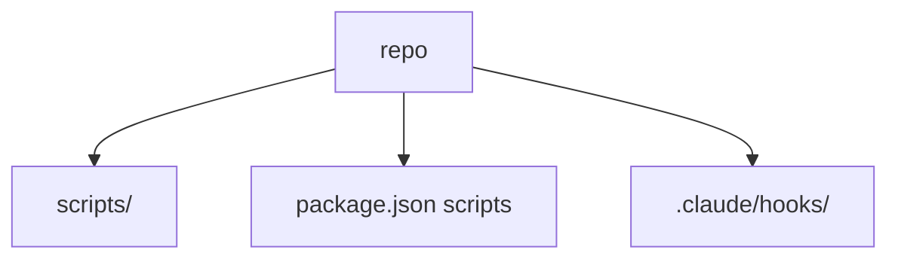
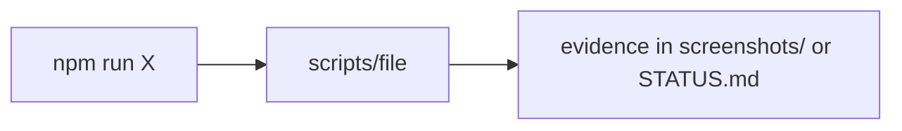

# Scripts Catalog

**¶1** □ GENERATED. 246 files in `scripts/`, 67 npm scripts, 10 project hooks in `.claude/hooks/`. Purpose text is each file's own header; `(no header comment...)` means none exists. See [gates and sweeps](../verification/gates-sweeps-and-deployment.md) and [legacy visual parity](../subsystems/legacy-visual-parity.md).

## Structure (`Continuant` — `graph TD`)

## How to use it (`Occurrent` — `graph LR`)

## npm scripts (`package.json`)

| Name | Command |
|---|---|
| `dev` | `node node_modules/concurrently/dist/bin ⁄ concurrently.js "npm:dev:*"` |
| `dev:features` | `echo 'Use FEAT_ALL=1 npm run dev instead'` |
| `dev:server` | `node --import tsx/esm --watch src/server ⁄ app.ts` |
| `dev:client` | `node node_modules/vite/bin ⁄ vite.js` |
| `build` | `npm run build:server && npm run build:client` |
| `build:server` | `node node_modules/typescript/bin/tsc -p tsconfig.server.json && node node_modules/tsc-alias/dist ⁄ index.js` |
| `build:client` | `node node_modules/vite/bin ⁄ vite.js build` |
| `start` | `node dist/server/server ⁄ app.js` |
| `test` | `node node_modules/vitest ⁄ vitest.mjs run --config vitest.config.ts` |
| `test:watch` | `node node_modules/vitest ⁄ vitest.mjs --config vitest.config.ts` |
| `test:e2e` | `node node_modules/cypress/bin/cypress run` |
| `lint` | `node node_modules/eslint/bin ⁄ eslint.js src --ext .ts,.tsx` |
| `format` | `node node_modules/prettier/bin ⁄ prettier.cjs --write "src/**/*.{ts,tsx,json,css,md}"` |
| `typecheck` | `node node_modules/typescript/bin/tsc --noEmit` |
| `migrate:coffee` | `node scripts ⁄ migrate-coffee-to-ts.js` |
| `prep:views` | `mkdir -p src/server/couch_views && cp -r rizzoma/src/server/couch_views/* src/server/couch_views/` |
| `deploy:views` | `node scripts ⁄ deploy-views.js` |
| `docker:dev` | `docker-compose up -d` |
| `docker:build` | `docker build -t rizzoma:latest .` |
| `start:all` | `bash scripts ⁄ start-all.sh` |
| `stop:all` | `bash scripts ⁄ stop-all.sh` |
| `restart:all` | `npm run stop:all && npm run start:all` |
| `logs` | `docker compose logs -f` |
| `logs:app` | `docker compose logs -f app` |
| `status` | `docker compose ps && echo ' API Health:' && curl -s http://localhost:8788/api/health \|\| echo 'API not responding'` |
| `test:toolbar-inline` | `node test-toolbar-inline-smoke.mjs` |
| `test:follow-green` | `node test-follow-green-smoke.mjs` |
| `test:collab` | `node test-collab-smoke.mjs` |
| `test:select-all-edit` | `node test-select-all-edit-smoke.mjs` |
| `test:collapse-control` | `node test-collapse-control-smoke.mjs` |
| `test:nested-pointer` | `node test-nested-pointer-focus-smoke.mjs` |
| `test:click-caret` | `node test-click-caret-smoke.mjs` |
| `test:paste-image` | `node test-paste-image-smoke.mjs` |
| `test:liliia` | `node test-liliia-smoke.mjs` |
| `test:gadgets-render` | `node test-gadgets-render-smoke.mjs` |
| `test:phone-layout` | `node test-phone-layout-smoke.mjs` |
| `test:tester-scenarios` | `node test-tester-scenarios.mjs` |
| `test:tester-scenarios:headed` | `bash scripts/tester-scenarios ⁄ run-headed.sh` |
| `test:scenarios-coverage` | `node scripts/tester-scenarios ⁄ coverage-matrix.mjs --check` |
| `test:deep-nesting` | `node test-deep-nesting-meta-smoke.mjs` |
| `test:shell-defects` | `node test-shell-defects-smoke.mjs` |
| `test:tester-feedback` | `node test-tester-feedback-smoke.mjs` |
| `test:root-ctrl-enter` | `node scripts ⁄ test-root-ctrl-enter-survives-reload.mjs` |
| `test:native-ctrl-enter` | `node test-native-ctrl-enter-smoke.mjs` |
| `test:readmode-seed` | `node test-topic-readmode-seed-smoke.mjs` |
| `test:done-flush` | `node test-done-flush-smoke.mjs` |
| `test:upload-signature` | `node test-upload-signature-smoke.mjs` |
| `test:embed-console` | `node test-embed-console-smoke.mjs` |
| `test:clipboard-paste` | `node test-clipboard-paste-smoke.mjs` |
| `test:topics-filter` | `node test-topics-filter-smoke.mjs` |
| `test:edit-meta` | `node test-edit-meta-smoke.mjs` |
| `test:gadgets` | `node test-gadget-apps-smoke.mjs` |
| `test:body-text` | `node test-blip-body-text-smoke.mjs` |
| `test:health` | `node node_modules/vitest ⁄ vitest.mjs run --config vitest.config.ts src/tests ⁄ server.health.test.ts src/tests ⁄ routes.comments.inlineHealth.test.ts src/test…` |
| `perf:harness` | `node perf-harness.mjs` |
| `perf:budget` | `node scripts ⁄ perf-budget.mjs` |
| `visual:sweep` | `node scripts ⁄ visual-feature-sweep.mjs` |
| `visual:coverage` | `node scripts ⁄ visual-feature-coverage.mjs` |
| `parity:gate` | `node scripts ⁄ check-rizzoma-parity-gate.mjs` |
| `sharing:count-legacy` | `node scripts ⁄ count-missing-sharing-policies.mjs` |
| `snapshots:pull` | `bash scripts ⁄ fetch-latest-snapshots.sh` |
| `lint:branch-context` | `node scripts ⁄ check-branch-state.cjs` |
| `cap:sync` | `npm run build && node node_modules/@capacitor/cli/bin/capacitor sync` |
| `cap:open:android` | `node node_modules/@capacitor/cli/bin/capacitor open android` |
| `cap:open:ios` | `node node_modules/@capacitor/cli/bin/capacitor open ios` |
| `cap:run:android` | `node node_modules/@capacitor/cli/bin/capacitor run android` |
| `cap:run:ios` | `node node_modules/@capacitor/cli/bin/capacitor run ios` |

## scripts/ (246)

| File | Lines | Header / first fact |
|---|---:|---|
| `scripts/README_recover_soft_deleted_blips.md` | — | — |
| `scripts/analyze_bullets.py` | 50 | Focus on the left edge where bullets appear (x: 0 to 60) |
| `scripts/append_workflow_note.py` | 25 | — |
| `scripts/backup-bundle.sh` | 93 | Hard Gap #23 (2026-04-13): one-shot bundle + GDrive copy script. |
| `scripts/backup-to-gdrive.ps1` | — | — |
| `scripts/backup-to-gdrive.sh` | 15 | — |
| `scripts/backup.sh` | 149 | Rizzoma Backup Automation Script |
| `scripts/build_depth10_fractal.mjs` | 130 | Build a depth-10 fractal in the Try topic via Playwright. |
| `scripts/build_native_pm.mjs` | 1411 | Build the HTML PM dashboard for the native fractal-render port. |
| `scripts/build_parity_comparisons.py` | 93 | Build legacy/current side-by-side comparison sheets for the parity gate. |
| `scripts/build_try_step_by_step_new.mjs` | 337 | Build a fresh Try topic in the NEW Rizzoma step-by-step via Ctrl+Enter, |
| `scripts/build_try_topic.mjs` | 158 | Build a "Try" topic on our Rizzoma matching the rizzoma.com Try fractal exactly: |
| `scripts/build_zoomed_parity_comparisons.py` | 76 | Build true zoomed component-level side-by-side comparison sheets. |
| `scripts/capture-child-blip-edit.mjs` | 90 | — |
| `scripts/capture-edit-mode.mjs` | 76 | — |
| `scripts/capture-exact-legacy-viewport.mjs` | 97 | — |
| `scripts/capture-feature-flows-fix.mjs` | 135 | Re-run the 7 editor features that failed in capture-feature-flows.mjs. |
| `scripts/capture-feature-flows-pass2.mjs` | 648 | Feature flow sweep — PASS 2 (2026-04-16). |
| `scripts/capture-feature-flows-pass3.mjs` | 883 | Feature flow sweep — PASS 3 (2026-04-16). |
| `scripts/capture-feature-flows-pass4.mjs` | 800 | Feature flow sweep — PASS 4 (2026-04-16). |
| `scripts/capture-feature-flows-pass5.mjs` | 795 | Feature flow sweep — PASS 5 (2026-04-16). |
| `scripts/capture-feature-flows-pass6.mjs` | 816 | Feature flow sweep — PASS 6 (2026-04-16). |
| `scripts/capture-feature-flows-pass7.mjs` | 391 | Feature flow sweep — PASS 7 (2026-04-16). |
| `scripts/capture-feature-flows-pass8.mjs` | 211 | Feature flow sweep — PASS 8 (2026-04-16) — FINAL. |
| `scripts/capture-feature-flows.mjs` | 651 | Feature-flow capture script. |
| `scripts/capture-final-4.mjs` | 136 | — |
| `scripts/capture-ftg-keyboard.mjs` | 123 | Two-user FtG keyboard capture for features 54 (jkgG) and 55 (Ctrl+Space). |
| `scripts/capture-offline-auth-ui.mjs` | 112 | — |
| `scripts/capture-public-blb-creation-contract.mjs` | 178 | — |
| `scripts/capture_blb_hierarchy.cjs` | 178 | Focused live verifier for Hard Gap #13 (BLB hierarchy legibility). |
| `scripts/capture_blb_inline_probe.cjs` | 129 | — |
| `scripts/capture_blb_live_scenario.cjs` | 574 | Hard Gap #14 (2026-04-13): replaced the previous fixed waitForTimeout(1500) |
| `scripts/capture_blb_live_scenario_asymmetric.cjs` | 291 | Focused live verifier for Hard Gap #17 (less scripted live-topic |
| `scripts/capture_blb_live_scenario_mobile.cjs` | 300 | — |
| `scripts/capture_blb_probe.cjs` | 428 | — |
| `scripts/capture_complex_live_workflow.cjs` | 158 | — |
| `scripts/capture_edit_determinism.cjs` | 194 | Focused live verifier for Hard Gap #12 (deterministic Edit semantics). |
| `scripts/capture_full_page_parity.cjs` | 92 | Honest side-by-side capture. Takes a full-viewport screenshot of the |
| `scripts/capture_full_render_lazy_mount.cjs` | 143 | Verifies that full-render topic-root waves with more than |
| `scripts/capture_inline_comments_playback_perf.cjs` | 235 | Perf/resilience verifier for inline comments + wave-level playback |
| `scripts/capture_live_inline_comment_flow.cjs` | 213 | — |
| `scripts/capture_live_store_install_lifecycle.cjs` | 170 | — |
| `scripts/capture_live_store_panel.cjs` | 43 | — |
| `scripts/capture_live_subblip_siblings.cjs` | 294 | Focused live verifier for the subblip parent inline preview (#34) and the |
| `scripts/capture_live_topic.cjs` | 100 | — |
| `scripts/capture_live_topic_app.cjs` | 230 | Hard Gap #21 (2026-04-13): replaced waitForTimeout(1500) with a |
| `scripts/capture_live_topic_gadget_entry.cjs` | 66 | — |
| `scripts/capture_live_topic_gadget_url.cjs` | 131 | — |
| `scripts/capture_live_topic_palette.cjs` | 70 | — |
| `scripts/capture_live_topic_poll.cjs` | 124 | — |
| `scripts/capture_realistic_topic_parity.cjs` | 351 | Honest parity capture against rizzoma-live/feature/rizzoma-core-features/. |
| `scripts/capture_realtime_pair.mjs` | 107 | Standalone two-client realtime capture → 041-real-time-cursor-and-typing-indicator-visible.png |
| `scripts/capture_subblip_view_parity.cjs` | 197 | Captures the subblip drill-down view for parity comparison against |
| `scripts/capture_test_editor_embed.cjs` | 33 | — |
| `scripts/capture_test_editor_poll.cjs` | 32 | — |
| `scripts/check-branch-state.cjs` | 80 | Guardrail: ensure branch-specific status notes mention the active branch. |
| `scripts/check-rizzoma-parity-gate.mjs` | 210 | — |
| `scripts/check_live_modules.mjs` | 14 | — |
| `scripts/clarify_tana_human_provenance_rule.py` | 52 | — |
| `scripts/consolidate_canonical_tana_workflow.py` | 101 | — |
| `scripts/count-missing-sharing-policies.mjs` | 126 | Exact, read-only sharing/owner inventory. Every topic row is emitted; no |
| `scripts/create-bundle.sh` | 136 | Create backup bundle for Google Drive |
| `scripts/create-owner-recovery-token.mjs` | 131 | Admin-only owner recovery for credential-less legacy placeholders. |
| `scripts/debug_bridge_stg.mjs` | 49 | — |
| `scripts/debug_focus_timeline.mjs` | 37 | — |
| `scripts/debug_planner_persistence.cjs` | 226 | — |
| `scripts/debug_root_ce2.mjs` | 68 | — |
| `scripts/debug_subblip_done.cjs` | 100 | — |
| `scripts/deep_visual_comparison.py` | 94 | Deep Visual Parity Comparison between Real Legacy Rizzoma and Modern Rizzoma. |
| `scripts/deploy-updates.sh` | 89 | Automated deployment script for Rizzoma updates |
| `scripts/deploy-views.js` | 167 | Use built-in fetch (Node 18+) |
| `scripts/deploy-vps.sh` | 408 | Build an immutable compiled Rizzoma release on the VPS and start it in an |
| `scripts/dump_blip_dom.mjs` | 34 | — |
| `scripts/explore_live_blip_workflow.cjs` | 156 | — |
| `scripts/fetch-latest-snapshots.sh` | 49 | — |
| `scripts/firefox-smoke.mjs` | 176 | Firefox cross-browser smoke test — top 10 features. |
| `scripts/fix-anonymous-authors.cjs` | 188 | Migration script: Fix "Anonymous" author names on blips |
| `scripts/fix_tana_docs_mirror.py` | 34 | — |
| `scripts/fractal-showcase/build-showcase.mjs` | 67 | Build the Fractal Showcase topic BY HAND (real keyboard / mouse) and verify it from persisted state. |
| `scripts/fractal-showcase/caret-probe.mjs` | 75 | Caret probe on a scratch chain (root > Probe level 1..4) on any host: click into the level 2 blip and type, |
| `scripts/fractal-showcase/count-spec.mjs` | 7 | Count the blips and the deepest level a spec will create (no browser). |
| `scripts/fractal-showcase/final-look.mjs` | 51 | How does a NORMAL EDITOR see the showcase gadgets? Fresh signed-in browser context as Fractal Tester 2 (not the owner, |
| `scripts/fractal-showcase/functions.mjs` | 53 | Registry of what was done and what persisted evidence to look for afterwards: filled by the hooks. |
| `scripts/fractal-showcase/gadget-look.mjs` | 34 | Screenshot how each gadget of a scratch topic renders in the VIEW state (to be READ). env: FS_STATE_IN (json |
| `scripts/fractal-showcase/gadget-render-probe.mjs` | 71 | Do the gadgets RENDER? Insert each of the 11 palette gadgets in a scratch topic with real clicks and typing, |
| `scripts/fractal-showcase/lib.mjs` | 83 | Shared helpers for the hand-built "Fractal Showcase" topic. Content is entered ONLY with real |
| `scripts/fractal-showcase/liliia-live.mjs` | 28 | Live check of Liliia (a)+(e) as the NON-OWNER Fractal Tester 2 on the live host, headed, real input. env FS_STATE_IN |
| `scripts/fractal-showcase/liliia-repro.mjs` | 67 | Reproduce Liliia's 19 Nov defects as a NON-OWNER in a clean context (headed, private display, real input). |
| `scripts/fractal-showcase/liliia-repro2.mjs` | 56 | Liliia (c) insert a blip mid-blip, (d) screenshot paste into a sub-blip + delete the picture, as the NON-OWNER B. |
| `scripts/fractal-showcase/live-access-probe.mjs` | 79 | READ-ONLY access probe as Fractal Tester 2 (no sharing with anyone): what can a brand-new user list and read? |
| `scripts/fractal-showcase/live-cleanup.mjs` | 40 | Delete the scratch topics of a live run through the UI (gear menu, Delete, confirm), then prove with a |
| `scripts/fractal-showcase/live-trial.mjs` | 52 | LIVE probe of the empty-root-editor fix: as Fractal Tester 1, N fresh scratch topics, each created through |
| `scripts/fractal-showcase/live-verify-pending.mjs` | 52 | LIVE verification of the pending-invitee fix and the avatar-overlay fix, headed, real clicks: |
| `scripts/fractal-showcase/liveauth.mjs` | 52 | Live sign-in helper. Credentials are read from the credential file inside this process, typed into |
| `scripts/fractal-showcase/ops.mjs` | 178 | Wait until at least one editable editor exists and the caret lives in one. |
| `scripts/fractal-showcase/paste-live.mjs` | 37 | Live check of the pasted-screenshot fix: Fractal Tester 2 makes a SCRATCH topic, types a reply blip, pastes a 1600x900 |
| `scripts/fractal-showcase/phase2-share.mjs` | 35 | Phase 2 on the built topic (live): topic-level functions as Fractal Tester 1, sharing through the REAL |
| `scripts/fractal-showcase/promote-t2.mjs` | 24 | Owner: make Fractal Tester 2 an Editor through the real Invite dialog (select the member's checkbox, "Select role", Editor). |
| `scripts/fractal-showcase/run-private.sh` | 26 | Run a showcase driver in a HEADED Chromium on a PRIVATE virtual display (Xvfb), never on the |
| `scripts/fractal-showcase/seed-one.mjs` | 5 | Seed one verified local test account: node seed-one.mjs <email> <password> (needs COUCHDB_URL / COUCHDB_DB) |
| `scripts/fractal-showcase/share-link.mjs` | 21 | As Fractal Tester 1 (owner): open the topic, click Share, choose "Anyone with the link" + allow editing, save. |
| `scripts/fractal-showcase/showcase-cleanup.mjs` | 49 | Refill the LaTeX, Code and Sheet leaves of the live showcase topic BY HAND (real clicks and typing), as the owner. |
| `scripts/fractal-showcase/showcase-cleanup2.mjs` | 52 | Refill the LaTeX, Code and Sheet leaves of the live showcase topic BY HAND (real clicks and typing), as the owner. |
| `scripts/fractal-showcase/showcase-finish.mjs` | 51 | Refill the LaTeX, Code and Sheet leaves of the live showcase topic BY HAND (real clicks and typing), as the owner. |
| `scripts/fractal-showcase/showcase-gadgets-look.mjs` | 38 | Look at how the 11 gadget blips of the live showcase topic ACTUALLY render (a person's view): expand the |
| `scripts/fractal-showcase/showcase-leaf-look.mjs` | 44 | Refill the LaTeX, Code and Sheet leaves of the live showcase topic BY HAND (real clicks and typing), as the owner. |
| `scripts/fractal-showcase/showcase-poll-dedupe.mjs` | 56 | Refill the LaTeX, Code and Sheet leaves of the live showcase topic BY HAND (real clicks and typing), as the owner. |
| `scripts/fractal-showcase/showcase-poll.mjs` | 45 | Refill the LaTeX, Code and Sheet leaves of the live showcase topic BY HAND (real clicks and typing), as the owner. |
| `scripts/fractal-showcase/showcase-refill.mjs` | 55 | Refill the LaTeX, Code and Sheet leaves of the live showcase topic BY HAND (real clicks and typing), as the owner. |
| `scripts/fractal-showcase/spec.mjs` | 56 | The content of the Fractal Showcase. Labels are atomic (2 to 5 words), globally unique by their first |
| `scripts/fractal-showcase/things-probe.mjs` | 63 | Probe the everyday editing things on a scratch chain (root > Probe level 1..4 (+ Extra child)), headed, real |
| `scripts/fractal-showcase/trial-new-topic-editor.mjs` | 32 | N fresh topics: create through the New dialog, press Edit, type one line, report whether the root |
| `scripts/fractal-showcase/verify-nonowner.mjs` | 20 | Load the topic link as a NON-OWNER account (Fractal Tester 2) in a headed run and report what a person sees. |
| `scripts/full-deploy.sh` | 141 | MASTER DEPLOYMENT SCRIPT |
| `scripts/gen_status.mjs` | 141 | Generate STATUS .md — the SINGLE authoritative current-state doc. |
| `scripts/generate-ui-exhaustive-pack.mjs` | 445 | — |
| `scripts/git-hooks/pre-push` | — | — |
| `scripts/handbuild_acceptance.mjs` | 462 | HAND-BUILD ACCEPTANCE — the gate for ALL Rizzoma fractal work (SDS 2026-07-14). |
| `scripts/handbuild_depth10.mjs` | 109 | HAND-BUILD a depth-10 fractal on the NEW rizzoma through the REAL UI. |
| `scripts/insert_depth10_spine.mjs` | 123 | Insert a depth-10 spine of blips directly into CouchDB. |
| `scripts/inspect_screenshot_155148.py` | 27 | Find all blue ribbons (#4ea0f1 -> r ~ 78, g ~ 160, b ~ 241) |
| `scripts/inspect_tana_nodes.py` | 25 | — |
| `scripts/inspect_user_screenshot.py` | 33 | Let's inspect horizontal slices of 20px |
| `scripts/install-git-hooks.sh` | 5 | Copy the tracked git hooks into this clone's .git/hooks (existing hooks there are kept). |
| `scripts/install-vps-systemd.sh` | 186 | Installation and reconciliation of the managed blue/green service template. |
| `scripts/legacy_archive_crops.mjs` | 154 | LEGACY ARCHIVE PHASE 2 — element-level CROPS keyed to feature-matrix rows, |
| `scripts/legacy_archive_p3.mjs` | 128 | LEGACY ARCHIVE PHASE 3 — clip-based crop retakes + settings/help/deep-topic states. |
| `scripts/legacy_archive_p4.mjs` | 66 | LEGACY ARCHIVE PHASE 4 — mobile nav states, extra widths, public-topic depth. |
| `scripts/legacy_probe.mjs` | 28 | READ-ONLY probe of legacy rizzoma.com UI landmarks (auth via rizzoma-session-state.json) |
| `scripts/legacy_reference_archive.mjs` | 215 | LEGACY REFERENCE ARCHIVE — systematic captures of original rizzoma.com. |
| `scripts/lib/e2e-sharing-fixtures.mjs` | 125 | (no header comment; exports seedVerifiedE2EAccount) |
| `scripts/measure_fractal_geometry.mjs` | 51 | Measure per-depth box geometry of the depth-10 fixture (staging). |
| `scripts/measure_indent_chain.mjs` | 62 | Walk the DOM chain from a parent blip-container to its child container and |
| `scripts/native_read_acceptance.mjs` | 142 | Phase 1 native-read acceptance. |
| `scripts/native_render_handbuilt.mjs` | 51 | Render the HAND-BUILT depth-10 topic through the NATIVE path (?render=native) |
| `scripts/native_render_sanity_sweep.mjs` | 182 | Native render sanity sweep. |
| `scripts/native_roundtrip_devdb.mjs` | 185 | Round-trip parser/serializer test against every blip in a CouchDB. |
| `scripts/perf-budget.mjs` | 182 | (no header comment; exports checkRun) |
| `scripts/pm_native_port.py` | 638 | Native Fractal-Render Port — live TUI PM dashboard. |
| `scripts/post_tana_daily.py` | 326 | — |
| `scripts/probe_bullet_structure.mjs` | 44 | — |
| `scripts/probe_ctrl_enter_handoff.mjs` | 125 | Diagnostic probe for the Ctrl+Enter hand-off (LOCAL stack only). |
| `scripts/probe_ids.mjs` | 20 | — |
| `scripts/probe_live_planner_iframe.cjs` | 169 | — |
| `scripts/probe_native_depth.mjs` | 29 | a React-built hand-build d10 topic (has real depth-10 content stored) |
| `scripts/probe_native_topdown.mjs` | 30 | top-down: click the FIRST *visible* folded thread's fold button, repeat |
| `scripts/probe_user_topic.mjs` | 64 | — |
| `scripts/recover_soft_deleted_blips.py` | 247 | Put the marker before the last 
; append it when the parent has no paragraph. |
| `scripts/repro-root-ctrl-enter-handoff.mjs` | 71 | REPRODUCTION of an OPEN defect (not a passing gate): after Ctrl+Enter in the TOPIC ROOT editor |
| `scripts/repro_live_subblip_bug.mjs` | 75 | Reproduce the dead-"+" subblip bug on LIVE master (138-201-62-161.nip.io). |
| `scripts/repro_nested_ctrl_enter.mjs` | 198 | Reproduce: Ctrl+Enter inside a NESTED blip's editor (not topic root) — user |
| `scripts/repro_nested_cursor_ce.mjs` | 52 | Reproduce SDS's action: click into L3 label, place cursor, Ctrl+Enter (as old Rizzoma). |
| `scripts/repro_root_ctrl_enter.mjs` | 64 | Reproduce SDS's manual flow on LIVE: open topic → click Edit (root) → Ctrl+Enter. |
| `scripts/rizzoma_export_manual_profile.bat` | — | — |
| `scripts/rizzoma_export_manual_profile.py` | 71 | Export Playwright storage state from an existing Chrome profile (manual login). |
| `scripts/rizzoma_export_via_cdp.bat` | — | — |
| `scripts/rizzoma_export_via_cdp.py` | 55 | Connect to an already running Chrome via CDP and export storage state. |
| `scripts/rizzoma_export_via_cdp_reset.bat` | — | — |
| `scripts/rizzoma_export_via_cdp_simple.bat` | — | — |
| `scripts/rizzoma_headful.bat` | — | — |
| `scripts/rizzoma_headful.py` | 115 | Headful Playwright helper to log into Rizzoma manually (e.g., Google SSO). |
| `scripts/rizzoma_manual_chrome.bat` | — | — |
| `scripts/rizzoma_sanity_sweep.mjs` | 323 | Rizzoma sanity sweep — analog of scripts ⁄ visual_sanity_analyze.mjs. |
| `scripts/shot_fractal_after.mjs` | 27 | — |
| `scripts/shot_topic.mjs` | 14 | — |
| `scripts/start-all.sh` | 105 | Colors for output |
| `scripts/stop-all.sh` | 31 | Colors for output |
| `scripts/sweep_try_topic.mjs` | 215 | Exhaustive visual sweep of the "Try" topic on our Rizzoma. Captures: |
| `scripts/sync_tana_provenance_docs.py` | 100 | — |
| `scripts/sync_tana_rizzoma_tags.py` | 40 | — |
| `scripts/tana-live-sync-260329.json` | — | — |
| `scripts/tana_doc_resolver.py` | 43 | — |
| `scripts/tana_fix_created_by.py` | 75 | — |
| `scripts/tana_rpc.py` | 108 | — |
| `scripts/test-ctrl-enter-live.mjs` | 149 | — |
| `scripts/test-delete-blip.mjs` | 164 | — |
| `scripts/test-live-auth-and-topic.mjs` | 75 | — |
| `scripts/test-root-ctrl-enter-survives-reload.mjs` | 291 | Regression gate: a NEWLY CREATED child blip must keep its editor, focus, caret and typed text |
| `scripts/test_edit_then_ce.mjs` | 31 | — |
| `scripts/test_recover_soft_deleted_blips.py` | 117 | Test of recover_soft_deleted_blips.py against a THROWAWAY database on a scratch CouchDB. |
| `scripts/test_surface7_selection.mjs` | 88 | — |
| `scripts/test_wiki_first_hook.py` | 58 | Tests for scripts ⁄ wiki_first_hook.py: wiki-first and ORIGINAL-FIRST gates. Run: python3 scripts ⁄ test_wiki_first_hook.py |
| `scripts/tester-scenarios/README.md` | — | — |
| `scripts/tester-scenarios/case_sheet.py` | 26 | Contact sheets of the evidence screenshot of passing cases, for reading: case_sheet.py <results.json[,more]> <steps dir> <out dir> [case ids...] |
| `scripts/tester-scenarios/cases/A-nesting.mjs` | 295 | Family A: nesting and typing. Every text must land in ITS OWN blip, under the right parent, |
| `scripts/tester-scenarios/cases/B-edit-modes.mjs` | 179 | Family B: edit modes (view <-> edit, jump-in, Ctrl+Enter from view state, reply vs inline comment, |
| `scripts/tester-scenarios/cases/C-data-safety.mjs` | 150 | Family C: data safety ("my blips disappear"). Every created blip must still exist, with the right |
| `scripts/tester-scenarios/cases/D-invite-people.mjs` | 134 | Family D: invite and people. The tester: "I cannot invite people to the topics" and the people list |
| `scripts/tester-scenarios/cases/E-images-files.mjs` | 104 | Family E: images and files. The tester: "screenshots work but a pasted image takes almost the whole page". |
| `scripts/tester-scenarios/cases/F-time-authorship.mjs` | 82 | Family F: time and authorship. The tester: "the time a blip was created does not display (only while writing)". |
| `scripts/tester-scenarios/cases/G-working-features.mjs` | 233 | Family G: the things the tester said work, which must keep working: login/logout, links, follow-the-green, |
| `scripts/tester-scenarios/cases/I-phone-mobile.mjs` | 92 | Family I: phone viewport (390 x 844) and the mobile / PWA rows. Real touch-sized viewport, real typing. |
| `scripts/tester-scenarios/cases/L-blb-fractal.mjs` | 127 | Family L: the BLB paradigm seen on screen: [+] markers, portal placement, nested inline expansion, deep fractal |
| `scripts/tester-scenarios/cases/N-navigation-ui.mjs` | 157 | Family N: navigation panel, topics list, tabs, right tools panel, store/teams/publics, new-topic wizard, |
| `scripts/tester-scenarios/cases/P-parity.mjs` | 346 | Family P: parity with the ORIGINAL Rizzoma, one ledger row per reference screenshot of |
| `scripts/tester-scenarios/cases/Q-native-guard.mjs` | 26 | Family Q: guard for the experimental native render path. ?render=native is an opt-in, unfinished port |
| `scripts/tester-scenarios/cases/R-contract-perf.mjs` | 105 | Family R: repository and deployment contract rows plus the 500-blip performance smoke. One-shot regression |
| `scripts/tester-scenarios/cases/S-server-contract.mjs` | 323 | Family S: the server contract as a signed-in colleague (and a second user, and a stranger) meets it: |
| `scripts/tester-scenarios/cases/T-toolbar-shortcuts.mjs` | 163 | Family T: the rich-text toolbar (every button) and the documented keyboard shortcuts, each judged by |
| `scripts/tester-scenarios/cases/W-realtime-presence.mjs` | 62 | Family W: real-time collaboration seen from the other user's screen (presence, cursors, typing, live updates). |
| `scripts/tester-scenarios/cases/X-gadgets-store.mjs` | 208 | Family X: gadgets, store, teams, publics. Every sandbox app must render AND respond. |
| `scripts/tester-scenarios/cases/_nest.mjs` | 46 | Level-1 blip from the topic reply box, then open it and put the caret in its editor. |
| `scripts/tester-scenarios/cases/_sh.mjs` | 12 | One-shot shell helper for contract cases: runs a command once and returns { status, out }. |
| `scripts/tester-scenarios/cases/index.mjs` | 21 | Every cases/<family>-*.mjs file default-exports an array of case specs: |
| `scripts/tester-scenarios/coverage-matrix.mjs` | 44 | Generates TESTERS_FEATURE_MATRIX.md (every documented feature row -> the behavioural case ids that |
| `scripts/tester-scenarios/feature-rows.mjs` | 32 | Parses the machine-readable feature contract (RIZZOMA_FEATURES_STATUS.md, "Comprehensive Feature |
| `scripts/tester-scenarios/ledger.mjs` | 130 | FEATURE LEDGER generator. Row sources: (A) the 240-row contract RIZZOMA_FEATURES_STATUS.md, (B) every gadget in the |
| `scripts/tester-scenarios/lib.mjs` | 363 | Shared driver for the tester-scenarios suite. A "client" is one real browser context signed in as |
| `scripts/tester-scenarios/list-rows.mjs` | 9 | — |
| `scripts/tester-scenarios/live-three.mjs` | 171 | Live check of three shipped fixes as the non-owner account Fractal Tester 2 (and Fractal Tester 1 as the topic owner for |
| `scripts/tester-scenarios/parity_compose.py` | 26 | Side-by-side composites for the parity rows: legacy reference screenshot (left) next to the modernized screen (right). |
| `scripts/tester-scenarios/parity_sheet.py` | 19 | Stack several composites into one image for reading: parity_sheet.py <evidence dir> <out.png> key [key ...] |
| `scripts/tester-scenarios/review.py` | 17 | Record a reading of one screenshot: review.py <row id> <WORKS\|PARTIAL\|BROKEN> "<what the screenshot shows>" [<screenshot path>] |
| `scripts/tester-scenarios/review_case.py` | 13 | Record a reading for every ledger row a case covers: review_case.py <results.json[,more]> <case id> <WORKS\|PARTIAL\|BROKEN> "<note>" [<sheet path>] |
| `scripts/tester-scenarios/reviews.json` | — | — |
| `scripts/tester-scenarios/run-headed.sh` | 21 | One-shot: run the tester-scenarios suite in a REAL, HEADED Chromium on a PRIVATE virtual display (Xvfb), never on |
| `scripts/verify-blb-fractal-proof.mjs` | 224 | — |
| `scripts/verify-fixes-261108.mjs` | 172 | — |
| `scripts/verify-full-parity-live.mjs` | 205 | — |
| `scripts/verify-full-parity-live2.mjs` | 187 | — |
| `scripts/verify-full-parity.mjs` | 173 | — |
| `scripts/verify-parity-all.mjs` | 143 | — |
| `scripts/verify-production-dependencies.cjs` | 70 | — |
| `scripts/verify-sharing-ui.mjs` | 110 | — |
| `scripts/verify-ui-delete-and-ctrl-enter.mjs` | 165 | — |
| `scripts/verify_bug_AB.mjs` | 162 | Verify Bug A (Ctrl+Enter latency) + Bug B (nested mount at depth 2+) on the live VPS dev container. |
| `scripts/verify_ctrl_enter_dev.mjs` | 75 | — |
| `scripts/verify_drift_fix.mjs` | 138 | Verify (3) — anchorPosition value is no longer used for positioning. |
| `scripts/verify_single_active_editor.mjs` | 150 | Acceptance verification for fix/single-active-editor on the DEV instance. |
| `scripts/verify_state_survives_collapse.mjs` | 220 | Verify (b): draft text typed into a child blip's editor SURVIVES the |
| `scripts/verify_surface4.mjs` | 124 | — |
| `scripts/viewport_sweep_dev.mjs` | 36 | — |
| `scripts/visual-feature-coverage.mjs` | 210 | — |
| `scripts/visual-feature-sweep.mjs` | 1412 | — |
| `scripts/visual_sanity_analyze.mjs` | 249 | Visual sanity pass on analyze.rubase.org after today's batch: |
| `scripts/wiki_coverage.py` | 50 | Fail when the wiki does not mention (by file name) something it must cover. |
| `scripts/wiki_first_hook.py` | 236 | Wiki-first gate for ONE repo, shared by every agent CLI that can run hooks. |
| `scripts/wiki_generate_catalogs.py` | 326 | import json |
| `scripts/wiki_generate_original_catalog.py` | 49 | Generate wiki/reference ⁄ original-source-map.md: every .coffee and .js file of the vendored ORIGINAL |
| `scripts/wiki_lint.py` | 48 | Thin wrapper in /mnt/c/Rizzoma/scripts ⁄ wiki_lint.py that invokes the canonical |
| `scripts/workflow-note-260329-canonical.md` | — | — |
| `scripts/workflow-note-260329-late.md` | — | — |
| `scripts/workflow-note-260330-app-runtime.md` | — | — |
| `scripts/workflow-note-260330-embed-adapters.md` | — | — |
| `scripts/workflow-note-260330-embed-expansion.md` | — | — |
| `scripts/workflow-note-260330-topic-app.md` | — | — |

## .claude/hooks/ (10)

| File | Lines | Header / first fact |
|---|---:|---|
| `.claude/hooks/blb-required-reading-check.sh` | 38 | PreToolUse on Edit/Write/mcp__playwright__* — non-blocking reminder if |
| `.claude/hooks/hetzner-firewall-safety.sh` | 34 | PreToolUse on Bash — gate POST to Hetzner Robot firewall API. |
| `.claude/hooks/post-work-checklist.sh` | 78 | Stop hook — checks the post-work checklist documented in MEMORY.md. |
| `.claude/hooks/screenshot-naming-check.sh` | 51 | PreToolUse on Write/Bash — verify screenshots/ filenames follow the |
| `.claude/hooks/session-start-clear-reads.sh` | 9 | SessionStart — clear the session-reads tracker so blb-required-reading-check |
| `.claude/hooks/tana-project-tags-check.sh` | 39 | PreToolUse on mcp__tana-local__tag — refuse to tag a Rizzoma entry without |
| `.claude/hooks/tana-unicode-safety.sh` | 24 | PreToolUse on mcp__tana-local__import_tana_paste — refuse content with |
| `.claude/hooks/track-session-reads.sh` | 12 | PostToolUse on Read — append the file path to .claude/state/session-reads.txt |
| `.claude/hooks/unpushed-commits-warn.sh` | 21 | Stop hook — standalone unpushed-commits warning (post-work-checklist |
| `.claude/hooks/visual-sweep-gate.sh` | 30 | Stop hook (Rizzoma project-scope) — block UI-status handoff when parity |

