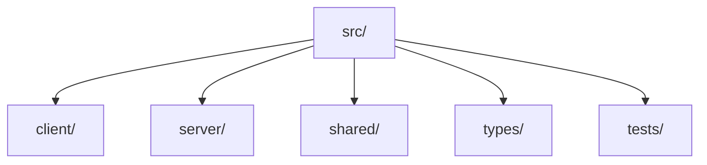
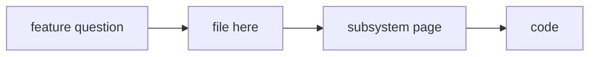

# Source Map

**¶1** □ GENERATED from `git ls-files`. Each tracked code file under `src/` appears once with its length and its first header comment or, failing that, the first exported name; where neither exists the table says so instead of guessing. Subsystem pages explain the important ones: [native port](../subsystems/native-render-port.md), [BLB invariants](../subsystems/blb-and-editor-invariants.md), [server](../subsystems/server-collab-and-storage.md), [parity](../subsystems/legacy-visual-parity.md).

## Structure (`Continuant` — `graph TD`)

## How to use it (`Occurrent` — `graph LR`)

## Client components (116)

| File | Lines | Header / first fact |
|---|---:|---|
| `src/client/components/AnonymousTopicRoute.css` | 86 | — |
| `src/client/components/AnonymousTopicRoute.tsx` | 78 | (no header comment; exports AnonymousTopicRoute) |
| `src/client/components/AuthPanel.css` | 208 | — |
| `src/client/components/AuthPanel.tsx` | 480 | (no header comment; exports AuthUser) |
| `src/client/components/BlipContent.tsx` | 13 | (no header comment; exports BlipContent) |
| `src/client/components/CreateTopicModal.css` | 276 | — |
| `src/client/components/CreateTopicModal.tsx` | 139 | (no header comment; exports CreateTopicModal) |
| `src/client/components/Editor.tsx` | 208 | (no header comment; exports Editor) |
| `src/client/components/EditorAdmin.tsx` | 83 | (no header comment; exports EditorAdmin) |
| `src/client/components/EditorSearch.tsx` | 174 | (no header comment; exports EditorSearch) |
| `src/client/components/ExportModal.css` | 199 | — |
| `src/client/components/ExportModal.tsx` | 177 | (no header comment; exports ExportModal) |
| `src/client/components/FollowTheGreen.css` | 66 | — |
| `src/client/components/FollowTheGreen.tsx` | 69 | (no header comment; exports FollowTheGreen) |
| `src/client/components/GadgetPalette.css` | 260 | — |
| `src/client/components/GadgetPalette.tsx` | 180 | (no header comment; exports GadgetPalette) |
| `src/client/components/GreenNavigation.tsx` | 43 | (no header comment; exports GreenNavigation) |
| `src/client/components/InviteModal.tsx` | 198 | (no header comment; exports InviteModal) |
| `src/client/components/MentionsList.css` | 134 | — |
| `src/client/components/MentionsList.tsx` | 183 | (no header comment; exports MentionsList) |
| `src/client/components/NavigationPanel.css` | 195 | NavigationPanel.css - Authentic Legacy Rizzoma Navigation Rail |
| `src/client/components/NavigationPanel.tsx` | 104 | (no header comment; exports NavigationPanel) |
| `src/client/components/PWAPrompts.css` | 100 | — |
| `src/client/components/PWAPrompts.tsx` | 129 | (no header comment; exports PWAPrompts) |
| `src/client/components/PresenceIndicator.css` | 66 | — |
| `src/client/components/PresenceIndicator.tsx` | 54 | (no header comment; exports PresenceIndicator) |
| `src/client/components/PublicTopicsPanel.css` | 80 | — |
| `src/client/components/PublicTopicsPanel.tsx` | 104 | (no header comment; exports PublicTopicsPanel) |
| `src/client/components/RebuildPanel.tsx` | 133 | (no header comment; exports RebuildPanel) |
| `src/client/components/RightToolsPanel.css` | 328 | RightToolsPanel.css - Authentic Legacy Rizzoma Right Tools Panel |
| `src/client/components/RightToolsPanel.tsx` | 451 | Custom events for insert shortcuts - these are dispatched globally |
| `src/client/components/RizzomaLanding.css` | 360 | — |
| `src/client/components/RizzomaLanding.tsx` | 115 | (no header comment; exports RizzomaLanding) |
| `src/client/components/RizzomaLayout.css` | 423 | dynamic viewport height — accounts for mobile address bar |
| `src/client/components/RizzomaLayout.tsx` | 567 | (no header comment; exports RizzomaLayout) |
| `src/client/components/RizzomaTopicDetail.css` | 1756 | RizzomaTopicDetail - Matching real Rizzoma |
| `src/client/components/RizzomaTopicDetail.tsx` | 2136 | (no header comment; exports shouldThrottleSocketTopicLoad) |
| `src/client/components/RizzomaTopicsList.css` | 225 | Authentic Legacy Rizzoma Topics List Styles |
| `src/client/components/RizzomaTopicsList.tsx` | 353 | (no header comment; exports RizzomaTopicsList) |
| `src/client/components/ShareModal.tsx` | 237 | (no header comment; exports ShareModal) |
| `src/client/components/ShellAuthControls.css` | 197 | — |
| `src/client/components/ShellAuthControls.tsx` | 184 | (no header comment; exports ShellAuthControls) |
| `src/client/components/StatusBar.tsx` | 16 | (no header comment; exports StatusBar) |
| `src/client/components/StorePanel.css` | 312 | — |
| `src/client/components/StorePanel.tsx` | 265 | (no header comment; exports StorePanel) |
| `src/client/components/TasksList.css` | 157 | — |
| `src/client/components/TasksList.tsx` | 216 | (no header comment; exports TasksList) |
| `src/client/components/TeamsPanel.css` | 186 | — |
| `src/client/components/TeamsPanel.tsx` | 120 | (no header comment; exports TeamsPanel) |
| `src/client/components/TipsBox.css` | 161 | TipsBox.css - Authentic Legacy Rizzoma Tips / Shortcuts Box |
| `src/client/components/TipsBox.tsx` | 81 | (no header comment; exports TipsBox) |
| `src/client/components/Toast.tsx` | 46 | (no header comment; exports Toast) |
| `src/client/components/TopicsList.tsx` | 123 | (no header comment; exports TopicsList) |
| `src/client/components/UserPresence.css` | 60 | — |
| `src/client/components/UserPresence.tsx` | 56 | (no header comment; exports UserPresence) |
| `src/client/components/WavePlaybackModal.css` | 523 | WavePlaybackModal - Wave-level Timeline Playback UI |
| `src/client/components/WavePlaybackModal.tsx` | 444 | (no header comment; exports WavePlaybackModal) |
| `src/client/components/WaveView.tsx` | 361 | (no header comment; exports WaveView) |
| `src/client/components/WavesList.tsx` | 79 | (no header comment; exports WavesList) |
| `src/client/components/blip/ActiveBlipContext.tsx` | 77 | Single-active-blip invariant (BLB §18b2 three-state model): a topic shows at |
| `src/client/components/blip/BlipHistoryModal.css` | 475 | BlipHistoryModal - Timeline Playback UI |
| `src/client/components/blip/BlipHistoryModal.tsx` | 323 | (no header comment; exports BlipHistoryModal) |
| `src/client/components/blip/BlipMenu.css` | 540 | Authentic Legacy Rizzoma Blip Menu Styles |
| `src/client/components/blip/BlipMenu.tsx` | 871 | (no header comment; exports BlipMenu) |
| `src/client/components/blip/InlineHtmlRenderer.tsx` | 561 | (no header comment; exports InlineHtmlRenderOptions) |
| `src/client/components/blip/LazyBlipSlot.tsx` | 121 | Lazy-mount slot for top-level child blips under the topic root. |
| `src/client/components/blip/RizzomaBlip.css` | 1792 | Rizzoma Blip Styles |
| `src/client/components/blip/RizzomaBlip.tsx` | 3052 | (no header comment; exports BlipContributor) |
| `src/client/components/blip/clipboardStore.ts` | 105 | (no header comment; exports BlipClipboardPayload) |
| `src/client/components/blip/collapsePreferences.ts` | 140 | (no header comment; exports getCollapsePreference) |
| `src/client/components/blip/copyBlipLink.ts` | 73 | (no header comment; exports LocationLike) |
| `src/client/components/blip/inlineMarkers.ts` | 185 | (no header comment; exports stripOrphanMarkers) |
| `src/client/components/editor/BlipEditor.css` | 244 | — |
| `src/client/components/editor/BlipEditor.tsx` | 105 | (no header comment; exports BlipEditor) |
| `src/client/components/editor/CollaborativeCursors.css` | 171 | Collaborative Cursors Styling |
| `src/client/components/editor/CollaborativeCursors.tsx` | 223 | (no header comment; exports CursorUser) |
| `src/client/components/editor/CollaborativeProvider.ts` | 584 | (no header comment; exports SocketIOProvider) |
| `src/client/components/editor/EditableBlipContent.tsx` | 68 | (no header comment; exports EditableBlipContent) |
| `src/client/components/editor/EditorConfig.tsx` | 283 | (no header comment; exports createYjsDocument) |
| `src/client/components/editor/EditorToolbar.css` | 239 | — |
| `src/client/components/editor/EditorToolbar.tsx` | 553 | (no header comment; exports EditorToolbar) |
| `src/client/components/editor/FloatingToolbar.css` | 67 | Floating Rich Text Toolbar for Rizzoma |
| `src/client/components/editor/FloatingToolbar.tsx` | 183 | (no header comment; exports FloatingToolbar) |
| `src/client/components/editor/FollowGreen.css` | 165 | Follow the Green - Visual indicators for unread content |
| `src/client/components/editor/InlineComments.css` | 533 | Inline Comments Styling |
| `src/client/components/editor/InlineComments.tsx` | 887 | (no header comment; exports InlineCommentsStatus) |
| `src/client/components/editor/MentionList.css` | 92 | — |
| `src/client/components/editor/MentionList.tsx` | 77 | (no header comment; exports MentionListProps) |
| `src/client/components/editor/YjsDocumentManager.ts` | 98 | (no header comment; exports YjsDocumentManager) |
| `src/client/components/editor/blbEditorInvariant.ts` | 212 | (no header comment; exports BlbEditorDocument) |
| `src/client/components/editor/collaborationIdentity.ts` | 86 | (no header comment; exports CollaborationUser) |
| `src/client/components/editor/extensions/BlipKeyboardShortcuts.ts` | 253 | (no header comment; exports BlipKeyboardShortcutsOptions) |
| `src/client/components/editor/extensions/BlipThread.css` | 81 | BlipThread inline marker styles — authentic original Rizzoma speech bubble |
| `src/client/components/editor/extensions/BlipThreadNode.tsx` | 161 | Insert an inline BlipThread marker at the current cursor position. |
| `src/client/components/editor/extensions/CodeBlockView.css` | 128 | Enhanced Code Block — replaces bare TipTap codeBlock |
| `src/client/components/editor/extensions/CodeBlockView.tsx` | 87 | (no header comment; exports CodeBlockView) |
| `src/client/components/editor/extensions/GadgetNodes.ts` | 531 | (no header comment; exports createDefaultPollOptions) |
| `src/client/components/editor/extensions/ImageGadget.ts` | 83 | (no header comment; exports ImageOptions) |
| `src/client/components/editor/extensions/InlineCommentsVisibility.ts` | 39 | (no header comment; exports InlineCommentsVisibilityOptions) |
| `src/client/components/editor/extensions/PollGadgetView.tsx` | 269 | (no header comment; exports PollGadgetView) |
| `src/client/components/editor/extensions/SandboxAppGadgetView.tsx` | 215 | (no header comment; exports SandboxAppGadgetView) |
| `src/client/components/editor/extensions/TagNode.tsx` | 159 | Mock tags – in production these would be extracted from topic content |
| `src/client/components/editor/extensions/TaskWidget.css` | 46 | Task widget — turquoise pill like original Rizzoma \|☐ Name DD Mon\| |
| `src/client/components/editor/extensions/TaskWidget.tsx` | 605 | (no header comment; exports TaskCompletion) |
| `src/client/components/editor/extensions/TextColor.ts` | 65 | (no header comment; exports TextColorOptions) |
| `src/client/components/editor/extensions/Underline.ts` | 72 | (no header comment; exports UnderlineOptions) |
| `src/client/components/editor/inlineCommentDecorations.ts` | 56 | (no header comment; exports CommentGroup) |
| `src/client/components/editor/inlineCommentsVisibility.ts` | 142 | (no header comment; exports getInlineCommentsVisibility) |
| `src/client/components/editor/useAuthenticatedCollaborationUser.ts` | 20 | Resolve the production auth context into the identity placed on Yjs |
| `src/client/components/editor/useCollaboration.ts` | 70 | (no header comment; exports useCollaboration) |
| `src/client/components/mobile/BottomSheet.css` | 217 | Bottom Sheet Styles |
| `src/client/components/mobile/BottomSheet.tsx` | 239 | Whether the bottom sheet is open |
| `src/client/components/mobile/BottomSheetMenu.css` | 174 | Bottom Sheet Menu Styles |
| `src/client/components/mobile/BottomSheetMenu.tsx` | 280 | Unique identifier for the item |
| `src/client/components/native/NativeWaveView.css` | 199 | Native fractal-render — minimum viable CSS for the new render path. |
| `src/client/components/native/NativeWaveView.tsx` | 308 | Native fractal-render — React wrapper for WaveView. |

## Client native render port (20)

| File | Lines | Header / first fact |
|---|---:|---|
| `src/client/native/__tests__/awareness.test.ts` | 130 | Awareness tests — presence + cursor sharing across simulated clients. |
| `src/client/native/__tests__/blip-editor-host.test.ts` | 202 | BlipEditorHost lifecycle + round-trip tests (vitest, jsdom). |
| `src/client/native/__tests__/content-lookup.test.ts` | 124 | Phase 1 recursion fix — the native content lookup drives full-depth render |
| `src/client/native/__tests__/parser.test.ts` | 109 | Parser smoke test (vitest). |
| `src/client/native/__tests__/serializer.test.ts` | 164 | Serializer + round-trip tests (vitest). |
| `src/client/native/__tests__/spike-depth-10.test.ts` | 187 | Phase 1 spike — depth-10 fractal renders correctly via the new stack. |
| `src/client/native/__tests__/wave-view.test.ts` | 147 | WaveView tests (vitest, jsdom). |
| `src/client/native/__tests__/yjs-binding.test.ts` | 180 | Y.js binding tests — convergence between two Y.Doc instances exchanging |
| `src/client/native/awareness.ts` | 148 | Native fractal-render — Awareness wrapper. |
| `src/client/native/blip-editor-host.ts` | 222 | Native fractal-render — BlipEditorHost. |
| `src/client/native/blip-thread.ts` | 233 | Native fractal-render — BlipThread. |
| `src/client/native/blip-view.ts` | 167 | Native fractal-render — BlipView (Phase 2 skeleton). |
| `src/client/native/content-lookup.ts` | 82 | Native fractal-render — content lookup builder. |
| `src/client/native/parser.ts` | 284 | Native fractal-render — HTML → ContentArray parser. |
| `src/client/native/renderer.ts` | 234 | Native fractal-render — Renderer. |
| `src/client/native/serializer.ts` | 210 | Native fractal-render — ContentArray → HTML serializer. |
| `src/client/native/tiptap-adapter.ts` | 70 | Native fractal-render — BlipEditorAdapter that delegates to TipTap. |
| `src/client/native/types.ts` | 98 | Native fractal-render — content array type definitions. |
| `src/client/native/wave-view.ts` | 249 | Native fractal-render — WaveView. |
| `src/client/native/yjs-binding.ts` | 202 | Native fractal-render — Y.js CRDT binding for the ContentArray model. |

## Client other (64)

| File | Lines | Header / first fact |
|---|---:|---|
| `src/client/RizzomaApp.css` | 100 | Reset and base styles |
| `src/client/RizzomaApp.tsx` | 95 | (no header comment; exports RizzomaApp) |
| `src/client/TestEditorApp.tsx` | 95 | (no header comment; exports TestEditorApp) |
| `src/client/contexts/MobileContext.tsx` | 129 | (no header comment; exports MobileContextValue) |
| `src/client/gadgets/apps/catalog.ts` | 120 | (no header comment; exports GADGET_APP_CATALOG) |
| `src/client/gadgets/apps/installState.ts` | 102 | (no header comment; exports GADGET_APP_INSTALLS_KEY) |
| `src/client/gadgets/apps/runtime.ts` | 51 | (no header comment; exports GadgetSandboxDescriptor) |
| `src/client/gadgets/defaults.ts` | 10 | (no header comment; exports createDefaultPollAttrs) |
| `src/client/gadgets/embedAdapters/common.ts` | 36 | (no header comment; exports buildIframeHtml) |
| `src/client/gadgets/embedAdapters/iframe.ts` | 8 | (no header comment; exports resolveIframeEmbed) |
| `src/client/gadgets/embedAdapters/image.ts` | 8 | (no header comment; exports resolveImageEmbed) |
| `src/client/gadgets/embedAdapters/index.ts` | 21 | (no header comment; exports resolveGadgetUrl) |
| `src/client/gadgets/embedAdapters/spreadsheet.ts` | 14 | (no header comment; exports resolveSpreadsheetEmbed) |
| `src/client/gadgets/embedAdapters/youtube.ts` | 36 | (no header comment; exports resolveYouTubeEmbed) |
| `src/client/gadgets/insert.ts` | 107 | (no header comment; exports insertGadget) |
| `src/client/gadgets/registry.ts` | 140 | (no header comment; exports GADGET_REGISTRY) |
| `src/client/gadgets/security.ts` | 69 | (no header comment; exports EmbedProvider) |
| `src/client/gadgets/types.ts` | 76 | (no header comment; exports GadgetType) |
| `src/client/hooks/useAuth.ts` | 210 | (no header comment; exports User) |
| `src/client/hooks/useChangeTracking.ts` | 138 | (no header comment; exports useChangeTracking) |
| `src/client/hooks/useCollaborationPending.ts` | 37 | Live count used by the offline shell warning. |
| `src/client/hooks/useMediaQuery.ts` | 215 | Standard breakpoint values matching breakpoints.css |
| `src/client/hooks/useOfflineStatus.ts` | 317 | Whether the browser reports being online |
| `src/client/hooks/useOnlineState.ts` | 22 | Lightweight browser connectivity state without touching mutation queues. |
| `src/client/hooks/usePresence.ts` | 48 | (no header comment; exports PresenceStatus) |
| `src/client/hooks/usePullToRefresh.ts` | 339 | Whether the user is currently pulling |
| `src/client/hooks/useServiceWorker.ts` | 307 | Whether SW is supported in this browser |
| `src/client/hooks/useSocket.ts` | 16 | (no header comment; exports useSocket) |
| `src/client/hooks/useSwipe.ts` | 355 | Direction of the swipe |
| `src/client/hooks/useViewTransition.ts` | 245 | Check if View Transitions API is supported |
| `src/client/hooks/useWaveUnread.ts` | 319 | Debounce helper |
| `src/client/index.html` | 37 | — |
| `src/client/lib/api.ts` | 179 | Persist this mutation for offline replay. Secret redemptions must set false. |
| `src/client/lib/authSessionSignal.ts` | 24 | Announce only an epoch change — never identity, credentials, or tokens. |
| `src/client/lib/blipCreateResponse.ts` | 33 | (no header comment; exports CreatedBlip) |
| `src/client/lib/blipPagination.ts` | 35 | Collect every CouchDB bookmark page without silently losing descendants. |
| `src/client/lib/capacitor-native.ts` | 254 | Capacitor native-shell glue for the Rizzoma Android / iOS apps. |
| `src/client/lib/collaborationPending.ts` | 73 | In-memory accounting for Yjs updates that the collaboration server has not |
| `src/client/lib/collaborationProjection.ts` | 29 | (no header comment; exports COLLABORATION_STATE_DIGEST_HEADER) |
| `src/client/lib/editorPersistence.ts` | 42 | (no header comment; exports REMOTE_EDITOR_UPDATE) |
| `src/client/lib/format.ts` | 9 | (no header comment; exports formatTimestamp) |
| `src/client/lib/fragmentSecrets.ts` | 165 | (no header comment; exports PENDING_INVITE_URL_KEY) |
| `src/client/lib/getUserMediaAdapter.ts` | 359 | Modern getUserMedia adapter — TypeScript ES module. |
| `src/client/lib/htmlDiff.ts` | 55 | Simple word-level diff for HTML content. |
| `src/client/lib/inlineChildHandoff.ts` | 18 | Decide the next step while a topic-root Ctrl+Enter child moves from the |
| `src/client/lib/logout.ts` | 17 | Complete durable logout before changing local identity. A failed session |
| `src/client/lib/offlineQueue.ts` | 846 | Auth-bound offline mutation queue. |
| `src/client/lib/performance.d.ts` | 9 | — |
| `src/client/lib/performance.ts` | 60 | Performance monitoring utilities |
| `src/client/lib/sanitizeRichHtml.ts` | 242 | (no header comment; exports isSafeRichUrl) |
| `src/client/lib/sectionAttribution.ts` | 107 | Per-section author attribution for topic body blocks. |
| `src/client/lib/socket.ts` | 290 | (no header comment; exports disconnectSocketForAuthTransition) |
| `src/client/lib/topicExport.ts` | 184 | (no header comment; exports ExportBlip) |
| `src/client/lib/upload.ts` | 97 | (no header comment; exports UploadResult) |
| `src/client/main.tsx` | 441 | (no header comment; exports App) |
| `src/client/rizzoma-main.tsx` | 7 | — |
| `src/client/rizzoma.html` | 19 | — |
| `src/client/settings.html` | 14 | — |
| `src/client/settings.tsx` | 327 | — |
| `src/client/styles/breakpoints.css` | 105 | Breakpoint System - CSS Custom Properties |
| `src/client/styles/view-transitions.css` | 263 | View Transitions Styles |
| `src/client/test-app-runtime.html` | 215 | — |
| `src/client/test-editor.html` | 395 | — |
| `src/client/types/tiptap-react-nodeview.d.ts` | 26 | Type augmentation for @tiptap/react NodeView exports |

## Server routes (14)

| File | Lines | Header / first fact |
|---|---:|---|
| `src/server/routes/auth.ts` | 1250 | Use a wrapper that prefers native bcrypt but falls back to bcryptjs when native build is unavailable |
| `src/server/routes/blips.ts` | 943 | — |
| `src/server/routes/comments.ts` | 138 | — |
| `src/server/routes/editor.ts` | 536 | Feature flag: set EDITOR_ENABLE=1 to enable endpoints |
| `src/server/routes/gadgets.ts` | 101 | Hard Gap #20 (2026-04-13): notes-scratchpad is the fourth real preview |
| `src/server/routes/health.ts` | 59 | — |
| `src/server/routes/inlineComments.ts` | 265 | — |
| `src/server/routes/links.ts` | 99 | BUG #43 (2026-04-21): this router is mounted at /api/links (see app.ts). |
| `src/server/routes/mentions.ts` | 192 | Mentions Routes |
| `src/server/routes/notifications.ts` | 309 | Notification Routes |
| `src/server/routes/tasks.ts` | 287 | Tasks Routes |
| `src/server/routes/topics.ts` | 851 | — |
| `src/server/routes/uploads.ts` | 308 | (no header comment; exports uploadsRouter) |
| `src/server/routes/waves.ts` | 1131 | — |

## Server lib (20)

| File | Lines | Header / first fact |
|---|---:|---|
| `src/server/lib/access.ts` | 353 | (no header comment; exports ShareLevel) |
| `src/server/lib/authTickets.ts` | 74 | Short-lived one-time auth tickets used to bridge an OAuth flow that |
| `src/server/lib/bcrypt.ts` | 21 | Wrapper around bcrypt that prefers native module when available |
| `src/server/lib/blbYjsValidation.ts` | 75 | (no header comment; exports isBlbProsemirrorDocument) |
| `src/server/lib/collaborationProjection.ts` | 41 | (no header comment; exports COLLABORATION_STATE_DIGEST_HEADER) |
| `src/server/lib/contentReferences.ts` | 244 | (no header comment; exports parseStoredContentReferences) |
| `src/server/lib/couch.ts` | 194 | (no header comment; exports couchDbInfo) |
| `src/server/lib/editorPresence.ts` | 132 | (no header comment; exports EditorPresenceManager) |
| `src/server/lib/gracefulShutdown.ts` | 25 | Stop realtime ingress, then drain HTTP sessions and persist collaborative |
| `src/server/lib/invitations.ts` | 101 | (no header comment; exports INVITE_TOKEN_TTL_MS) |
| `src/server/lib/logger.ts` | 86 | Persistent file transport — rotates at 10 MB, keeps 5 generations. |
| `src/server/lib/passwordReset.ts` | 186 | (no header comment; exports PASSWORD_RESET_TTL_MS) |
| `src/server/lib/readMarkers.ts` | 88 | (no header comment; exports BlipReadUpsertResult) |
| `src/server/lib/saml.ts` | 137 | SAML 2.0 authentication service |
| `src/server/lib/sectionAttribution.ts` | 137 | Server-side block text-hash + attribution stamping. |
| `src/server/lib/sessionCredentials.ts` | 49 | (no header comment; exports CredentialVersionSession) |
| `src/server/lib/socket.ts` | 1014 | — |
| `src/server/lib/unread.ts` | 174 | Simple in-memory cache for unread counts (TTL: 30 seconds) |
| `src/server/lib/virusScan.ts` | 155 | Commands using clamd's `z` prefix are framed with one trailing NUL byte. |
| `src/server/lib/yjsDocCache.ts` | 367 | — |

## Server other (40)

| File | Lines | Header / first fact |
|---|---:|---|
| `src/server/app.ts` | 209 | — |
| `src/server/config.ts` | 25 | (no header comment; exports AppConfig) |
| `src/server/couch_views/main/auth_by_user_id.js` | 20 | — |
| `src/server/couch_views/main/blip.js` | 18 | — |
| `src/server/couch_views/main/blip_by_need_notificate.js` | 20 | — |
| `src/server/couch_views/main/blip_child_ids_by_wave_id_1.js` | 31 | — |
| `src/server/couch_views/main/blip_parent_id_by_id.js` | 37 | — |
| `src/server/couch_views/main/blip_real_parent_id_by_id.js` | 27 | — |
| `src/server/couch_views/main/blip_version_by_id.js` | 19 | — |
| `src/server/couch_views/main/docs_by_timestamp.js` | 19 | — |
| `src/server/couch_views/main/file_size_by_user_id.js` | 20 | — |
| `src/server/couch_views/main/files_for_compare.js` | 38 | — |
| `src/server/couch_views/main/nonremoved_blips_by_wave_id.js` | 19 | — |
| `src/server/couch_views/main/nonsent_blips_by_time.js` | 34 | — |
| `src/server/couch_views/main/read_blip_count_by_wave_id_and_participant_id_2.js` | 27 | — |
| `src/server/couch_views/main/sequence.js` | 27 | — |
| `src/server/couch_views/main/store_item_by_category_2.js` | 22 | — |
| `src/server/couch_views/main/tags_by_blip_id.js` | 26 | — |
| `src/server/couch_views/main/total_blip_count_by_wave_id_2.js` | 22 | — |
| `src/server/couch_views/main/user_by_digest_3.js` | 36 | — |
| `src/server/couch_views/main/user_by_email_1.js` | 25 | — |
| `src/server/couch_views/main/user_by_first_visit.js` | 19 | — |
| `src/server/couch_views/main/user_by_notification_id.js` | 18 | — |
| `src/server/couch_views/main/wave_by_topic_type_and_user_id.js` | 24 | — |
| `src/server/couch_views/main/waves_by_container_blip_id.js` | 18 | — |
| `src/server/couch_views/main/waves_by_creation_date.js` | 19 | — |
| `src/server/couch_views/main/waves_by_url_2.js` | 23 | — |
| `src/server/couch_views/operations/ot_1.js` | 22 | — |
| `src/server/middleware/auth.ts` | 34 | Add user to request |
| `src/server/middleware/csrf.ts` | 64 | Do not turn every anonymous page/API/asset request into a saved session. |
| `src/server/middleware/error.ts` | 17 | ensure request id header is present on error paths |
| `src/server/middleware/inviteRateLimit.ts` | 41 | (no header comment; exports inviteRateLimit) |
| `src/server/middleware/noStore.ts` | 29 | Middleware that sets `Cache-Control: no-store` on the response. |
| `src/server/middleware/requestId.ts` | 13 | attach to req and response header |
| `src/server/middleware/session.ts` | 242 | Hard Gap #30 (2026-04-13): Redis-backed session store with MemoryStore |
| `src/server/middleware/sessionCredentials.ts` | 56 | (no header comment; exports sessionCredentialGuard) |
| `src/server/schemas/comment.ts` | 14 | (no header comment; exports CreateCommentSchema) |
| `src/server/schemas/topic.ts` | 27 | Per-section author attribution sidecar returned to clients. Authorship is |
| `src/server/schemas/wave.ts` | 69 | (no header comment; exports CreateWaveSchema) |
| `src/server/services/email.ts` | 435 | Email Notification Service |

## Shared (11)

| File | Lines | Header / first fact |
|---|---:|---|
| `src/shared/blbContent.ts` | 268 | Canonical creation-time HTML for the Bullet-Label-Blip contract. |
| `src/shared/constants/textFormatting.d.ts` | 42 | (no header comment; exports TextFormattingOptions) |
| `src/shared/constants/textFormatting.js` | 41 | (no header comment; exports TextLevelParams) |
| `src/shared/constants/textFormatting.ts` | 59 | Text formatting constants from original Rizzoma |
| `src/shared/featureFlags.ts` | 54 | Feature flags for progressive rollout of Rizzoma core features |
| `src/shared/types/blips.d.ts` | 13 | (no header comment; exports BlipHistoryEntry) |
| `src/shared/types/blips.js` | 2 | # sourceMappingURL=blips.js.map |
| `src/shared/types/blips.ts` | 21 | (no header comment; exports BlipHistoryEntry) |
| `src/shared/types/comments.d.ts` | 29 | (no header comment; exports InlineComment) |
| `src/shared/types/comments.js` | 2 | # sourceMappingURL=comments.js.map |
| `src/shared/types/comments.ts` | 34 | (no header comment; exports InlineComment) |

## Types (9)

| File | Lines | Header / first fact |
|---|---:|---|
| `src/types/bcryptjs.d.ts` | 3 | — |
| `src/types/connect-redis.d.ts` | 12 | (no header comment; exports RedisStore) |
| `src/types/express-session.d.ts` | 22 | — |
| `src/types/shims.d.ts` | 15 | — |
| `src/types/tiptap-collaboration.d.ts` | 11 | (no header comment; exports isChangeOrigin) |
| `src/types/tiptap-react.d.ts` | 16 | (no header comment; exports useEditor) |
| `src/types/tiptap-starter-kit.d.ts` | 9 | — |
| `src/types/vitest.d.ts` | 4 | Minimal global types for vitest when typechecking test files |
| `src/types/winston.d.ts` | 6 | — |

## Tests (108)

| File | Lines | Header / first fact |
|---|---:|---|
| `src/tests/client.AnonymousTopicRoute.test.tsx` | 80 | — |
| `src/tests/client.AuthPanelSecurity.test.tsx` | 202 | — |
| `src/tests/client.BlipEditor.test.ts` | 114 | Warm the EditorConfig module once up-front with a generous timeout. |
| `src/tests/client.BlipMenu.test.tsx` | 628 | — |
| `src/tests/client.EditorSearch.test.tsx` | 76 | — |
| `src/tests/client.LazyBlipSlot.test.tsx` | 106 | — |
| `src/tests/client.PresenceIndicator.test.tsx` | 63 | — |
| `src/tests/client.RebuildPanel.test.tsx` | 98 | — |
| `src/tests/client.RightToolsPanel.followGreen.test.tsx` | 214 | — |
| `src/tests/client.ShareModal.test.tsx` | 104 | — |
| `src/tests/client.authCollaborationComponents.test.tsx` | 142 | — |
| `src/tests/client.authCollaborationIntegration.test.tsx` | 94 | — |
| `src/tests/client.authUiIsolation.test.tsx` | 180 | — |
| `src/tests/client.authenticatedShellKey.test.tsx` | 134 | — |
| `src/tests/client.blbContent.test.ts` | 124 | — |
| `src/tests/client.blbEditorInvariant.test.ts` | 264 | — |
| `src/tests/client.blipClipboardStore.test.ts` | 34 | — |
| `src/tests/client.blipCreateResponse.test.ts` | 38 | — |
| `src/tests/client.blipPagination.test.ts` | 25 | — |
| `src/tests/client.capacitorNativeOAuth.test.ts` | 137 | — |
| `src/tests/client.collaborationIdentity.test.ts` | 45 | — |
| `src/tests/client.collaborationProjection.test.ts` | 47 | @vitest-environment node |
| `src/tests/client.collaborativeProvider.test.ts` | 711 | — |
| `src/tests/client.collapsePreferences.test.ts` | 63 | — |
| `src/tests/client.copyBlipLink.test.ts` | 35 | — |
| `src/tests/client.editor.GadgetNodes.test.ts` | 149 | Access TipTap extension config via .config property |
| `src/tests/client.editorPersistence.test.ts` | 68 | — |
| `src/tests/client.followGreenNavigation.test.tsx` | 209 | — |
| `src/tests/client.fragmentSecrets.test.ts` | 81 | — |
| `src/tests/client.gadgets.appInstallState.test.ts` | 44 | — |
| `src/tests/client.gadgets.appsCatalog.test.ts` | 35 | — |
| `src/tests/client.gadgets.embedAdapters.test.ts` | 36 | — |
| `src/tests/client.gadgets.insert.test.ts` | 118 | — |
| `src/tests/client.getUserMediaAdapter.test.ts` | 318 | — |
| `src/tests/client.historyXss.test.tsx` | 63 | — |
| `src/tests/client.inlineChildHandoff.test.ts` | 14 | — |
| `src/tests/client.inlineCommentAnchoring.test.ts` | 94 | — |
| `src/tests/client.inlineCommentsPopover.test.tsx` | 393 | — |
| `src/tests/client.inlineCommentsVisibilityShortcuts.test.ts` | 21 | — |
| `src/tests/client.inlineCommentsVisibilityStorage.test.ts` | 71 | — |
| `src/tests/client.inlineHtmlTaskHydration.test.tsx` | 415 | — |
| `src/tests/client.insertHandlers.test.ts` | 60 | Tests for features 24 (toolbar alignment CSS), 31 (smart space prefix), |
| `src/tests/client.inviteDelivery.test.tsx` | 134 | — |
| `src/tests/client.logoutSecurity.test.ts` | 34 | — |
| `src/tests/client.mobilePwa.test.tsx` | 346 | — |
| `src/tests/client.mutationTransportInvariant.test.ts` | 36 | — |
| `src/tests/client.nativeSchemeConfig.test.ts` | 17 | — |
| `src/tests/client.offlineAuthIsolation.test.tsx` | 769 | — |
| `src/tests/client.participantRoster.test.tsx` | 49 | — |
| `src/tests/client.passwordResetBoot.test.tsx` | 94 | — |
| `src/tests/client.referenceLists.test.tsx` | 94 | — |
| `src/tests/client.richHtmlSanitizer.test.tsx` | 105 | — |
| `src/tests/client.socketAuthIsolation.test.ts` | 206 | — |
| `src/tests/client.socketSession.test.ts` | 107 | — |
| `src/tests/client.taskWidgetDurability.test.ts` | 271 | — |
| `src/tests/client.topicExport.test.ts` | 75 | — |
| `src/tests/client.topicRealtime.test.ts` | 22 | — |
| `src/tests/client.uploadCancellation.test.ts` | 85 | — |
| `src/tests/client.useWaveUnread.test.tsx` | 211 | — |
| `src/tests/client.yjsAuthIsolation.test.ts` | 109 | — |
| `src/tests/middleware.csrf.test.ts` | 140 | — |
| `src/tests/middleware.error.test.ts` | 23 | — |
| `src/tests/middleware.requestId.test.ts` | 20 | — |
| `src/tests/routes.auth.test.ts` | 225 | Use bcryptjs in tests to avoid native binding issues |
| `src/tests/routes.blips.history.test.ts` | 130 | — |
| `src/tests/routes.blips.permissions.test.ts` | 438 | — |
| `src/tests/routes.comments.edgecases.test.ts` | 119 | — |
| `src/tests/routes.comments.inline.test.ts` | 275 | — |
| `src/tests/routes.comments.inlineHealth.test.ts` | 105 | — |
| `src/tests/routes.comments.test.ts` | 87 | — |
| `src/tests/routes.editor.rebuild.test.ts` | 163 | Increase timeout for module loading with mocks |
| `src/tests/routes.editor.search.test.ts` | 159 | Increase timeout for module loading with mocks |
| `src/tests/routes.editor.test.ts` | 228 | Increase timeout for module loading with mocks |
| `src/tests/routes.topics.authorizationMatrix.test.ts` | 1435 | — |
| `src/tests/routes.topics.edgecases.test.ts` | 70 | — |
| `src/tests/routes.topics.follow.test.ts` | 196 | — |
| `src/tests/routes.topics.test.ts` | 209 | — |
| `src/tests/routes.uploads.edgecases.test.ts` | 508 | — |
| `src/tests/routes.waves.counts.test.ts` | 61 | — |
| `src/tests/routes.waves.edgecases.test.ts` | 67 | — |
| `src/tests/routes.waves.materialize.test.ts` | 56 | — |
| `src/tests/routes.waves.prev.test.ts` | 56 | — |
| `src/tests/routes.waves.seed.test.ts` | 48 | — |
| `src/tests/routes.waves.test.ts` | 61 | — |
| `src/tests/routes.waves.unread.test.ts` | 312 | — |
| `src/tests/scripts.ownerRecoverySecurity.test.ts` | 17 | — |
| `src/tests/server.access.test.ts` | 224 | — |
| `src/tests/server.authOauth.test.ts` | 255 | — |
| `src/tests/server.authRegistrationSecurity.test.ts` | 224 | — |
| `src/tests/server.authTickets.test.ts` | 22 | — |
| `src/tests/server.blbYjsValidation.test.ts` | 61 | — |
| `src/tests/server.contentReferences.test.ts` | 27 | — |
| `src/tests/server.editorPresence.test.ts` | 79 | — |
| `src/tests/server.emailTemplates.test.ts` | 57 | — |
| `src/tests/server.gadgetPreferences.test.ts` | 190 | — |
| `src/tests/server.gracefulShutdown.test.ts` | 55 | — |
| `src/tests/server.health.test.ts` | 118 | — |
| `src/tests/server.invitations.test.ts` | 42 | — |
| `src/tests/server.inviteRateLimit.test.ts` | 33 | — |
| `src/tests/server.passwordReset.test.ts` | 233 | — |
| `src/tests/server.samlCrossSite.test.ts` | 113 | — |
| `src/tests/server.samlSecurity.test.ts` | 34 | — |
| `src/tests/server.session.test.ts` | 185 | — |
| `src/tests/server.sessionCredentialVersion.test.ts` | 90 | — |
| `src/tests/server.socketAuthorization.test.ts` | 1294 | — |
| `src/tests/server.virusScan.test.ts` | 113 | — |
| `src/tests/server.yjsDocCache.test.ts` | 537 | Mock couch module before importing yjsDocCache |
| `src/tests/setup.ts` | 21 | Vitest <-> Jest compatibility shim so legacy jest.* tests still work. |

