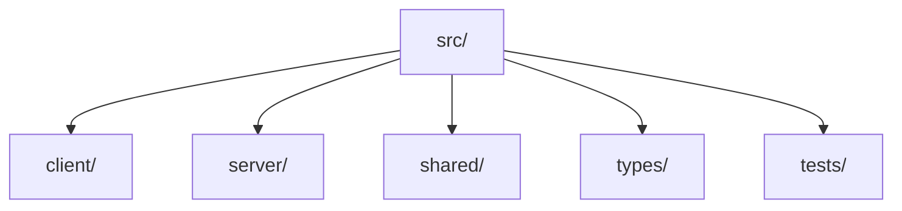
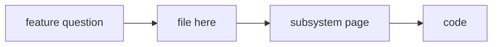

# Source Map

**¶1** □ GENERATED from `git ls-files`. Each tracked code file under `src/` appears once with its length and its first header comment or, failing that, the first exported name; where neither exists the table says so instead of guessing. Subsystem pages explain the important ones: [native port](../subsystems/native-render-port.md), [BLB invariants](../subsystems/blb-and-editor-invariants.md), [server](../subsystems/server-collab-and-storage.md), [parity](../subsystems/legacy-visual-parity.md).

## Structure (`Continuant` — `graph TD`)

## How to use it (`Occurrent` — `graph LR`)

## Client components (105)

| File | Lines | Header / first fact |
|---|---:|---|
| `src/client/components/AuthPanel.css` | 201 | — |
| `src/client/components/AuthPanel.tsx` | 211 | (no header comment; exports AuthPanel) |
| `src/client/components/BlipContent.tsx` | 13 | (no header comment; exports BlipContent) |
| `src/client/components/CreateTopicModal.css` | 276 | — |
| `src/client/components/CreateTopicModal.tsx` | 120 | (no header comment; exports CreateTopicModal) |
| `src/client/components/Editor.tsx` | 168 | (no header comment; exports Editor) |
| `src/client/components/EditorAdmin.tsx` | 83 | (no header comment; exports EditorAdmin) |
| `src/client/components/EditorSearch.tsx` | 174 | (no header comment; exports EditorSearch) |
| `src/client/components/ExportModal.css` | 199 | — |
| `src/client/components/ExportModal.tsx` | 365 | (no header comment; exports ExportModal) |
| `src/client/components/FollowTheGreen.css` | 66 | — |
| `src/client/components/FollowTheGreen.tsx` | 65 | (no header comment; exports FollowTheGreen) |
| `src/client/components/GadgetPalette.css` | 184 | — |
| `src/client/components/GadgetPalette.tsx` | 127 | (no header comment; exports GadgetType) |
| `src/client/components/GreenNavigation.tsx` | 43 | (no header comment; exports GreenNavigation) |
| `src/client/components/InviteModal.tsx` | 147 | (no header comment; exports InviteModal) |
| `src/client/components/MentionsList.css` | 134 | — |
| `src/client/components/MentionsList.tsx` | 154 | (no header comment; exports MentionsList) |
| `src/client/components/NavigationPanel.css` | 195 | NavigationPanel.css - Authentic Legacy Rizzoma Navigation Rail |
| `src/client/components/NavigationPanel.tsx` | 95 | (no header comment; exports NavigationPanel) |
| `src/client/components/PWAPrompts.css` | 100 | — |
| `src/client/components/PWAPrompts.tsx` | 100 | (no header comment; exports PWAPrompts) |
| `src/client/components/PresenceIndicator.css` | 66 | — |
| `src/client/components/PresenceIndicator.tsx` | 54 | (no header comment; exports PresenceIndicator) |
| `src/client/components/PublicTopicsPanel.css` | 80 | — |
| `src/client/components/PublicTopicsPanel.tsx` | 104 | (no header comment; exports PublicTopicsPanel) |
| `src/client/components/RebuildPanel.tsx` | 133 | (no header comment; exports RebuildPanel) |
| `src/client/components/RightToolsPanel.css` | 306 | RightToolsPanel.css - Authentic Legacy Rizzoma Right Tools Panel |
| `src/client/components/RightToolsPanel.tsx` | 396 | Custom events for insert shortcuts - these are dispatched globally |
| `src/client/components/RizzomaLanding.css` | 360 | — |
| `src/client/components/RizzomaLanding.tsx` | 115 | (no header comment; exports RizzomaLanding) |
| `src/client/components/RizzomaLayout.css` | 297 | dynamic viewport height — accounts for mobile address bar |
| `src/client/components/RizzomaLayout.tsx` | 306 | (no header comment; exports RizzomaLayout) |
| `src/client/components/RizzomaTopicDetail.css` | 1014 | RizzomaTopicDetail - Matching real Rizzoma |
| `src/client/components/RizzomaTopicDetail.tsx` | 1777 | DISABLED: Socket subscription was causing infinite loop |
| `src/client/components/RizzomaTopicsList.css` | 214 | Authentic Legacy Rizzoma Topics List Styles |
| `src/client/components/RizzomaTopicsList.tsx` | 270 | (no header comment; exports RizzomaTopicsList) |
| `src/client/components/ShareModal.tsx` | 180 | (no header comment; exports ShareModal) |
| `src/client/components/StatusBar.tsx` | 16 | (no header comment; exports StatusBar) |
| `src/client/components/StorePanel.css` | 144 | — |
| `src/client/components/StorePanel.tsx` | 160 | (no header comment; exports StorePanel) |
| `src/client/components/TasksList.css` | 157 | — |
| `src/client/components/TasksList.tsx` | 188 | (no header comment; exports TasksList) |
| `src/client/components/TeamsPanel.css` | 186 | — |
| `src/client/components/TeamsPanel.tsx` | 120 | (no header comment; exports TeamsPanel) |
| `src/client/components/TipsBox.css` | 161 | TipsBox.css - Authentic Legacy Rizzoma Tips / Shortcuts Box |
| `src/client/components/TipsBox.tsx` | 81 | (no header comment; exports TipsBox) |
| `src/client/components/Toast.tsx` | 46 | (no header comment; exports Toast) |
| `src/client/components/TopicsList.tsx` | 118 | (no header comment; exports TopicsList) |
| `src/client/components/UserPresence.css` | 60 | — |
| `src/client/components/UserPresence.tsx` | 56 | (no header comment; exports UserPresence) |
| `src/client/components/WavePlaybackModal.css` | 523 | WavePlaybackModal - Wave-level Timeline Playback UI |
| `src/client/components/WavePlaybackModal.tsx` | 443 | (no header comment; exports WavePlaybackModal) |
| `src/client/components/WaveView.tsx` | 361 | (no header comment; exports WaveView) |
| `src/client/components/WavesList.tsx` | 79 | (no header comment; exports WavesList) |
| `src/client/components/blip/BlipHistoryModal.css` | 475 | BlipHistoryModal - Timeline Playback UI |
| `src/client/components/blip/BlipHistoryModal.tsx` | 322 | (no header comment; exports BlipHistoryModal) |
| `src/client/components/blip/BlipMenu.css` | 607 | Authentic Legacy Rizzoma Blip Menu Styles |
| `src/client/components/blip/BlipMenu.tsx` | 872 | (no header comment; exports BlipMenu) |
| `src/client/components/blip/InlineHtmlRenderer.tsx` | 322 | (no header comment; exports InlineHtmlRenderOptions) |
| `src/client/components/blip/RizzomaBlip.css` | 1634 | Rizzoma Blip Styles |
| `src/client/components/blip/RizzomaBlip.tsx` | 2769 | (no header comment; exports BlipContributor) |
| `src/client/components/blip/clipboardStore.ts` | 105 | (no header comment; exports BlipClipboardPayload) |
| `src/client/components/blip/collapsePreferences.ts` | 140 | (no header comment; exports getCollapsePreference) |
| `src/client/components/blip/copyBlipLink.ts` | 73 | (no header comment; exports LocationLike) |
| `src/client/components/blip/inlineMarkers.ts` | 129 | (no header comment; exports injectInlineMarkers) |
| `src/client/components/editor/BlipEditor.css` | 197 | — |
| `src/client/components/editor/BlipEditor.tsx` | 99 | (no header comment; exports BlipEditor) |
| `src/client/components/editor/CollaborativeCursors.css` | 171 | Collaborative Cursors Styling |
| `src/client/components/editor/CollaborativeCursors.tsx` | 215 | (no header comment; exports CursorUser) |
| `src/client/components/editor/CollaborativeProvider.ts` | 155 | (no header comment; exports SocketIOProvider) |
| `src/client/components/editor/EditableBlipContent.tsx` | 68 | (no header comment; exports EditableBlipContent) |
| `src/client/components/editor/EditorConfig.tsx` | 271 | (no header comment; exports createYjsDocument) |
| `src/client/components/editor/EditorToolbar.css` | 239 | — |
| `src/client/components/editor/EditorToolbar.tsx` | 546 | Common emojis for quick access |
| `src/client/components/editor/FloatingToolbar.css` | 67 | Floating Rich Text Toolbar for Rizzoma |
| `src/client/components/editor/FloatingToolbar.tsx` | 180 | (no header comment; exports FloatingToolbar) |
| `src/client/components/editor/FollowGreen.css` | 165 | Follow the Green - Visual indicators for unread content |
| `src/client/components/editor/InlineComments.css` | 527 | Inline Comments Styling |
| `src/client/components/editor/InlineComments.tsx` | 887 | (no header comment; exports InlineCommentsStatus) |
| `src/client/components/editor/MentionList.css` | 92 | — |
| `src/client/components/editor/MentionList.tsx` | 77 | (no header comment; exports MentionListProps) |
| `src/client/components/editor/YjsDocumentManager.ts` | 46 | (no header comment; exports YjsDocumentManager) |
| `src/client/components/editor/extensions/BlipKeyboardShortcuts.ts` | 188 | Callback to create a child blip at the given anchor position. |
| `src/client/components/editor/extensions/BlipThread.css` | 75 | BlipThread inline marker styles — unified with .blip-expand-icon (#b3b3b3 gray) |
| `src/client/components/editor/extensions/BlipThreadNode.tsx` | 152 | Insert an inline BlipThread marker at the current cursor position. |
| `src/client/components/editor/extensions/CodeBlockView.css` | 128 | Enhanced Code Block — replaces bare TipTap codeBlock |
| `src/client/components/editor/extensions/CodeBlockView.tsx` | 87 | (no header comment; exports CodeBlockView) |
| `src/client/components/editor/extensions/GadgetNodes.ts` | 224 | (no header comment; exports ChartGadget) |
| `src/client/components/editor/extensions/ImageGadget.ts` | 83 | (no header comment; exports ImageOptions) |
| `src/client/components/editor/extensions/InlineCommentsVisibility.ts` | 39 | (no header comment; exports InlineCommentsVisibilityOptions) |
| `src/client/components/editor/extensions/TagNode.tsx` | 148 | Mock tags – in production these would be extracted from topic content |
| `src/client/components/editor/extensions/TaskWidget.css` | 38 | Task widget — turquoise pill like original Rizzoma \|☐ Name DD Mon\| |
| `src/client/components/editor/extensions/TaskWidget.tsx` | 188 | Reuse the same mock users as mentions |
| `src/client/components/editor/extensions/TextColor.ts` | 65 | (no header comment; exports TextColorOptions) |
| `src/client/components/editor/extensions/Underline.ts` | 72 | (no header comment; exports UnderlineOptions) |
| `src/client/components/editor/inlineCommentDecorations.ts` | 56 | (no header comment; exports CommentGroup) |
| `src/client/components/editor/inlineCommentsVisibility.ts` | 142 | (no header comment; exports getInlineCommentsVisibility) |
| `src/client/components/editor/useCollaboration.ts` | 49 | Hook to create a SocketIOProvider for real-time collaboration. |
| `src/client/components/mobile/BottomSheet.css` | 217 | Bottom Sheet Styles |
| `src/client/components/mobile/BottomSheet.tsx` | 239 | Whether the bottom sheet is open |
| `src/client/components/mobile/BottomSheetMenu.css` | 174 | Bottom Sheet Menu Styles |
| `src/client/components/mobile/BottomSheetMenu.tsx` | 280 | Unique identifier for the item |
| `src/client/components/native/NativeWaveView.css` | 199 | Native fractal-render — minimum viable CSS for the new render path. |
| `src/client/components/native/NativeWaveView.tsx` | 308 | Native fractal-render — React wrapper for WaveView. |

## Client native render port (20)

| File | Lines | Header / first fact |
|---|---:|---|
| `src/client/native/__tests__/awareness.test.ts` | 130 | Awareness tests — presence + cursor sharing across simulated clients. |
| `src/client/native/__tests__/blip-editor-host.test.ts` | 202 | BlipEditorHost lifecycle + round-trip tests (vitest, jsdom). |
| `src/client/native/__tests__/content-lookup.test.ts` | 124 | Phase 1 recursion fix — the native content lookup drives full-depth render |
| `src/client/native/__tests__/parser.test.ts` | 87 | Parser smoke test (vitest). |
| `src/client/native/__tests__/serializer.test.ts` | 164 | Serializer + round-trip tests (vitest). |
| `src/client/native/__tests__/spike-depth-10.test.ts` | 187 | Phase 1 spike — depth-10 fractal renders correctly via the new stack. |
| `src/client/native/__tests__/wave-view.test.ts` | 147 | WaveView tests (vitest, jsdom). |
| `src/client/native/__tests__/yjs-binding.test.ts` | 180 | Y.js binding tests — convergence between two Y.Doc instances exchanging |
| `src/client/native/awareness.ts` | 148 | Native fractal-render — Awareness wrapper. |
| `src/client/native/blip-editor-host.ts` | 222 | Native fractal-render — BlipEditorHost. |
| `src/client/native/blip-thread.ts` | 233 | Native fractal-render — BlipThread. |
| `src/client/native/blip-view.ts` | 167 | Native fractal-render — BlipView (Phase 2 skeleton). |
| `src/client/native/content-lookup.ts` | 82 | Native fractal-render — content lookup builder. |
| `src/client/native/parser.ts` | 283 | Native fractal-render — HTML → ContentArray parser. |
| `src/client/native/renderer.ts` | 231 | Native fractal-render — Renderer. |
| `src/client/native/serializer.ts` | 210 | Native fractal-render — ContentArray → HTML serializer. |
| `src/client/native/tiptap-adapter.ts` | 70 | Native fractal-render — BlipEditorAdapter that delegates to TipTap. |
| `src/client/native/types.ts` | 98 | Native fractal-render — content array type definitions. |
| `src/client/native/wave-view.ts` | 249 | Native fractal-render — WaveView. |
| `src/client/native/yjs-binding.ts` | 202 | Native fractal-render — Y.js CRDT binding for the ContentArray model. |

## Client other (34)

| File | Lines | Header / first fact |
|---|---:|---|
| `src/client/RizzomaApp.css` | 65 | Reset and base styles |
| `src/client/RizzomaApp.tsx` | 51 | (no header comment; exports RizzomaApp) |
| `src/client/TestEditorApp.tsx` | 76 | (no header comment; exports TestEditorApp) |
| `src/client/contexts/MobileContext.tsx` | 129 | (no header comment; exports MobileContextValue) |
| `src/client/hooks/useAuth.ts` | 81 | (no header comment; exports AuthProvider) |
| `src/client/hooks/useChangeTracking.ts` | 138 | (no header comment; exports useChangeTracking) |
| `src/client/hooks/useMediaQuery.ts` | 215 | Standard breakpoint values matching breakpoints.css |
| `src/client/hooks/useOfflineStatus.ts` | 271 | Whether the browser reports being online |
| `src/client/hooks/usePresence.ts` | 48 | (no header comment; exports PresenceStatus) |
| `src/client/hooks/usePullToRefresh.ts` | 339 | Whether the user is currently pulling |
| `src/client/hooks/useServiceWorker.ts` | 307 | Whether SW is supported in this browser |
| `src/client/hooks/useSocket.ts` | 16 | (no header comment; exports useSocket) |
| `src/client/hooks/useSwipe.ts` | 355 | Direction of the swipe |
| `src/client/hooks/useViewTransition.ts` | 245 | Check if View Transitions API is supported |
| `src/client/hooks/useWaveUnread.ts` | 308 | Debounce helper |
| `src/client/index.html` | 38 | — |
| `src/client/lib/api.ts` | 98 | (no header comment; exports ApiResponse) |
| `src/client/lib/format.ts` | 9 | (no header comment; exports formatTimestamp) |
| `src/client/lib/getUserMediaAdapter.ts` | 222 | Modern getUserMedia adapter — TypeScript ES module. |
| `src/client/lib/htmlDiff.ts` | 55 | Simple word-level diff for HTML content. |
| `src/client/lib/offlineQueue.ts` | 470 | Offline Queue - Manages mutations that occurred while offline |
| `src/client/lib/performance.d.ts` | 9 | — |
| `src/client/lib/performance.ts` | 60 | Performance monitoring utilities |
| `src/client/lib/socket.ts` | 183 | (no header comment; exports subscribeTopicsRefresh) |
| `src/client/lib/upload.ts` | 82 | (no header comment; exports UploadResult) |
| `src/client/main.tsx` | 258 | (no header comment; exports App) |
| `src/client/rizzoma-main.tsx` | 7 | — |
| `src/client/rizzoma.html` | 19 | — |
| `src/client/settings.html` | 14 | — |
| `src/client/settings.tsx` | 327 | — |
| `src/client/styles/breakpoints.css` | 105 | Breakpoint System - CSS Custom Properties |
| `src/client/styles/view-transitions.css` | 263 | View Transitions Styles |
| `src/client/test-editor.html` | 45 | — |
| `src/client/types/tiptap-react-nodeview.d.ts` | 26 | Type augmentation for @tiptap/react NodeView exports |

## Server routes (13)

| File | Lines | Header / first fact |
|---|---:|---|
| `src/server/routes/auth.ts` | 693 | Use a wrapper that prefers native bcrypt but falls back to bcryptjs when native build is unavailable |
| `src/server/routes/blips.ts` | 658 | — |
| `src/server/routes/comments.ts` | 113 | — |
| `src/server/routes/editor.ts` | 314 | Feature flag: set EDITOR_ENABLE=1 to enable endpoints |
| `src/server/routes/health.ts` | 43 | CouchDB check |
| `src/server/routes/inlineComments.ts` | 170 | Schema for comment creation |
| `src/server/routes/links.ts` | 73 | — |
| `src/server/routes/mentions.ts` | 144 | Mentions Routes |
| `src/server/routes/notifications.ts` | 221 | Notification Routes |
| `src/server/routes/tasks.ts` | 177 | Tasks Routes |
| `src/server/routes/topics.ts` | 508 | User type for lookups |
| `src/server/routes/uploads.ts` | 231 | AWS SDK v3 - optional, loaded dynamically when S3 storage is enabled |
| `src/server/routes/waves.ts` | 612 | GET /api/waves?limit&offset&q |

## Server lib (9)

| File | Lines | Header / first fact |
|---|---:|---|
| `src/server/lib/bcrypt.ts` | 21 | Wrapper around bcrypt that prefers native module when available |
| `src/server/lib/couch.ts` | 136 | (no header comment; exports couchDbInfo) |
| `src/server/lib/editorPresence.ts` | 132 | (no header comment; exports EditorPresenceManager) |
| `src/server/lib/logger.ts` | 27 | (no header comment; exports logger) |
| `src/server/lib/saml.ts` | 129 | SAML 2.0 authentication service |
| `src/server/lib/socket.ts` | 197 | (no header comment; exports initSocket) |
| `src/server/lib/unread.ts` | 150 | Simple in-memory cache for unread counts (TTL: 30 seconds) |
| `src/server/lib/virusScan.ts` | 51 | (no header comment; exports scanBuffer) |
| `src/server/lib/yjsDocCache.ts` | 122 | (no header comment; exports yjsDocCache) |

## Server other (37)

| File | Lines | Header / first fact |
|---|---:|---|
| `src/server/app.ts` | 125 | — |
| `src/server/config.ts` | 18 | (no header comment; exports AppConfig) |
| `src/server/couch_views/main/auth_by_user_id.js` | 20 | — |
| `src/server/couch_views/main/blip.js` | 18 | — |
| `src/server/couch_views/main/blip_by_need_notificate.js` | 20 | — |
| `src/server/couch_views/main/blip_child_ids_by_wave_id_1.js` | 31 | — |
| `src/server/couch_views/main/blip_parent_id_by_id.js` | 37 | — |
| `src/server/couch_views/main/blip_real_parent_id_by_id.js` | 27 | — |
| `src/server/couch_views/main/blip_version_by_id.js` | 19 | — |
| `src/server/couch_views/main/docs_by_timestamp.js` | 19 | — |
| `src/server/couch_views/main/file_size_by_user_id.js` | 20 | — |
| `src/server/couch_views/main/files_for_compare.js` | 38 | — |
| `src/server/couch_views/main/nonremoved_blips_by_wave_id.js` | 19 | — |
| `src/server/couch_views/main/nonsent_blips_by_time.js` | 34 | — |
| `src/server/couch_views/main/read_blip_count_by_wave_id_and_participant_id_2.js` | 27 | — |
| `src/server/couch_views/main/sequence.js` | 27 | — |
| `src/server/couch_views/main/store_item_by_category_2.js` | 22 | — |
| `src/server/couch_views/main/tags_by_blip_id.js` | 26 | — |
| `src/server/couch_views/main/total_blip_count_by_wave_id_2.js` | 22 | — |
| `src/server/couch_views/main/user_by_digest_3.js` | 36 | — |
| `src/server/couch_views/main/user_by_email_1.js` | 25 | — |
| `src/server/couch_views/main/user_by_first_visit.js` | 19 | — |
| `src/server/couch_views/main/user_by_notification_id.js` | 18 | — |
| `src/server/couch_views/main/wave_by_topic_type_and_user_id.js` | 24 | — |
| `src/server/couch_views/main/waves_by_container_blip_id.js` | 18 | — |
| `src/server/couch_views/main/waves_by_creation_date.js` | 19 | — |
| `src/server/couch_views/main/waves_by_url_2.js` | 23 | — |
| `src/server/couch_views/operations/ot_1.js` | 22 | — |
| `src/server/middleware/auth.ts` | 34 | Add user to request |
| `src/server/middleware/csrf.ts` | 53 | (no header comment; exports csrfInit) |
| `src/server/middleware/error.ts` | 17 | ensure request id header is present on error paths |
| `src/server/middleware/requestId.ts` | 13 | attach to req and response header |
| `src/server/middleware/session.ts` | 37 | (no header comment; exports sessionMiddleware) |
| `src/server/schemas/comment.ts` | 14 | (no header comment; exports CreateCommentSchema) |
| `src/server/schemas/topic.ts` | 16 | (no header comment; exports CreateTopicSchema) |
| `src/server/schemas/wave.ts` | 55 | (no header comment; exports CreateWaveSchema) |
| `src/server/services/email.ts` | 313 | Email Notification Service |

## Shared (10)

| File | Lines | Header / first fact |
|---|---:|---|
| `src/shared/constants/textFormatting.d.ts` | 42 | (no header comment; exports TextFormattingOptions) |
| `src/shared/constants/textFormatting.js` | 41 | (no header comment; exports TextLevelParams) |
| `src/shared/constants/textFormatting.ts` | 59 | Text formatting constants from original Rizzoma |
| `src/shared/featureFlags.ts` | 54 | Feature flags for progressive rollout of Rizzoma core features |
| `src/shared/types/blips.d.ts` | 13 | (no header comment; exports BlipHistoryEntry) |
| `src/shared/types/blips.js` | 2 | # sourceMappingURL=blips.js.map |
| `src/shared/types/blips.ts` | 21 | (no header comment; exports BlipHistoryEntry) |
| `src/shared/types/comments.d.ts` | 29 | (no header comment; exports InlineComment) |
| `src/shared/types/comments.js` | 2 | # sourceMappingURL=comments.js.map |
| `src/shared/types/comments.ts` | 34 | (no header comment; exports InlineComment) |

## Types (10)

| File | Lines | Header / first fact |
|---|---:|---|
| `src/types/bcryptjs.d.ts` | 3 | — |
| `src/types/connect-redis.d.ts` | 12 | (no header comment; exports RedisStore) |
| `src/types/express-session.d.ts` | 14 | — |
| `src/types/shims.d.ts` | 15 | — |
| `src/types/tiptap-collaboration.d.ts` | 9 | — |
| `src/types/tiptap-react.d.ts` | 16 | (no header comment; exports useEditor) |
| `src/types/tiptap-starter-kit.d.ts` | 9 | — |
| `src/types/tiptap.d.ts` | 52 | (no header comment; exports Commands) |
| `src/types/vitest.d.ts` | 4 | Minimal global types for vitest when typechecking test files |
| `src/types/winston.d.ts` | 6 | — |

## Tests (49)

| File | Lines | Header / first fact |
|---|---:|---|
| `src/tests/client.BlipEditor.test.ts` | 77 | — |
| `src/tests/client.BlipMenu.test.tsx` | 628 | — |
| `src/tests/client.EditorSearch.test.tsx` | 76 | — |
| `src/tests/client.PresenceIndicator.test.tsx` | 63 | — |
| `src/tests/client.RebuildPanel.test.tsx` | 98 | — |
| `src/tests/client.RightToolsPanel.followGreen.test.tsx` | 170 | — |
| `src/tests/client.blipClipboardStore.test.ts` | 34 | — |
| `src/tests/client.collaborativeProvider.test.ts` | 169 | Create a minimal mock socket that mimics Socket.IO client behavior |
| `src/tests/client.collapsePreferences.test.ts` | 63 | — |
| `src/tests/client.copyBlipLink.test.ts` | 35 | — |
| `src/tests/client.editor.GadgetNodes.test.ts` | 121 | Access TipTap extension config via .config property |
| `src/tests/client.followGreenNavigation.test.tsx` | 209 | — |
| `src/tests/client.getUserMediaAdapter.test.ts` | 182 | — |
| `src/tests/client.inlineCommentAnchoring.test.ts` | 94 | — |
| `src/tests/client.inlineCommentsPopover.test.tsx` | 393 | — |
| `src/tests/client.inlineCommentsVisibilityShortcuts.test.ts` | 21 | — |
| `src/tests/client.inlineCommentsVisibilityStorage.test.ts` | 71 | — |
| `src/tests/client.mobilePwa.test.tsx` | 326 | — |
| `src/tests/client.useWaveUnread.test.tsx` | 211 | — |
| `src/tests/middleware.csrf.test.ts` | 63 | — |
| `src/tests/middleware.error.test.ts` | 23 | — |
| `src/tests/middleware.requestId.test.ts` | 20 | — |
| `src/tests/routes.auth.test.ts` | 126 | Use bcryptjs in tests to avoid native binding issues |
| `src/tests/routes.blips.history.test.ts` | 127 | — |
| `src/tests/routes.blips.permissions.test.ts` | 125 | — |
| `src/tests/routes.comments.edgecases.test.ts` | 84 | — |
| `src/tests/routes.comments.inline.test.ts` | 151 | — |
| `src/tests/routes.comments.inlineHealth.test.ts` | 92 | — |
| `src/tests/routes.comments.test.ts` | 84 | — |
| `src/tests/routes.editor.rebuild.test.ts` | 121 | Increase timeout for module loading with mocks |
| `src/tests/routes.editor.search.test.ts` | 105 | Increase timeout for module loading with mocks |
| `src/tests/routes.editor.test.ts` | 73 | Increase timeout for module loading with mocks |
| `src/tests/routes.topics.edgecases.test.ts` | 70 | — |
| `src/tests/routes.topics.follow.test.ts` | 181 | — |
| `src/tests/routes.topics.test.ts` | 184 | minimal session shim |
| `src/tests/routes.uploads.edgecases.test.ts` | 283 | — |
| `src/tests/routes.waves.counts.test.ts` | 61 | — |
| `src/tests/routes.waves.edgecases.test.ts` | 61 | — |
| `src/tests/routes.waves.materialize.test.ts` | 56 | — |
| `src/tests/routes.waves.prev.test.ts` | 70 | — |
| `src/tests/routes.waves.seed.test.ts` | 48 | — |
| `src/tests/routes.waves.test.ts` | 61 | — |
| `src/tests/routes.waves.unread.test.ts` | 152 | — |
| `src/tests/server.authOauth.test.ts` | 106 | — |
| `src/tests/server.editorPresence.test.ts` | 79 | — |
| `src/tests/server.health.test.ts` | 43 | — |
| `src/tests/server.session.test.ts` | 63 | — |
| `src/tests/server.yjsDocCache.test.ts` | 252 | Mock couch module before importing yjsDocCache |
| `src/tests/setup.ts` | 21 | Vitest <-> Jest compatibility shim so legacy jest.* tests still work. |

