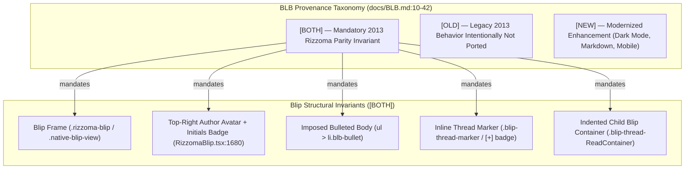
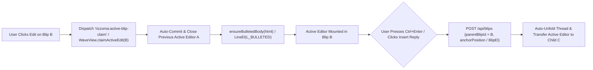

# Subsystem — BLB Specification & Editor/Blip Invariants (`[BOTH]` / `[OLD]` / `[NEW]`)

**¶1** □ `docs/BLB.md` (`Blip / Line / Bullet`, `docs/BLB.md:1-182`) is the normative behavioral contract for every blip, line, bullet, and inline thread in modernized Rizzoma. Every requirement in `docs/BLB.md` carries a mandatory provenance tag (`[BOTH]`, `[OLD]`, or `[NEW]`) that governs both the current React/TipTap hybrid (`src/client/components/blip/RizzomaBlip.tsx`) and the native fractal port (`src/client/native/`).

---

## 1. Visual & Structural Taxonomy (`Continuant` — `graph TD`)

---

## 2. Interactive Editing & Inline Reply Lifecycle (`Occurrent` — `graph LR`)

---

## 3. Core `[BOTH]` Invariants Verified by Acceptance Suites

### 3.1 Imposed `<ul><li>` Bullet Structure
- **¶2** □ **Rule (`docs/BLB.md` `[BOTH]`)**: Every line inside a blip body (except explicit headings `h1`–`h3` or code/blockquote blocks) is a bulleted list item (`<ul><li>`) by default. Pressing `Enter` creates a new sibling bullet; `Tab` / `Shift+Tab` indents or outdents `LINE_LEVEL` (`0`..`N`).
- **¶3** □ **Code Ground Truth**:
  - In the React/TipTap path, `ensureBulletedBody(html)` (`src/client/components/blip/RizzomaBlip.tsx:291-295`, invoked at lines `618`, `670`, `955`, `1076`) wraps bare `
` or plain text segments into `<ul><li>...</li></ul>` before seeding TipTap.
  - In the native port, `parseHtmlToContentArray()` (`src/client/native/parser.ts:105-126`) sets `[ModelField.LINE_TYPE]: LineType.BULLETED` (`L_BULLETED`), and `renderContent()` (`src/client/native/renderer.ts:37-71`, `144-169`) constructs `<ul class="blb-list-level-N"><li class="blb-bullet">` containers.

### 3.2 Single Active Editor Per Wave
- **¶4** □ **Rule (`docs/BLB.md` `[BOTH]`)**: At most **one** blip in a wave may be in edit mode at any instant. Entering edit mode on Blip `B` must immediately save and exit edit mode on Blip `A`.
- **¶5** □ **Code Ground Truth**:
  - In the React/TipTap path, `ACTIVE_BLIP_CLAIM_EVENT = 'rizzoma:active-blip-claim'` (`src/client/components/blip/RizzomaBlip.tsx:78-80`) broadcasts a window-level custom event whenever a blip claims edit focus; all other mounted `RizzomaBlip` instances listen for this event and set `isEditing = false`.
  - In the native port, `WaveView.claimActiveEdit(blipId)` (`src/client/native/wave-view.ts:138-157`) and `BlipEditorHost.attachToBlip(blipId, view)` (`src/client/native/blip-editor-host.ts:95-156`) enforce this structurally because **only one `BlipEditorHost` instance exists per `WaveView`**.

### 3.3 Inline Child Blip Creation (`Ctrl+Enter` / `Insert Reply`)
- **¶6** □ **Rule (`docs/BLB.md` `[BOTH]`)**: Pressing `Ctrl+Enter` (or clicking the toolbar `Insert reply` button) while editing a bullet creates a child blip anchored at the current cursor line/position, expands the thread inline immediately below/within that bullet, and moves edit focus into the newly created child blip.
- **¶7** □ **Code Ground Truth**:
  - In the React/TipTap path, `RizzomaTopicDetail.tsx:740-785` (`createInlineChildBlip`) creates the child via `POST /api/blips`, splices the marker via `injectInlineMarkers` (`src/client/components/blip/inlineMarkers.ts:53`), and runs a `requestAnimationFrame` focus-handoff loop (`RizzomaTopicDetail.tsx:774`).
  - In the native port, `WaveView.insertInlineReplyAtSelection(newChildBlipId)` (`src/client/native/wave-view.ts:163-198`) calls `BlipView.insertSubBlip(newChildBlipId, afterLineIndex)` (`src/client/native/blip-view.ts:126-152`), which splices a `BlipEl` into `ContentArray`, mounts a `BlipThread`, unfolds it, and claims active edit on `newChildBlipId`.

### 3.4 Folded Thread Summary (`[+]`) & Unread Green Rail
- **¶8** □ **Rule (`docs/BLB.md` `[BOTH]`)**: When an inline thread is folded, it collapses to an inline pill/marker inside the parent text line showing the expand chevron/count (`▸` / `[+N]`). When expanded, it renders an indented block container with a left hierarchy rail (green when unread, muted grey when read).
- **¶9** □ **Code Ground Truth**:
  - Native port: `BlipThread` (`src/client/native/blip-thread.ts:81-139`) renders `.blip-thread.folded` with `.blip-thread-marker` and `.blip-thread-unread-badge` (`setUnreadCount(n)` at `blip-thread.ts:116-139`).
  - React/TipTap path: `InlineHtmlRenderer.tsx:107` and `BlipThreadNode.tsx:33` render `.inline-blip-marker` and `.inline-child-portal`, persisted per user in `localStorage` via `collapsePreferences.ts:113-138`.
