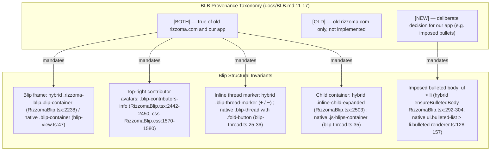
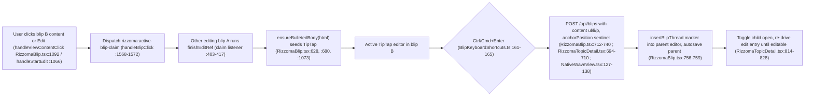

# Subsystem — BLB Specification & Editor/Blip Invariants (`[BOTH]` / `[OLD]` / `[NEW]`)

**¶1** □ `docs/BLB.md` (`Bullet-Label-Blip`, 182 lines; provenance tags defined at `docs/BLB.md:11-17`) is the normative behavioral contract for every blip, line, bullet, and inline thread in modernized Rizzoma. Every rule in it carries a mandatory provenance tag (`[BOTH]`, `[OLD]`, or `[NEW]`) that governs both the current React/TipTap hybrid (`src/client/components/blip/RizzomaBlip.tsx`) and the native fractal port (`src/client/native/`).

**¶1a** ◇ **Re-verification note (2026-11-07, HEAD `6cf6fc7a`)**: citations were re-read against the working tree. `RizzomaBlip.tsx` carries other sessions' uncommitted edits, so its line numbers may be a few lines off against `HEAD`. Nothing here was run in a browser this session. The earlier revision attributed three rules to `docs/BLB.md` that are **not in that file** (single active editor, folded-thread `▸ / [+N]` chevrons with a green hierarchy rail, `Tab` / `Shift+Tab` level changes with `h1`–`h3` exempt); they are corrected below with their real sources.

---

## 1. Visual & Structural Taxonomy (`Continuant` — `graph TD`)

---

## 2. Interactive Editing & Inline Reply Lifecycle (`Occurrent` — `graph LR`)

---

## 3. Core `[BOTH]` / `[NEW]` Invariants and Where They Live in Code

### 3.1 Imposed `<ul><li>` Bullet Structure (`[NEW]`)
- **¶2** □ **Rule**: `docs/BLB.md:62-88` (§5, tagged `[NEW]` for our app; old rizzoma.com blips are blank sheets, `[OLD]`): every blip body **is** a bulleted list; a persisted body with no `<li>` is a bug. `docs/BLB.md:108-125` (§7a) adds the one exception: the topic title (`<h1>`) and the optional hashtag line under it are the only un-bulleted lines, and the blip container must not draw its own second bullet. The earlier revision's "headings `h1`–`h3` and code/blockquote blocks are exempt", "`Enter` creates a sibling bullet" and "`LINE_LEVEL 0..N`" wording is not in `docs/BLB.md`; the only matching code is TipTap's `Tab` / `Shift+Tab` indent / outdent handlers (`src/client/components/editor/extensions/BlipKeyboardShortcuts.ts:22-23`, `:52-`).
- **¶3** □ **Code Ground Truth**:
  - Hybrid: `BLB_EMPTY_BODY = '<ul><li>

</li></ul>'` and `ensureBulletedBody(html)` are exported (`src/client/components/blip/RizzomaBlip.tsx:291-304`). It returns the empty body for blank input, otherwise wraps `
` runs or bare text in `<ul><li>` when no `<ul>` / `<ol>` is present. Callers: editor seeding (`:628`, `:680`), edit-entry (`:967`, `:1073`), and — new in `597f767c` / `a4d4d583` — the **view-mode** HTML (`:872`) and the parity read path (`:2405`).
  - Native: `parseHtmlToContentArray()` (`src/client/native/parser.ts:264`) emits a `LINE` whose params carry `bulleted: <level>` for each `<li>` under a `<ul>` (list level taken from a `bulleted-list-levelN` class if present, else DOM nesting; `parser.ts:191-199`, `:213-216`). `renderContent()` builds `<ul class="bulleted-list bulleted-list-levelN">` containers (`src/client/native/renderer.ts:128-157`) and `<li class="bulleted bulleted-typeN">` lines (`:73-96`). The earlier names `L_BULLETED`, `ModelField.LINE_TYPE`, `blb-list-level-N` and `li.blb-bullet` do not exist in the code (grep over `src/client` finds no `blb-bullet`).
  - New children are created with `content: '<ul><li>

</li></ul>'` **by the client** (`RizzomaTopicDetail.tsx:704`, `NativeWaveView.tsx:135`); `POST /api/blips` stores whatever `content` it receives and returns 400 if it is empty (`src/server/routes/blips.ts:184-231`, check at `:190-193`). `docs/BLB.md:76` and the comment at `RizzomaBlip.tsx:285-290` say "seeded server-side"; the handler read here does not seed (see contradiction entry C7 in [`decisions/contradictions-and-lint-findings.md`](../decisions/contradictions-and-lint-findings.md)).
  - Collapsed by default (`docs/BLB.md:42-49`): `initialExpanded` is true only for root / topic-root / force-expanded blips, else taken from the parent's `expandedBlips` set (`RizzomaBlip.tsx:342-346`); `POST /api/blips` defaults `isFoldedByDefault` to `true` (`blips.ts:209`); the per-user preference is persisted in `localStorage` under `blipCollapsePreferences` (`src/client/components/blip/collapsePreferences.ts:1`, `:113-142`).

### 3.2 Single Active Editor (`[BOTH]`, source: `docs/ARCHITECTURE.md`, not `docs/BLB.md`)
- **¶4** □ **Rule**: `docs/ARCHITECTURE.md:96-104` (§5): one TipTap editor exists only for the blip being edited; entering edit mode broadcasts `rizzoma:active-blip-claim` and any other surface holding the slot finishes and auto-saves; the topic editor participates as `topic-editor:<topicId>`. `docs/BLB.md` itself does not state this (no match for "active" / "single" in it).
- **¶5** □ **Code Ground Truth**:
  - Hybrid: `ACTIVE_BLIP_CLAIM_EVENT = 'rizzoma:active-blip-claim'` (`src/client/components/blip/RizzomaBlip.tsx:78`) is dispatched when a blip is clicked (`:1568-1572`). Each mounted `RizzomaBlip` listens (`:403-417`): it sets `isActive` for its own id and, **if it is editing and the claim is foreign, calls `finishEditRef.current()`** (`:412-414`; `finishEditRef` assigned at `:1173`) — so the previous editor is closed and auto-saved rather than merely hidden. A module-level `globalActiveBlipId` (`:77`) mirrors the active id. `RizzomaTopicDetail.tsx` also dispatches and listens to the same event (`:1181`, `:1211-1219`).
  - Native: the earlier claim that `WaveView.claimActiveEdit()` and `BlipEditorHost.attachToBlip()` enforce this structurally is **false for the current code**: neither method exists (`wave-view.ts` and `blip-editor-host.ts` contain no `claimActiveEdit` / `attachToBlip`; `git grep` over `src/` finds none). `BlipEditorHost` wraps exactly one `BlipView` (`src/client/native/blip-editor-host.ts:51-60`), and `NativeWaveView` keeps a `Map<blipId, BlipEditorHost>` (`src/client/components/native/NativeWaveView.tsx:55`). `handleCreateChild` mounts an editor on the new child while the parent host stays mounted (`:149-173`), and only the Done button unmounts all hosts (`:193-212`). So in the native path **more than one editor can be mounted at once** (read from code; not run). This is recorded as C8 in the contradictions page.

### 3.3 Inline Child Blip Creation (`Ctrl+Enter`) (`[BOTH]`, `docs/BLB.md:51-60`)
- **¶6** □ **Rule**: `docs/BLB.md:51-60` (§4): Ctrl+Enter at the cursor while editing creates a child anchored at that exact point, rendered inline; a reply (the "Write a reply…" box) is anchored to the parent as a whole and rendered at the end.
- **¶7** □ **Code Ground Truth**:
  - Shortcut: `'Mod-Enter'` calls `onCreateInlineChildBlip(0)`; `0` is a sentinel whose only role is to mark the child inline (`src/client/components/editor/extensions/BlipKeyboardShortcuts.ts:147-165`).
  - Hybrid, nested blip: `createChildBlipRef` (`RizzomaBlip.tsx:712-`) POSTs `/api/blips` through `ensureCsrf()` + `api()` (changed in `6cf6fc7a`, which fixed Ctrl+Enter credentials), then inserts the marker into the parent editor with the TipTap command `insertBlipThread` and **immediately auto-saves the parent** (`:751-759`, the latter lines uncommitted at the time of writing), then awaits a topic reload and dispatches `rizzoma:toggle-inline-blip`. Hybrid, topic root: `createInlineChildBlip` (`RizzomaTopicDetail.tsx:694-833`; it sends `parentId: null`, `:705`, marker insertion at `:727`), followed by the bounded edit-entry retry `tryEnterEdit` (`:814-828`). The earlier claim that this path "splices the marker via `injectInlineMarkers`" is wrong: that function no longer inserts markers (`inlineMarkers.ts:85-100`).
  - View-mode and menu entry: `handleCreateInlineChildAtCursor` (`RizzomaBlip.tsx:1175-`) now no longer requires an open editor (`6cf6fc7a`: position falls back to `0`). A view-mode Ctrl/Cmd+Enter handler in the key listener (~`:1693`) is **uncommitted** in the working tree at the time of writing.
  - Native: the earlier `WaveView.insertInlineReplyAtSelection()` / `BlipView.insertSubBlip()` / `removeSubBlip()` **do not exist**. The only native splice helper is `BlipEditorHost.insertChildBlipAtCursor(cursorMarker, newBlipId)` (`blip-editor-host.ts:162-200`), which is not called from `NativeWaveView`. `NativeWaveView.handleCreateChild` (`NativeWaveView.tsx:127-186`) instead POSTs `/api/blips` with `parentId` (null for the root), calls the same TipTap `insertBlipThread` command on the parent's raw editor (`:153-155`), creates the child `BlipView` (`:159-160`), appends its container into the `data-portal-child` anchor (`:164-166`), mounts a child editor (`:173`) and focuses it (`:176-181`).

### 3.4 Folded Thread Summary and Unread State (`[BOTH]`, `docs/BLB.md:99-107`)
- **¶8** □ **Rule**: `docs/BLB.md:99-107` (§7): collapsed child → `[+]`, expanded → `[−]`; a child renders inside its parent's box; fold / unfold never destroys the subtree (draft text, scroll, focus survive). The `▸` / `[+N]` chevron and the "green when unread, grey when read" rail named by the earlier revision are **not** in `docs/BLB.md` (grep for `rail`, `unread`, `green` finds nothing there).
- **¶9** □ **Code Ground Truth**:
  - Native: `BlipThread` (`src/client/native/blip-thread.ts:38-232`) is a `span.blip-thread.folded` with `.fold-button-container` (sprite button, `plus_minus` image) and `.js-blips-container` (`:25-36`). Geometry/sprite styling lives in `src/client/components/native/NativeWaveView.css:48-103` (commit `0c50a727`). There is **no** `.blip-thread-marker`, `.blip-thread-unread-badge`, `setUnreadCount()` or `.blip-thread-ReadContainer` in the native TypeScript (grep). Unread is handled per blip: `WaveView.setUnreadSet()` toggles `data-unread="1"` on `.blip-container` (`wave-view.ts:107-119`), `nextUnreadAfter()` / `markRead()` walk it (`:123-152`); a `.fold-button.unread` CSS rule exists (`NativeWaveView.css:70`) but no TypeScript was found that adds that class (grep for `unread` in `src/client/native/*.ts` shows only `wave-view.ts`).
  - Hybrid: `.blip-thread-marker` spans (`+` / `−`, classes `expanded`, `has-unread`, `orphaned`) are produced by `injectInlineMarkers` (`inlineMarkers.ts:10-19`, `:65-84`), by `renderInlineHtml` (`InlineHtmlRenderer.tsx:61-76`, `:141-169`) and by `BlipThreadNode` (`BlipThreadNode.tsx:87-107`); expansion state is persisted per user in `localStorage` through `collapsePreferences.ts` (`:113-142`).
  - Playback/history, the wave header and the range-selection menu were reworked on 2026-11-07 (`BlipMenu.tsx` read/edit ribbon with `blip-menu-done` test id at `:493-501`; bottom "Done / Write a reply…" bar at `RizzomaBlip.tsx:2650-2672`; `range-menu` at `:2692`; commit `1322eb71`). Pixel-level detail belongs to [`legacy-visual-parity.md`](legacy-visual-parity.md); this page does not re-verify it.

### 3.5 Unverified on this page
- **¶10** ▷ Browser behaviour of every code path above (nothing was run or screenshotted this session); whether `docs/BLB.md` should gain the single-active and folded-thread rules (currently they live in `docs/ARCHITECTURE.md:96-104` and in code); the `Enter`-creates-sibling-bullet behaviour (TipTap default, not located in repo code).
