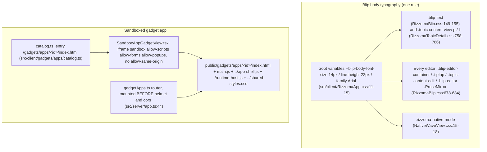
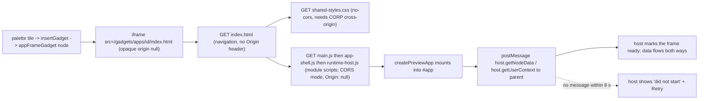

# Subsystem — Sandboxed Gadget Apps and Blip Body Typography

**¶1** □ Two defects SDS reported on 2026-11-17 are fixed by commit `c9e37545` on branch `fix/list-font-and-kanban-gadget`: (a) list items in a blip were a different size from paragraph text, (b) an inserted Kanban gadget was an empty white box on the live site. Both were reproduced and measured in this session before any change; the numbers are below. Neither fix is on the live host until the branch is merged and deployed; see the deployment note in the pull request.

---

## 1. Structure (`Continuant` — `graph TD`)

## 2. How a gadget app starts (`Occurrent` — `graph LR`)

---

## 3. Defect A — blank Kanban gadget

**¶2** □ **Symptom (reproduced).** On a production-mode server (`NODE_ENV=production`, helmet and cors exactly as in `src/server/app.ts`), inserting any of the four sandbox apps through the real palette produced an iframe 730x430 (Kanban) whose document had `document.body.innerText === ""` and an empty `#app` (`children.length === 0`). The wrapper still showed "3 columns · 4 cards" from the node data, so only the frame was blank. A development server (Vite, `vite.config.ts` `server.headers`) rendered all four correctly, which is why nothing in development or in the palette tests showed it.

**¶3** □ **Root cause (measured, three layers, all from the same cause).** The frame is sandboxed without `allow-same-origin` (`src/client/gadgets/apps/runtime.ts:9-13`), so its document has an opaque origin and everything it loads is cross-origin. The application-wide hardening, written for the SPA, then broke the frame:

| # | Request from the frame | Production response before the fix | Browser result |
|---|---|---|---|
| 1 | inline `<script type="module">` in `index.html` | helmet `script-src 'self'` (`app.ts` helmet block) | `Executing inline script violates ... 'script-src 'self'` — the script never ran |
| 2 | `shared-styles.css` (no-cors) | helmet `Cross-Origin-Resource-Policy: same-origin` | `net::ERR_BLOCKED_BY_RESPONSE.NotSameOrigin` |
| 3 | module import of `app-shell.js` (CORS mode, `Origin: null`) | `cors()` allowlist rejects `null` | HTTP 500 `{"error":"server_error","message":"CORS not allowed"}` — hidden behind #1 |

**¶4** □ **Live evidence.** `curl -H 'Origin: null' https://138-201-62-161.nip.io/gadgets/apps/app-shell.js` returned HTTP 500 `CORS not allowed` with `Cross-Origin-Resource-Policy: same-origin`; the same URL without an `Origin` header returned 200. The old `/gadgets/apps` handler that set `Access-Control-Allow-Origin: *` was registered after `cors()` and never ran for such a request.

**¶5** □ **The other three apps share the cause.** Kanban, Planner, Focus and Notes all have one inline module script and one shared stylesheet, so all four were blank (probe output: `bodyText ""`, `appChildren 0` for each).

**¶6** □ **Fix.** (1) `src/server/middleware/gadgetApps.ts` serves `/gadgets/apps` from `dist/client/gadgets/apps` with its own headers: `Access-Control-Allow-Origin: *` (no credentials), `Cross-Origin-Resource-Policy: cross-origin`, a strict CSP (`default-src 'none'; script-src 'self'; style-src 'self' 'unsafe-inline'; img-src 'self' data:; connect-src 'none'; frame-ancestors 'self'`) and `X-Frame-Options: SAMEORIGIN`; it is mounted before helmet and cors in production only (`src/server/app.ts:44`). (2) The inline module script of each app moved to `public/gadgets/apps/<id>/main.js`, because inline script stays forbidden. (3) `SandboxAppGadgetView.tsx` now shows "This gadget did not start" with a Retry button if the frame sends no authenticated host message within `GADGET_START_TIMEOUT_MS` (8 s), as the original did (`original-rizzoma-src/src/static/css/gadget.css`: `.gadget-loading`, `.gadget-error`, error message and retry button) instead of an empty box.

**¶7** □ **Invariant for new gadget apps.** A gadget page must keep all script in external `.js` files and load only same-folder assets, because the gadget CSP has no `'unsafe-inline'` for script and `connect-src 'none'`. Tests: `src/tests/server.gadgetApps.test.ts` (headers for `Origin: null`, CORP, CSP, 404, no inline script in the four pages), `src/tests/client.sandboxAppGadgetView.test.tsx` (watchdog), and the browser smoke `test-gadget-apps-smoke.mjs` (`npm run test:gadgets`). Run the smoke against a **production-mode** server: a development Vite server cannot reproduce the defect.

**¶8** ◇ **Not covered.** Saved gadget HTML shown in read mode goes through `sanitizeRichHtml.ts:168` (same sandbox attributes) and the same `/gadgets/apps` files, so it benefits from the server fix; the 8 s watchdog exists only in the edit-mode node view.

---

## 4. Defect B — list text 15px against paragraph text 14px

**¶9** □ **Original.** Every text run in a blip carries the class `default-text`, `font-size: 14px; font-weight: normal` (`original-rizzoma-src/src/static/css/blip.css:860-863`, assigned in `original-rizzoma-src/src/client/editor/renderer.coffee:259` and `:1046`), page font family `arial` (`original-rizzoma-src/src/static/css/page.css:16-17`), the root title line 18px bold (`blip.css:79-82`). The legacy screenshots (`screenshots/260714-legacy-reference-archive/222-crop-root-blip-body.png`, `051-fractal-unfold-level-1.png`, `238-edit-gadget-picker.png`) show one uniform text size for the title's list, nested lists and the edit mode.

**¶10** □ **Measured before the fix** (`getComputedStyle`, Chromium in WSL, 1366x900, topic root plus one child blip, nesting levels 1-3, paragraph / bullet / numbered / bare `<li>`):

| Path and mode | Root blip text | Child blip text | Font family |
|---|---|---|---|
| React, read | 14px / 22px | **15px** / 22px | Arial |
| React, edit | 14px / 22px | 14px / 22px (21.7px for a bare paragraph) | **-apple-system** |
| Native (`?render=native`), read | **15px** / 22px | **15px** / 22px | Arial |
| Native, edit | **15px** / 22px | - | Arial |

The same sentence in the root and in a child blip measured 271.6 px against 291 px wide (layout) and 270 px against 289 px (ink pixels sampled from the screenshot), a ratio of 1.07 = 15/14.

**¶11** □ **Causes.** `.root-blip .blip-text { font-size: 15px }` (`RizzomaBlip.css`, formerly line 1094) enlarged everything inside the root, including nested blips and any `<li>` without a `
`, while `.topic-content-view p` and `.topic-content-edit .ProseMirror p` carried their own literal `14px` (`RizzomaTopicDetail.css`), and `.blip-text` / `.blip-editor .ProseMirror` said `13px`. The editors set no font family and inherited the app shell's `-apple-system, BlinkMacSystemFont, 'Segoe UI'` stack (`RizzomaLayout.css:10`), which is not Arial on Windows or macOS.

**¶12** □ **Fix: one rule.** `:root { --blip-body-font-family: Arial, Helvetica, sans-serif; --blip-body-font-size: 14px; --blip-body-line-height: 22px }` in `RizzomaApp.css`; `.blip-text`, `.topic-content-view p/li`, `.topic-content-edit .ProseMirror p`, `.blip-editor .ProseMirror`, `.rizzoma-native-mode` and the `.subblip-focus-shell .blip-text` line-height use the variables, the root rule no longer sets a size, and one shared rule gives every editor the same family, size and line height (`RizzomaBlip.css:678-684`). The bullet markers (`::before`, `list-style: none !important`) and the indent geometry were not touched. The deliberate 12px parent-context preview (`.subblip-parent-context-blip .blip-text`) and headings keep their sizes.

**¶13** □ **Measured after the fix**: every paragraph, bullet, numbered and bare list item, at levels 1-3, in the root and in a child blip, in read and edit mode, on React and native, at 1366 and 1600 px, is **14px / 22px / Arial** (`test-blip-body-text-smoke.mjs`, 20 PASS lines). The identical sentence is 270 px against 270 px wide in the root and in a child (ink pixels), previously 270 against 289. Regression guards: `src/tests/client.blipBodyTypography.test.ts` (no literal size or line height on body-text rules) and the smoke above (`npm run test:body-text`).

**¶14** ▷ **Open, not changed.** The original's list rows are 23 px apart at 14px; ours are 22 px line height plus margins, a spacing question outside this fix. In the native editor, nested lists are flattened to one level when the blip is parsed back (`ul>li>p` for "Bullet L2" in the native edit measurement); this was observed, not investigated.
