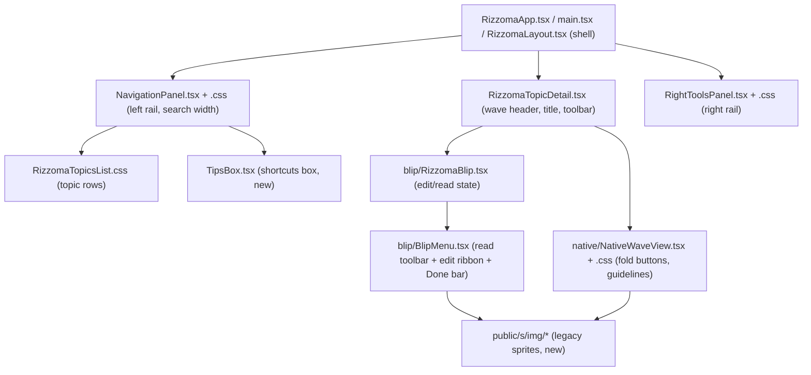
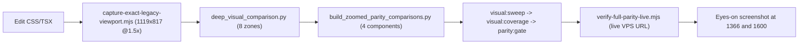

# Legacy Visual Parity — 2026-11-07 Chrome, Blip Edit Mode, and the Pixel-Comparison Tooling

**¶1** □ Between commit `54626e77` (2026-11-06 21:42, the wiki's own binding commit) and `a4d4d583` (2026-11-07 15:37) 21 commits landed on `feature/native-fractal-port`; `git diff --stat 54626e77..HEAD` reports 253 files changed (3,021 insertions, 1,641 deletions), a large share of them legacy sprite images added under `public/s/img/`. Their purpose: make the modern UI match the original Rizzoma's chrome and blip interaction. This page records what changed and where. It was written from the commit list and file reads, not from a fresh visual run.

**¶2** ◇ The handoff entries of 2026-11-07 describe this work as "100% parity". That claim is **not verified by this wiki**; the pixel-gate evidence lives in `screenshots/` and the scripts in §3 are the way to re-check it.

---

## 1. Components touched (`Continuant` — `graph TD`)

**¶3** □ Blip state lives in `src/client/components/blip/RizzomaBlip.tsx`. All blips start collapsed by default, as in the original (`src/client/components/blip/RizzomaBlip.tsx:339`). Entering edit mode goes through `handleStartEdit` (`src/client/components/blip/RizzomaBlip.tsx:1030`), which a content click also triggers (`src/client/components/blip/RizzomaBlip.tsx:1076`). Commit `25f4f492` fixed a temporal-dead-zone `ReferenceError` on that callback.

**¶4** □ `BlipMenu` (`src/client/components/blip/BlipMenu.tsx:60`) renders the read toolbar, the edit ribbon and the bottom **Done** control, whose title is "Done, switch to read mode (Ctrl+E, Shift+Enter)" (`src/client/components/blip/BlipMenu.tsx:497`).

**¶5** □ `TipsBox` is a new component (`src/client/components/TipsBox.tsx:4`) for the shortcuts box in the left rail, matching the legacy layout (commit `230bca83`).

**¶6** ▷ Per-commit intent, taken from commit subjects only: `0c50a727` fold-button geometry and `plus_minus` sprite; `92746e01` BlipMenu and top chrome; `7b8299aa` wave header, topics list, TipTap paragraph styling; `73cd7a10` search container 301px; `1322eb71` blip edit mode, wave-panel ribbon, bottom done bar, range-selection menu; `597f767c` single clean bullet, click-to-edit, auto-bulleting, hidden blips default; `a4d4d583` auto-bulleting in all view modes.

---

## 2. How a parity change is verified (`Occurrent` — `graph LR`)

---

## 3. Tooling added or changed

| Script | What it does (from its own header) |
|---|---|
| `scripts/capture-exact-legacy-viewport.mjs` | Playwright capture at viewport 1119x817, device scale 1.5, against the live app URL. |
| `scripts/deep_visual_comparison.py` | Compares legacy vs modern across 8 zones Z1–Z8 (left strip, list header, list rows, wave header toolbar, title/meta, folded BLB outlines, bottom shortcuts box, right tools panel). |
| `scripts/build_zoomed_parity_comparisons.py` | Side-by-side sheets for blip read toolbar, blip edit ribbon, topic header toolbar, topics list row. |
| `scripts/analyze_bullets.py` | Finds dark bullet clusters in the left 70 px strip of a screenshot. |
| `scripts/verify-full-parity-live.mjs` | Playwright run against `https://138-201-62-161.nip.io/?layout=rizzoma`, with goto retries. |
| `scripts/visual-feature-sweep.mjs`, `scripts/handbuild_acceptance.mjs`, `scripts/check-rizzoma-parity-gate.mjs` | Existing gates, edited for the new selectors (commits `478d46c0`, `f3a4365c`, `3de65e73`, `3cfdd07a`). |

**¶7** ◇ Compatibility rule learned in these commits: the sweep tests find buttons by selector, so restyling the chrome must keep the old selectors (commits `478d46c0`, `b8d631ce`, `f3a4365c`).

**¶8** ▷ Not yet recorded here: which of the 240 rows of `RIZZOMA_FEATURES_STATUS.md` changed status, and a post-change `parity:gate` result. Re-run the gate and file the numbers in `log.md`.

---

## 4. 2026-11-08 Structural Forensic Fixes for Discrepancies in Topic Pane

**¶9** □ On 2026-11-08, user review of screenshot `2026-11-08_00-27-53.png` identified 7 critical visual and behavioral discrepancies from the original Rizzoma UI (`original-rizzoma-src/` and `screenshots/260714-legacy-reference-archive/`):
1. **Child Blips Uncollapsed in Topic Root**:
   - *Original CoffeeScript*: `blip/blip_thread.coffee` executes `@initFold(true)`, ensuring all child threads start folded (`isFolded() == true`).
   - *Modern Defect*: In `RizzomaBlip.tsx`, an explicit condition `isTopicRoot ? listChildren.map(...) : ...` bypassed all fold checks and rendered full `<RizzomaBlip>` components for root children, forcing reply inputs, child chrome, and author badges (`[jan] Nov 2026`) into the main viewport.
   - *Fix*: Removed root bypass. All child blips respect `expandedBlips?.has(childBlip.id)`. Unexpanded blips render strictly as collapsed rows (`[+] <label>`).
2. **Elevated Cross/Diamond Bullets**:
   - *Original CSS*: `editor/renderer.coffee` / `static/css/blip.css` used standard `<li>` bullet discs with `BULLETED_LIST_START_PADDING = 22px`.
   - *Modern Defect*: `RizzomaBlip.css` rendered pseudo-element `::before` using Arial unicode character `•` with `top: 0; line-height: 22px;`. Arial's bullet glyph sits high in the em-box, floating 9px above the 22px line height baseline and anti-aliasing into a diamond/cross shape.
   - *Fix*: Replaced unicode glyph with a mathematically centered 5px disc (`width: 5px; height: 5px; border-radius: 50%; background: #333333; position: absolute; left: 5px; top: 9px;`).
3. **Double Markers on Collapsed Rows**:
   - *Modern Defect*: Collapsed blips showed a bullet disc on the left and a fold toggle on the right (`• Title [+]`).
   - *Fix*: Reordered to authentic legacy layout: `[+] Title` on the left, and suppressed `.blip-bullet` entirely on `.blip-collapsed-row`.
4. **Authentic Two-State Toolbar and Bottom Done Bar**:
   - *Original CoffeeScript*: `blip/menu/template.coffee` pairs `.read-only-menu` and `.edit-menu`. The edit ribbon exposes full formatting tools, `is-folded-by-default` toggle, and a green `Done` button (`Ctrl+E`, `Shift+Enter`).
   - *Fix*: Standardized 2-state toolbar in `BlipMenu.tsx`, restored bottom Done bar, and wired `Hidden` toggle to both blips and root topic menu.

