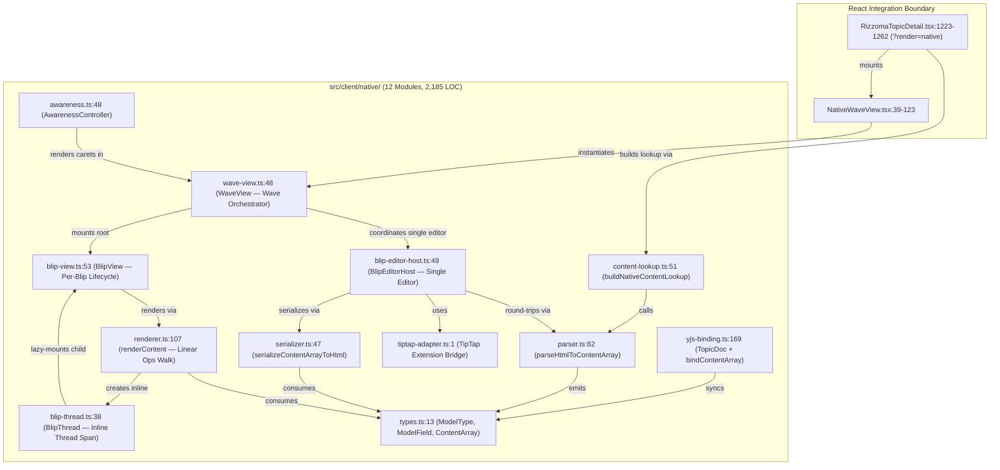

# Subsystem — Native Fractal Render Port (`src/client/native/`)

**¶1** □ The `src/client/native/` subsystem (`12` TypeScript modules, `2,185` lines of code, plus the React host wrapper `src/client/components/native/NativeWaveView.tsx`) is a direct, faithful TypeScript port of original Rizzoma's 2013 CoffeeScript rendering and threading stack (documented in `docs/ORIGINAL_FRACTAL_LOGIC_AND_WHY_OURS_DOESNT_MATCH.md:1-151`). Its roadmap and phase gates are specified in `docs/NATIVE_RENDER_PORT_PLAN.md:1-150`.

---

## 1. Module Dependency Graph (`Continuant` — `graph TD`)

---

## 2. End-to-End Render & Edit Pipeline (`Occurrent` — `graph LR`)

```mermaid
graph LR
    DB_TREE["CouchDB Nested BlipData[]"] --> FLATTEN["Flatten Tree in RizzomaTopicDetail.tsx:1241-1255"]
    FLATTEN --> LOOKUP["buildNativeContentLookup (content-lookup.ts:51-81)"]
    LOOKUP --> PARSE["parseHtmlToContentArray (parser.ts:62-186)"]
    PARSE --> SYNTH["Strip stale BLIP markers + Append Child BlipEls (content-lookup.ts:71-76)"]
    SYNTH --> SET_ROOT["WaveView.setRoot(topic.id) (wave-view.ts:81-118)"]
    SET_ROOT --> RENDER["BlipView.render() -> renderContent() (renderer.ts:107-230)"]
    RENDER --> UNFOLD["User Clicks .blip-thread-marker -> BlipThread.unfold() (blip-thread.ts:141-162)"]
    UNFOLD --> CHILD_BV["Lazy-Instantiate Child BlipView (blip-thread.ts:154-160)"]
    CHILD_BV --> EDIT_ATTACH["▷ Phase 2 Target: BlipEditorHost.attachToBlip() (blip-editor-host.ts:95-156)"]
```

---

## 3. Complete Inventory of the 12 Native Modules

### 3.1 Data Model & HTML Conversion (`types.ts`, `parser.ts`, `serializer.ts`, `content-lookup.ts`)
- **¶2** □ **[`types.ts`](file:///mnt/c/Rizzoma/src/client/native/types.ts#L13-L108)** (`108 LOC`): Defines `ModelType` (`TEXT`, `LINE`, `BLIP`, `ATTACHMENT`, `RECIPIENT`, `GADGET`, `TASK` at `types.ts:13-21`), `ModelField` (`PARAMS`, `TYPE`, `ID`, `RANDOM`, `LINE_TYPE`, `LINE_LEVEL`, `LINE_ALIGN`, `TEXT_BOLD`, `TEXT_ITALIC`, `TEXT_UNDERLINE`, `TEXT_STRUCKTHROUGH`, `TEXT_BG_COLOR`, `TEXT_COLOR`, `URL`, `USER_ID` at `types.ts:23-32`), and `ContentArray` (`types.ts:76`). Also provides `countBlips(content)` (`types.ts:82`) and `findBlipIndex(content, childBlipId)` (`types.ts:98`).
- **¶3** □ **[`parser.ts`](file:///mnt/c/Rizzoma/src/client/native/parser.ts#L62-L186)** (`257 LOC`): `parseHtmlToContentArray(html: string): ContentArray` (`parser.ts:62`) walks a `DOMParser` tree and emits flat `LINE`, `TEXT`, `BLIP`, and `ATTACHMENT` ops. Block tags (`p`, `div`, `li`, `h1`–`h6`, `blockquote`) emit a `LineEl` with `L_BULLETED` when inside `ul > li` (`parser.ts:98-136`). Inline `` elements emit a `BlipEl` (`parser.ts:141-148`).
- **¶4** □ **[`serializer.ts`](file:///mnt/c/Rizzoma/src/client/native/serializer.ts#L47-L143)** (`163 LOC`): `serializeContentArrayToHtml(content: ContentArray): string` (`serializer.ts:47`) is the exact inverse of `parser.ts`. It groups consecutive `L_BULLETED` lines into `<ul><li>...</li></ul>` (`serializer.ts:68-103`) and serializes `ModelType.BLIP` elements back into `\u200b` (`serializer.ts:116-123`).
- **¶5** □ **[`content-lookup.ts`](file:///mnt/c/Rizzoma/src/client/native/content-lookup.ts#L31-L81)** (`82 LOC`): Provides `createBlipMapContentLookup()` (`content-lookup.ts:31`) for raw HTML maps and `buildNativeContentLookup(rootId, flatBlips)` (`content-lookup.ts:51`) for CouchDB's `parentId` tree.
  - **Important Phase 1 Limitation (`content-lookup.ts:71-76`)**: Because the legacy React/TipTap save path does not persist `data-blip-thread` spans into CouchDB, `buildNativeContentLookup` strips any parsed `ModelType.BLIP` elements and appends one synthesized `BlipEl` per child at the end of the parent's `ContentArray` (`base.push({ t: ' ', params: { [ModelField.TYPE]: ModelType.BLIP, [ModelField.ID]: cid } })`). See [`wiki/decisions/contradictions-and-lint-findings.md`](../decisions/contradictions-and-lint-findings.md#¶5).

### 3.2 Linear Renderer & Threading (`renderer.ts`, `blip-thread.ts`, `blip-view.ts`, `wave-view.ts`)
- **¶6** □ **[`renderer.ts`](file:///mnt/c/Rizzoma/src/client/native/renderer.ts#L107-L230)** (`281 LOC`): `renderContent(container, content, opts): RenderResult` (`renderer.ts:107`) executes a single linear walk over `content: ContentArray`:
  - `ModelType.LINE` (`renderer.ts:144-174`): Calls `ensureListOfLevel()` (`renderer.ts:37-71`) to open/close nested `<ul class="blb-list-level-N">` lists for bulleted lines, then creates `<li class="blb-bullet">` or `
` via `createLineElement()` (`renderer.ts:73-105`).
  - `ModelType.TEXT` (`renderer.ts:176-187`): Ensures an open line exists, then appends styled `` or `<a class="blb-link">` via `renderTextInto()` (`renderer.ts:232-273`).
  - `ModelType.BLIP` (`renderer.ts:189-221`): Instantiates `new BlipThread(...)` (`renderer.ts:201`), records it in `threadsByBlipId`, and appends `thread.getElement()` **directly inside `currentLine`** (`currentLine.appendChild(thread.getElement())` at `renderer.ts:216`). This single line of code is why inline child blips appear mid-sentence inside the parent's bullet rather than below the parent block.
- **¶7** □ **[`blip-thread.ts`](file:///mnt/c/Rizzoma/src/client/native/blip-thread.ts#L38-L232)** (`232 LOC`): `BlipThread` (`blip-thread.ts:38`) owns ``, which contains `` (`▸`/`▾` + unread badge) and `
`. Calling `unfold()` (`blip-thread.ts:141-162`) removes `.folded` and calls `mountChildBlip()` (`blip-thread.ts:180-198`) on first open; calling `fold()` (`blip-thread.ts:167-178`) adds `.folded` back **without destroying the child `BlipView`**.
- **¶8** □ **[`blip-view.ts`](file:///mnt/c/Rizzoma/src/client/native/blip-view.ts#L53-L230)** (`230 LOC`): `BlipView` (`blip-view.ts:53`) manages a single blip's header/chrome, content container (`.blip-content-container`), and child `BlipThread` map (`threads: Map<string, BlipThread>`). It supports incremental `insertSubBlip(childBlipId, afterLineIndex)` (`blip-view.ts:141-189`) and `removeSubBlip(childBlipId)` (`blip-view.ts:195-206`).
- **¶9** □ **[`wave-view.ts`](file:///mnt/c/Rizzoma/src/client/native/wave-view.ts#L48-L216)** (`216 LOC`): `WaveView` (`wave-view.ts:48`) is the top-level controller for a topic wave. It maintains `viewsById: Map<string, BlipView>`, enforces the single-active-editor invariant via `claimActiveEdit(blipId)` (`wave-view.ts:138-157`), and handles `Ctrl+Enter` / `Cmd+Enter` inline reply creation via `insertInlineReplyAtSelection()` (`wave-view.ts:163-198`).

### 3.3 Single Editor Host & Y.js Collaboration (`blip-editor-host.ts`, `tiptap-adapter.ts`, `yjs-binding.ts`, `awareness.ts`)
- **¶10** ▷ **[`blip-editor-host.ts`](file:///mnt/c/Rizzoma/src/client/native/blip-editor-host.ts#L49-L195)** (`195 LOC`) and **[`tiptap-adapter.ts`](file:///mnt/c/Rizzoma/src/client/native/tiptap-adapter.ts#L1-L169)** (`169 LOC`): `BlipEditorHost` implements the single-editor-per-wave pattern. When a user clicks Edit on `blipId`, `attachToBlip(blipId, view)` (`blip-editor-host.ts:95-156`) detaches from the previous blip (serializing its TipTap HTML back to `ContentArray` while preserving `BlipThread` DOM nodes across the swap), mounts the single editor instance into the target `BlipView`, and emits `onCommit(blipId, nextContent)`.
- **¶11** ▷ **[`yjs-binding.ts`](file:///mnt/c/Rizzoma/src/client/native/yjs-binding.ts#L58-L276)** (`276 LOC`) and **[`awareness.ts`](file:///mnt/c/Rizzoma/src/client/native/awareness.ts#L48-L176)** (`176 LOC`): `bindContentArray(yarray, initialContent)` (`yjs-binding.ts:58`) binds a `Y.Array<ContentElement>` to a blip's `ContentArray` with minimal prefix/suffix diffing (`applyMinimalDiff` at `yjs-binding.ts:229-269`), while `TopicDoc` (`yjs-binding.ts:169-227`) manages one `Y.Doc` per wave (`y.getArray('blip:' + blipId)`). `AwarenessController` (`awareness.ts:48`) projects remote user carets (`renderCaretsInContainer` at `awareness.ts:127-168`).

---

## 4. Phase Completion Matrix (`docs/NATIVE_RENDER_PORT_PLAN.md`)

| Phase | Scope | Unit / Integration Tests | Live Runtime Wiring Status |
|---|---|---|---|
| **Phase 1** | Core `ContentArray` + `parser` + `serializer` + `renderer` + `BlipThread` + `BlipView` + `WaveView` | □ Passing (`tests/unit/native-*.test.ts`) | ◇ Live read-only via `?render=native` (`src/client/components/RizzomaTopicDetail.tsx:1223-1262`) |
| **Phase 2** | Single TipTap `BlipEditorHost` + `tiptap-adapter` | □ Unit-tested (`tests/unit/native-editor-host.test.ts`) | ▷ Not yet wired into `<NativeWaveView>` (`src/client/components/native/NativeWaveView.tsx:15-16`) |
| **Phase 3** | `TopicDoc` Y.js binding + `AwarenessController` | □ Unit-tested (`tests/unit/native-yjs.test.ts`, `native-awareness.test.ts`) | ▷ Not yet wired to Socket.IO / CouchDB save route |
| **Phase 4** | Top-level wave chrome (Playback, Swipe, Pull-to-refresh) | □ Wired in `NativeWaveView.tsx:49-121` | ◇ Playback button receives `blips={[]}` stub (`NativeWaveView.tsx:117`) |
| **Phase 5** | Flip default from React/TipTap hybrid to Native & delete legacy portal stack | ▷ Gated on `HB_RENDER=native node scripts/handbuild_acceptance.mjs` | ▷ Pending Phase 2 & 3 runtime wiring |

---

## 5. Measured `codegraph` AST Call-Graph & Blast-Radius Profile (`2026-11-06`)

- **¶12** □ **Index Coverage (`.codegraph-wsl/graph.db`)**: `365` files (`148` `.ts`, `67` `.tsx`, `134` `.js`/`.mjs`, `9` `.py`), `16,336` AST nodes (`6,797` functions, `3,218` methods, `445` classes, `112` Express routes), and `50,192` edges (`59.25 MB` SQLite WAL database).
- **¶13** □ **Direct Callers of `renderContent` (`src/client/native/renderer.ts:107`)**:
  - `BlipView.render` (`src/client/native/blip-view.ts:120`)
  - `renderBlip` (`src/client/native/__tests__/spike-depth-10.test.ts:57`)
- **¶14** □ **Transitive Blast Radius of `buildNativeContentLookup` (`src/client/native/content-lookup.ts:51`)**: `8` affected symbols across `src/client/native/content-lookup.ts:51`, `src/client/native/__tests__/content-lookup.test.ts:1`, `src/client/components/RizzomaTopicDetail.tsx:176`, `src/client/components/RizzomaLayout.tsx:54`, and `src/client/main.tsx:78`.
