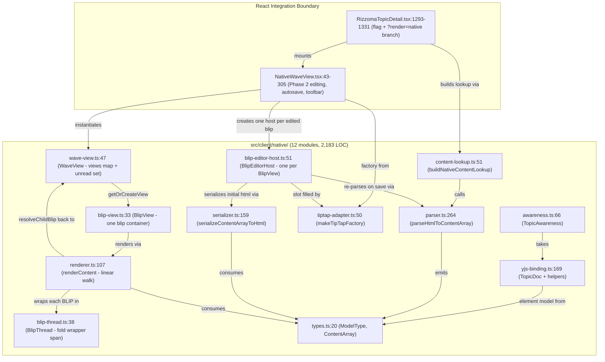

# Subsystem — Native Fractal Render Port (`src/client/native/`)

**¶1** □ The `src/client/native/` subsystem (12 TypeScript modules, **2,183 lines** by `wc -l` this session, plus the React host wrapper `src/client/components/native/NativeWaveView.tsx`, 307 lines) is a TypeScript port of original Rizzoma's CoffeeScript rendering and threading stack (rationale: `docs/ORIGINAL_FRACTAL_LOGIC_AND_WHY_OURS_DOESNT_MATCH.md:1-35`, `:39-114`). Its roadmap and phase gates are in `docs/NATIVE_RENDER_PORT_PLAN.md` (277 lines; phases at `:91-188`, daily gates at `:203-217`). `STATUS.md:42` reports "12 files, 2185 LOC"; that file is generated and was last generated 2026-07-16 (`STATUS.md:7`), so its figures predate commit `195dfcde`.

**¶1a** ◇ **Re-verification note (2026-11-07, HEAD `6cf6fc7a`)**: the 12 modules under `src/client/native/` were last touched by the 2026-11-07 commits only in `blip-editor-host.ts` and `tiptap-adapter.ts` (`195dfcde`: +6 and +4 lines); the earlier revision of this page nevertheless described APIs that do not exist in these files (listed below under *Corrections*). Everything here was read from source, nothing was executed (no vitest run, no browser, no `HB_RENDER=native` run) this session.

---

## 1. Module Dependency Graph (`Continuant` — `graph TD`)

---

## 2. End-to-End Render & Edit Pipeline (`Occurrent` — `graph LR`)

```mermaid
graph LR
    DB_TREE["CouchDB nested BlipData[] (parentBlipId tree)"] --> FLATTEN["Flatten tree in RizzomaTopicDetail.tsx:1311-1324"]
    FLATTEN --> LOOKUP["buildNativeContentLookup (content-lookup.ts:51-81)"]
    LOOKUP --> PARSE["parseHtmlToContentArray per blip (parser.ts:264-282)"]
    PARSE --> SYNTH["Drop parsed BLIP elements, append one BlipEl per child (content-lookup.ts:71-78)"]
    SYNTH --> SET_ROOT["new WaveView + setRoot(topic.id) (NativeWaveView.tsx:247-250; wave-view.ts:170-179)"]
    SET_ROOT --> RENDER["BlipView.render() -> renderContent() (blip-view.ts:120-127; renderer.ts:107-230)"]
    RENDER --> CHILDREN["Each BLIP: resolveChildBlip -> getOrCreateView(child) recursively (renderer.ts:181-182; wave-view.ts:88-101, 230-234)"]
    CHILDREN --> EDIT["Edit click: mountEditor -> BlipEditorHost.mount() (NativeWaveView.tsx:89-124, 193-225; blip-editor-host.ts:75-93)"]
    EDIT --> SAVE["onUpdate: 200 ms debounce -> PUT /api/blips/:id or PATCH /api/topics/:id (NativeWaveView.tsx:104-113, 60-83)"]
```

---

## 3. Inventory of the 12 Native Modules (line counts: `wc -l` this session)

### 3.1 Data Model & HTML Conversion (`types.ts`, `parser.ts`, `serializer.ts`, `content-lookup.ts`)
- **¶2** □ **[`types.ts`](file:///mnt/c/Rizzoma/src/client/native/types.ts#L20-L97)** (97 LOC): `ModelType = { TEXT:'text', LINE:'line', BLIP:'blip', ATTACHMENT:'attachment' }` (`types.ts:20-25`); `TextParams` (`bold`, `italic`, `underlined`, `struckthrough`, `url`, `bgColor`, `fgColor`; `:30-38`); `LineParams` (`bulleted`, `numbered`, `heading`; `:41-48`); `TextEl` (`:51`), `LineEl` (`:58`), `BlipEl {type, text:' ', params:{id, threadId?}}` (`:66-76`), `AttachmentEl` (`:79`), `ContentElement` (`:88`), `ContentArray` (`:91`) and the guards `isText` / `isLine` / `isBlip` / `isAttachment` (`:94-97`). **Corrections**: the earlier revision listed `ModelField`, `ModelType.RECIPIENT|GADGET|TASK`, `countBlips()` and `findBlipIndex()`; none exist in this file.
- **¶3** □ **[`parser.ts`](file:///mnt/c/Rizzoma/src/client/native/parser.ts#L264-L282)** (282 LOC): `parseHtmlToContentArray(html)` (`parser.ts:264`) wraps the HTML in a `
`, parses with `DOMParser` and calls the recursive `walk()` (`:153-262`). ` ` emits a `LINE` (`:164-167`); `<li>`, `<h1>`–`<h6>` and `
` emit a `LINE` carrying the list level / heading (`:213-216`), with the level read from a `bulleted-list-levelN` / `numbered-list-levelN` class when present (`:191-199`). A `` with class `blip-thread-marker` or attribute `data-blip-thread` becomes a `BlipEl` (`isMarkerSpan` `:46-49`; `:169-177`), and a `.blip-thread-host` wrapper is unwrapped to its marker (`:179-184`). Skipped tags are listed at `:32-36`.
- **¶4** □ **[`serializer.ts`](file:///mnt/c/Rizzoma/src/client/native/serializer.ts#L159-L209)** (209 LOC): `serializeContentArrayToHtml(content)` (`serializer.ts:159`) groups `LINE`s into `<ul class="bulleted-list bulleted-list-levelN">` / `<ol>` with `<li class="bulleted bulleted-typeN">` (`:132-148`, `:183-190`). A `BlipEl` is serialized as `+` (`:113-120`) — **not** the `contenteditable="false"` `​` span the earlier revision described.
- **¶5** □ **[`content-lookup.ts`](file:///mnt/c/Rizzoma/src/client/native/content-lookup.ts#L31-L81)** (81 LOC): `NativeBlipInput` (`:31`) and `buildNativeContentLookup(rootId, blips)` (`:51`), which builds a `parent -> ordered children` map from `parentId` (blips with `parentId === null` hang under `rootId`; `:55-63`) and pre-computes every blip's `ContentArray` (`:67-78`). `createBlipMapContentLookup()` (named by the earlier revision at `:31`) **does not exist**.
  - **Phase 1 limitation, still true (`content-lookup.ts:69-76`)**: any `BLIP` element parsed from stored HTML is filtered out (`.filter((el) => el.type !== ModelType.BLIP)`, `:72`) and one synthesized `BlipEl` per tree child is **appended after the parent's own content** (`:74-76`). The file header states the reason: stored HTML "usually has NO marker" because markers are injected at render time (`:4-19`) and that mid-line `anchorPosition` handling is "a Phase-2 / edit-path concern" (`:21-25`). **Caveat now needed**: the hybrid editor does persist marker spans in parent HTML (the server deletes them on blip delete, `src/server/routes/blips.ts:88-118`, `:153`; the nested Ctrl+Enter path auto-saves the parent right after inserting the marker, `RizzomaBlip.tsx:756-759`, the save call being uncommitted at the time of writing), so the premise "usually no marker" is weaker than in July. Consequence by reading, not tested: a child created at mid-line in native edit mode (via `insertBlipThread`, `NativeWaveView.tsx:153-155`) would be saved with a marker but re-rendered **at the end** of the parent after reload, because the lookup discards persisted markers. See [`decisions/contradictions-and-lint-findings.md`](../decisions/contradictions-and-lint-findings.md) (C3).

### 3.2 Linear Renderer & Threading (`renderer.ts`, `blip-thread.ts`, `blip-view.ts`, `wave-view.ts`)
- **¶6** □ **[`renderer.ts`](file:///mnt/c/Rizzoma/src/client/native/renderer.ts#L107-L230)** (230 LOC): `renderContent(container, content, opts): void` (`renderer.ts:107`; **returns nothing** — the earlier `RenderResult` / `threadsByBlipId` do not exist) empties the container (`:113`) and walks `content` once (`:159-229`):
  - `LINE` (`:160-167`): `ensureLineParent()` (`:128-157`) opens `<ul class="bulleted-list bulleted-list-levelN">` or `<ol class="numbered-list …">` when the level changes, `startLineElement()` (`:73-96`) returns `<hN>`, `<li class="bulleted bulleted-typeN">`, `<li class="numbered …">` or `
`.
  - `TEXT` (`:169-179`): creates a `
` if there is no current line, appends `renderTextElement()` output (`:44-67`: a text node, or a ``/`<a>` with inline styles).
  - `BLIP` (`:181-213`): `opts.resolveChildBlip(id)` returns the child container; if none, a `span.blip-thread-placeholder` with text `[+]` is emitted (`:182-195`). Otherwise consecutive BLIPs with the same `threadId` are appended to the previous thread (`:197-202`) and a new `BlipThread(tid, childContainer)` is created and appended **into `currentLine`** (`:204-211`) — the one line that places an inline child inside the parent's bullet rather than below it.
  - `ATTACHMENT` (`:215-228`): a plain `` (Phase-1 stub).
- **¶7** □ **[`blip-thread.ts`](file:///mnt/c/Rizzoma/src/client/native/blip-thread.ts#L38-L232)** (232 LOC): `BlipThread` (`:38`) builds `span.blip-thread` (`contentEditable=false`, `data-thread-id`) from a template with `.fold-button-container > .js-fold-button.fold-button` (sprite images) and `.js-blips-container` (`:25-36`, `:48-54`) and starts folded (`:76`). `fold(animated)` (`:147-159`) and `unfold()` (`:161-171`) toggle `.folded` and emit `'fold'` / `'unfold'`; `toggle()` `:173`; clicking the button toggles (`:205-209`). Blip nodes are managed with `appendBlipElement` (`:122`), `insertBlipNodeAfter` (`:128`), `removeBlipNode` (`:135`, destroys the thread when empty). **Corrections**: there is no `mountChildBlip()` and no lazy child instantiation in the thread, no `.blip-thread-marker`, no unread badge.
- **¶8** □ **[`blip-view.ts`](file:///mnt/c/Rizzoma/src/client/native/blip-view.ts#L33-L166)** (166 LOC): `BlipView` (`:33`) owns `div.blip-container[data-blip-id]` > `div.blip-text` plus a `div.blip-gear-menu` with a "View blip history" button (`⏱`; `:44-74`, handler via `setHistoryHandler` `:77`). `setChildResolver()` (`:106`), `setContent()` (`:110`), `render()` (`:120-127`, calls `renderContent(this.inner, this.content, …)`), `on('rendered' | 'destroyed')`, `destroy()` (`:139`). **Corrections**: `insertSubBlip()` / `removeSubBlip()` and the `threads: Map` do not exist; the file also re-exports `WaveView` (`:166`).
- **¶9** □ **[`wave-view.ts`](file:///mnt/c/Rizzoma/src/client/native/wave-view.ts#L47-L248)** (248 LOC): `WaveView` (`:47`) keeps `views: Map<string, BlipView>`, `getOrCreateView(blipId)` (`:88-101`; creates the view, installs the child resolver, applies unread state, fills it from `contentByBlipId`), `setRoot` (`:170-179`), `removeView` (`:160-166`), `findViewForElement` (`:184-195`) and an unread model: `setUnreadSet` (`:107-119`), `nextUnreadAfter` (`:123-142`), `markRead` (`:145-152`). Events: `'blip-added' | 'blip-removed' | 'root-set' | 'unread-changed' | 'destroyed'` (`:28-33`). **Corrections**: `claimActiveEdit()` and `insertInlineReplyAtSelection()` named by the earlier revision do not exist anywhere in `src/` (`git grep` finds none); single-active-editor and Ctrl+Enter are handled in `NativeWaveView.tsx` and the TipTap extensions instead.

### 3.3 Single Editor Host & Y.js Collaboration (`blip-editor-host.ts`, `tiptap-adapter.ts`, `yjs-binding.ts`, `awareness.ts`)
- **¶10** □ **[`blip-editor-host.ts`](file:///mnt/c/Rizzoma/src/client/native/blip-editor-host.ts#L51-L221)** (221 LOC) and **[`tiptap-adapter.ts`](file:///mnt/c/Rizzoma/src/client/native/tiptap-adapter.ts#L50-L69)** (69 LOC): `BlipEditorHost(view, factory)` (`:51-60`) is bound to **one `BlipView`**. `mount()` (`:75-93`) snapshots the content, empties the view's `.blip-text`, serializes the snapshot to HTML, creates the editor in that slot via the factory and adds `.edit-mode` to the container. `save()` (`:100-110`) re-parses editor HTML into a `ContentArray` and `setContent`s the view; `unmount()` (`:113-127`) destroys the editor and calls `view.render()`; `cancelAndUnmount()` (`:130`) restores the snapshot; `saveAndUnmount()` (`:139`); `insertChildBlipAtCursor(marker, newBlipId)` (`:162-200`) splices a `BlipEl` after the cursor's line. `getView()` and the adapter's optional `raw` editor were added in `195dfcde` (`:62`, `:40`). `makeTipTapFactory({extensions, editorProps, extensionOptions, onUpdate})` (`tiptap-adapter.ts:35-50`) builds a TipTap `Editor` with `autofocus: 'end'` and forwards `onUpdate` (`:51-60`) — `onUpdate` and `raw` also from `195dfcde`. **Corrections**: `attachToBlip()` and "detach from the previous blip preserving `BlipThread` DOM nodes" do not exist.
- **¶11** ▷ **[`yjs-binding.ts`](file:///mnt/c/Rizzoma/src/client/native/yjs-binding.ts#L49-L201)** (201 LOC) and **[`awareness.ts`](file:///mnt/c/Rizzoma/src/client/native/awareness.ts#L66-L147)** (147 LOC): element <-> `Y.Map` converters (`elementToYMap` `:49`, `yMapToElement` `:63`), `seedYArrayFromContent` (`:71`), `yArrayToContentArray` (`:84`), mutation helpers `insertBlipMarker` / `insertText` / `insertLine` / `removeAt` (`:93-137`), `observeContent` (`:153`); `TopicDoc` (`:169-201`) holds **one `Y.Array<Y.Map>` at key `'content'` per topic** (`:175`) and hands out per-blip `Y.XmlFragment`s named `blip:<id>` (`:194`). `TopicAwareness` (`awareness.ts:66`) wraps `y-protocols/awareness` with `setUser` / `setCursor` / `getParticipants` / `getParticipantsInBlip` / `on` (`:79-129`). **Corrections**: `bindContentArray`, `applyMinimalDiff`, `AwarenessController` and `renderCaretsInContainer` do not exist. Grep shows **no importer outside `src/client/native/__tests__/`** for either file (the only non-test reference is the `import type { TopicDoc }` inside `awareness.ts:21`), i.e. Phase 3 is not wired into the app.

### 3.4 Phase 2 Host Wiring (`components/native/NativeWaveView.tsx`, commit `195dfcde`)
- **¶11a** □ `NativeWaveView` (`:43-305`) renders null unless `FEATURES.RIZZOMA_NATIVE_RENDER` (`:270-272`), builds a `WaveView` in an effect (`:242-266`), and now also: an **Edit / Done** toolbar button (`:276-284`) whose handler mounts a TipTap editor on the root `BlipView` (`:193-225`) or, on Done, flushes pending saves, calls `saveAndUnmount()` on every host and clears the registry (`:197-212`); `mountEditor()` (`:89-124`) builds the factory with `getEditorExtensions(...)` including an `onCreateInlineChildBlip` callback; **auto-save** debounced 200 ms per blip (`:104-113`) — `PATCH /api/topics/:id {title, content}` for the root (`:63-72`, title taken from the first `<h1>` or first line) and `PUT /api/blips/:id {content}` otherwise (`:73-78`); `handleCreateChild()` for Ctrl+Enter (`:127-186`, see [`blb-and-editor-invariants.md`](blb-and-editor-invariants.md) §3.3). Mobile: `usePullToRefresh` with an empty `onRefresh` (`:228-230`) and a left-swipe that folds all open threads (`:231-238`).
- **¶11b** □ `src/client/components/native/NativeWaveView.css` was restyled in `0c50a727` (original fold-button geometry, `plus_minus` sprite, hierarchy guidelines; `NativeWaveView.css:48-103`). Visual-parity work is covered in [`legacy-visual-parity.md`](legacy-visual-parity.md).

---

## 4. Phase Completion Matrix (`docs/NATIVE_RENDER_PORT_PLAN.md`)

| Phase | Scope | Tests (exist on disk; **not run this session**) | Live Runtime Wiring Status |
|---|---|---|---|
| **Phase 1** | `ContentArray` + parser + serializer + renderer + `BlipThread` + `BlipView` + `WaveView` | `src/client/native/__tests__/{parser,serializer,content-lookup,wave-view,spike-depth-10}.test.ts` (8 test files total in that folder; the earlier path `tests/unit/native-*.test.ts` does not exist) | ◇ Opt-in: `FEAT_RIZZOMA_NATIVE_RENDER=1` (`src/shared/featureFlags.ts:45`) **and** `?render=native` (`RizzomaTopicDetail.tsx:1293-1301`) |
| **Phase 2** | Single TipTap `BlipEditorHost` + `tiptap-adapter` | `__tests__/blip-editor-host.test.ts` | ◇ **Wired** in `NativeWaveView.tsx` since `195dfcde` (Edit/Done, Ctrl+Enter child creation, autosave). Differs from the plan: one host per edited blip, no single-active enforcement (`NativeWaveView.tsx:55`, `:149-173`). `STATUS.md:44` and the comment at `RizzomaTopicDetail.tsx:1296-1299` still say "read-only / no Edit button" (stale, see C2) |
| **Phase 3** | `TopicDoc` Y.js binding + `TopicAwareness` | `__tests__/yjs-binding.test.ts`, `awareness.test.ts` | ▷ Not wired: no non-test importer of `yjs-binding.ts` / `awareness.ts` |
| **Phase 4** | Top-level wave chrome (Playback, swipe, pull-to-refresh) | none found | ◇ Toolbar `▷ Playback` button opens `WavePlaybackModal` with `blips={[]}` (`NativeWaveView.tsx:285-301`); pull-to-refresh is a no-op (`:228-230`) |
| **Phase 5** | Flip default from React/TipTap hybrid to Native & delete legacy portal stack | ▷ Gated on `HB_RENDER=native node scripts/handbuild_acceptance.mjs` (`scripts/handbuild_acceptance.mjs:24`). Evidence folder `screenshots/260714-handbuild-acceptance-native/` (35 files, folder mtime 2026-11-06 23:23) exists; **its pass/fail result was not read** | ▷ Pending; React path is still the default (`RizzomaTopicDetail.tsx:1333`) |

---

## 5. Measured `codegraph` AST Call-Graph (re-queried 2026-11-07, index is stale)

- **¶12** □ **Index coverage** (`codegraph status` this session): 365 files (148 `.ts`, 134 `.js`), 16,336 nodes (6,797 functions, 3,218 methods, 445 classes, 112 routes), 50,192 edges, 59.25 MB. These numbers are identical to the 2026-11-06 figures and the database file `.codegraph-wsl/codegraph.db` was last written 2026-11-06 14:11, **before** the 2026-11-07 commits, so the index does not contain them. (The earlier revision named the file `graph.db`; the actual file is `codegraph.db`. The earlier "67 `.tsx`, 9 `.py`" breakdown was not re-checked.)
- **¶13** □ **Direct callers of `renderContent` (`src/client/native/renderer.ts:107`)**, from `codegraph callers renderContent` this session: `BlipView.render` (`src/client/native/blip-view.ts:120`) and `renderBlip` (`src/client/native/__tests__/spike-depth-10.test.ts:57`).
- **¶14** □ **Impact of `buildNativeContentLookup` (`content-lookup.ts:51`)**: `codegraph impact` reports 8 affected symbols in `content-lookup.ts`, `__tests__/content-lookup.test.ts`, `RizzomaTopicDetail`, `RizzomaLayout` and `App` (`main.tsx:78`). Because the index is stale its line anchors for two components are off: it says `RizzomaTopicDetail.tsx:176` and `RizzomaLayout.tsx:54`; in the working tree the functions are declared at `RizzomaTopicDetail.tsx:203` and `RizzomaLayout.tsx:55`. The real chain is: import at `RizzomaTopicDetail.tsx:24`, call at `:1325`, the component rendered by `RizzomaLayout.tsx:269`, which `main.tsx` imports (`:14`).
