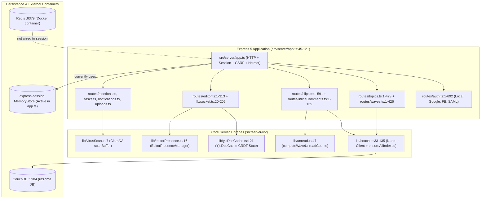
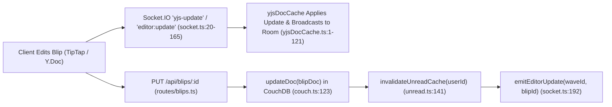

# Subsystem — Express 5 Server, CouchDB Mango Storage, and Y.js/Socket.IO Collaboration

**¶1** □ The backend of modernized Rizzoma (`src/server/`) is an Express 5 TypeScript server (`src/server/app.ts:1-121`) backed by **CouchDB 3** for document storage (`src/server/lib/couch.ts:1-135`), **Socket.IO + Y.js** for real-time collaborative editing and presence (`src/server/lib/socket.ts:1-205`, `src/server/lib/yjsDocCache.ts:1-125`), and **Passport** (Local, Google OAuth 2.0, Facebook OAuth, SAML 2.0) for authentication (`src/server/routes/auth.ts:1-692`, `src/server/lib/saml.ts:1-120`).

---

## 1. Backend Component Topology (`Continuant` — `graph TD`)

---

## 2. Real-Time Blip Save, Y.js Sync & Unread Invalidation Flow (`Occurrent` — `graph LR`)

---

## 3. Subsystem Deep Dive

### 3.1 CouchDB Mango Indexes & Document Model (`src/server/lib/couch.ts`)
- **¶2** □ `src/server/lib/couch.ts:1-135` wraps the `nano` CouchDB client. On server startup, `ensureAllIndexes()` (`src/server/lib/couch.ts:102-110`) ensures 13 Mango indexes (`INDEX_DEFINITIONS` at `src/server/lib/couch.ts:74-100`) covering `type`, `waveId`, `topicId`, `parentBlipId`, `createdAt`, `updatedAt`, `authorId`, `email`, and `userId`.
- **¶3** □ Core helper exports: `find()` (`couch.ts:53`), `findOne()` (`couch.ts:118`), `getDoc()` (`couch.ts:112`), `insertDoc()` (`couch.ts:47`), `updateDoc()` (`couch.ts:123`), and `deleteDoc()` (`couch.ts:130`).

### 3.2 Real-Time Collaboration (`src/server/lib/socket.ts`, `yjsDocCache.ts`, `editorPresence.ts`)
- **¶4** □ `initSocket(server, allowedOrigins)` (`src/server/lib/socket.ts:20-165`) attaches Socket.IO to the HTTP server and manages per-wave rooms (`wave:<waveId>`), per-blip Y.js binary state exchange (`yjsDocCache` at `src/server/lib/yjsDocCache.ts:121`), and active cursor/selection presence (`EditorPresenceManager` at `src/server/lib/editorPresence.ts:16`).
- **¶5** □ Whenever a blip is created, edited, or deleted via REST (`src/server/routes/blips.ts:1-591`), the route calls `emitEditorUpdate(waveId, blipId, payload)` (`src/server/lib/socket.ts:192`) so connected clients refresh or merge the updated blip tree.

### 3.3 Authentication & Session Store (`src/server/app.ts`, `src/server/routes/auth.ts`)
- **¶6** □ `src/server/routes/auth.ts:1-692` supports four authentication strategies:
  1. Email + bcrypt password (`src/server/lib/bcrypt.ts:13-20`).
  2. Google OAuth 2.0 (`/api/auth/google` and `/api/auth/google/callback`).
  3. Facebook OAuth (`/api/auth/facebook`).
  4. SAML 2.0 (`src/server/lib/saml.ts:22-115`).
- **¶7** □ **Known Session Persistence Gap (`STATUS.md:25`)**: Although Redis runs in Docker on `:6379` and `connect-redis` is installed, `src/server/app.ts` currently configures `express-session` with the default in-memory `MemoryStore`. Every restart of the `tsx` backend process on `:8000` invalidates active browser login cookies. This is tracked in [`wiki/decisions/contradictions-and-lint-findings.md`](../decisions/contradictions-and-lint-findings.md#¶4).

### 3.4 Unread Tracking & Upload Scanning (`src/server/lib/unread.ts`, `virusScan.ts`)
- **¶8** □ `computeWaveUnreadCounts()` (`src/server/lib/unread.ts:47-139`) computes per-wave `{ total, unread, read }` blip counts by comparing each blip's `updatedAt` timestamp against the user's `blipReadStatus` watermark document in CouchDB, caching results in memory until `invalidateUnreadCache(userId)` (`src/server/lib/unread.ts:141`) is called.
- **¶9** □ `src/server/routes/uploads.ts:1-94` pipes uploaded attachments through `scanBuffer(buffer)` (`src/server/lib/virusScan.ts:7-45`) before persisting files to local disk or S3-compatible object storage.
