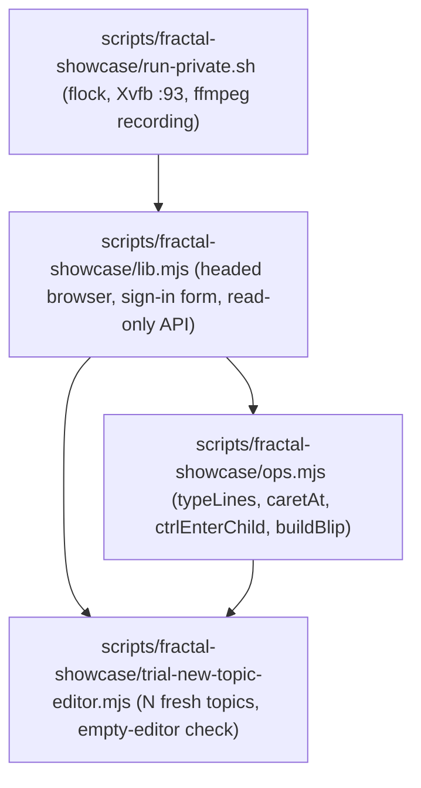
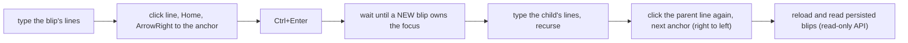

# Fractal Showcase: hand-built demonstration topic, driver and defects found

**¶1** □ Purpose: a deep demonstration topic ("Fractal Showcase: every function (built by hand, 18 Nov 2026)", at least 8 levels, 60 blips, every product function used once) built ONLY with real keyboard, mouse, clipboard and file-chooser input, because the earlier deep topics were created through the REST API and screenshotted, so no real typing, Ctrl+Enter, delete, cut, paste or reload ever ran. The server API is used only to read persisted state afterwards, and (local stack only) to seed verified accounts, because production registration needs a mailbox-verified invitation (`src/server/routes/auth.ts:152-205`).

**¶2** ▷ STATUS 18 Nov 2026: the topic is NOT built yet. What exists: the driver, one product fix (below) and the measured findings. The function table at the end lists every function as not yet exercised, which is the honest state.

## 1. The driver (`Continuant` — `graph TD`)

**¶3** □ A headed run is refused unless `DISPLAY` is a private Xvfb display (`:9x`) and `WAYLAND_DISPLAY` is unset (`lib.mjs`, `launch()`), so nothing ever opens on the operator's desktop. Human pace: slowMo 120 ms, 60 to 80 ms per typed character. Only one visible run at a time (`/tmp/rizzoma-visible-browser.lock`, shared with other agents).

## 2. One build step (`Occurrent` — `graph LR`)

**¶4** □ Anchors are inserted right to left on each line, so the offsets of the remaining anchors (counted from `Home`) are not shifted by markers already inserted.

## 3. Defects found

**¶5** □ DEFECT A (fixed, PR 96): new topics opened an EMPTY root editor on Edit (measured: base 6 of 10 clean headed and 8 of 10 headless, 4 of 5 in the first hand trials; with the fix 10 of 10 clean headed and 10 of 10 headless, on a clean checkout of the fix commit). Trace: the topic's collaboration provider emits `blip:join` twice about 50 ms apart; the first answer (`shouldSeed=true`) is ignored by the client until its join is acknowledged (`src/client/components/editor/CollaborativeProvider.ts:153`, `if (!this.joined) return`), and the second answer was `shouldSeed=false` because the seed lease was already owned by the same socket (`src/server/lib/socket.ts:543-551`). Nobody seeded the Y.Doc; the stored topic stayed `<h1>title</h1><ul><li>

</li></ul>` and typed text was lost. Fix: the lease-owner socket is granted seed authority again while the doc is empty; any other socket, including a second socket of the same user, is still refused. Tests: `src/tests/server.socketAuthorization.test.ts`, "grants seed authority again when the lease owner socket joins a second time" (fails on base, passes with the fix).

**¶5a** □ DEFECT D (fixed): a mouse press inside an OPEN nested blip focused the PARENT editor, so a person clicking into the middle blip of an open chain (root > A > B > C) typed into A. Cause: the inline child renders inside the parent's `contenteditable=false` atom host (`.inline-child-portal`); ProseMirror of the parent treated the press as a press on the atom (selected the marker, focused the parent). Fix: `BlipThreadNode.tsx` registers a plugin whose `handleDOMEvents` ignores mousedown, mouseup and click from inside the portal (`isEventInsideInlineChildPortal`). Tests: `test-nested-pointer-focus-smoke.mjs` (fails on base: focus lands in A; passes with the fix) and `src/tests/client.blipThreadNestedPointer.test.ts`. The build content is in `scripts/fractal-showcase/spec.mjs`, counted by `scripts/fractal-showcase/count-spec.mjs`, built by `scripts/fractal-showcase/build-showcase.mjs`.

**¶5b** □ DEFECT F (fixed): a click into the MIDDLE of a view-state blip put the caret at the END of the blip (and the editing effect forced it to the end again once the collaboration room had synced, even after the person had started typing): "my cursor jumped away" (SDS, 18 Nov 2026). Cause: `RizzomaBlip.tsx` editing effect `focus('end')` after every `isEditing && collabReady`, and `handleViewContentClick` never kept the click position. Fix: the click coordinates are kept (`pendingClickCaretRef`), the caret is set with `posAtCoords` at the clicked place, and an editor that already holds the caret is never moved. Test: `test-click-caret-smoke.mjs` (npm run test:click-caret): base 5 of 5 typed characters at the end, fix 0 of 5.

**¶5c** □ DEFECT G (fixed, gadgets rendered nothing useful although they were STORED; SDS, 18 Nov 2026): the earlier "17 of 17 functions persisted" was a read-only check of stored HTML, never of the rendered read view. Measured on the live host (headed, screenshots read): Notes, Focus, Planner, Kanban apps rendered; iFrame and Sheet rendered when a URL was entered; Image rendered; YouTube was a BLACK box (`sandbox` lacked `allow-same-origin`, the player stayed in an opaque origin: "Cache storage is disabled"); Poll was a zero-height box (stored as a bare `<figure>`, only the editor node view drew it); Code inserted nothing inside a bullet (`toggleCodeBlock` cannot turn a list item's first paragraph into a code block); LaTeX inserted `$$  $$` and left the caret after it, so the formula was never typed and the read view showed a raw `$$ $$`; every embed raised React "Invalid DOM property allowfullscreen". Fixes: `sanitizeRichHtml.ts` (`isYoutubeFrameSource`, same-origin only for the YouTube player), `GadgetNodes.ts`, `InlineHtmlRenderer.tsx` (read-state poll, `allowFullScreen`/`frameBorder`), `insert.ts` (code block as the bullet's next block, caret between the LaTeX `$$`). Tests that judge RENDERED output: `test-gadgets-render-smoke.mjs` (npm run test:gadgets-render: base 6 of 9 checks fail) and `src/tests/client.gadgetRender.test.tsx`. Why nothing caught it: `test-gadget-apps-smoke.mjs` judges only the four sandbox apps; the other gadgets were covered by unit tests of URL normalisation and of the inserted node (`client.gadgets.insert.test.ts`, `client.gadgets.embedAdapters.test.ts`) and by API "stored" checks. Live look scripts: `scripts/fractal-showcase/gadget-render-probe.mjs`, `scripts/fractal-showcase/gadget-look.mjs`, `scripts/fractal-showcase/showcase-gadgets-look.mjs`.

**¶5d** □ DEFECT H (fixed): LaTeX showed raw `$$ ... $$` in EDIT mode (only the read view typeset), and gadgets stored empty before the fix showed a bare `$$ $$`. Fix: `src/client/components/editor/extensions/LatexPreview.ts` (ProseMirror decorations: the formula shows typeset while the caret is elsewhere, the source while the caret touches it, a click on the formula edits it; an empty formula shows "type a formula") and the read view draws the same placeholder for empty delimiters (`InlineHtmlRenderer.tsx`). Tests: `test-gadgets-render-smoke.mjs` (edit-mode checks), `src/tests/client.gadgetRender.test.tsx`.

**¶5e** □ DEFECT I (fixed): the click-caret fix of ¶5b did not cover NESTED blips. Measured with a page-side probe: on a level 2 blip `editor.view.posAtCoords` answered null at the old click position (the toolbar shifts the text in edit mode), so the caret fell to the end. Fix: the click is converted to a TEXT OFFSET in the read view (`src/client/lib/clickCaret.ts`) and mapped to the editor position, so layout no longer matters. Test: `test-click-caret-smoke.mjs` nested case (base 5 of 5 fail, fix 0 of 5).

**¶5f** □ Liliia's review of 19 Nov 2026 (topic 62d6bdc5..., blip 0_b_cjjg_cq8uf), six defects, reproduced as a NON-OWNER in a clean headed context on the private display (`scripts/fractal-showcase/liliia-repro.mjs`, `liliia-repro2.mjs`). (a) follow-the-green stayed lit: a blip opened through its inline [+] marker was never marked read (server: 1 unread after everything was open); FIXED, `RizzomaBlip.tsx` marks an open inline child read. (e) copy-blip link gave the topic link: the link used `?focus=`, which no topic view reads; FIXED, `copyBlipLink.ts` now builds the sub-blip route `#/topic/<wave>/<blip>/` (screenshot: breadcrumb "ZZ SCRATCH liliia -> Nested child text"). Test: `test-liliia-smoke.mjs` (base fails 4 of 4 checks, fix passes). (c) inserting a blip mid-blip: Ctrl+Enter after clicking into the middle works (child anchored mid-sentence, parent `1f4ea8`); the right-panel reply button after opening a row acts on the TOPIC ROOT (probe: `.rizzoma-blip.active` = topic root; the click after a finished edit reaches the children container, not the row): REPRODUCED, NOT FIXED. (d) screenshot paste into a sub-blip: a PNG pasted with Ctrl+V while the caret is in the nested child lands in that child and clicking the picture then Backspace deletes only the picture (nested child and 4 other blips kept): NOT REPRODUCED in this flow. (f) copy a whole blip with its [+]: PR 111 (open, not merged). (b) layout size and spacing versus the original: not analysed.

**¶6** ▷ DEFECT B (open, owned by another agent, branch `fix/root-ctrl-enter-survives-reload`): Ctrl+Enter in the topic-root editor creates a child whose editor and typed text are destroyed by a socket-triggered reload; seen locally in the first multi-line build attempt (root blank after the child was typed).

**¶7** ▷ DEFECT C (open, not yet reproduced here): deep nesting clips the deepest blip's date at the right edge on the React path at 1366 and 1600 px.

**¶7a** □ Live scripts: `scripts/fractal-showcase/liveauth.mjs` (credentials read inside the process, typed into the real form, never printed; sign-in in a throwaway context without video), `scripts/fractal-showcase/live-trial.mjs`, `scripts/fractal-showcase/live-access-probe.mjs`, `scripts/fractal-showcase/live-cleanup.mjs`. LIVE probe of defect A's fix (18 Nov, Fractal Tester 1, headed on a private display): 10 of 10 fresh scratch topics kept the title, took three typed bullets, survived Done and reload (view and stored content), then were deleted; `GET /api/topics?my=1` showed 0 remaining. The product has NO topic-delete control in the UI (only blips), so cleanup used `DELETE /api/topics/:id` (`live-cleanup.mjs`).

**¶7b** □ ACCESS finding (read-only, Fractal Tester 2, no sharing): `GET /api/topics` without `my=1` returned 122 topics, all with `sharing.shareLevel` public and role viewer (canEdit 0); every one was readable (topic and blips 200). Cause: `buildAccessibleTopicSelector` (`src/server/lib/access.ts:325-341`) lists topics with no persisted sharing policy as legacy public-read-only (`DEFAULT_SHARING_POLICY`, `access.ts:68-75`). Production data: 153 topics, 122 without a policy (3 created 2026-06, 51 in 2026-07, 68 in 2026-11, mostly test fixtures), 31 with an explicit private policy. Private topics are excluded: Tester 1's private topics answered 403 for topic and blips to Tester 2. SDS's account owns 3 topics under its legacy user id: 2 have no policy (test topics from 16 Jun 2026, so readable by any signed-in user) and 1 is private. Not fixed; decision belongs to SDS.

## 4. Function table

**¶8** ▷ Every row below is NOT yet exercised; this table is filled by the build.

| Function | How exercised | Result | Defect and fix |
|---|---|---|---|
| New topic through the dialog | typed title, clicked Create | works | A (fixed) |
| Edit root, type bullets | click Edit, type | works after fix A | A |
| Ctrl+Enter inline child (root) | keys | intermittent | B (open) |
| All other toolbar, gadget, sharing, navigation functions | not yet | not yet | none recorded |
