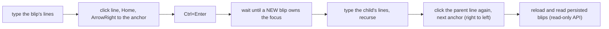

# Fractal Showcase: hand-built demonstration topic, driver and defects found

**¶1** □ Purpose: a deep demonstration topic ("Fractal Showcase: every function (built by hand, 18 Nov 2026)", at least 8 levels, 60 blips, every product function used once) built ONLY with real keyboard, mouse, clipboard and file-chooser input, because the earlier deep topics were created through the REST API and screenshotted, so no real typing, Ctrl+Enter, delete, cut, paste or reload ever ran. The server API is used only to read persisted state afterwards, and (local stack only) to seed verified accounts, because production registration needs a mailbox-verified invitation (`src/server/routes/auth.ts:152-205`).

**¶2** ▷ STATUS 18 Nov 2026: the topic is NOT built yet. What exists: the driver, one product fix (below) and the measured findings. The function table at the end lists every function as not yet exercised, which is the honest state.

## 1. The driver (`Continuant` — `graph TD`)

**¶3** □ A headed run is refused unless `DISPLAY` is a private Xvfb display (`:9x`) and `WAYLAND_DISPLAY` is unset (`lib.mjs`, `launch()`), so nothing ever opens on the operator's desktop. Human pace: slowMo 120 ms, 60 to 80 ms per typed character. Only one visible run at a time (`/tmp/rizzoma-visible-browser.lock`, shared with other agents).

## 2. One build step (`Occurrent` — `graph LR`)

**¶4** □ Anchors are inserted right to left on each line, so the offsets of the remaining anchors (counted from `Home`) are not shifted by markers already inserted.

## 3. Defects found

**¶5** □ DEFECT A (fixed, PR 96): new topics opened an EMPTY root editor on Edit (4 of 5 fresh topics on the base, measured with the headed driver; later trials below). Trace: the topic's collaboration provider emits `blip:join` twice about 50 ms apart; the first answer (`shouldSeed=true`) is ignored by the client until its join is acknowledged (`src/client/components/editor/CollaborativeProvider.ts:153`, `if (!this.joined) return`), and the second answer was `shouldSeed=false` because the seed lease was already owned by the same socket (`src/server/lib/socket.ts:543-551`). Nobody seeded the Y.Doc; the stored topic stayed `<h1>title</h1><ul><li>

</li></ul>` and typed text was lost. Fix: the lease-owner socket is granted seed authority again while the doc is empty; any other socket, including a second socket of the same user, is still refused. Tests: `src/tests/server.socketAuthorization.test.ts`, "grants seed authority again when the lease owner socket joins a second time" (fails on base, passes with the fix).

**¶6** ▷ DEFECT B (open, owned by another agent, branch `fix/root-ctrl-enter-survives-reload`): Ctrl+Enter in the topic-root editor creates a child whose editor and typed text are destroyed by a socket-triggered reload; seen locally in the first multi-line build attempt (root blank after the child was typed).

**¶7** ▷ DEFECT C (open, not yet reproduced here): deep nesting clips the deepest blip's date at the right edge on the React path at 1366 and 1600 px.

## 4. Function table

**¶8** ▷ Every row below is NOT yet exercised; this table is filled by the build.

| Function | How exercised | Result | Defect and fix |
|---|---|---|---|
| New topic through the dialog | typed title, clicked Create | works | A (fixed) |
| Edit root, type bullets | click Edit, type | works after fix A | A |
| Ctrl+Enter inline child (root) | keys | intermittent | B (open) |
| All other toolbar, gadget, sharing, navigation functions | not yet | not yet | none recorded |
