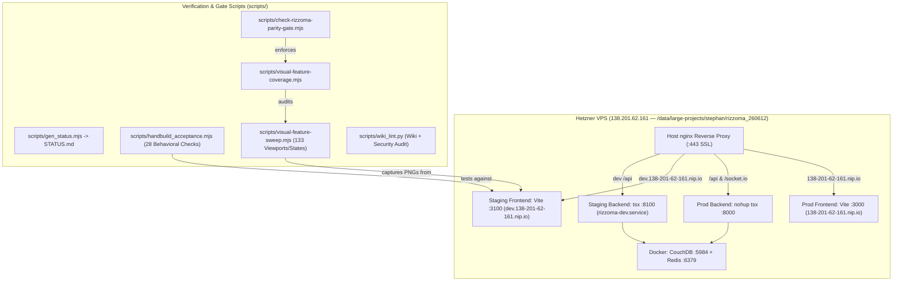
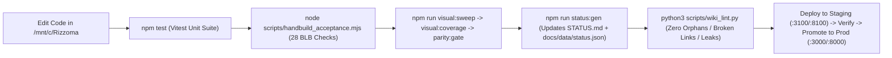

# Verification & Deployment — Visual Sweep Gates, Handbuild Acceptance, and VPS Topology

**¶1** □ Modernized Rizzoma enforces a strict **receipt-and-screenshot verification architecture** (`docs/VISUAL_SCREENSHOT_SWEEP.md:1-57`, `docs/GITHUB_DOCUMENTATION_SPINE.md:1-110`) paired with a **two-lane live/staging Hetzner VPS topology** (`STATUS.md:14-27`). No UI or fractal-rendering change may be declared complete from unit tests or code inspection alone.

---

## 1. VPS Deployment & Gate Topology (`Continuant` — `graph TD`)

---

## 2. Three-Stage Verification & Promotion Pipeline (`Occurrent` — `graph LR`)

---

## 3. Verification Gates & Scripts

### 3.1 `scripts/handbuild_acceptance.mjs` (The 28-Check Behavioral Gate)
- **¶2** □ [`scripts/handbuild_acceptance.mjs`](file:///mnt/c/Rizzoma/scripts/handbuild_acceptance.mjs) drives a real browser through creating a topic, adding multi-level inline child blips (`L1` → `L2` → `L3` → `L4`), folding/unfolding `[+]` markers, verifying single-active-editor handoff, testing `Ctrl+Enter` inline replies, and checking DOM order (`docs/NATIVE_RENDER_PORT_PLAN.md:115-140`).
- **¶3** ◇ Setting `HB_RENDER=native` runs the exact same 28 checks against `?render=native` (`src/client/components/RizzomaTopicDetail.tsx:1223-1262`). Phase 5 cutover is gated on `HB_RENDER=native node scripts/handbuild_acceptance.mjs` passing `28/28`.

### 3.2 Three-Layer Visual Parity Gate (`visual:sweep` → `visual:coverage` → `parity:gate`)
- **¶4** □ Documented in `docs/VISUAL_SCREENSHOT_SWEEP.md:1-57`:
  1. `npm run visual:sweep` (`scripts/visual-feature-sweep.mjs`): Captures 133 deterministic screenshots across desktop/mobile viewports and light/dark themes into `screenshots/sweep/`.
  2. `npm run visual:coverage` (`scripts/visual-feature-coverage.mjs`): Verifies every `[BOTH]` and `[NEW]` item in `docs/BLB.md` has corresponding screenshot coverage.
  3. `npm run parity:gate` (`scripts/check-rizzoma-parity-gate.mjs`): Fails if any visual regression or missing state is detected.

### 3.3 Auto-Generated Status Spine (`scripts/gen_status.mjs`)
- **¶5** □ [`scripts/gen_status.mjs`](file:///mnt/c/Rizzoma/scripts/gen_status.mjs) generates `STATUS.md` and `docs/data/status.json` from live git state, test counts, and sweep results (`docs/GITHUB_DOCUMENTATION_SPINE.md:1-90`). Never hand-edit the generated regions of `STATUS.md`; edit `scripts/gen_status.mjs` and run `npm run status:gen`.

### 3.4 Pre-Edit Hook Gate (`rizzoma-app-docs-gate.sh`)
- **¶6** □ Any agent editing `/mnt/c/Rizzoma/` is gated by `~/.claude/hooks/rizzoma-app-docs-gate.sh` (Gate #47), which requires reading `CLAUDE.md`, `STATUS.md`, `docs/ARCHITECTURE.md`, `docs/BLB.md`, `docs/NATIVE_RENDER_PORT_PLAN.md`, `docs/VISUAL_SCREENSHOT_SWEEP.md`, `docs/GITHUB_DOCUMENTATION_SPINE.md`, and `docs/ORIGINAL_FRACTAL_LOGIC_AND_WHY_OURS_DOESNT_MATCH.md` in the current session before mutating code.
