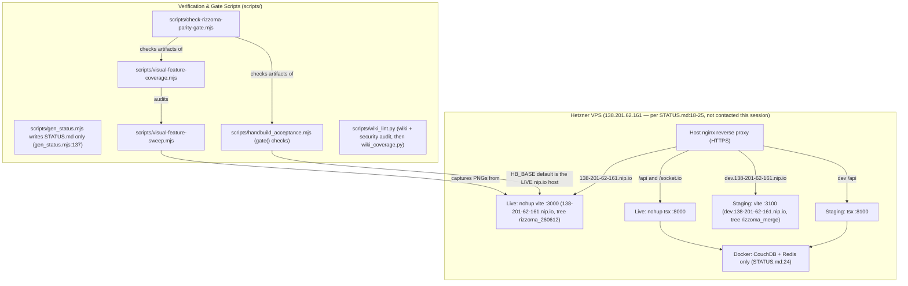
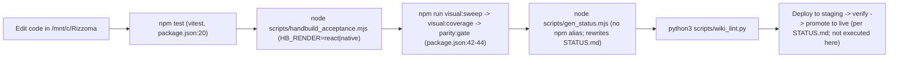

# Verification & Deployment — Visual Sweep Gates, Handbuild Acceptance, and VPS Topology

**¶1** □ Modernized Rizzoma enforces a **screenshot-and-evidence verification chain** (`docs/VISUAL_SCREENSHOT_SWEEP.md:1-26`) paired with a two-lane live/staging Hetzner VPS topology (`STATUS.md:18-25`). No UI or fractal-rendering change may be declared complete from unit tests or code inspection alone. (`docs/GITHUB_DOCUMENTATION_SPINE.md`, which the earlier revision cited here, is about documentation synchronization, not screenshot verification; it is not a source for this page.)

**¶1a** ◇ **Re-verification note (2026-11-07, HEAD `6cf6fc7a`)**: scripts were read; the parity gate and `wiki_lint.py` were actually **run** this session (results below); `handbuild_acceptance.mjs`, `visual-feature-sweep.mjs`, vitest and the VPS were **not** run or contacted. VPS facts come from `STATUS.md` / `docs/VPS_DEPLOYMENT.md` only and are unverified live.

---

## 1. VPS Deployment & Gate Topology (`Continuant` — `graph TD`)

**¶1b** ◇ Two corrections to the earlier diagram: (a) `handbuild_acceptance.mjs` defaults `HB_BASE` to `https://138-201-62-161.nip.io` (the live host), not staging (`scripts/handbuild_acceptance.mjs:34`); (b) the "`rizzoma-dev.service`" systemd unit named earlier does not appear in `STATUS.md` or `docs/VPS_DEPLOYMENT.md` — the latter mentions an nginx vhost `rizzoma-dev.conf` (`VPS_DEPLOYMENT.md:76`) — and is unverified. `docs/VPS_DEPLOYMENT.md:10-12` and `:76` describe the dev and public vhosts as proxying to `127.0.0.1:3000/8000`, whereas `STATUS.md:22-23` puts staging on `:3100/:8100`; the two documents disagree (both dated July) and I could not check the server.

---

## 2. Verification & Promotion Pipeline (`Occurrent` — `graph LR`)

---

## 3. Verification Gates & Scripts

### 3.1 `scripts/handbuild_acceptance.mjs` (the hand-build behavioural gate)
- **¶2** □ [`scripts/handbuild_acceptance.mjs`](file:///mnt/c/Rizzoma/scripts/handbuild_acceptance.mjs) drives a real Chromium (Playwright) through creating a topic, typing a root label, pressing real `Control+Enter` to descend to `HB_DEPTH` levels (default 10) with sibling-line branches at depth 3 and 6 (`:114-138`), reloading to assert the tree renders **collapsed** and a fold affordance exists (`:174-177`), asserting every authored label persists and every authored body is `<ul><li>` (`:206`, `:224`), and finally that a **second browser context** sees the whole fractal (`:256`). Usage and env (`HB_BASE`, `HB_OUT`, `HB_DEPTH`, `HB_RENDER`) are at `:21-26`, `:34-37`. Exit code 0 only if every `gate()` passed (`:263-270`).
- **¶2a** □ **Check count**: the earlier revision, `STATUS`-style prose and the Phase-5 gate all say "28 checks". Counting `gate(` call sites at the default `HB_DEPTH=10`: one root-typing check (`:113`) + 2 per level for levels 2..10 (`:120`, `:126`; 9 levels = 18) + 2 sibling-branch checks (`:136`, depths 3 and 6) + 5 post-reload checks (`:174`, `:177`, `:206`, `:224`, `:256`) = **26**, plus an extra failing `gate` only if the root *Edit* button is missing (`:105`). I could not derive 28 from the script and did not run it; treat "28" as **unverified / probably stale**.
- **¶3** ◇ `HB_RENDER=native` runs the same script against the native path; the native path is reachable only with `?render=native` **and** the build flag (`src/client/components/RizzomaTopicDetail.tsx:1293-1301`). Phase 5 cutover is gated on that run passing (`docs/NATIVE_RENDER_PORT_PLAN.md:172-188`). Evidence folders exist on disk: `screenshots/260714-handbuild-acceptance-react/` (47 PNGs; files rewritten 2026-11-07 01:25) and `...-native/` (35 files; folder mtime 2026-11-06 23:23). Whether those runs passed was **not read** this session.
- **¶3a** □ Recent edits (2026-11-07): `3de65e73` filters fold buttons to visible ones (`offsetParent !== null`) and waits for `.blip-thread, .blip-thread-marker` on client 2; `3cfdd07a` makes the edit-entry step robust (clicks `.blip-collapsed-row`, waits for `blip-menu-read-surface`, then `blip-menu-edit`) — these change how the single-active menu is entered, not what is asserted.

### 3.2 Three-Layer Visual Parity Gate (`visual:sweep` → `visual:coverage` → `parity:gate`)
- **¶4** □ Documented in `docs/VISUAL_SCREENSHOT_SWEEP.md:1-26`:
  1. `npm run visual:sweep` (`scripts/visual-feature-sweep.mjs`, `package.json:42`): Playwright signs in, creates a fixture topic, captures screenshots into a new `screenshots/<YYMMDDHHMM>-feature-sweep/` folder and writes `manifest.md` / `manifest.json`. The earlier "133 screenshots across desktop/mobile and light/dark" is **not supported**: the 10 sweep folders of 2026-11-06/07 record 29, 45, 29, 45, 2, 44, 9, 39, 44 and 0 captures (manifests read this session); the old doc cites 42 primary captures for 2026-04-24 (`VISUAL_SCREENSHOT_SWEEP.md:32`); `STATUS.md:32` says 44 gates.
  2. `npm run visual:coverage` (`scripts/visual-feature-coverage.mjs`, `package.json:43`): maps rows parsed from `RIZZOMA_FEATURES_STATUS.md` (manifests say "Documented rows parsed: 200, screenshot-valid 159") to evidence in the sweep folder and writes `coverage.md`. The earlier claim "verifies every `[BOTH]` and `[NEW]` item in `docs/BLB.md`" is not what the docs or the manifests say.
  3. `npm run parity:gate` (`scripts/check-rizzoma-parity-gate.mjs`, `package.json:44`): exits 0 immediately if no UI-touching commit or working-tree change exists today (`:71-72`); otherwise requires **all** of: legacy reference archive of at least 150 PNGs and 150 notes (`:74-93`); a newest `*-feature-sweep` folder (chosen **by name**, `:96`) whose mtime is not older than today's latest UI commit (`:104-107`), with `manifest.md` showing equal pass/total gates (`:109-118`) and `coverage.md` with zero `screenshot_gap` rows (`:120-145`); hand-build evidence of at least 20 PNGs, newest by mtime (since `3cfdd07a`), not older than the latest UI commit (`:151-175`); at least 16 comparison PNGs in `legacy-current-comparisons/` and a `PARITY_AUDIT.md` with required section markers (`:176-205`).
- **¶4a** □ **Measured gate result (run this session, `node scripts/check-rizzoma-parity-gate.mjs`)**: **FAILED** with five errors — `coverage.md` missing in `screenshots/2611070351-feature-sweep`; that sweep is older than today's latest UI-touching commit; hand-build folder `260714-handbuild-acceptance-react` is older than that commit; 0 comparison PNGs (need 16); no `PARITY_AUDIT.md`. Measured context printed by the gate: legacy PNGs 150 / notes 151 (floor 150), manifest "rows=200, captures=0, pass=0/0", hand-build 47 PNGs. The newest sweep by name (`2611070351`, commit `1322eb71`) is an **aborted run**: its manifest records "Sweep aborted: page.goto: Timeout 30000ms exceeded" and 0 captures. Note the gate treats `0 / 0` as "all gates passing" (`passLine[1] !== passLine[2]` is false for `0`/`0`, `:115`), so an aborted run is only caught by the other checks.
- **¶4b** □ **Per-run record** (read from each `manifest.md`; commit and gate counts): `2611062200` 45/45 @`3de65e73`, comparisons dir 25 files; `2611070026` 29/29 @`92746e01`; `2611070028` 29/29 @`b8d631ce`; `2611070030` 45/45 @`b8d631ce`, 25 comparison files; `2611070144` 2/2 @`7b8299aa`; `2611070145` 44/44 @`7b8299aa`, 25 comparison files; `2611070246` 9/9 @`230bca83`; `2611070248` 39/39 @`478d46c0`; `2611070251` 44/44 @`f3a4365c`, 1 comparison file; `2611070351` 0/0 aborted @`1322eb71`. No complete sweep exists for any commit after `f3a4365c` (the later commits `1322eb71` … `6cf6fc7a` are therefore **not covered** by a passing sweep). I did not look at the PNGs; this page makes no visual-parity claim (see [`legacy-visual-parity.md`](../subsystems/legacy-visual-parity.md) ¶2).
- **¶4c** □ Sweep tooling changed on 2026-11-07: `c11a034b` makes the playback step click the gear toggle then the playback button; `178cd6e3` / `1322eb71` add `scripts/build_zoomed_parity_comparisons.py`, `scripts/capture-exact-legacy-viewport.mjs`, `scripts/deep_visual_comparison.py`; `a4d4d583` adds `scripts/verify-full-parity-live.mjs` and `scripts/analyze_bullets.py`.

### 3.3 Auto-Generated Status Spine (`scripts/gen_status.mjs`)
- **¶5** □ [`scripts/gen_status.mjs`](file:///mnt/c/Rizzoma/scripts/gen_status.mjs) writes **`STATUS.md` only** (`gen_status.mjs:137-138`), from git, the latest sweep / audit and the native-port sources. The earlier revision's `npm run status:gen` and `docs/data/status.json` do not exist (`package.json` has no such script; `docs/data/` is absent); run `node scripts/gen_status.mjs` (`STATUS.md:3`). Never hand-edit it. **`STATUS.md` is stale**: generated 2026-07-16 for `12984319` (`STATUS.md:7`, `:14`), it still says the native path is "READ-ONLY … no Edit button" (`:44`) and lists the latest sweep as `260714-1600-feature-sweep` (`:31`); it has not been regenerated since the 2026-11-07 commits.

### 3.4 Pre-Edit Hook Gate (`rizzoma-app-docs-gate.sh`)
- **¶6** □ Agents editing the app are gated by `~/.claude/hooks/rizzoma-app-docs-gate.sh` (WSL path `/home/stephan/.claude/hooks/`; file exists, mtime 2026-11-07; **its own header calls it gate #34**, the earlier "#47" is unverified). It denies `Edit` / `Write` / `MultiEdit` on `/mnt/c/Rizzoma/src/*` and `/mnt/c/Rizzoma/scripts/*.mjs`, and `Bash` commands mentioning `rizzoma_260612`, `rizzoma_merge` or `feature/native-fractal-port`, until five docs have been read this session: `ORIGINAL_FRACTAL_LOGIC_AND_WHY_OURS_DOESNT_MATCH.md`, `NATIVE_RENDER_PORT_PLAN.md`, `VISUAL_SCREENSHOT_SWEEP.md`, `BLB.md`, `ARCHITECTURE.md` (hook lines 28-35 for scope, 57-65 for the doc list). The earlier list (`CLAUDE.md`, `STATUS.md`, `GITHUB_DOCUMENTATION_SPINE.md`) was wrong. A second, repo-local Stop hook `.claude/hooks/visual-sweep-gate.sh` calls `npm run parity:gate` (`docs/VISUAL_SCREENSHOT_SWEEP.md:21`; the hook file is modified, uncommitted, in the working tree).

### 3.5 Wiki lint
- **¶7** □ `scripts/wiki_lint.py` is a thin wrapper around `/mnt/g/My Drive/claude-hooks/tools/wiki_and_security_audit.py` (`:11-14` also accepts the Windows `G:` path). The working tree carries an uncommitted change (`scripts/wiki_lint.py`) that also runs `scripts/wiki_coverage.py` after the audit and exits non-zero if either fails; commit `90b9ac38` made it run on Windows. The run result for this re-verification is in `wiki/log.md`.
